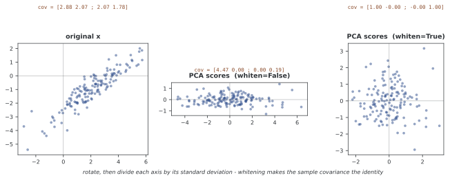

# scikit-learn으로 구현하는 2차원 PCA

`sklearn.decomposition.PCA`는 학습 평균과 주성분을 저장하고 새 데이터의 투영과 재구성을 제공한다. 이 예제는 NumPy 구현과 같은 생성 설정의 2차원 데이터를 1차원으로 줄인다. 라이브러리의 배열 방향, 분산 정의와 적합·변환의 구분에 초점을 맞춘다.

## 1. 예제 코드

```python
"""2차원 주성분 분석 Sklearn."""
import numpy as np
from sklearn.decomposition import PCA

# === 만든 2차원 자료 묶음 만들기 ==========================================
rng = np.random.default_rng(42)
n = 150
mean_true = np.array([2.0, -1.0])
cov_true = np.array([[3.0, 2.2],
                     [2.2, 2.0]])
X = rng.multivariate_normal(mean_true, cov_true, size=n)

# === scikit-learn으로 주성분 분석 맞추기 ===================================
pca = PCA(n_components=1)
scores_1d = pca.fit_transform(X)
X_recon = pca.inverse_transform(scores_1d)

reconstruction_error = np.mean((X - X_recon) ** 2)

# === 변환기가 들고 있는 것 =================================================
print(f"mean_                   {pca.mean_}")
print(f"components_ shape       {pca.components_.shape}   (성분 x 피처)")
print(f"components_[0]          {pca.components_[0]}")
print(f"explained_variance_     {pca.explained_variance_}")
print(f"explained_variance_ratio_ {pca.explained_variance_ratio_}")
print(f"Reconstruction MSE      {reconstruction_error:.6f}")

# 비율의 분모는 '남긴 성분의 합' 이 아니라 '전체 분산' 이다 — 3절
full = PCA(n_components=2).fit(X)
print(f"\n성분 둘을 다 남기면 비율의 합 {full.explained_variance_ratio_.sum():.6f}")
print(f"하나만 남겨도 분모는 그대로라 비율은 {pca.explained_variance_ratio_[0]:.6f}")

# === whiten 은 무엇을 바꾸는가 — 4절 ======================================
Z = PCA(n_components=2, whiten=False).fit_transform(X)
W = PCA(n_components=2, whiten=True).fit_transform(X)
np.set_printoptions(precision=3, suppress=True)
print(f"\nwhiten=False 점수의 공분산\n{np.cov(Z.T)}")
print(f"whiten=True  점수의 공분산\n{np.cov(W.T)}")
```

**출력:**

```
mean_                   [ 2.05164101 -0.99877953]
components_ shape       (1, 2)   (성분 x 피처)
components_[0]          [-0.79255817 -0.60979632]
explained_variance_     [4.46577868]
explained_variance_ratio_ [0.95857024]
Reconstruction MSE      0.095863

성분 둘을 다 남기면 비율의 합 1.000000
하나만 남겨도 분모는 그대로라 비율은 0.958570

whiten=False 점수의 공분산
[[4.466 0.   ]
 [0.    0.193]]
whiten=True  점수의 공분산
[[ 1. -0.]
 [-0.  1.]]
```

재구성 MSE 0.095863은 [NumPy 쪽](01_pca_2d_numpy.md)의 값과 **자릿수까지 같다.** 같은 씨앗, 같은 자료, 같은 계산이기 때문이다. 다른 것은 그 계산을 누가 들고 있느냐뿐이다 — 여기서는 `pca` 객체가 평균과 방향을 기억한다.

`components_[0]`이 음수인 것은 부호 자유다. 방향을 뒤집어도 점수가 함께 뒤집혀 재구성은 같다.

## 2. 적합·변환·재구성

`fit_transform(X)`는 평균과 방향을 적합하고 학습 점수 150×1을 반환한다. 평균은 `mean_`, 방향은 `components_`에 저장된다. `components_`는 성분×피처 배열이므로 여기서는 1×2다. 입력을 중심화하지만 피처별 단위 분산 표준화는 자동으로 하지 않는다.

`inverse_transform`은 점수에 방향을 곱하고 평균을 더한다. 차원을 줄인 경우 버린 방향은 되살릴 수 없으며 주부분공간으로 투영된 점을 반환한다. 기본값처럼 whitening을 사용하지 않을 때 행벡터 식은 z=(x−μ)Wᵀ, x̂=zW+μ다.

## 3. 분산 속성과 MSE

`explained_variance_`는 n−1 분모의 선택된 공분산 고윳값이다. `explained_variance_ratio_`의 분모는 선택된 성분의 합이 아니라 전체 데이터 분산이다. 전체 분산이 양수이고 모든 유효 분산을 남기면 비율의 합은 수치 오차 범위에서 1이다.

이 코드의 재구성 오차는 두 피처의 원소별 평균이다. 버린 고윳값 λ₂와는 MSE=(n−1)λ₂/(2n) 관계이므로 λ₂ 자체와 같지 않다. 생성 모수의 첫 분산 비율과 유한 표본의 값도 구분한다.

## 4. 성분 수와 whitening

0과 1 사이의 실수 `n_components`는 지원되는 분해 설정에서 목표 누적 분산을 넘는 성분 수를 선택한다. 필요한 수는 학습 데이터와 전처리에 따라 달라지므로 적합된 변환기와 실제 `n_components_`를 함께 관리한다.



그림의 세 판이 출력의 세 공분산이다. 가운데에서 **돌리고**(비대각 원소가 0이 된다), 오른쪽에서 **축마다 나눈다**(대각 원소가 1이 된다). `whiten=True`는 남긴 점수를 고윳값 제곱근으로 나누어 학습 표본 공분산이 단위 행렬이 되도록 한다. 양의 분산 성분이 전제이며 작은 고윳값의 잡음을 증폭할 수 있다. 원래 방향별 분산 차이를 없애는 것이므로 후속 작업에서 유용한지는 검증한다. `inverse_transform`은 적용한 스케일도 되돌린다.

## 5. 분해 방법과 평가

전체 SVD, 절단·무작위 방법과 공분산 고유분해는 데이터 크기와 목표 성분 수, 지원 버전에 따라 선택할 수 있다. 근사 방법의 오차와 무작위성, 공분산 방식의 수치 안정성을 고려한다. 정확한 옵션·제약은 [PCA 공식 문서](https://scikit-learn.org/stable/modules/generated/sklearn.decomposition.PCA.html)를 참고한다.

예측 평가에서는 학습 데이터에만 적합한 PCA로 검증·테스트 데이터를 변환한다. 교차 검증은 전처리와 분류기를 Pipeline으로 묶어 폴드 안에서 적합한다. 전체 데이터에 PCA를 먼저 적합하면 레이블을 사용하지 않아도 평가 데이터의 구조가 학습에 들어간다.

## 연습문제

<div class="drillbox" markdown>

**연습문제 1.** <span class="diff hard" title="어려움"></span>
PCA(n_components=0.95)가 성분 수를 정하는 원리를 설명하라. 이 데이터에서 결과를 생성 공분산만으로 확정할 수 있는가?

</div>

??? success "풀이"

    학습 표본의 누적 설명 분산이 목표를 넘는 최소 성분 수를 선택한다. 생성 공분산의 첫 비율이 약 95.1%여도 유한 표본에서는 달라지므로 반드시 한 개라고 단정할 수 없다. 아래 코드는 실제 선택된 수와 비율을 조회한다.

    ```python
    pca_auto = PCA(n_components=0.95)
    pca_auto.fit(X)
    print(f"Components selected: {pca_auto.n_components_}")
    print(f"Variance ratios: {pca_auto.explained_variance_ratio_}")
    ```


---

<div class="drillbox" markdown>

**연습문제 2.** <span class="diff med" title="중간"></span>
아래 코드의 reconstruction_error와 var_pc2가 같지 않은 이유를 식으로 설명하라.

</div>

??? success "풀이"

    var_pc2는 n−1로 나눈 두 번째 공분산 고윳값이고 reconstruction_error는 n×2 원소의 평균이다. 따라서 MSE=(n−1)var_pc2/(2n)이다. n=150이면 계수는 149/300이다. 작은 차이만 있는 것이 아니라 피처 수 2의 계수도 들어간다.

    ```python
    pca_full = PCA(n_components=2).fit(X)
    var_pc2 = pca_full.explained_variance_[1]
    print(f"Reconstruction MSE: {reconstruction_error:.6f}")
    print(f"PC2 variance:       {var_pc2:.6f}")
    ```


---

<div class="drillbox" markdown>

**연습문제 3.** <span class="diff med" title="중간"></span>
whitening 뒤 표본 공분산이 단위 행렬이 되는 조건과 그 대가를 설명하라.

</div>

??? success "풀이"

    양의 고윳값 성분의 점수를 그 표준편차로 나누면 같은 학습 데이터의 n−1 표본 공분산이 단위 행렬이 된다. 이는 독립성을 보장하지 않는다. 작은 분산의 잡음을 키우고 원래 방향별 분산 정보를 제거할 수 있으므로 후속 태스크에서 평가한다.

    ```python
    pca_white = PCA(n_components=2, whiten=True)
    scores_white = pca_white.fit_transform(X)
    cov_white = np.cov(scores_white.T)
    print("Covariance of whitened scores:")
    print(np.round(cov_white, 4))
    ```


---

<div class="drillbox" markdown>

**연습문제 4.** <span class="diff easy" title="쉬움"></span>
fit과 transform의 역할을 구분하고 아래 코드에 필요한 전제를 설명하라.

</div>

??? success "풀이"

    fit은 학습 평균과 방향을 추정하고 transform은 저장한 변환을 적용한다. fit_transform은 학습 데이터에서 두 작업을 수행한다. 아래 X_train과 X_test는 미리 정의해야 하며 같은 피처 순서를 사용한다. 테스트에는 다시 적합하지 않는다.

    ```python
    pca = PCA(n_components=1)
    Z_train = pca.fit_transform(X_train)   # 배우고 옮긴다
    Z_test  = pca.transform(X_test)        # 배운 것을 쓴다
    ```


---

<div class="drillbox" markdown>

**연습문제 5.** <span class="diff easy" title="쉬움"></span>
선택된 성분이 적을 때 explained_variance_ratio_의 합이 1보다 작은 이유를 설명하라.

</div>

??? success "풀이"

    각 비율의 분모가 전체 분산이기 때문이다. 합은 남긴 성분이 설명하는 비율이다. 선택 고윳값만 합해 다시 정규화하면 라이브러리의 전체 분산 비율과 다른 양이 된다. 전체 분산이 0인 데이터에는 이 비율이 정의되지 않는다.

    ```python
    pca.explained_variance_        # 고윳값. 단위가 자료의 단위^2
    pca.explained_variance_ratio_  # 합이 1이 되도록 나눈 것
    ```


---

<div class="drillbox" markdown>

**연습문제 6.** <span class="diff med" title="중간"></span>
inverse_transform이 정확한 원본을 반환하는 경우와 반환하지 않는 경우를 설명하라.

</div>

??? success "풀이"

    버린 방향의 성분이 없으면 원본을 수치 오차 범위에서 복원한다. 일반적인 차원 축소에서는 평균을 지나는 선택 부분공간에 투영된 점을 반환한다. 모든 입력 방향을 포함하는 기저를 남기는 경우는 정확 복원의 충분조건이다.

    ```python
    X2 = pca.inverse_transform(pca.transform(X))
    ((X - X2)**2).mean()          # 0이 아니다. 버린 고윳값의 합/d
    ```


---

<div class="drillbox" markdown>

**연습문제 7.** <span class="diff med" title="중간"></span>
직접 구현과 비교할 때 점수 절댓값만 검사하면 항상 충분한가?

</div>

??? success "풀이"

    단순 고윳값에서 부호만 다른 경우에는 유용하지만 중복 고윳값에서는 같은 공간 안의 회전도 가능해 절댓값이 달라질 수 있다. 정렬된 고윳값과 재구성, 투영 행렬 또는 부분공간 각도를 함께 비교한다. 아래 변수들은 미리 정의해야 하며 dtype과 공분산 분모도 맞춘다.

    ```python
    assert np.allclose(np.abs(Z_mine), np.abs(Z_sklearn))
    assert np.allclose(ev_mine, pca.explained_variance_)
    ```


---

<div class="drillbox" markdown>

**연습문제 8.** <span class="diff med" title="중간"></span>
분해 알고리즘을 선택할 때 고려할 조건을 설명하라.

</div>

??? success "풀이"

    전체 스펙트럼이 필요하면 전체 분해를, 큰 행렬에서 소수 성분만 필요하면 절단·무작위 분해를 검토한다. 표본이 많고 피처가 적으면 공분산 고유분해도 선택지지만 조건수 문제가 있다. 지원 입력과 목표 차원의 제약은 사용 버전에서 확인한다.


---

<div class="drillbox" markdown>

**연습문제 9.** <span class="diff med" title="중간"></span>
실수 n_components로 적합한 모델을 저장할 때 무엇을 기록해야 하는가?

</div>

??? success "풀이"

    설정한 분산 임계값뿐 아니라 적합된 평균·방향과 실제 n_components_를 저장한다. 학습 데이터를 바꾸면 선택 차원이 달라질 수 있으므로 뒤 모델도 같은 적합된 변환과 함께 관리한다. 차원을 정수로 고정하는 것만으로 평균이나 기저 불일치가 해결되지는 않는다.

    ```python
    PCA(n_components=0.95)    # 흩어짐 95%를 남기는 가장 작은 k
    ```


---

<div class="drillbox" markdown>

**연습문제 10.** <span class="diff hard" title="어려움"></span>
전체 데이터에 PCA를 먼저 적합한 뒤 교차 검증하는 첫 코드와 Pipeline을 쓰는 두 번째 코드를 비교하라.

</div>

??? success "풀이"

    첫 방식은 각 검증 폴드의 분포가 전처리에 들어간다. 두 번째 방식은 각 학습 폴드에서 표준화와 PCA, 분류기를 적합해 누출을 피한다. 표준화 전 PCA와 PCA 점수의 스케일링은 서로 다른 목적이며 적용 순서는 의도에 따라 정한다. 코드에 쓰인 cross_val_score, make_pipeline과 분류기 등은 별도 정의·import가 필요하다.

    ```python
    Z = PCA(n_components=50).fit_transform(X)      # 전체 자료로 fit
    scores = cross_val_score(clf, Z, y, cv=5)      # 그 뒤에 교차 검증
    ```
    ```python
    pipe = make_pipeline(StandardScaler(), PCA(n_components=50), LogisticRegression())
    scores = cross_val_score(pipe, X, y, cv=5)     # 접기마다 fit 이 다시 된다
    ```


## 정리하며

scikit-learn PCA는 중심화 통계와 방향을 저장해 변환·재구성을 제공한다. components_의 행 방향, n−1 고윳값과 원소별 MSE, whitening의 스케일을 구분한다. 평가 데이터에는 학습 변환을 재사용하고 교차 검증의 전처리는 Pipeline 안에서 적합한다.
