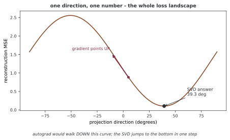

# PyTorch로 구현하는 2차원 PCA

이 예제는 PyTorch 텐서와 SVD로 2차원 데이터를 1차원으로 투영한다. NumPy 구현과 같은 수학적 절차를 사용하지만 장치·dtype, 배치 분해와 자동 미분을 직접 다룰 수 있다. 같은 난수 시드 번호를 사용해도 라이브러리별 생성 표본이 같아지는 것은 아니다.

## 1. 예제 코드와 출력

```python
"""2차원 주성분 분석 PyTorch."""
import numpy as np
import torch

torch.manual_seed(42)
device = torch.device('cuda' if torch.cuda.is_available() else 'cpu')
n = 150

# === 촐레스키로 자료 만들기 ================================================
mean_true = torch.tensor([2.0, -1.0], device=device)
cov_true = torch.tensor([[3.0, 2.2], [2.2, 2.0]], device=device)
L = torch.linalg.cholesky(cov_true)
Z = torch.randn(n, 2, device=device)
X = mean_true + Z @ L.T

# === 가운데 맞추고 특잇값 쪼개기 셈하기 ======================================
mu = X.mean(dim=0, keepdim=True)
X_centered = X - mu
U, S, Vh = torch.linalg.svd(X_centered, full_matrices=False)
V = Vh.T
pc1 = V[:, 0]

explained_variance = (S ** 2) / (n - 1)
variance_ratios = explained_variance / explained_variance.sum()

# === 쏘고 다시 세우기 ======================================================
scores_1d = X_centered @ pc1
X_recon = torch.outer(scores_1d, pc1) + mu
reconstruction_error = ((X - X_recon) ** 2).mean()

print(f"PC1 explains {variance_ratios[0].item():.1%} of variance")
print(f"Reconstruction MSE: {reconstruction_error.item():.6f}")

# === 방향을 각도 하나로 적으면 로스를 미분할 수 있다 — 5절 =====================
# 1차원 투영이라 방향이 각도 하나다. 그 각도로 오차를 미분해 본다.
theta = torch.tensor([0.0], requires_grad=True)


def mse_at(t):
    v = torch.cat([torch.cos(t), torch.sin(t)])
    return ((X_centered - torch.outer(X_centered @ v, v)) ** 2).mean()


mse_at(theta).backward()
best = torch.atan2(pc1[1], pc1[0])
print(f"\ntheta = 0 에서  MSE {mse_at(torch.tensor([0.0])).item():.6f}"
      f"   d(MSE)/d(theta) {theta.grad.item():+.6f}")
print(f"기울기가 음수이므로 theta 를 **키워야** 오차가 준다")
print(f"SVD 가 주는 답   {torch.rad2deg(best).item() % 180:.2f} deg")

# 경사를 따라 걸어가면 같은 곳에 닿는가
t = torch.tensor([0.0], requires_grad=True)
opt = torch.optim.SGD([t], lr=0.05)
for _ in range(200):
    opt.zero_grad()
    mse_at(t).backward()
    opt.step()
print(f"경사로 200 걸음   {torch.rad2deg(t.detach()).item() % 180:.2f} deg"
      f"   MSE {mse_at(t.detach()).item():.6f}")
```

**출력:**

```
PC1 explains 96.1% of variance
Reconstruction MSE: 0.104872

theta = 0 에서  MSE 1.088178   d(MSE)/d(theta) -2.402110
기울기가 음수이므로 theta 를 **키워야** 오차가 준다
SVD 가 주는 답   39.31 deg
경사로 200 걸음   39.31 deg   MSE 0.104872
```

## 2. 촐레스키 분해로 표본 생성하기

공분산 Σ=LLᵀ이고 Z의 각 행이 독립 표준정규 벡터라면 μ+ZLᵀ의 각 행은 평균 μ, 공분산 Σ인 정규 표본이다. 이 코드는 양의 정부호 공분산에 촐레스키 분해를 사용한다. 이것이 다변량 정규 표본을 만드는 유일한 방법은 아니다.

기본 입력 X는 150×2, 평균은 1×2다. `X-mu`에서 평균이 행 방향으로 브로드캐스팅된다. 생성 공분산은 NumPy 예제와 같지만 실제 난수 표본과 표본 고윳값은 달라질 수 있다.

## 3. SVD와 재구성 오차

실수 입력에서 `torch.linalg.svd`의 세 번째 반환값 `Vh`는 Vᵀ다. NumPy의 세 번째 반환값도 일반적으로 켤레 전치이며 두 라이브러리의 차이가 단순히 복소수 전치 여부인 것은 아니다. 성분은 `Vh`의 행이고 코드에서는 전치하여 V의 열을 사용한다.

`explained_variance=S**2/(n-1)`는 표본 공분산 고윳값이다. 점수 `X_centered@pc1`은 길이 150이고 외적과 평균 복원으로 150×2 재구성을 얻는다. 모든 원소의 평균 MSE는 버린 고윳값 λ₂에 대해 (n−1)λ₂/(2n)이다. 출력의 비율과 오차는 보존된 한 실행의 예시이며 모든 환경에서 같은 결과나 속도를 보장하지 않는다.

## 4. 장치·정밀도·속도

이 코드는 CUDA가 가능하면 CUDA, 아니면 CPU를 선택한다. MPS는 자동 선택하지 않는다. 지원 dtype과 분해 커널은 장치별로 확인해야 한다. float64는 작은 성분의 정확도에 도움이 될 수 있지만 장치 지원과 비용이 다르다.

PyTorch와 NumPy 결과 차이는 dtype뿐 아니라 서로 다른 입력 표본, 부호·중복 기저, 분해 알고리즘과 수치 오차에서도 생긴다. 같은 데이터와 dtype, 중심화 기준으로 비교한다. GPU가 고정된 배수로 빠르다는 보장은 없으며 크기·전송·작업 공간에 따라 CPU가 더 유리할 수도 있다.

## 5. 고정 기저와 학습되는 기저

미리 구한 PCA 기저를 고정하고 입력만 투영할 때는 행렬곱을 미분하면 된다. 입력 묶음에서 기저를 다시 구하는 과정까지 미분하면 모든 표본이 기저 추정에 영향을 준다. 개별 특이벡터의 비유일성과 스펙트럼 간격을 고려해야 한다.

1차원 투영에서는 방향이 **각도 하나**다. 그래서 로스 지형을 통째로 그릴 수 있다.



출력의 세 줄이 이 그림의 세 자리다. $\theta=0$ 에서 MSE 1.088이고 기울기가 $-2.402$ 다 — **음수이므로 $\theta$ 를 키워야 오차가 준다.** 경사로 200걸음을 걸으면 39.31도, MSE 0.104872에 닿는다. **SVD 가 한 번에 주는 답과 소수점까지 같다.**

그림의 화살표가 가리키는 쪽이 오차가 **늘어나는** 쪽이다. 재구성 오차의 그래디언트는 오차가 가장 빠르게 **증가**하는 방향이고, 감소 방향은 음의 그래디언트다. 경사 하강법이 그 반대로 걷는 까닭이다. 고정된 최적 투영에서 잔차 방향에 비례하고, 매끄럽고 유일한 최적 부분공간을 재추정하는 로스도 적절한 조건에서 포락선 정리로 같은 잔차 식을 얻을 수 있다. 임의로 정의한 기저 의존 로스까지 이 해석이 성립하는 것은 아니다. [PyTorch SVD 문서](https://docs.pytorch.org/docs/stable/generated/torch.linalg.svd.html)의 그래디언트 조건도 확인한다.

## 연습문제

<div class="drillbox" markdown>

**연습문제 1.** <span class="diff med" title="중간"></span>
NumPy와 PyTorch의 SVD 시간을 공정하게 비교하는 조건을 정하고 아래 코드가 측정하는 범위를 설명하라.

</div>

??? success "풀이"

    같은 행렬·dtype, 스레드 조건, 워밍업과 반복 측정이 필요하다. 아래 코드는 CPU 한 번씩의 경과 시간만 재고 GPU 비교는 하지 않는다. GPU를 추가한다면 장치 동기화와 전송 비용 포함 여부를 명시해야 한다. 어느 쪽이 몇 배 빠른지 이 코드 없이 미리 확정할 수 없다.

    ```python
    import time
    X_large_np = np.random.randn(10000, 784).astype(np.float32)
    X_large_pt = torch.from_numpy(X_large_np)

    t0 = time.time()
    np.linalg.svd(X_large_np, full_matrices=False)
    t_numpy = time.time() - t0

    t0 = time.time()
    torch.linalg.svd(X_large_pt, full_matrices=False)
    t_torch_cpu = time.time() - t0

    print(f"NumPy CPU: {t_numpy:.2f}s")
    print(f"PyTorch CPU: {t_torch_cpu:.2f}s")
    ```


---

<div class="drillbox" markdown>

**연습문제 2.** <span class="diff med" title="중간"></span>
아래 코드가 입력과 PCA 기저 추정 중 어느 경로를 미분하는지 설명하고 그래디언트의 부호 의미를 서술하라.

</div>

??? success "풀이"

    X_diff에서 평균과 SVD를 다시 계산하므로 입력의 직접 경로뿐 아니라 평균·기저 추정 경로도 포함한다. 반복 특잇값 등에는 주의가 필요하다. 그래디언트는 로스 증가 방향이고 그 음수가 감소 방향이다. 고정된 투영의 원소별 MSE 기울기는 2(X−재구성)/(n d)다.

    ```python
    X_diff = X.clone().requires_grad_(True)
    mu_d = X_diff.mean(dim=0, keepdim=True)
    Xc_d = X_diff - mu_d
    _, _, Vh_d = torch.linalg.svd(Xc_d, full_matrices=False)
    pc1_d = Vh_d[0]
    scores = Xc_d @ pc1_d
    recon = torch.outer(scores, pc1_d) + mu_d
    mse = ((X_diff - recon) ** 2).mean()
    mse.backward()
    print(f"Gradient for point 0: {X_diff.grad[0]}")
    ```


---

<div class="drillbox" markdown>

**연습문제 3.** <span class="diff hard" title="어려움"></span>
B×N×D 입력에서 독립적인 배치 PCA를 수행할 때 중심화 축과 출력 모양을 설명하라.

</div>

??? success "풀이"

    각 데이터셋의 N개 표본 평균을 dim=1에서 빼 B×1×D 평균을 사용한다. r=min(N,D)일 때 축소 SVD는 U가 B×N×r, S가 B×r, Vh가 B×r×D다. 첫 방향은 B×D다. 이 계산은 B개 데이터셋을 합친 하나의 PCA와 다르다.

    ```python
    B, N, D = 5, 100, 10
    X_batch = torch.randn(B, N, D)
    mu_batch = X_batch.mean(dim=1, keepdim=True)
    Xc_batch = X_batch - mu_batch
    U_b, S_b, Vh_b = torch.linalg.svd(Xc_batch, full_matrices=False)
    # Vh_b 꼴: (배치, D, D), 자료 묶음마다의 첫 주성분:
    pc1_batch = Vh_b[:, 0, :]  # (배치, D)
    print(f"Batch PCs shape: {pc1_batch.shape}")
    ```


---

<div class="drillbox" markdown>

**연습문제 4.** <span class="diff easy" title="쉬움"></span>
NumPy와 PyTorch SVD의 세 번째 반환값이 무엇인지 설명하고 아래 변수 V의 이름에 주의할 점을 적어라.

</div>

??? success "풀이"

    둘 다 오른쪽 특이벡터의 켤레 전치 Vh를 반환한다. 실수에서는 Vᵀ와 같다. 아래 V=r.Vh는 이름이 V여도 실제로 전치된 배열이며 성분이 행이다. torch.svd_lowrank나 옛 torch.svd처럼 V를 직접 반환하는 함수와 혼동하지 않는다.

    ```python
    r = torch.linalg.svd(Xc, full_matrices=False)
    V = r.Vh                     # r[2] 와 같다
    ```


---

<div class="drillbox" markdown>

**연습문제 5.** <span class="diff med" title="중간"></span>
같은 데이터의 결과가 소수점에서 다를 때 무엇을 확인해야 하는가? 아래 변환의 입력 조건도 적어라.

</div>

??? success "풀이"

    입력값, 중심화, dtype과 장치, 분해 방식, 부호와 중복 고유공간을 확인한다. 아래 torch.from_numpy(X)는 X가 NumPy 배열이어야 하며 double은 float64로 바꾼다. 원래 낮은 정밀도로 저장한 데이터를 double로 바꿔도 이미 잃은 입력 자릿수는 복원되지 않는다. 허용 오차는 데이터 크기와 조건수에 맞춘다.

    ```python
    t = torch.from_numpy(X).double()        # float64 로
    U, S, Vh = torch.linalg.svd(t, full_matrices=False)
    ```


---

<div class="drillbox" markdown>

**연습문제 6.** <span class="diff med" title="중간"></span>
PyTorch PCA를 사용하는 이점과 선택 조건을 설명하라.

</div>

??? success "풀이"

    데이터가 이미 텐서이고 후속 뉴럴 넷트웍과 연결되거나 배치 분해·장치 연산·자동 미분이 필요할 때 유용하다. 작은 일회성 데이터에서는 scikit-learn의 저장된 변환기 인터페이스가 편리할 수 있다. GPU 사용과 데이터 크기만으로 우열을 확정하지 않는다.


---

<div class="drillbox" markdown>

**연습문제 7.** <span class="diff med" title="중간"></span>
아래 MPS 동기화 타이밍 코드의 장치 전제를 설명하라.

</div>

??? success "풀이"

    MPS가 사용 가능하고 X도 지원되는 MPS 텐서여야 그 장치의 시간을 측정한다. 본 예제의 X는 CUDA 또는 CPU이므로 이 조각을 그대로 붙인다고 MPS 연산이 되지 않는다. CUDA에는 해당 CUDA 동기화를 사용하며 워밍업과 반복, 전송 포함 여부를 통일한다.

    ```python
    torch.mps.synchronize()          # 또는 torch.cuda.synchronize()
    t0 = time.time()
    torch.linalg.svd(X)
    torch.mps.synchronize()
    print(time.time() - t0)
    ```


---

<div class="drillbox" markdown>

**연습문제 8.** <span class="diff med" title="중간"></span>
성분 50개만 필요한 큰 행렬에서 저랭크 근사를 사용할 때 q와 설명 분산의 분모를 어떻게 다루는가?

</div>

??? success "풀이"

    q=60처럼 여유를 두어 근사한 뒤 앞 50개를 선택할 수 있다. q는 유효 차원 범위여야 하고 시드·반복 횟수에 따른 근사 품질을 확인한다. svd_lowrank는 V를 전치하지 않고 반환한다. 전체 분산은 같은 중심화 데이터의 제곱합을 n−1로 나누어 구할 수 있어 전체 스펙트럼이 없어도 비율의 분모를 계산할 수 있다.

    ```python
    U, S, V = torch.svd_lowrank(Xc, q=50 + 10)   # 여유를 조금 둔다
    ```


---

<div class="drillbox" markdown>

**연습문제 9.** <span class="diff hard" title="어려움"></span>
고정된 PCA 전처리와 데이터에서 재추정하는 PCA 레이어의 미분을 비교하라.

</div>

??? success "풀이"

    첫 코드의 detach는 저장된 기저·평균 경로를 끊고 새 입력 x의 투영 경로를 남긴다. 두 번째 코드는 SVD로 투영 행렬을 다시 만들어 데이터 의존 경로를 포함한다. 투영 행렬은 선택 공간 내부 기저 회전에 불변이지만 경계 스펙트럼 간격과 실제 SVD 역전파의 안정성은 여전히 확인해야 한다. Xc,k 등의 입력은 별도로 정의한다.

    ```python
    V = V.detach()                 # 성분은 상수로 둔다
    z = (x - mu.detach()) @ V.T    # 미분 가능
    ```
    ```python
    Vk = torch.linalg.svd(Xc, full_matrices=False).Vh[:k]
    P = Vk.T @ Vk                  # 부분 공간만 쓴다. 겹침에 딸리지 않는다
    loss = ((Xc - Xc @ P)**2).mean()
    ```


---

<div class="drillbox" markdown>

**연습문제 10.** <span class="diff easy" title="쉬움"></span>
세 라이브러리의 결과를 비교하는 아래 코드에서 성분 절댓값 비교의 적용 범위와 필요한 전제를 설명하라.

</div>

??? success "풀이"

    같은 실수 NumPy 배열 X와 유효한 k, PCA import가 필요하다. 단순 고윳값에서 부호만 다른 경우 절댓값 점수가 가까울 수 있다. 중복 고윳값이면 회전된 기저도 같은 PCA 공간이므로 절댓값 일치를 요구하면 잘못 실패할 수 있다. 재구성·투영 행렬과 분산을 함께 보고 dtype과 조건수에 맞는 오차 기준을 사용한다.

    ```python
    Xc = X - X.mean(0)

    # NumPy
    Vt_np = np.linalg.svd(Xc, full_matrices=False)[2]
    Z_np = Xc @ Vt_np[:k].T

    # sklearn
    p = PCA(n_components=k).fit(X)
    Z_sk = p.transform(X)

    # PyTorch
    t = torch.from_numpy(Xc).double()
    Vh = torch.linalg.svd(t, full_matrices=False).Vh
    Z_pt = (t @ Vh[:k].T).numpy()

    for A, B in ((Z_np, Z_sk), (Z_np, Z_pt)):
        assert np.allclose(np.abs(A), np.abs(B), atol=1e-8)
    ```

---

<div class="drillbox" markdown>

**연습문제 11.** <span class="diff hard" title="어려움"></span>
앞 문제가 "경계 스펙트럼 간격"을 확인하라고만 하고 넘어갔다. 개별 특이벡터를 쓰는
SVD 역전파에서 그 간격이 왜 문제가 되는지 설명하라.

</div>

??? success "풀이"

    벡터 미분에는 특잇값 차이의 **역수**가 나타난다. 그래서 특잇값이 겹치거나 가까우면
    미분이 정의되지 않거나 수치적으로 터진다.

    투영 행렬 $P = V_k^{\top} V_k$는 고른 공간 **안에서의** 기저 회전에 불변이므로 그
    안쪽의 겹침은 문제가 되지 않는다. 남는 것은 **경계**다. $k$번째와 $k+1$번째가 가까우면
    어느 쪽을 고를지가 정해지지 않는다.

    공분산에 $\varepsilon I$를 더하는 손쉬운 처방은 듣지 않는다. 모든 고윳값이 **같이**
    옮겨 가므로 간격이 그대로다. 쓰는 로스와 미분 구현에 맞는 처리가 따로 필요하며,
    개별 벡터 대신 부분공간만 쓰는 것이 그 하나다(앞 문제의 둘째 코드가 그렇게 한다).

    **재어 보면 이렇게 나타난다.** [AE_Linear 쪽](../../ch05/dimreduction/02_ae_linear.md)에서
    선형 오토인코더의 디코더가 되찾은 PCA 부분공간은 잠재 차원 2에서 주각 코사인이
    0.9999까지 맞는데 64에서는 0.9990까지만 맞는다. 까닭이 이것이다 — 64번째와 65번째
    고윳값이 1.2305와 1.1871로 거의 같아 그 자리에서는 두 방향이 서로 바뀌어도 로스가
    거의 같다. 잠재 차원 2 쪽은 39.41과 34.27로 벌어져 있어 또렷하게 정해진다.


## 정리하며

PyTorch PCA도 중심화와 SVD, 투영·평균 복원으로 구성된다. 반환 배열과 함수별 V/Vh 관례, dtype과 장치를 맞추어 비교한다. 고정 기저 투영과 기저 추정까지의 미분을 구분하고 실제 속도와 그래디언트의 수치 조건을 따로 확인한다.
