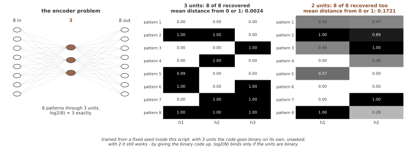

# 오토인코더의 기본 구조

오토인코더는 입력을 잠재 표현으로 바꾸는 인코더 f와 잠재 표현에서 입력을 복원하는 디코더 g를 함께 학습한다. 보통 L(x,g(f(x)))라는 재구성 목표를 사용하며 별도의 클래스 레이블은 필요하지 않다. 이 페이지의 코드는 구조 정의와 파라미터 수 출력만 포함하고 데이터 학습은 수행하지 않는다.

## 1. 예제 코드와 출력

```python
#!/usr/bin/env python3
'''
오토인코더 - 차원 줄이기와 피처 배우기
핵심: 이끌리지 않은 러닝을 위한 인코더-디코더 짜임
'''
import torch
import torch.nn as nn

# ========================================================================
# 메인
# ========================================================================

class Autoencoder(nn.Module):
    def __init__(self, input_dim=784, encoding_dim=32):
        super().__init__()
        
        # 인코더
        self.encoder = nn.Sequential(
            nn.Linear(input_dim, 512),
            nn.ReLU(),
            nn.Linear(512, 256),
            nn.ReLU(),
            nn.Linear(256, 128),
            nn.ReLU(),
            nn.Linear(128, encoding_dim)
        )
        
        # 디코더
        self.decoder = nn.Sequential(
            nn.Linear(encoding_dim, 128),
            nn.ReLU(),
            nn.Linear(128, 256),
            nn.ReLU(),
            nn.Linear(256, 512),
            nn.ReLU(),
            nn.Linear(512, input_dim),
            nn.Sigmoid()
        )
    
    def forward(self, x):
        encoded = self.encoder(x)
        decoded = self.decoder(encoded)
        return decoded

if __name__ == "__main__":
    model = Autoencoder()
    print(f"Parameters: {sum(p.numel() for p in model.parameters()):,}")
```

```
Parameters: 1,141,296
```

## 2. 인코더·병목·디코더

기본 인코더는 784→512→256→128→32, 디코더는 역방향이다. 선형 계층 사이에 ReLU를 사용하고 잠재 표현의 마지막 계층에는 활성화가 없다. 디코더 출력은 Sigmoid로 [0,1] 범위에 둔다. B×784 입력의 잠재 표현은 B×32, 복원값은 B×784다. 이미지 배치를 사용하려면 피처를 직접 펼쳐야 한다.

잠재 차원을 줄이면 입력을 그대로 통과시키는 항등 함수에 제약이 생기지만, 잡음·불필요한 변동만 버린다고 보장할 수는 없다. 예측에 중요한 작은 변화가 로스에서 충분한 비중을 얻지 못할 수도 있다. 파라미터 수, 정규화와 데이터 양에 따라 좁은 병목에서도 훈련 표본을 암기할 수 있다.

<div class="storybox" markdown>

**그림으로 보는 AI 1.** 병목을 가장 작게 만들어 본 자리

병목이 무엇을 강제하는지 보려면 가장 헐벗은 꼴로 줄여 보면 된다. 1986년에 데이비드 러멜하트(David Rumelhart)·제프리 힌턴(Geoffrey Hinton)·로널드 윌리엄스(Ronald Williams)가 역전파를 소개한 그 글에 **인코더 문제**라는 이름으로 실려 있다. 문제를 먼저 낸 것은 한 해 앞선 애클리(Ackley)·힌턴·세즈노스키(Sejnowski)다.

서로 직교하는 패턴 N개를 그대로 복원하게 하되, 가운데 유닛은 $\log_2 N$개만 준다. 여덟 개면 셋이다. 그림 7의 설명이 기대를 이렇게 적어 두었다.

> "if the hidden units take on binary values, the hidden units must form a binary number to encode each of the input patterns. **This is exactly what the system learns to do.**"



정말 그렇게 된다. 유닛 셋으로 돌려 보면 여덟 패턴을 모두 복원하고, 은닉값은 0이나 1에서 평균 **0.0024**밖에 떨어져 있지 않다. 반올림하면 `000`, `001`, `010`, `011`, `100`, `101`, `110`, `111` — 세 자리 이진수 여덟 개가 빠짐없이 나온다. 로스 어디에도 "이진수로 적으라"는 말은 없었다.

**그런데 이 이야기에서 $\log_2 N$을 한계로 읽으면 틀린다.** 유닛을 **둘로 줄여도 여덟 개를 모두 복원한다.** 대신 은닉값이 0.50, 0.47, 0.28처럼 중간에 머물러 0이나 1에서 평균 0.1721 떨어진다. 이진 코드를 포기하는 대신 **눈금 사이를 쓰는** 것이다. 위 그림 7의 설명이 "**if** the hidden units take on binary values"라는 단서를 달아 둔 까닭이 그것이다 — $\log_2 N$은 유닛이 이진일 때의 셈이지 구조의 용량이 아니다. 연속값 유닛 하나에는 실수만큼의 자리가 있다.

바로 위 문단이 "좁은 병목에서도 훈련 표본을 암기할 수 있다"고 적어 둔 것이 이 자리에서 눈으로 보이는 셈이다. **병목의 폭은 무엇을 버릴지 정해 주지 않는다.** 버리게 만들고 싶다면 폭 말고 다른 장치가 필요하고, 그래서 이 장의 뒤쪽이 디노이징과 수축 정규화를 따로 다룬다.

_확인한 곳 — D. E. Rumelhart, G. E. Hinton, R. J. Williams, "Learning Internal Representations by Error Propagation", in *Parallel Distributed Processing*, vol. 1 (1986), 「The Encoding Problem」 절과 그림 7. 그 절이 문제의 출처로 든 것은 Ackley, Hinton, Sejnowski (1985) 다. 그림의 수는 그림을 그리는 코드가 8-3-8 과 8-2-8 을 직접 학습해 잰 것이다._

</div>

## 3. 재구성 목표와 잠재 표현의 의미

학습에는 입력 범위와 출력에 맞는 MSE 또는 BCE 등의 로스를 정하고 평균 축을 명시한다. 디노이징에서는 오염 입력에서 깨끗한 표적을 복원한다. 이런 목표는 데이터에서 표적을 만드는 자기지도 학습으로 볼 수 있고 비지도 표현 학습에도 속한다.

일반적인 재구성 로스는 개별 잠재 축의 의미나 잠재 표현 분포를 정규분포로 고정하지 않는다. 잠재 표현 z를 가역변환하고 디코더를 역변환에 맞추면 같은 재구성을 얻을 수 있는 경우도 있다. 따라서 축 하나가 획 두께 같은 의미와 반드시 대응하지 않는다. 네트워크 구조가 허용하는 변환과 선형 AE의 대칭성을 비선형 모델에 무조건 확대하지도 않는다.

## 4. 학습과 평가를 추가할 때

학습·검증 데이터를 나누어 복원 로스를 비교하고, 피처 활용이 목적이면 보류 데이터의 후속 태스크를 평가한다. 병목 크기와 깊이를 바꾸는 곡선의 팔꿈치는 해당 모델·학습 예산의 경험적 선택 기준이지 데이터의 참 내재 차원은 아니다.

인코더·디코더의 너비 대칭은 선택 사항이며 웨이트 공유를 뜻하지 않는다. 전치 웨이트를 실제 공유하면 독립 웨이트 수를 줄일 수 있지만 바이어스는 따로 남는다. 좋은 재구성, 바이트 압축, 분류 피처와 새로운 샘플 생성은 서로 다른 목표다.

## 5. 샘플링의 범위

학습된 인코더가 만드는 잠재 표현 분포와 임의의 N(0,I)는 일반적으로 다르다. 후자에서 뽑아 디코더에 넣어도 의미 있는 데이터가 나온다는 보장은 없다. [잠재공간 샘플링의 한계](../limits/latent_sampling.md)에서는 이 문제를 더 살펴본다. 잠재 표현 분포를 모델링하거나 적절한 생성 목표를 추가한 방법도 가능하므로 모든 AE 기반 생성이 불가능하다는 뜻은 아니다.

## 연습문제

<div class="drillbox" markdown>

**연습문제 1.** <span class="diff easy" title="쉬움"></span>
기본 Autoencoder의 각 선형 계층과 전체 파라미터 수를 계산하라.

</div>

??? success "풀이"

    인코더 각 레이어는 401920, 131328, 32896, 4128개로 합 570272개다. 디코더는 4224, 33024, 131584, 402192개로 합 571024개다. 전체는 1141296개다. ReLU와 Sigmoid에는 학습 파라미터가 없다.


---

<div class="drillbox" markdown>

**연습문제 2.** <span class="diff med" title="중간"></span>
이 구조에 필요한 입력 검증 항목을 구체적으로 설명하라.

</div>

??? success "풀이"

    입력은 기본 B×784이고 모델 파라미터와 호환되는 부동소수 dtype과 장치여야 한다. 모든 부동소수 모델을 float32로 제한할 필요는 없다. Sigmoid 복원 표적과 BCE를 사용한다면 [0,1] 전처리를 확인한다. 출력과 표적 모양이 같아 브로드캐스팅으로 다른 로스를 계산하지 않도록 한다.


---

<div class="drillbox" markdown>

**연습문제 3.** <span class="diff med" title="중간"></span>
재구성 모델의 과적합과 출력 범위 불일치를 어떻게 구분하는가?

</div>

??? success "풀이"

    학습 로스만 낮고 독립 검증 로스가 나쁘면 과적합·분포 차이를 검토한다. 반면 음수 표적에 Sigmoid를 쓰면 표현 범위가 맞지 않아 학습·검증 모두 제한될 수 있다. 로스 곡선, 복원값 범위와 표본별 오차를 확인하고 원인에 맞게 용량·정규화나 출력·로스를 조정한다.


---

<div class="drillbox" markdown>

**연습문제 4.** <span class="diff hard" title="어려움"></span>
깊이를 설정 가능하게 만들 때 아래 코드 조각이 해결하는 부분과 남은 부분을 설명하라.

</div>

??? success "풀이"

    ModuleList는 하위 계층과 파라미터를 등록하지만 YourBlock은 정의되지 않은 자리표시자다. 입력부터 병목까지의 너비와 디코더의 복원 차원을 설계하고 forward에서 호출해야 한다. 이 조각만 추가한다고 num_layers 인수를 받거나 깊이에 맞는 구조가 완성되지는 않는다.

    ```python
    self.layers = nn.ModuleList()
    for i in range(num_layers):
        self.layers.append(YourBlock(dim, ...))
    ```


---

<div class="drillbox" markdown>

**연습문제 5.** <span class="diff easy" title="쉬움"></span>
너비 대칭과 tied weights의 차이를 설명하라.

</div>

??? success "풀이"

    대칭은 계층 크기의 대응이고 웨이트 값 공유는 아니다. 전치 웨이트를 실제 묶을 때 독립 웨이트가 줄며 바이어스가 남아 전체 수가 정확히 절반은 아닐 수 있다. 대칭 구조만으로 인코더·디코더가 역함수이거나 같은 유효 표현력을 갖는다는 보장은 없다.


---

<div class="drillbox" markdown>

**연습문제 6.** <span class="diff med" title="중간"></span>
병목 차원을 고를 때 재구성 오차의 팔꿈치를 내재 차원으로 읽어도 되는가?

</div>

??? success "풀이"

    팔꿈치는 데이터뿐 아니라 모델 용량·최적화·정규화·로스에 의존한다. 따라서 참 내재 차원의 직접 추정은 아니다. 여러 차원에서 같은 학습 예산과 독립 검증 오차, 후속 태스크와 저장 비용을 비교한다. 이 코드에는 병목별 학습·평가가 없어 고정 MSE 표를 그 결과로 제시할 수 없다.


---

<div class="drillbox" markdown>

**연습문제 7.** <span class="diff med" title="중간"></span>
표본 수가 60000이고 잠재 표현이 16차원이면 암기가 불가능한가?

</div>

??? success "풀이"

    그렇지 않다. 실수 잠재 차원은 저장 가능한 표본 개수와 같지 않으며 유한 표본을 구별하는 잠재 표현을 큰 뉴럴 넷트웍이 학습할 수 있다. 용량·정밀도·정규화와 데이터에 따라 과적합할 수 있다. 학습·검증 차이와 보류 표본의 복원을 확인해야 한다.


---

<div class="drillbox" markdown>

**연습문제 8.** <span class="diff hard" title="어려움"></span>
스칼라 선형 AE의 로스가 비볼록임을 보여라. 비볼록성과 비유일성은 같은 개념인가?

</div>

??? success "풀이"

    x=1에서 f(w1,w2)=(w1w2−1)²다. (1,1), (−1,−1)에서는 0이지만 중점 (0,0)에서는 1이므로 비볼록이다. 한편 w1w2=1인 여러 전역해가 있어 비유일하다. 두 성질은 구별되며 볼록 함수도 여러 해를 가질 수 있다. 이 반례가 비선형 네트워크의 모든 국소해 성질을 증명하지는 않는다.


---

<div class="drillbox" markdown>

**연습문제 9.** <span class="diff easy" title="쉬움"></span>
클래스 레이블이 없다면 일반 AE의 표적은 무엇인가?

</div>

??? success "풀이"

    기본 복원 학습에서는 입력 자신이 표적이고 디노이징에서는 깨끗한 원본이 표적이다. 레이블이 없다는 것은 로스에 표적이 없다는 뜻이 아니다. 자기지도 또는 비지도 표현 학습으로 설명할 수 있지만 모든 방식이 좁은 병목만 사용하는 것은 아니다.


---

<div class="drillbox" markdown>

**연습문제 10.** <span class="diff med" title="중간"></span>
인코더를 분류기의 전처리로 사용할 때 기대와 검증 조건을 설명하라.

</div>

??? success "풀이"

    인코더를 고정해 잠재 표현을 만들거나 레이블로 함께 파인튜닝할 수 있다. 재구성에 좋은 잠재 표현이 항상 분류에 유용하지는 않으므로 원본 피처와 다른 표현 학습 기준을 비교한다. 표현 적합과 분류 평가의 데이터 분할을 맞추고 레이블 수·학습 예산에 따른 일반화를 평가한다.


## 정리하며

오토인코더는 입력에서 만든 표적을 재구성하며 표현을 학습한다. 병목과 대칭 구조만으로 잡음 제거·일반화·의미 있는 잠재 표현나 샘플 생성을 보장하지 않는다. 구조 정의, 실제 학습과 평가를 구분하고 목적에 맞는 로스·데이터 분할·비용을 확인한다.
