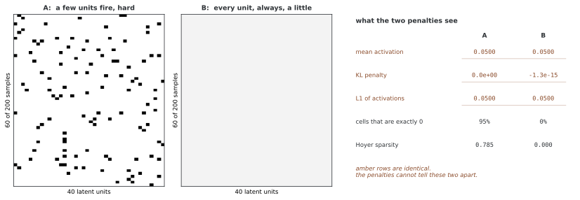

# 오토인코더의 로스 함수

오토인코더의 로스는 복원에서 무엇을 정확히 맞출지와 잠재 표현에 어떤 제약을 줄지를 정한다. MSE·BCE·MAE는 서로 다른 복원 목표이며, 희소성·수축·디노이징은 추가 학습 제약이다. 로스 이름만으로 표현의 의미·일반화·생성 품질이 보장되지는 않는다.

## 1. 재구성 로스와 평균 축

배치 B개와 피처 d개에 대해 원소별 MSE는 Σ_{i,j}(x_ij−x̂_ij)²/(Bd)다. 표본별 제곱 거리 평균은 분모가 B라 d배 크다. `reduction='sum'`은 두 축을 모두 더하므로 기본 `mean`과는 **Bd배** 차이다. 같은 배치에서 순수 SGD만 비교하면 로스 상수배를 러닝레이트로 상쇄할 수 있지만 Adam·클리핑·다른 패널티까지 포함하면 단순한 러닝레이트 등가가 일반적으로 성립하지 않는다.

| 로스 | 원소별 형태 | 해석과 조건 |
|---|---|---|
| MSE | (x−x̂)² | 큰 오차에 이차 벌점, 이상적 복원은 조건부 평균 |
| MAE/L1 | 절댓값 오차 | 선형 벌점, 이상적 복원은 조건부 중앙값 |
| BCE | −x log p−(1−x)log(1−p) | p와 소프트 표적 x가 [0,1], 이진 관측에서는 베르누이 음의 로그우도 |

MSE는 고정 분산 가우시안 관측, MAE는 고정 스케일 라플라스 관측으로 확률적으로 해석할 수 있다. 로스를 사용하려면 실제 데이터가 반드시 그 잡음 모형이어야 한다는 뜻은 아니다. BCE 확률에는 Sigmoid 같은 범위 제한이 필요하지만 `BCEWithLogitsLoss`는 로짓을 직접 받아 수치적으로 안정된 결합을 수행한다.

회색 픽셀이 [0,1]이라는 이유만으로 실제 베르누이 관측이 되는 것은 아니다. BCE와 MSE의 조건부 최적 출력이 같은 평균이 될 수 있어 “BCE는 항상 선명하고 MSE는 항상 흐리다”는 구분은 맞지 않는다. MSE의 출력 미분은 2(p−x)로 일정하지 않고 MAE는 0이 아닌 잔차에서 부호에 따라 일정하다. BCE의 로짓 미분은 p−x다.

## 2. 로스·병목 비교 코드 읽기

```python
import torch
import torch.nn as nn
import torch.optim as optim
import numpy as np
import matplotlib.pyplot as plt
from torchvision import datasets, transforms
from torch.utils.data import DataLoader

class AutoencoderWithAnalysis(nn.Module):
    """숨은 공간 살피기 방법을 갖춘 오토인코더."""
    
    def __init__(self, input_dim=784, latent_dim=32):
        super().__init__()
        self.latent_dim = latent_dim
        
        self.encoder = nn.Sequential(
            nn.Linear(input_dim, 256),
            nn.ReLU(),
            nn.Linear(256, 128),
            nn.ReLU(),
            nn.Linear(128, latent_dim),
        )
        
        self.decoder = nn.Sequential(
            nn.Linear(latent_dim, 128),
            nn.ReLU(),
            nn.Linear(128, 256),
            nn.ReLU(),
            nn.Linear(256, input_dim),
            nn.Sigmoid()
        )
    
    def encode(self, x):
        return self.encoder(x)
    
    def decode(self, z):
        return self.decoder(z)
    
    def forward(self, x):
        z = self.encode(x)
        return self.decode(z), z

def compare_loss_functions(model_class, train_loader, test_loader, device):
    """여러 다시 세우기 로스 함수를 견준다."""
    
    losses = {
        'MSE': nn.MSELoss(),
        'BCE': nn.BCELoss(),
        'L1': nn.L1Loss()
    }
    
    results = {}
    
    for loss_name, criterion in losses.items():
        print(f"\nTraining with {loss_name} loss...")
        
        model = model_class().to(device)
        optimizer = optim.Adam(model.parameters(), lr=0.001)
        
        train_losses = []
        for epoch in range(10):
            model.train()
            epoch_loss = 0
            for images, _ in train_loader:
                images = images.view(images.size(0), -1).to(device)
                
                optimizer.zero_grad()
                recon, _ = model(images)
                loss = criterion(recon, images)
                loss.backward()
                optimizer.step()
                epoch_loss += loss.item()
            
            train_losses.append(epoch_loss / len(train_loader))
        
        # 평가한다
        model.eval()
        with torch.no_grad():
            test_images, _ = next(iter(test_loader))
            test_images = test_images[:10].view(10, -1).to(device)
            recon, _ = model(test_images)
        
        results[loss_name] = {
            'model': model,
            'train_losses': train_losses,
            'reconstructions': recon.cpu().numpy()
        }
    
    return results
```

`compare_loss_functions`는 각 목적에 새 무작위 모델을 만들고 10에포크 학습한 뒤 테스트 로더 첫 배치의 **처음 열 장**을 복원한다. 테스트 전체 MSE·MAE를 계산하지 않는다. 각 목적의 학습 로스값 자체를 직접 순위화할 수 없고 초기값도 다르다. `train_loader`, `test_loader`와 장치를 준비해 호출해야 실제 실행된다.

```python
def find_optimal_latent_dim(train_loader, test_loader, device, 
                            dims=[2, 4, 8, 16, 32, 64, 128, 256]):
    """다시 세우기 어긋남으로 가장 좋은 숨은 차원을 찾는다."""
    
    results = []
    
    for dim in dims:
        model = AutoencoderWithAnalysis(latent_dim=dim).to(device)
        optimizer = optim.Adam(model.parameters(), lr=0.001)
        criterion = nn.MSELoss()
        
        # 학습
        for epoch in range(15):
            model.train()
            for images, _ in train_loader:
                images = images.view(images.size(0), -1).to(device)
                optimizer.zero_grad()
                recon, _ = model(images)
                loss = criterion(recon, images)
                loss.backward()
                optimizer.step()
        
        # 평가한다
        model.eval()
        test_loss = 0
        with torch.no_grad():
            for images, _ in test_loader:
                images = images.view(images.size(0), -1).to(device)
                recon, _ = model(images)
                test_loss += criterion(recon, images).item()
        
        test_loss /= len(test_loader)
        results.append({'dim': dim, 'error': test_loss})
        print(f"Latent dim {dim}: Test MSE = {test_loss:.6f}")
    
    return results
```

`find_optimal_latent_dim`은 차원별 MSE 학습·평가를 제공하지만 배치별 평균 로스를 단순 평균한다. 마지막 배치 크기가 다르면 전체 픽셀 가중 MSE와 다르다. 차원을 고르는 데 사용한 데이터를 이름만 테스트로 두어도 독립 최종 테스트가 되지는 않는다. 검증 데이터에서 선택하고 최종 보류 구간을 따로 평가한다.

## 3. 희소성: 작은 값과 낮은 활성 빈도

활성화 h의 L1 패널티는 절댓값의 합 또는 평균을 줄인다. 정확한 0의 개수 제한이나 의미 있는 피처 분리를 강제하는 것은 아니다. 비정규화 디코더가 잠재 축소를 큰 웨이트로 리워드할 수도 있어 웨이트 크기·구조와 함께 해석한다.

베르누이 KL 희소성은 0<ρ<1과 평균 활성화 ρ̂_j에 다음 패널티를 사용한다.

$$\Omega_{KL}=\sum_j\left[\rho\log\frac\rho{\hat\rho_j}+(1-\rho)\log\frac{1-\rho}{1-\hat\rho_j}\right].$$

ρ̂_j는 [0,1] 범위의 활성화를 평균한 값이어야 한다. 예를 들어 Sigmoid 잠재 표현에서 사용할 수 있지만 Sigmoid만이 유일한 방법은 아니다. 평균 활성화 0.05가 정확히 5%의 표본에서만 켜짐을 뜻하지 않는다. 모든 표본에서 0.05여도 같은 평균이다. 목표와의 KL 최소화도 전체 재구성 로스과의 절충 때문에 정확히 달성되거나 죽은 단위가 사라진다고 보장할 수 없다.

<div class="storybox" markdown>

**그림으로 보는 AI 1.** 희소성은 정규화 수법으로 태어나지 않았다

활성화에 벌을 주어 성기게 만든다는 생각은 오토인코더를 길들이려고 나온 것이 아니다. **왜 시각 피질 세포가 그렇게 생겼는가**를 묻다가 나왔다.

1996년에 브루노 올스하우젠(Bruno Olshausen)과 데이비드 필드(David Field)가 《네이처》에 세 쪽짜리 글을 실었다. 자연 영상 조각을 가져다 놓고, **성긴 선형 코드로 표현하라**는 조건 하나만 걸어 학습시켰다. 무엇을 찾으라고 일러 준 것은 없었다. 그런데 나온 기저 함수들이 국소적이고, 방향을 가지고, 특정 주파수 대역에 반응하는 꼴 — 일차 시각 피질의 단순 세포에서 관찰되던 바로 그 성질을 갖추고 있었다. 성김이라는 요구 하나가 그 모양을 **끌어냈다**는 것이 요지였다.

**그러면 위 식의 ρ̂가 그 성김인가.** 그렇지 않다. 재어 보면 분명하다.



A는 유닛마다 200개 표본 가운데 열 곳에서만 켜지고 나머지는 **정확히 0**이다. B는 모든 자리가 늘 0.05다. 두 코드는 닮은 데가 없는데, **위에 적은 두 패널티는 둘을 구별하지 못한다.** 유닛별 평균이 둘 다 꼭 0.05라 KL은 양쪽 모두 0이고(계산 오차 범위에서 $-1.3\times10^{-15}$), L1 평균도 똑같이 0.0500이다. 정확한 0의 비율은 95%와 0%, Hoyer 희소성은 0.785와 0.000으로 갈리는데도 그렇다.

까닭은 두 패널티가 **유닛별 평균 하나만** 보기 때문이다. 바로 위 문단이 "모든 표본에서 0.05여도 같은 평균이다"라고 적어 둔 것이 이 그림이다.

**그래서 올스하우젠과 필드가 얻은 것을 이 패널티로 얻었다고 말할 수 없다.** 그들이 건 조건은 표본마다 **몇 개만 크게 켜지는** 쪽이었지 평균을 낮추는 쪽이 아니었다. 평균을 목표에 맞추는 것과 분포를 뾰족하게 만드는 것은 다른 요구이며, 어느 쪽을 원하는지에 따라 패널티도 그것을 재는 지표도 달리 골라야 한다.

_확인한 곳 — B. A. Olshausen, D. J. Field, "Emergence of simple-cell receptive field properties by learning a sparse code for natural images", *Nature* **381**, 607–609 (1996년 6월 13일), DOI 10.1038/381607a0. 그림의 수는 그림을 그리는 코드가 두 활성화 행렬을 만들어 직접 잰 것이다._

</div>

```python
class SparseAutoencoder_L1(nn.Module):
    """
    숨은 활성화에 L1 벌주기를 쓴 성긴 오토인코더.
    
    로스 = 다시 세우기 로스 + λ × L1(숨은 활성화)
    
    L1 벌주기가 숨은 활성화 여럿을 딱 0이 되도록 이끈다.
    """
    
    def __init__(self, input_dim: int = 784, latent_dim: int = 128):
        super(SparseAutoencoder_L1, self).__init__()
        
        self.input_dim = input_dim
        self.latent_dim = latent_dim
        
        # 인코더: 넘치게 갖춘 나타냄을 위해 흔히 latent_dim을 크게 둔다
        self.encoder = nn.Sequential(
            nn.Linear(input_dim, 256),
            nn.ReLU(),
            nn.Linear(256, latent_dim),
            nn.ReLU()  # 정류 선형이 저절로 성김을 북돋운다
        )
        
        # 디코더
        self.decoder = nn.Sequential(
            nn.Linear(latent_dim, 256),
            nn.ReLU(),
            nn.Linear(256, input_dim),
            nn.Sigmoid()
        )
    
    def forward(self, x):
        latent = self.encoder(x)
        reconstructed = self.decoder(latent)
        return reconstructed, latent

def l1_loss(latent: torch.Tensor) -> torch.Tensor:
    """
    숨은 활성화의 L1 벌주기를 셈한다.
    
    L1(h) = Σᵢⱼ |hᵢⱼ|
    
    0이 아닌 활성화에 벌을 주어 성김을 이끈다.
    """
    return torch.mean(torch.abs(latent))

class SparseAutoencoder_KL(nn.Module):
    """
    KL 벌어짐 성김 제약을 쓴 성긴 오토인코더.
    
    뉴런마다의 평균 활성화가 목표 성김 수준 ρ(예컨대 0.05)에
    가깝도록 옭아맨다.
    """
    
    def __init__(self, input_dim: int = 784, latent_dim: int = 128):
        super(SparseAutoencoder_KL, self).__init__()
        
        self.input_dim = input_dim
        self.latent_dim = latent_dim
        
        # KL 벌어짐을 위해 에스자를 쓴 인코더(내놓기가 [0,1])
        self.encoder = nn.Sequential(
            nn.Linear(input_dim, 256),
            nn.ReLU(),
            nn.Linear(256, latent_dim),
            nn.Sigmoid()  # KL 벌어짐에 필요하다
        )
        
        # 디코더
        self.decoder = nn.Sequential(
            nn.Linear(latent_dim, 256),
            nn.ReLU(),
            nn.Linear(256, input_dim),
            nn.Sigmoid()
        )
    
    def forward(self, x):
        latent = self.encoder(x)
        reconstructed = self.decoder(latent)
        return reconstructed, latent

def kl_divergence_loss(latent: torch.Tensor, rho: float = 0.05) -> torch.Tensor:
    """
    KL 벌어짐 성김 벌주기를 셈한다.
    
    뉴런 j마다 평균 활성화가 ρ̂ⱼ ≈ ρ이기를 바란다.
    
    KL(ρ || ρ̂ⱼ) = ρ log(ρ/ρ̂ⱼ) + (1-ρ) log((1-ρ)/(1-ρ̂ⱼ))
    
    ρ̂ⱼ = ρ일 때 가장 작다.
    """
    # 배치에 걸친 뉴런마다의 평균 활성화
    rho_hat = torch.mean(latent, dim=0)
    
    # log(0)을 피한다
    eps = 1e-8
    rho_hat = torch.clamp(rho_hat, eps, 1 - eps)
    
    # 뉴런마다의 KL 벌어짐
    kl = rho * torch.log(rho / rho_hat) + \
         (1 - rho) * torch.log((1 - rho) / (1 - rho_hat))
    
    return torch.sum(kl)

def train_sparse_autoencoder(
    model, train_loader, optimizer, device, epoch,
    sparsity_type='l1', sparsity_weight=0.001, rho=0.05
):
    """
    성긴 오토인코더를 한 바퀴 익힌다.
    
    전체 로스 = 다시 세우기 로스 + 성김 벌주기
    """
    model.train()
    
    total_loss_sum = 0.0
    recon_loss_sum = 0.0
    sparsity_loss_sum = 0.0
    num_batches = 0
    
    recon_criterion = nn.MSELoss()
    
    for batch_idx, (images, _) in enumerate(train_loader):
        images = images.view(images.size(0), -1).to(device)
        
        optimizer.zero_grad()
        
        # 순전파
        reconstructed, latent = model(images)
        
        # 되살림 로스
        recon_loss = recon_criterion(reconstructed, images)
        
        # 성김 벌주기
        if sparsity_type == 'l1':
            sparsity_loss = l1_loss(latent)
        elif sparsity_type == 'kl':
            sparsity_loss = kl_divergence_loss(latent, rho)
        
        # 전체 로스
        total_loss = recon_loss + sparsity_weight * sparsity_loss
        
        # 역전파
        total_loss.backward()
        optimizer.step()
        
        total_loss_sum += total_loss.item()
        recon_loss_sum += recon_loss.item()
        sparsity_loss_sum += sparsity_loss.item()
        num_batches += 1
    
    return (total_loss_sum / num_batches, 
            recon_loss_sum / num_batches, 
            sparsity_loss_sum / num_batches)
```

`l1_loss`는 배치·잠재 표현 전체의 **평균**, KL은 잠재 축의 **합**이라 같은 `sparsity_weight`가 같은 정규화 강도를 뜻하지 않는다. KL 평균은 현재 미니배치에서 구하므로 전체 데이터 평균의 목적과 확률적 추정도 구분한다. clamp는 극단값을 제한하지만 낮은 정밀도에서 ε와 1−ε가 표현되는지 확인해야 한다. 알 수 없는 `sparsity_type`에는 로스가 정의되지 않는다.

```python
def analyze_sparsity(model, test_loader, device, num_samples=1000):
    """배운 나타냄의 성김을 살핀다."""
    model.eval()
    
    all_activations = []
    
    with torch.no_grad():
        for images, _ in test_loader:
            if len(all_activations) * test_loader.batch_size >= num_samples:
                break
            images = images.view(images.size(0), -1).to(device)
            _, latent = model(images)
            all_activations.append(latent.cpu().numpy())
    
    all_activations = np.concatenate(all_activations, axis=0)[:num_samples]
    
    # 활성화 > 임계를 "깨어 있음"이라 한다
    threshold = 0.1
    active = all_activations > threshold
    
    # 표본별 성김: 표본마다 깨어 있는 뉴런의 평균 몫
    population_sparsity = np.mean(np.mean(active, axis=1))
    
    # 평생 성김: 뉴런마다 그것을 깨우는 표본의 몫
    lifetime_sparsity = np.mean(active, axis=0)
    
    return population_sparsity, lifetime_sparsity
```

`analyze_sparsity`는 0.1보다 큰 활성화를 켜짐으로 정의한다. 반환 `population_sparsity`는 이름과 달리 **평균 활성 비율**이며 클수록 더 많이 켜진다. `lifetime_sparsity`도 단위별 활성 빈도다. 부호 있는 잠재 표현라면 양수 임계값만으로 의미 있는 음수 활성화를 놓칠 수 있다. 빈 로더와 고정 `batch_size`에 의존하는 표본 수 추정도 별도 처리한다.

## 4. 수축 정규화와 야코비안

수축 오토인코더(CAE)는 인코더 f의 입력 야코비안에 벌점을 준다.

$$L=L_{rec}+\lambda\,\mathbb E_x\|J_f(x)\|_F^2,\qquad\lambda\ge0.$$

작은 입력 변화에 대한 국소 잠재 표현 민감도를 줄이는 목표다. 유용한 방향도 줄일 수 있고 접평면·잡음 방향을 정확히 식별하는 보장은 없다. 디코더가 큰 민감도로 작은 잠재 표현을 다시 확대하는 스케일 자유도도 고려해야 한다. [CAE 원 논문](https://icml.cc/2011/papers/455_icmlpaper.pdf)의 목적과 조건을 참고한다.

```python
from torch.autograd import grad

class ContractiveAutoencoder(nn.Module):
    """야코비 벌주기를 갖춘 오그리는 오토인코더."""
    
    def __init__(self, input_dim=784, latent_dim=64):
        super().__init__()
        
        self.input_dim = input_dim
        self.latent_dim = latent_dim
        
        # 내놓기를 가두려 에스자를 쓴 인코더
        self.encoder = nn.Sequential(
            nn.Linear(input_dim, 256),
            nn.Sigmoid(),
            nn.Linear(256, 128),
            nn.Sigmoid(),
            nn.Linear(128, latent_dim),
            nn.Sigmoid()  # 야코비가 안정되도록 [0,1]로 가둔다
        )
        
        # 디코더
        self.decoder = nn.Sequential(
            nn.Linear(latent_dim, 128),
            nn.ReLU(),
            nn.Linear(128, 256),
            nn.ReLU(),
            nn.Linear(256, input_dim),
            nn.Sigmoid()
        )
    
    def encode(self, x):
        return self.encoder(x)
    
    def decode(self, z):
        return self.decoder(z)
    
    def forward(self, x):
        z = self.encode(x)
        x_recon = self.decode(z)
        return x_recon, z

def compute_jacobian_penalty(model, x):
    """
    인코더 야코비 행렬의 프로베니우스 노름 제곱을 셈한다.
    
    J_f(x)_ij = ∂z_i / ∂x_j
    ||J_f||_F^2 = Σ_ij (∂z_i / ∂x_j)^2
    """
    x = x.requires_grad_(True)
    z = model.encode(x)
    
    # 야코비 행렬을 세로줄마다 셈한다
    jacobian_norm_sq = 0.0
    
    for i in range(z.shape[1]):
        # x에 대한 z_i의 그래디언트
        grad_outputs = torch.zeros_like(z)
        grad_outputs[:, i] = 1.0
        
        jacobian_col = grad(
            outputs=z,
            inputs=x,
            grad_outputs=grad_outputs,
            create_graph=True,
            retain_graph=True
        )[0]
        
        # 이 세로줄의 제곱합
        jacobian_norm_sq = jacobian_norm_sq + torch.sum(jacobian_col ** 2)
    
    return jacobian_norm_sq / x.shape[0]  # 배치에 걸친 평균

def train_contractive_autoencoder(
    model, train_loader, device, 
    lambda_contractive=0.1, num_epochs=15
):
    """
    오그리는 오토인코더를 익힌다.
    
    로스 = 다시 세우기 + λ × ||J_f||_F^2
    """
    optimizer = optim.Adam(model.parameters(), lr=0.001)
    recon_criterion = nn.MSELoss()
    
    history = {'recon_loss': [], 'contractive_loss': [], 'total_loss': []}
    
    for epoch in range(num_epochs):
        model.train()
        
        epoch_recon = 0
        epoch_contractive = 0
        epoch_total = 0
        
        for images, _ in train_loader:
            images = images.view(images.size(0), -1).to(device)
            
            optimizer.zero_grad()
            
            # 순전파
            recon, z = model(images)
            
            # 되살림 로스
            recon_loss = recon_criterion(recon, images)
            
            # 오그림 벌주기
            contractive_loss = compute_jacobian_penalty(model, images)
            
            # 전체 로스
            total_loss = recon_loss + lambda_contractive * contractive_loss
            
            # 역전파
            total_loss.backward()
            optimizer.step()
            
            epoch_recon += recon_loss.item()
            epoch_contractive += contractive_loss.item()
            epoch_total += total_loss.item()
        
        n_batches = len(train_loader)
        history['recon_loss'].append(epoch_recon / n_batches)
        history['contractive_loss'].append(epoch_contractive / n_batches)
        history['total_loss'].append(epoch_total / n_batches)
        
        print(f"Epoch {epoch+1}: Recon={epoch_recon/n_batches:.6f}, "
              f"Contract={epoch_contractive/n_batches:.6f}")
    
    return history
```

`compute_jacobian_penalty`는 각 잠재 표현 성분의 배치 합을 입력으로 미분한다. 여기처럼 표본 사이 연산이 없는 인코더에서는 표본별 야코비안 행을 구하는 것과 맞는다. BatchNorm처럼 표본을 결합하는 계층으로 바꾸면 이 해석이 달라진다. `create_graph=True`는 패널티에서 파라미터로 다시 미분하기 위해 필요하며 잠재 차원만큼 반복하므로 비용이 크다.

복원은 모든 원소 평균 MSE, 야코비안은 전체 입력·잠재 표현 제곱합의 표본 평균이다. 차원과 정규화 강도를 함께 기록한다. 모델을 장치로 옮기는 코드는 이 함수 안에 없고 실제로 학습 함수를 호출하는 부분도 없다.

## 5. 디노이징과 수축은 같은 로스가 아니다

DAE는 입력을 오염시키고 깨끗한 표적을 복원한다. 작은 가우시안 잡음 ε의 제곱 복원 로스를 전개할 때 미분되는 함수는 일반적으로 **전체 재구성 r=g∘f**다. 충분히 매끄러운 r에서 2차 항에는 ||J_r||_F²뿐 아니라 복원 잔차와 r의 2차 미분이 곱해진 항도 포함된다. 잔차가 작다는 등의 추가 가정 없이 이를 곧바로 σ²||J_f||_F²로 바꿀 수 없다.

따라서 DAE가 인코더 CAE 패널티의 정확한 몬테카를로 계산이라는 설명은 일반적으로 틀리다. 오염에 대한 복원 안정성과 인코더의 직접적인 민감도 제약이라는 차이를 유지한다.

```python
def add_noise(images: torch.Tensor, noise_factor: float = 0.1) -> torch.Tensor:
    """
    그림에 정규 잡음을 더한다.
    
    망가뜨린 그림: x̃ = x + ε, 여기서 ε ~ N(0, σ²)
    """
    noise = torch.randn_like(images) * noise_factor
    noisy_images = images + noise
    return torch.clamp(noisy_images, 0.0, 1.0)

def add_salt_pepper_noise(images: torch.Tensor, 
                          noise_prob: float = 0.2) -> torch.Tensor:
    """그림에 소금과 후추 잡음을 더한다."""
    noisy_images = images.clone()
    
    noise_mask = torch.rand_like(images) < noise_prob
    salt_mask = torch.rand_like(images) > 0.5
    
    noisy_images[noise_mask & salt_mask] = 1.0   # 소금
    noisy_images[noise_mask & ~salt_mask] = 0.0  # 후추
    
    return noisy_images

def add_masking_noise(images: torch.Tensor, 
                      mask_prob: float = 0.3) -> torch.Tensor:
    """
    화소를 아무렇게나 0으로 두어 가리기 잡음을 더한다.
    요즘 보기 변환기의 가린 오토인코더(MAE)와 맞닿는다.
    """
    mask = (torch.rand_like(images) > mask_prob).float()
    return images * mask
```

위 가우시안 입력은 [0,1]로 클리핑되고, salt-and-pepper와 masking은 확률적 교체다. 표준편차와 오염 확률의 의미, 유효 범위를 확인한다. `add_masking_noise`는 살아남은 값을 확대하지 않으므로 `nn.Dropout`과 다르다.

클리핑 없는 가우시안 오염의 이상적 조건부 평균은 x̃+σ²∇log p_σ(x̃)로 쓸 수 있다. 이는 평활 밀도 p_σ의 점수이며 유한 학습·클리핑된 잡음의 출력이 곧 원래 p(x)의 정확한 점수라는 뜻은 아니다.

## 6. 통합 루프와 시각화의 범위

```python
def train_regularized_autoencoder(
    model, train_loader, optimizer, device, epoch,
    regularization='none',       # 'none', 'l1', 'kl', 'contractive', 'denoising'
    reg_weight=0.001,            # 벌주기 항의 무게
    rho=0.05,                    # KL의 목표 성김
    noise_factor=0.1             # 잡음 없애기의 잡음 수준
):
    """
    모든 벌주기 클래스를 받치는 아우른 익히기 함수.
    
    전체 로스 = 다시 세우기 로스 + reg_weight × 벌주기 항
    """
    model.train()
    
    total_loss_sum = 0.0
    recon_loss_sum = 0.0
    reg_loss_sum = 0.0
    num_batches = 0
    
    recon_criterion = nn.MSELoss()
    
    for batch_idx, (images, _) in enumerate(train_loader):
        images = images.view(images.size(0), -1).to(device)
        
        optimizer.zero_grad()
        
        # 들임을 마련한다(잡음 없애기면 망가뜨리고 아니면 깨끗이)
        if regularization == 'denoising':
            input_images = add_noise(images, noise_factor)
        else:
            input_images = images
        
        # 순전파
        reconstructed, latent = model(input_images)
        
        # 다시 세우기 로스(늘 깨끗한 그림에 대해)
        recon_loss = recon_criterion(reconstructed, images)
        
        # 벌주기 항
        if regularization == 'l1':
            reg_loss = l1_loss(latent)
        elif regularization == 'kl':
            reg_loss = kl_divergence_loss(latent, rho)
        elif regularization == 'contractive':
            reg_loss = compute_jacobian_penalty(model, input_images)
        else:
            reg_loss = torch.tensor(0.0, device=device)
        
        # 전체 로스
        total_loss = recon_loss + reg_weight * reg_loss
        
        total_loss.backward()
        optimizer.step()
        
        total_loss_sum += total_loss.item()
        recon_loss_sum += recon_loss.item()
        reg_loss_sum += reg_loss.item()
        num_batches += 1
    
    return (total_loss_sum / num_batches,
            recon_loss_sum / num_batches,
            reg_loss_sum / num_batches)
```

이 루프는 `regularization` 문자열로 **한 가지 방식**을 고른다. 여러 패널티를 동시에 모두 합하는 구현이 아니다. `'denoising'`은 입력을 바꾸며 명시적 `reg_loss`는 0이다. L1·KL·수축에는 각 방법에 맞는 반환값·활성화와 `encode`가 필요하다. 알 수 없는 문자열도 조용히 정규화 없음으로 처리하므로 호출 값을 검증한다.

```python
def visualize_learned_features(model, num_features=64):
    """
    하나만 뜨거운 숨은 벡터를 풀어 배운 피처를 그려 본다.
    
    성긴 오토인코더에서는 피처가 흔히 더 풀이하기 쉬우며
    국소한 결을 보인다.
    """
    model.eval()
    
    latent_dim = model.latent_dim
    num_features = min(num_features, latent_dim)
    
    features = []
    with torch.no_grad():
        for i in range(num_features):
            # 하나만 뜨거운 벡터를 만든다
            latent = torch.zeros(1, latent_dim)
            latent[0, i] = 1.0  # 뉴런 i만 깨운다
            
            # 그림 공간으로 푼다
            feature = model.decoder(latent)
            features.append(feature.cpu().numpy().reshape(28, 28))
    
    # 격자로 그려 본다
    grid_size = int(np.ceil(np.sqrt(num_features)))
    fig, axes = plt.subplots(grid_size, grid_size, figsize=(12, 12))
    axes = axes.flatten()
    
    for i in range(num_features):
        axes[i].imshow(features[i], cmap='gray')
        axes[i].axis('off')
    
    plt.suptitle('Learned Features (Decoder Basis)')
    plt.savefig('learned_features.png', dpi=150)
    plt.show()
```

`visualize_learned_features`는 잠재 표현의 표준 기저 e_i를 디코딩한다. 비선형 디코더에서는 이를 선형 기저나 독립 피처로 부를 수 없다. g(0)의 바이어스 효과도 섞인다. 학습 잠재 표현이 실제로 그런 위치를 방문했는지 확인해야 한다. 텐서를 CPU에 만들기 때문에 장치·dtype을 모델에 맞추어야 하고 출력 784차원, num_features>0을 가정한다. 한 그림이면 `axes`가 스칼라라 `.flatten()`이 실패할 수 있다.

## 연습문제


<div class="drillbox" markdown>

**연습문제 1.** <span class="diff easy" title="쉬움"></span>
MNIST에서 BCE·MSE·MAE 중 어떤 로스가 좋은지 비교하는 절차를 설명하라.

</div>

??? success "풀이"

    같은 구조·전처리·초기값 조건과 각 로스에 적절한 학습 설정을 사용한다. 독립 검증에서 공통 MSE·MAE와 시각적 품질을 평가한다. 현재 비교 함수는 테스트 전체 수치가 아니라 열 장 복원만 반환한다. 고정 성능표나 BCE 우위를 이 코드의 결과로 가정하지 않는다. MAE가 조건부 중앙값을 선호해도 항상 검은 그림이 최적이라는 뜻은 아니다.


---

<div class="drillbox" markdown>

**연습문제 2.** <span class="diff med" title="중간"></span>
B×784 데이터에서 sum과 mean 로스의 비율과 다른 패널티와 결합할 때의 의미를 구하라.

</div>

??? success "풀이"

    모든 원소를 합하면 기본 mean의 B×784배다. sum을 B로 나눈 표본별 픽셀 합은 원소 평균의 784배다. 어떤 축을 정규화했는지 명시한다. SGD 상수배 보정과 달리 Adam·클리핑·웨이트 감쇠·다른 로스가 함께 있으면 러닝레이트만 같은 비율로 바꾸어 완전히 같은 학습이 된다고 보장할 수 없다.


---

<div class="drillbox" markdown>

**연습문제 3.** <span class="diff med" title="중간"></span>
MAE와 MSE의 최적 복원과 그래디언트 차이를 설명하라.

</div>

??? success "풀이"

    이상적 제곱 로스 복원은 조건부 평균, 절댓값 로스 복원은 조건부 중앙값이다. MSE의 출력 미분은 잔차에 비례하고 MAE는 0이 아닌 곳에서 부호에 따라 일정하다. 이 성질은 이상값 영향과 불확실한 복원에 영향을 주지만 MAE가 항상 선명하거나 MSE보다 우수하다는 보장은 아니다.


---

<div class="drillbox" markdown>

**연습문제 4.** <span class="diff med" title="중간"></span>
희소 잠재 표현과 좁은 병목의 제약 차이를 설명하라.

</div>

??? success "풀이"

    병목은 잠재 표현 좌표 수를 줄이고 희소 패널티는 주어진 좌표의 활성 크기·빈도를 제한하려 한다. 좁은 잠재 표현도 표본마다 다른 좌표를 활성화할 수 있어 분업이 불가능한 것은 아니다. L1은 정확히 일정 개수만 켜는 제약이 아니며 잠재 표현이 의미별로 분리되는지도 별도 평가해야 한다.


---

<div class="drillbox" markdown>

**연습문제 5.** <span class="diff med" title="중간"></span>
L1과 베르누이 KL 활성화 패널티의 목표와 합산 차이를 설명하라.

</div>

??? success "풀이"

    L1은 활성화 절댓값을 줄이고 KL은 단위별 평균을 목표 ρ에 맞추려 한다. 평균 ρ만으로 표본별 활성 빈도나 정확한 0의 비율이 정해지지 않는다. 이 코드의 L1은 평균, KL은 잠재 표현별 합이라 강도를 직접 비교할 수 없다. KL도 전체 로스의 최적화에서 목표를 정확히 맞추거나 단위 비활성화를 완전히 막는 것은 아니다.


---

<div class="drillbox" markdown>

**연습문제 6.** <span class="diff hard" title="어려움"></span>
희소 AE의 KL과 VAE의 KL이 비교하는 대상을 구분하라.

</div>

??? success "풀이"

    희소 패널티는 목표 ρ와 평균 활성화로 정의한 두 베르누이 분포의 KL을 사용한다. VAE는 각 입력의 잠재 사후 q(z|x)와 사전 p(z)를 비교한다. 같은 KL 개념이지만 대상과 목적이 다르다. 희소 패널티만으로 잠재 표현 전체 분포가 샘플링 가능한 특정 사전과 같아지지는 않으며 VAE도 KL만으로 좋은 생성 품질이 보장되지 않는다.


---

<div class="drillbox" markdown>

**연습문제 7.** <span class="diff easy" title="쉬움"></span>
CAE 패널티가 작게 만드는 양과 구현의 합산 축을 설명하라.

</div>

??? success "풀이"

    인코더의 입력 야코비안 프로베니우스 제곱 노름이다. 구현은 입력·잠재 축을 합하고 배치 크기로 나눈다. 표본 독립 인코더에서는 각 잠재 표현의 배치 합을 미분해 표본별 행을 얻을 수 있다. 배치 결합 계층을 추가하면 교차 표본 미분을 고려해야 한다.


---

<div class="drillbox" markdown>

**연습문제 8.** <span class="diff hard" title="어려움"></span>
수축 패널티와 복원 로스가 함께 있으면 유용한 모든 방향이 반드시 보존되는가?

</div>

??? success "풀이"

    아니다. 두 목표가 절충되지만 어떤 방향이 유용한지 자동으로 식별하는 정리는 아니다. 너무 강하면 복원이나 구별 능력을 약화할 수 있고 잠재 축소를 디코더 확대가 리워드할 수도 있다. 야코비안 스펙트럼, 복원과 후속 태스크를 함께 검증한다.


---

<div class="drillbox" markdown>

**연습문제 9.** <span class="diff med" title="중간"></span>
작은 입력 잡음의 DAE 로스를 인코더 야코비안 패널티와 그대로 같다고 할 수 있는가?

</div>

??? success "풀이"

    일반적으로 아니다. 전체 재구성 함수 r의 1·2차 미분과 복원 잔차가 전개에 나타난다. 추가 조건 없이 이를 J_f의 노름만으로 치환할 수 없다. DAE는 오염 복원을, CAE는 인코더 민감도를 직접 제약한다. 잡음 생성도 계산 비용이 있고 두 방법의 구현 비용은 구조에 달려 있다.


---

<div class="drillbox" markdown>

**연습문제 10.** <span class="diff hard" title="어려움"></span>
병목·희소성·수축·잡음을 정보량의 같은 상한이라고 볼 수 있는가?

</div>

??? success "풀이"

    모두 표현에 제약을 줄 수 있지만 차원·활성 크기·민감도만으로 일반적인 정보량 상한이 자동으로 성립하지 않는다. 정밀도·분포와 확률 모형 등의 조건이 필요하다. VAE의 기대 KL은 I(X;Z)+KL(q(z)||p(z))로 분해할 수 있는 확률적 대상이며 모든 AE 패널티에 같은 식을 적용하지 않는다.


## 정리하며

복원 로스는 데이터와 평가 목표에 맞추고 합·평균의 축을 일관되게 정한다. L1·활성화 KL·수축·디노이징은 서로 다른 제약이며 같은 강도나 효과를 뜻하지 않는다. 잠재 표현의 측정 범위와 야코비안·점수 해석 조건을 확인하고 표현 품질과 생성 성능을 따로 평가한다.
