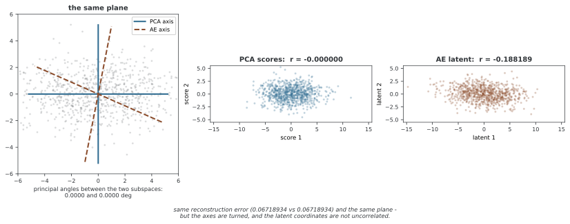

# 오토인코더와 비선형 재구성 곡선

1차원 잠재 표현을 디코더에 넣으면 입력 공간에 곡선을 그릴 수 있다. 이 예제는 잡음이 있는 2차원 사인 곡선 표본을 1차원 잠재 표현으로 복원하도록 작은 tanh 오토인코더를 학습한다. 이는 PCA의 직선과 대비할 수 있는 비선형 근사지만, 일반 AE가 통계학의 주곡선 조건을 자동으로 만족한다는 뜻은 아니다.

## 1. 예제 코드

```python
"""오토인코더의 주다양체."""
import numpy as np
import matplotlib.pyplot as plt
import torch
import torch.nn as nn
import torch.optim as optim

def make_s_curve(n=400, noise=0.07, seed=0):
    rng = np.random.default_rng(seed)
    t = rng.uniform(-2.5, 2.5, size=n)
    x = t
    y = np.sin(1.5 * t)
    X = np.stack([x, y], axis=1)
    X += rng.normal(scale=noise, size=X.shape)
    return X.astype(np.float32)

X = make_s_curve(n=600, noise=0.06, seed=42)
X_mean, X_std = X.mean(axis=0, keepdims=True), X.std(axis=0, keepdims=True)
Xn = (X - X_mean) / X_std
Xt = torch.from_numpy(Xn)

class AE(nn.Module):
    def __init__(self):
        super().__init__()
        self.encoder = nn.Sequential(
            nn.Linear(2, 32), nn.Tanh(),
            nn.Linear(32, 16), nn.Tanh(),
            nn.Linear(16, 1),
        )
        self.decoder = nn.Sequential(
            nn.Linear(1, 16), nn.Tanh(),
            nn.Linear(16, 32), nn.Tanh(),
            nn.Linear(32, 2),
        )

    def forward(self, x):
        z = self.encoder(x)
        return self.decoder(z), z

ae = AE()
opt = optim.Adam(ae.parameters(), lr=5e-3)
loss_fn = nn.MSELoss()

for ep in range(1, 60001):
    perm = torch.randperm(len(Xt))
    for i in range(0, len(Xt), 128):
        xb = Xt[perm[i:i+128]]
        xhat, _ = ae(xb)
        loss = loss_fn(xhat, xb)
        opt.zero_grad()
        loss.backward()
        opt.step()

if __name__ == "__main__":
    pass
```

## 2. 데이터와 학습 구조

생성기는 t∈[−2.5,2.5]를 뽑아 (t,sin(1.5t))에 잡음을 더한다. 실제 사용 표본은 600개, 잡음 표준편차는 0.06이다. 피처별 평균과 표준편차로 표준화한 600×2 배열을 학습하므로 로스는 원래 두 좌표의 단위가 아니라 표준화된 거리 기준이다.

인코더는 2→32→16→1, 디코더는 1→16→32→2이며 은닉 계층에 tanh를 사용한다. 잠재 표현과 복원 출력의 마지막 계층은 선형이다. 표본당 잠재 표현 원소 하나로 2차원 입력을 근사한다. tanh 디코더는 매끄러운 함수를 주지만, 어떤 위치에서도 도함수가 0이 아니거나 자기 교차가 없는 매끄러운 매니폴드 임베딩이라는 보장은 없다.

코드는 Adam으로 60,000에포크 학습한다. 에포크마다 600개를 섞고 최대 128개 미니배치로 갱신한다. 검증·조기 종료·로스 기록과 디코더 곡선 시각화는 포함하지 않으므로 전역 수렴이나 곡선 품질을 이 코드의 출력으로 확인한 것은 아니다.

## 3. 재구성 오차와 곡선까지의 거리

AE 로스는 ||x−g(f(x))||²다. 디코더의 상 M={g(z)}에 대한 가장 가까운 점의 거리와는 다음 관계만 일반적으로 성립한다.

$$\min_z\|x-g(z)\|^2\le\|x-g(f(x))\|^2.$$

인코더가 실제 최근접 좌표를 반환해야 등호다. 이 조건을 강제하지 않으므로 AE 학습을 모든 점의 직교 투영 오차 최소화와 동일시하지 않는다. 디코더 곡선을 보려면 학습 잠재 표현 범위에서 z를 훑어 복원하고, 필요하면 원래 평균·스케일을 되돌려 표시할 수 있다. 잠재 표현 빈 구간과 범위 밖에서 좋은 곡선을 보장하지는 않는다.

## 4. 주곡선과의 관계

[Hastie–Stuetzle의 주곡선](https://doi.org/10.1080/01621459.1989.10478797)은 투영 인덱스로 조건화한 데이터 평균이 곡선과 일치하는 자기 일관성 조건으로 정의된다. 임의의 매우 복잡한 곡선에 대한 경험 재구성 오차의 무제약 최소화와는 다르다. 매끄러움과 복잡도, 투영 규칙이 중요하다.

AE 재구성 곡선은 이 개념과 비교할 수 있지만 같은 해나 더 나은 위상, 수렴 보장을 일반적으로 갖지는 않는다. 데이터를 지나치게 따라가는 곡선은 학습 오차를 줄여도 보류 데이터의 구조를 잘 표현하지 못할 수 있다.

## 5. 선형 PCA와 비교할 때의 조건

모든 활성화를 제거하면 여러 아핀 계층의 합성은 하나의 저랭크 아핀 사상이다. 같은 학습 데이터의 유클리드 제곱 오차에서 충분한 조건의 전역 최적해는 중심화 PCA와 같은 최소 오차를 달성할 수 있다. Sigmoid가 하나라도 남아 있으면 그 선형 동등성 조건에 해당하지 않는다.

학습 데이터의 PCA 최적 오차보다 낮아질 수 없다는 선형 랭크 제약은 **같은 학습 목적**에 대한 결과다. 테스트 오차의 순위, 임의 유한 학습의 수렴과 개별 인코더 웨이트의 직교성까지 보장하지 않는다. PCA 축도 중복 고윳값에서는 비유일하고 선형 AE는 가역 잠재 표현 변환의 자유가 있다.

<div class="storybox" markdown>

**그림으로 보는 AI 1.** 같은 평면에 닿지만 같은 축에 닿지는 않는다

활성화를 모두 지운 오토인코더가 PCA와 같은 곳에 닿는다는 이 절의 이야기는 1988년에 나왔다. 에르베 부를라르(Hervé Bourlard)와 이브 캄프(Yves Kamp)가 《생물 사이버네틱스》에 실은 네 쪽짜리 글이고, 제목이 이미 결론이다 — 「다층 퍼셉트론에 의한 자기 연상과 특잇값 분해」. 자기 자신을 복원하는 과제에서는 **은닉 유닛의 비선형성이 쓸모없고**(useless), 최적 파라미터를 역전파 없이 SVD와 저랭크 근사로 바로 구할 수 있다는 것이었다. 이듬해 피에르 발디(Pierre Baldi)와 쿠르트 호르니크(Kurt Hornik)가 그 로스 지형에 **나쁜 국소해가 없다**는 것까지 보였다.

그런데 "같은 곳에 닿는다"가 어디까지 참인지가 이 절의 마지막 문장이 조심하는 대목이다. 재어 보면 선이 분명하다.



3차원 자료를 병목 2로 줄여 보면, 재구성 오차는 PCA가 0.06718934이고 선형 AE도 **0.06718934**다. 두 부분공간 사이의 주각은 **0.0000도** — 같은 평면이다. 거기까지가 부를라르와 캄프의 결론이다.

**그 평면 위에서 축은 서로 다른 데를 가리킨다.** AE의 첫 축은 가장 가까운 PCA 축에서 **23.9도** 돌아가 있고 둘째 축은 11.0도 돌아가 있다. 잠재 좌표도 PCA 점수는 상관계수가 0.000000인데 AE 쪽은 **−0.188189**다. 이 쪽의 자료(2차원, 병목 1)에서는 자유가 크기 하나뿐이라 방향은 0.0000도로 같고 대신 웨이트 길이가 0.691317로 1이 아니다.

까닭은 단순하다. 인코더 뒤에 아무 가역 행렬이나 끼우고 디코더 앞에 그 역행렬을 끼우면 복원은 글자 그대로 똑같다. 로스가 보는 것은 **평면이지 그 위의 눈금이 아니다.** 그래서 PCA가 주는 성질 — 축이 직교하고, 분산 큰 순서로 정렬되고, 좌표가 무상관이고, 차원을 늘려도 앞쪽이 그대로인 것 — 은 선형 AE 웨이트에 그냥 따라오지 않는다.

**읽을 때 조심할 곳이 여기다.** "선형 AE는 PCA다"라는 말은 **부분공간까지만** 참이다. 학습한 AE의 첫 잠재 축을 제1주성분처럼 해석하면 위 23.9도만큼 틀린다. 연습문제 5가 묻는 것이 그것이고, 6절이 "개별 축 의미나 내재 차원을 정해 주지는 않는다"고 적어 둔 것도 같은 말이다.

_확인한 곳 — H. Bourlard, Y. Kamp, "Auto-association by multilayer perceptrons and singular value decomposition", *Biological Cybernetics* **59**, 291–294 (1988). P. Baldi, K. Hornik, "Neural networks and principal component analysis: Learning from examples without local minima", *Neural Networks* **2**(1), 53–58 (1989). 부분공간과 로딩 벡터를 가르는 진술은 E. Plaut, "From Principal Subspaces to Principal Components with Linear Autoencoders", arXiv:1804.10253 의 표현을 따랐다 — 웨이트는 "span the same subspace … but are not identical to the loading vectors". 그림의 수는 그림을 그리는 코드가 직접 학습해 재어 얻는다._

</div>

## 6. 재구성과 표현의 평가

병목을 넓히면 더 낮은 오차가 가능할 수 있지만, 고정 구조의 학습 결과가 항상 좋아지는 것은 아니다. 2차원 입력에 2차원 잠재 표현을 쓰면 항등에 가까운 복원이 가능해도 차원 수는 줄지 않는다. 좁은 병목, 디노이징과 수축 정규화는 서로 다른 제약이며 개별 축 의미나 내재 차원을 정해 주지는 않는다.

오토인코더의 바이어스는 평균을 포함한 선형 변환을 표현할 수 있다. 그러나 마지막 바이어스가 반드시 데이터 평균과 같아지는 것은 아니다. 선형 복원 Ax+c의 학습 평균을 정확히 맞추려면 c=(I−A)μ이며, 평균 이동을 여러 레이어에 나누어 표현할 수도 있다.

## 연습문제

<div class="drillbox" markdown>

**연습문제 1.** <span class="diff med" title="중간"></span>
아래 Swiss roll 투영을 이 예제의 입력으로 바꾸려면 어떤 전처리와 평가가 필요한가?

</div>

??? success "풀이"

    X_3d의 x,z 좌표만 선택한 X_spiral을 새 입력으로 쓰고 그 학습 평균·표준편차로 다시 표준화한다. 모델·옵티마이저를 새로 만들고 독립 평가나 곡선 시각화를 추가한다. 1차원 디코더가 그 곡선을 근사할 수 있지만 충분한 학습·용량만으로 최근접 투영이나 교차 없는 곡선이 보장되지는 않는다.

    ```python
    from sklearn.datasets import make_swiss_roll
    X_3d, t = make_swiss_roll(600, noise=0.3, random_state=42)
    X_spiral = X_3d[:, [0, 2]]  # 2차원으로 쏜다
    ```


---

<div class="drillbox" markdown>

**연습문제 2.** <span class="diff med" title="중간"></span>
2차원 입력의 병목을 2로 늘리면 차원 축소 목표와 복원 목표는 어떻게 달라지는가?

</div>

??? success "풀이"

    항등에 가까운 아핀·비선형 복원을 표현할 여지가 커져 재구성 오차가 작아질 수 있다. 하지만 원소 수 기준 차원 축소는 아니다. 잠재 표현이 입력과 정확히 같거나 의미 없는 것이라고 단정할 수도 없다. 다른 정규화나 후속 목표가 있으면 같은 차원의 변환도 유용할 수 있다.


---

<div class="drillbox" markdown>

**연습문제 3.** <span class="diff med" title="중간"></span>
일반 AE 곡선과 자기 일관적인 주곡선의 차이를 설명하라.

</div>

??? success "풀이"

    AE는 인코더가 선택한 좌표의 복원 오차를 줄인다. 주곡선은 최근접 투영 인덱스에 따른 조건부 평균의 자기 일관성을 정의에 포함한다. 일반 AE는 그 투영과 조건을 강제하지 않아 같은 결과나 더 강한 수렴 보장을 주장할 수 없다. 복잡도와 스케일을 맞추어 별도 비교해야 한다.


---

<div class="drillbox" markdown>

**연습문제 4.** <span class="diff med" title="중간"></span>
MNIST에서 같은 병목의 PCA와 비선형 AE를 비교하는 공정한 절차를 정하라.

</div>

??? success "풀이"

    같은 학습·검증·테스트 데이터와 픽셀 정규화, 동일 원소별 MSE를 사용한다. PCA는 학습 평균으로 적합하고 AE는 검증으로 학습 설정을 선택한다. 여러 시드·비용과 함께 비교하며 오차 개선의 최대 지점을 참 내재 차원이라고 해석하지 않는다. 본 코드는 MNIST 실험을 하지 않는다.


---

<div class="drillbox" markdown>

**연습문제 5.** <span class="diff hard" title="어려움"></span>
정말 선형인 AE와 PCA의 로스·기저 관계를 설명하라.

</div>

??? success "풀이"

    모든 비선형 출력을 제거하고 같은 학습 데이터의 저랭크 아핀 제곱 재구성 목적을 비교한다. 전역 최적 오차는 PCA와 같을 수 있으나 유한 학습의 도달 여부는 별도다. 같은 부분공간을 얻어도 인코더 축은 직교·정렬되지 않을 수 있다. 학습 최적성의 부등식을 테스트 오차에 그대로 적용하지 않는다.


---

<div class="drillbox" markdown>

**연습문제 6.** <span class="diff med" title="중간"></span>
활성화 유무를 비교할 때 선형 모델과 Sigmoid 출력 모델을 왜 구분하는가?

</div>

??? success "풀이"

    Sigmoid가 남으면 전체 복원은 선형·아핀 사상이 아니며 출력 범위도 바뀐다. 은닉 활성화와 출력 활성화를 따로 명시하고 같은 목표·전처리·예산에서 비교한다. 특정 활성화의 고정 MSE나 수렴 순위를 측정 없이 단정하지 않는다.


---

<div class="drillbox" markdown>

**연습문제 7.** <span class="diff easy" title="쉬움"></span>
PCA에 비해 AE가 제공하는 유연성과 추가 비용을 설명하라.

</div>

??? success "풀이"

    비선형 인코더·디코더와 미니배치 학습, 다른 뉴럴 넷트웍과의 결합이 가능하다. 대신 구조·정규화·최적화와 일반화를 검증해야 한다. PCA도 SVD·증분·무작위 방법과 새 입력 투영을 제공하므로 전체 공분산 저장만 가능한 방법으로 비교하지 않는다.


---

<div class="drillbox" markdown>

**연습문제 8.** <span class="diff med" title="중간"></span>
1차원 디코더 곡선이면 항상 최적 주곡선인가?

</div>

??? success "풀이"

    아니다. 최근접 투영과 자기 일관성을 강제하지 않고 유한 학습·함수 복잡도에 제한이 있다. 디코더 도함수가 0이거나 자기 교차할 수도 있다. 직선 주변 데이터에서도 주곡선의 유일성·선택에는 정의와 분포 조건이 필요하며 PCA 직선과 반드시 같다고 할 수 없다.


---

<div class="drillbox" markdown>

**연습문제 9.** <span class="diff hard" title="어려움"></span>
같은 차원의 잠재 표현을 사용해 재구성 오차가 작다면 압축이나 좋은 표현을 증명하는가?

</div>

??? success "풀이"

    낮은 복원 오차는 해당 목적의 한 지표일 뿐이다. 같은 차원은 좌표 수 압축을 뜻하지 않고 잠재 표현의 의미·분류 유용성·생성 분포도 보장하지 않는다. 병목 외 정규화·디노이징도 가능하므로 좁은 통로만이 유일한 학습 장치라고 할 수 없다.


---

<div class="drillbox" markdown>

**연습문제 10.** <span class="diff easy" title="쉬움"></span>
아핀 AE에서 마지막 바이어스가 데이터 평균과 같아야 하는지 식으로 설명하라.

</div>

??? success "풀이"

    복원이 Ax+c이고 학습 평균 μ를 보존하려면 Aμ+c=μ이므로 c=(I−A)μ다. μ 자체와 같을 필요는 없다. 여러 레이어의 바이어스가 합성되면 표현은 더 비유일해진다. 비선형 AE에서 마지막 바이어스를 평균으로 단정할 근거도 없다.


## 정리하며

AE의 1차원 디코더는 비선형 재구성 곡선을 표현하지만 최근접 투영이나 통계적 주곡선 조건을 자동으로 만족하지 않는다. PCA 비교는 같은 데이터·거리·선형성 조건에서 하고, 복원·표현·내재 차원과 생성 품질을 서로 다른 문제로 평가한다.
