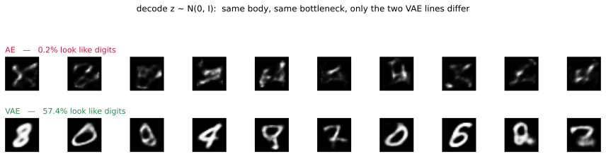
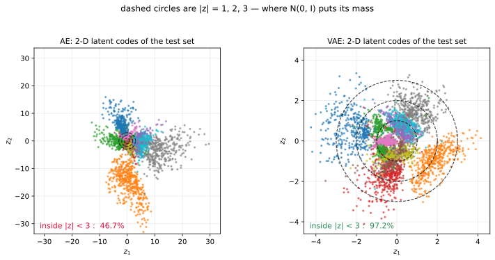
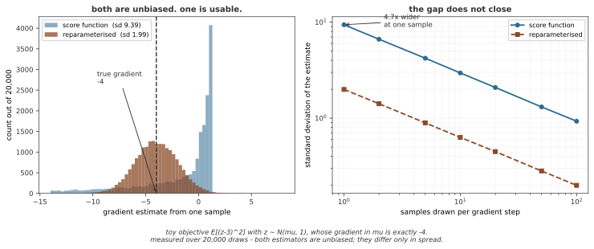

# 잠재공간 샘플링의 한계

오토인코더의 좋은 재구성은 인코더가 만든 잠재 표현에서 디코더가 원본을 복원한다는 뜻이다. 여기에 임의의 N(0,I) 잠재 표현을 넣어 좋은 새 표본을 얻는 것은 다른 문제다. 일반적인 재구성 목표는 잠재 표현 전체의 분포를 정해진 사전에 맞추지 않는다.

## 1. 재구성과 생성의 차이

재구성은 x→f(x)→g(f(x))를, 잠재 샘플링은 z∼p(z), x̃=g(z)를 사용한다. 후자의 출력 분포는 선택한 p(z)와 디코더로 정해진다. 인코더가 만드는 경험적 잠재 표현 분포와 p(z)가 다르면 디코더가 학습 중 거의 방문하지 않은 영역을 평가하게 될 수 있다.

잠재 표현의 위치·회전·척도를 바꾸고 이를 디코더에서 상쇄해도 같은 재구성을 얻을 수 있는 경우가 있다. 그러므로 좋은 복원만으로 잠재 표현 평균이 0이고 분산이 1이라고 결론 내릴 수 없다. 잠재 표현을 멀리 놓는 것이 언제나 재구성에 유리하다거나 모든 빈 구간이 나쁜 출력으로 이어진다는 법칙도 아니다.

## 2. 보존된 그림과 실험 기록

아래 그림과 표는 기존 문서에 수록된 비교 기록이다. 문서에는 16차원 잠재 표현, 20에포크와 시드 42, 정규 잠재 샘플 1,000개를 사용했다고 적혀 있다. 이 페이지에는 해당 학습·평가 코드나 체크포인트가 없어 정확한 구조·로스 정규화·분류기 보정과 전체 재현 조건을 확인할 수는 없다. 따라서 이 기록을 모든 AE·VAE의 일반적인 성능 수치로 해석하지 않는다.

| 기존 기록의 모델 | 재구성 MSE | 분류기 평균 최대 확률 | 최대 확률 >0.9 비율 |
|---|---:|---:|---:|
| 일반 AE | 0.00880 | 0.354 | 0.2% |
| VAE | 0.01379 | 0.839 | 57.4% |
| 실제 테스트 이미지 | — | 0.981 | 95.1% |

이 기록에서 AE의 MSE는 VAE보다 약 36% 낮고, 분류기의 확률이 임계를 넘은 생성 표본은 각각 2장과 574장이다. **후자의 비율은 숫자로 보이는 표본의 실제 비율이나 정답률이 아니다.** 분류기는 일반적으로 주어진 입력을 어떤 숫자 클래스로든 분류하며, 최대 확률이 높은 분포 밖 이미지도 있을 수 있다. 실제 MNIST에서의 높은 분류 정확도가 생성 표본에서의 확신도 보정을 보장하지는 않는다.

시각 검토, 클래스별 분포와 다양성·중복도, 학습 표본 유사성 등을 함께 평가해야 한다. 모든 출력이 같은 숫자여도 확신도 비율은 높을 수 있다. 한 표의 수치를 개별 학습 변경 두 줄의 인과 효과로 단정하지 않는다.

## 3. 2차원 잠재 표현 그림이 보여 주는 범위

다음은 기존 기록의 2차원 잠재 표현 요약이다. 16차원 실험과 별개의 차원 설정이며 그림이 VAE의 평균 μ(x)인지 확률적 샘플인지도 해석에 중요하다.

| 모델 | 기록된 좌표 범위 | 반지름 3 안의 잠재 표현 비율 |
|---|---|---:|
| 일반 AE | x: −15.0~30.3, y: −33.1~15.9 | 46.7% |
| VAE | x: −4.2~4.3, y: −4.2~3.6 | 97.2% |

2차원 표준정규에서 반지름 3 안의 확률은 1−exp(−9/2)≈98.89%다. 그러나 반지름 안에 얼마나 많은 **데이터 잠재 표현**가 있는지는 정규 샘플이 디코더가 잘 학습한 영역에 놓이는 확률과 같지 않다. 내부에서도 밀도·방향·빈 구간이 다를 수 있다. 높은 차원 표준정규의 전형적인 반지름은 대략 √d여서 2차원 원 그림을 16차원에 그대로 적용할 수도 없다.

VAE의 평균 잠재 표현 μ(x) 분포는 조건부 분산까지 섞은 집계 사후 q(z)=E_xq(z|x)와 다르다. 평균의 산점도나 한 개의 전체 표준편차만으로 사전 일치나 샘플 품질을 증명하지 않는다.

## 4. VAE가 바꾸는 확률 모형과 목표

VAE는 사전 p(z), 확률적 디코더 p_θ(x|z)와 근사 사후 q_φ(z|x)를 둔다. 대각 가우시안 사후라면 다음과 같이 표기한다.

$$q_\phi(z|x)=\mathcal N(\mu_\phi(x),\operatorname{diag}(\sigma_\phi^2(x))).$$

리파라메리제이션은 z=μ+σ⊙ε, ε∼N(0,I)다. 학습은 일반적으로 다음 증거 하한(ELBO)을 최대화한다.

$$\log p_\theta(x)\ge\mathbb E_{q_\phi(z|x)}[\log p_\theta(x|z)]
-D_{KL}(q_\phi(z|x)\|p(z)).$$

이 관계는 [VAE 원 논문](https://arxiv.org/abs/1312.6114)에 제시되어 있다. 복원 항은 선택한 관측 분포의 로그우도이며 임의 MSE와 항상 같은 단위는 아니다. 출력 분포·샘플링·학습 로스와 호출 계약까지 맞추어야 하므로 단순히 어느 모델에 두 줄을 더하면 모든 실험 조건이 같아지는 것은 아니다.

KL은 사후를 사전 쪽으로 제약하지만 q(z)가 p(z)와 정확히 같아지거나 잠재공간의 빈 구간이 모두 없어지는 보장은 없다. 너무 강한 제약은 입력 정보가 사라지는 사후 붕괴를 만들 수도 있다. 재구성과 샘플 품질의 절충은 모델·학습·평가에 따라 확인해야 한다.

**그림으로 보는 AI 1.** 리파라메리제이션은 멋이 아니라 어쩔 수 없어서다

위에 적힌 z=μ+σ⊙ε를 처음 보면 쓸데없이 돌아가는 것처럼 보인다. 그냥 q(z|x)에서 z를 뽑으면 될 일을 왜 ε를 따로 뽑아 더하는가. 2013년에 디데릭 킹마(Diederik Kingma)와 막스 벨링(Max Welling)이 이 식을 내놓은 까닭은 **곧바로 가는 길이 막혀 있었기** 때문이다.

뽑기 자체를 미분할 수는 없지만, 미분을 **기댓값 안으로** 옮기는 고전적인 방법은 있다. 점수함수 항등식이라 하는 것으로, $\nabla_\phi\mathbb E_{q_\phi}[f(z)]=\mathbb E_{q_\phi}[f(z)\nabla_\phi\log q_\phi(z)]$ 이다. 수학은 맞다. 논문이 이것을 두고 한 말은 짧다 — "This gradient estimator exhibits very high variance ... and is **impractical for our purposes**."

얼마나 넓은지는 재어 보면 된다.

참값이 정확히 −4인 장난감 목적함수에서 표본 하나로 그래디언트를 어림하면, 점수함수 쪽은 표준편차가 **9.39**이고 리파라메리제이션 쪽은 **1.99**다. 둘 다 치우침은 없다 — 2만 번 평균이 −3.96과 −3.99로 모두 −4 둘레다. 다른 것은 **흔들림의 폭**뿐이고, 참값이 −4인데 한 번 뽑아 +1이 나오는 일이 예사라면 그 방향으로 걸을 수가 없다. 표본을 늘려도 두 선은 나란히 내려갈 뿐 간격이 좁아지지 않는다.

**그러니 이 식은 분포를 바꾸지 않는다.** 바꾼 것은 **어디에 무작위를 두느냐**다. ε를 파라미터 바깥으로 빼내면 μ와 σ에 대한 미분이 보통의 역전파로 흘러간다. 그리고 이것이 고쳐 주는 것은 거기까지다 — 위 문단이 적어 둔 사후 붕괴도, q(z)와 p(z)가 어긋나 생기는 빈 구간도 이 식이 없애 주지 않는다. 1절이 말한 "좋은 복원만으로 잠재 표현이 N(0,I)라고 할 수 없다"는 문제를 푸는 것은 KL 항이지 리파라메리제이션이 아니다.

_확인한 곳 — D. P. Kingma, M. Welling, "Auto-Encoding Variational Bayes", arXiv:1312.6114. 인용한 구절은 2.1절 끝이다. 그림의 수는 그림을 그리는 코드가 두 추정량을 각각 2만 번 뽑아 직접 잰 것이다._

## 5. 학습 뒤 잠재 표현 분포를 모델링하는 방법

AE 잠재 표현을 수집해 가우시안·혼합모형·흐름·다른 잠재 생성 모델을 적합하고 디코더와 결합할 수도 있다. 단일 가우시안은 다봉 분포의 빈 영역에 확률을 둘 수 있지만 항상 부적절하거나 혼합 성분 수를 클래스 수로 정하면 최선이라는 규칙은 없다. 검증 데이터로 밀도와 생성 품질을 평가한다.

잠재 분포와 결정적 디코더는 적어도 출력의 확률 법칙을 정의하므로 생성 모형의 일부가 될 수 있다. 다만 입력 공간의 보통 밀도가 존재하는지, 그 우도를 계산할 수 있는지는 별개다. 저차원 결정적 디코더의 출력은 고차원 공간에서 특이한 분포일 수 있다. 명시적인 관측 잡음·확률적 디코더 등을 두면 모델과 평가가 달라진다.

보간이나 잠재 표현 주변 잡음도 탐색에 사용할 수 있지만 새롭고 다양한 표본을 보장하지 않는다. 데이터 잠재 표현 재사용은 주로 재구성·재표집이며, 중간 잠재 표현이 매끄럽게 디코딩된다는 것과 그 분포가 실제 데이터와 같다는 것은 다르다. 일반 AE만으로 정규 사전 샘플링이 보장되지 않는다는 한계를 모든 AE 기반 생성이 불가능하다는 주장으로 확대하지 않는다.

## 연습문제

**연습문제 1.** 
좋은 재구성이 N(0,I) 잠재 샘플의 품질을 보장하지 않는 이유를 설명하라.

??? success "풀이"

    재구성은 인코더가 실제 만든 잠재 표현에서 평가하고 임의 정규 샘플은 다른 영역을 방문할 수 있다. 일반 AE 로스는 잠재 표현 분포를 정규 사전과 맞추지 않는다. 반면 VAE는 확률 모형과 KL 제약을 함께 두지만 좋은 생성이나 사전 일치가 자동으로 완성되는 것은 아니다.

---

**연습문제 2.** 
학습 잠재 표현 재표집과 두 잠재 표현 사이 보간을 구분하라.

??? success "풀이"

    학습 잠재 표현 자체를 디코딩하면 기존 표본의 복원에 가깝다. 보간은 새로운 좌표를 방문하지만 데이터가 드문 구간을 지날 수 있어 좋은 중간 표본을 보장하지 않는다. VAE에서도 KL만으로 모든 보간이 의미 있거나 속성이 분리된다고 결론 내리지 않는다.

---

**연습문제 3.** 
잠재 표현을 16차원에서 2차원으로 줄이면 정규 샘플 품질이 반드시 나아지는가?

??? success "풀이"

    아니다. 잠재 차원 감소가 정규 사전과의 척도·밀도 일치를 강제하지 않는다. 재구성·샘플 품질이 모두 구조·학습에 따라 달라질 수 있다. 같은 조건에서 다시 평가해야 하며 2차원 반지름 안의 데이터 비율로 16차원 샘플 성공률을 추정할 수 없다.

---

**연습문제 4.** 
학습 뒤 잠재 가우시안을 적합한 AE가 확률 모형을 전혀 정의하지 않는다는 주장은 맞는가?

??? success "풀이"

    잠재 분포와 디코더를 결합하면 출력 확률 법칙은 정의된다. 다만 일반 고차원 입력에 대한 밀도·계산 가능한 우도가 반드시 생기는 것은 아니다. 결정적 저차원 사상, 관측 잡음과 가역성 등을 구분한다. 사후 잠재 표현 모델도 유효한 선택지이며 검증해야 한다.

---

**연습문제 5.** 
단일 가우시안과 혼합모형으로 잠재 표현을 적합할 때 성능 순위를 미리 단정할 수 있는가?

??? success "풀이"

    없다. 잠재 표현이 단봉인지 다봉인지와 표본 수·정규화·과적합에 따라 달라진다. 성분 수를 숫자 클래스 수로 정할 근거도 별도로 필요하다. 보류 잠재 표현의 적합과 생성 품질·다양성을 비교하고 특정 VAE보다 항상 나쁘거나 좋다고 일반화하지 않는다.

---

**연습문제 6.** 
분류기 최대 확률 >0.9 비율의 장점과 한계를 설명하라.

??? success "풀이"

    같은 분류기로 비교 가능한 수치를 만들지만 실제 숫자 유효률이나 생성 정확도는 아니다. 분포 밖 입력에 과신할 수 있고 한 클래스 반복도 높은 값을 낼 수 있다. 사람 검토, 다양성과 중복·학습 표본 유사성 등 보조 평가가 필요하다.

---

**연습문제 7.** 
2차원에서 반지름 3 안의 잠재 표현 비율만으로 사전 일치를 판정할 수 없는 이유를 설명하라.

??? success "풀이"

    반지름 구간 하나의 질량만 같아도 각도·밀도·다봉 구조는 다를 수 있다. 데이터 잠재 표현 비율과 사전 샘플의 좋은 영역 방문 확률은 다른 양이다. VAE 평균 μ와 집계 사후 샘플도 구분한다. 표준정규의 반지름 분포는 차원에 따라 달라진다.

---

**연습문제 8.** 
ELBO가 제공하는 평가와 샘플 품질 지표의 관계를 설명하라.

??? success "풀이"

    VAE는 관측 분포와 사전을 둔 모델의 로그우도에 대한 하한을 최적화한다. ELBO는 추론 근사 차이도 포함하므로 서로 다른 모델의 참 우도와 같지 않다. 높은 우도·하한이 사람의 시각 품질과 다양성을 완벽히 요약하지도 않는다. 일반 AE도 복원 외 후속 태스크와 샘플 지표를 평가할 수 있다.

---

**연습문제 9.** 
AE·VAE 비교에서 같은 병목과 에포크만 맞추면 변경 원인이 완전히 통제되는가?

??? success "풀이"

    아니다. 확률 파라미터 출력으로 파라미터 수가 달라질 수 있고 관측 분포·복원 합산·KL 무게·초기값·평가 샘플링도 영향을 준다. 실제 구조와 학습 예산, 평가 모드·시드와 여러 실행 변동을 기록해야 한다. 두 변경이 같이 있으면 각 효과 분리에는 추가 비교가 필요하다.

---

**연습문제 10.** 
일반 AE를 사용한 생성에서 가능한 접근과 보장되지 않는 점을 설명하라.

??? success "풀이"

    보간·잠재 표현 주변 오염·사후 잠재 밀도 적합과 디코더 결합을 사용할 수 있다. 새로움·다양성·품질은 별도 검증해야 한다. VAE도 잠재 표현 분포의 모든 빈 영역을 없애거나 좋은 표본을 보장하지 않으므로 확률 목표와 실제 결과를 구분한다.

## 정리하며

일반 AE의 재구성 목표는 임의 정규 잠재 샘플의 품질을 보장하지 않는다. 기존 비교 기록의 분류기 확신도와 실제 샘플 유효률, 평균 잠재 표현과 집계 사후를 구분해야 한다. VAE와 사후 잠재 모델링은 서로 다른 확률적 접근이며 품질·다양성·재구성과 비용을 함께 검증한다.
