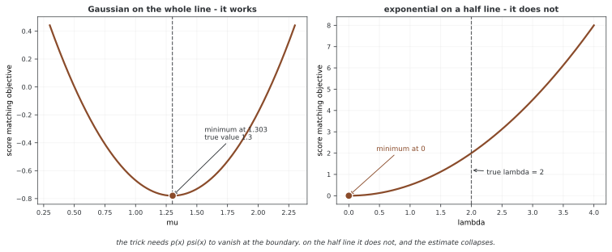

# 에너지 모델의 스코어 매칭

연속 입력의 로그 밀도를 미분하면 정규화 상수가 사라진다. 스코어 매칭은 이 성질을 이용해 분배 함수를 직접 계산하지 않고 입력 그래디언트를 학습한다. 에너지의 부호, trace 항의 계수와 엑티베이션 함수의 매끄러움이 수학적 목적과 맞아야 한다. 이 예제에는 그 조건과 다른 부분이 있다.

## 1. 에너지와 로그 밀도 그래디언트

온도 1의 pθ(x)∝exp(−Eθ(x))에서는 sθ=−∇Eθ다. [스코어 매칭](https://www.jmlr.org/papers/v6/hyvarinen05a.html)의 피셔 목적 0.5Eₚ||sθ−∇log p||²에 부분적분을 적용하면 θ와 무관한 항을 제외하고 다음을 얻는다.

$$J(\theta)=\mathbb E_p\left[\frac12\|s_\theta(x)\|^2+
\nabla_x\cdot s_\theta(x)\right]
=\mathbb E_p\left[\frac12\|\nabla_xE_\theta(x)\|^2-\Delta E_\theta(x)\right]$$

경계 항이 사라지고 미분·적분이 잘 정의되는 조건이 필요하다. 오른쪽 목적은 상수항을 뺐으므로 최적점의 값이 반드시 0일 필요는 없다. 원래 피셔 발산과 학습용 목적의 숫자를 구분한다.

<div class="storybox" markdown>

**그림으로 보는 AI 1.** 사라지는 것이 둘인데, 둘째가 진짜 수다

위 식에서 분배 함수 $Z$ 가 사라지는 것은 그리 놀랍지 않다. $\log$ 를 $x$ 로 미분하면 $x$ 와 무관한 상수는 당연히 죽는다. 이 방법이 쓸모 있게 된 것은 **둘째로 사라지는 것** 때문이다.

목적을 세울 때 우리가 맞추려는 상대는 $\nabla_x \log p_{\text{data}}$ 인데, 그것은 **우리가 모르는 것**이다. 2005년 아포 휘바리넨(Aapo Hyvärinen)이 《JMLR》에 낸 글도 그 곤란을 먼저 적는다 — 자료 스코어를 추정하는 일은 "basically a non-parametric estimation problem"이라고. 그리고 바로 뒤집는다. **"However, no such non-parametric estimation is needed."** 부분적분을 한 번 하면 모르는 항이 통째로 사라지고, 남는 것은 모델만으로 셈할 수 있는 양이다. 논문은 이것을 "the remarkable fact"라 부른다.

**다만 부분적분에는 값이 있다.** 경계항이 0이어야 한다는 조건이고, 위 문단이 "경계 항이 사라지고"라고 적은 그 한 줄이다. 논문에서는 각주 하나로 들어가 있다 — $p(\xi)\psi(\xi;\theta)$ 가 $\lVert\xi\rVert\to\infty$ 에서 0으로 가야 한다는 조건이다. 각주로 적혀 있다고 사소한 것은 아니다.



왼쪽은 조건이 맞는 경우다. 실수 전체의 가우시안에서 스코어 매칭 목적을 그려 보면 최소가 **1.303**, 참값 1.3과 맞는다. $Z$ 를 한 번도 건드리지 않고 얻은 값이다.

오른쪽은 조건이 깨지는 경우다. 반직선 위의 지수분포에서는 스코어가 $-\lambda$ 로 상수라 목적이 $\tfrac12\lambda^2$ 이 되고, **단조증가한다.** 최소는 $\lambda=0$ 이다. 참값이 2인데 추정은 0으로 무너진다 — 조금 틀리는 것이 아니라 분포 자체를 지워 버리는 답이다. 까닭은 $y=0$ 에서 $p\psi$ 가 $-4$ 로 0이 아니기 때문이다. 경계가 생기자 부분적분이 버린 항이 돌아온 것이다.

**그러니 "스코어 매칭은 $Z$ 를 피한다"는 요약은 절반만 맞다.** 피한 것은 $Z$ 이고, 대신 **정의역의 모양에 대한 조건**을 떠안았다. 이 쪽 3절과 5절이 코드의 부호·계수·매끄러움을 따로 따지는 까닭도 같은 자리에 있다 — 식이 성립하는 조건과 코드가 실제로 셈하는 양은 따로 확인해야 한다.

_확인한 곳 — A. Hyvärinen, "Estimation of Non-Normalized Statistical Models by Score Matching", *Journal of Machine Learning Research* **6**, 695–709 (2005). 인용한 두 문장과 "the remarkable fact"는 2절의 것이고, 경계 조건은 정리 1 에 딸린 각주 1 이다. 그림의 수는 그림을 그리는 코드가 직접 셈한다._

</div>

## 2. 코드와 보존된 출력

```python
"""
에너지 바탕 모델 익히기를 위한 점수 맞추기
============================================

점수 맞추기는 힘 바탕 모델을 익힐 때 최대가능도를 대신하는 길이다.
다룰 수 없는 나눔 함수를 피한다. 점수는 로그 확률의 그래디언트이다.

학습 목표:
-------------------
1. 점수 함수와 그 성질을 이해한다
2. 점수 맞추기 목표를 짠다
3. 잡음 없애는 점수 맞추기를 배운다
4. 최대 가능도와 견준다
5. 이어진 자료 분포에 쓴다

핵심 개념:
------------
- Score: ∇ₓ log p(x) = -∇ₓ E(x) / T
- 점수 맞추기: min E_p[(∇ₓ log p(x) - ∇ₓ log q(x))²]
- 잡음 없애는 점수 맞추기: 쓸모 있는 어림
- 나눔 함수를 셈할 필요가 없다

걸리는 시간: 90~120분
미리 알아 둘 것: 1~5단원, 미적분(그래디언트)
"""

import numpy as np
import torch
import torch.nn as nn
import torch.nn.functional as F
import matplotlib.pyplot as plt
from torch.utils.data import DataLoader, TensorDataset

# ========================================================================
# 메인
# ========================================================================

torch.manual_seed(42)


class EnergyNetwork(nn.Module):
    """점수 맞추기를 위해 에너지를 내놓는 뉴럴 넷트웍."""
    
    def __init__(self, input_dim=2, hidden_dim=128):
        super().__init__()
        self.net = nn.Sequential(
            nn.Linear(input_dim, hidden_dim),
            nn.ReLU(),
            nn.Linear(hidden_dim, hidden_dim),
            nn.ReLU(),
            nn.Linear(hidden_dim, 1)
        )
    
    def forward(self, x):
        return self.net(x).squeeze()


def score_matching_loss(energy_net, x):
    """
    점수 맞추기 로스를 셈한다.
    
    L = ½ E[‖∇ₓ E(x)‖² + 2 Tr(∇²ₓ E(x))]
    
    이는 나눔 함수를 셈하지 않아도 되게 한다!
    """
    x = x.requires_grad_(True)
    
    # 에너지를 셈한다
    energy = energy_net(x)
    
    # 점수(에너지의 그래디언트)를 셈한다
    score = torch.autograd.grad(
        outputs=energy.sum(),
        inputs=x,
        create_graph=True
    )[0]
    
    # 첫 항: ‖∇E‖²
    score_norm = (score ** 2).sum(dim=1).mean()
    
    # 둘째 항: Tr(∇²E) - 헤세의 대각합
    trace = 0
    for i in range(x.shape[1]):
        grad2 = torch.autograd.grad(
            outputs=score[:, i].sum(),
            inputs=x,
            create_graph=True
        )[0]
        trace += grad2[:, i]
    
    trace_term = 2 * trace.mean()
    
    return 0.5 * score_norm + trace_term


def denoising_score_matching_loss(energy_net, x, noise_std=0.1):
    """
    잡음 없애는 점수 맞추기: 온전한 점수 맞추기보다 셈하기 쉽다.
    
    Add noise: x̃ = x + ε, ε ~ N(0, σ²I)
    Loss: E[‖∇ₓ̃ E(x̃) + (x̃ - x)/σ²‖²]
    """
    # 가우스 잡음을 더한다
    noise = torch.randn_like(x) * noise_std
    x_noisy = x + noise
    x_noisy = x_noisy.requires_grad_(True)
    
    # 에너지와 그 그래디언트를 셈한다
    energy = energy_net(x_noisy)
    score = torch.autograd.grad(
        outputs=energy.sum(),
        inputs=x_noisy,
        create_graph=True
    )[0]
    
    # 목표 점수: -(x̃ - x)/σ²
    target_score = -noise / (noise_std ** 2)
    
    # 헤아린 점수와 목표 점수의 평균 제곱 어긋남
    loss = ((score - target_score) ** 2).sum(dim=1).mean()
    
    return loss


def train_score_matching_2d():
    """점수 맞추기로 2차원 정규 분포 섞기에서 에너지 바탕 모델을 익힌다."""
    print("\n" + "="*70)
    print("SCORE MATCHING TRAINING (2D Example)")
    print("="*70)
    
    # 2차원 정규 분포 섞기를 만든다
    n_samples = 5000
    means = [torch.tensor([-2., -2.]), torch.tensor([2., 2.]), 
             torch.tensor([-2., 2.])]
    
    samples = []
    for _ in range(n_samples):
        mean = means[np.random.choice(len(means))]
        sample = mean + torch.randn(2) * 0.5
        samples.append(sample)
    
    data = torch.stack(samples)
    print(f"Generated {n_samples} samples from 3-component mixture")
    
    # 에너지 뉴럴 넷트웍을 만든다
    energy_net = EnergyNetwork(input_dim=2, hidden_dim=64)
    optimizer = torch.optim.Adam(energy_net.parameters(), lr=0.001)
    
    # 학습
    n_epochs = 1000
    batch_size = 128
    dataset = TensorDataset(data)
    loader = DataLoader(dataset, batch_size=batch_size, shuffle=True)
    
    losses = []
    
    for epoch in range(n_epochs):
        epoch_loss = 0
        for (batch_x,) in loader:
            optimizer.zero_grad()
            
            # 잡음 없애는 점수 맞추기를 쓴다(셈하기 쉽다)
            loss = denoising_score_matching_loss(energy_net, batch_x, noise_std=0.5)
            
            loss.backward()
            optimizer.step()
            epoch_loss += loss.item()
        
        losses.append(epoch_loss / len(loader))
        
        if (epoch + 1) % 100 == 0:
            print(f"Epoch {epoch+1}/{n_epochs}, Loss: {losses[-1]:.4f}")
    
    print("\n✓ Score matching training complete")
    return energy_net


def main():
    print("="*70)
    print("SCORE MATCHING FOR ENERGY-BASED MODELS")
    print("="*70)
    
    train_score_matching_2d()
    
    print("\n" + "="*70)
    print("MODULE COMPLETE")
    print("="*70)
    print("\nKey Takeaways:")
    print("  ✓ Score matching avoids partition function")
    print("  ✓ Denoising score matching is practical")
    print("  ✓ Connection to diffusion models")
    print("\nNext: 07_neural_ebms.py")


if __name__ == "__main__":
    main()
```

```
======================================================================
SCORE MATCHING FOR ENERGY-BASED MODELS
======================================================================

======================================================================
SCORE MATCHING TRAINING (2D Example)
======================================================================
Generated 5000 samples from 3-component mixture
Epoch 100/1000, Loss: 6.2046
Epoch 200/1000, Loss: 6.0045
Epoch 300/1000, Loss: 5.9700
Epoch 400/1000, Loss: 5.9069
Epoch 500/1000, Loss: 6.1397
Epoch 600/1000, Loss: 5.8569
Epoch 700/1000, Loss: 6.1200
Epoch 800/1000, Loss: 5.8966
Epoch 900/1000, Loss: 5.9559
Epoch 1000/1000, Loss: 6.1142

✓ Score matching training complete

======================================================================
MODULE COMPLETE
======================================================================

Key Takeaways:
  ✓ Score matching avoids partition function
  ✓ Denoising score matching is practical
  ✓ Connection to diffusion models

Next: 07_neural_ebms.py
```

score_matching_loss는 score라는 변수에 **+∇E**를 넣고 0.5||∇E||²+2ΔE를 반환한다. exp(−E)의 올바른 목적은 0.5||∇E||²−ΔE다. 만약 E를 에너지 대신 로그 밀도의 비정규화 potential로 해석해 exp(+E)를 쓰더라도 trace 계수는 +1이어야 하므로 이 함수의 +2와 일치하지 않는다.

실제 main이 호출하는 것은 이 함수가 아니라 denoising_score_matching_loss다. 따라서 출력 로스는 위의 명시적 trace 로스를 실행한 기록이 아니다.

## 3. DSM 목표와 부호 문제

노이즈 η∼N(0,σ²I)를 더한 y=x+η에서 조건부 노이즈 목표는 −η/σ²다. 이 코드처럼 noise에 이미 σ가 곱해져 있으면 −noise/σ²가 올바른 조건부 목표다. 제곱 로스의 최적 예측은 목표의 조건부 평균인 ∇log pσ(y)다. 개별 목표가 곧 주변 스코어인 것은 아니다.

그러나 denoising_score_matching_loss도 **+∇E**를 이 목표에 맞춘다. 따라서 학습된 E를 exp(−E)의 에너지로 쓰면 스코어 방향이 뒤집힌다. +∇E를 스코어로 해석하려면 E를 로그 potential로 보고 exp(+E)의 정규화 가능성을 따로 확인해야 한다. 변수 이름만으로 두 관례를 섞지 않는다.

이 에너지 네트워크에는 ReLU가 있다. 입력 그래디언트는 구간별 상수이며 Hessian은 kink를 제외하면 0이다. 자동 미분의 이차 미분만 사용한 결과를 매끄러운 밀도에 대한 원래 스코어 매칭 정리와 동일시할 수 없다. 명시적 로스는 trace가 거의 어디서나 사라져 그래디언트를 0으로 줄이는 쪽으로 기울 수 있다. DSM도 매끄러운 스코어 근사의 표현력과 학습 성질을 별도로 고려해야 한다.

DSM이 trace 계산을 없애더라도 에너지를 미분해 스코어를 만들면 학습에는 입력·파라미터의 혼합 미분이 필요하다. create_graph=True가 그 경로를 유지한다. “이계 미분이 전혀 필요 없다”는 설명은 직접 스코어 네트워크를 쓰는 경우와 구분해야 한다.

## 4. 실제 학습 설정

데이터는 중심 (−2,−2), (2,2), (−2,2)의 가우스 성분을 균등하게 선택해 5,000개를 만든다. 각 성분의 원래 공분산은 0.25I다. 여기에 σ=0.5의 DSM 노이즈를 추가하므로 학습 목표의 주변분포 성분 공분산은 0.5I가 된다.

모델은 2→64→64→1의 ReLU MLP로 4,417개 파라미터다. 배치 128에서 39개 전체 배치와 마지막 8개를 사용하므로 에포크당 40번, 1,000에포크에서 40,000번 업데이트한다. 기록값은 배치별 평균을 다시 같은 비중으로 평균해 마지막 배치의 샘플 수 웨이트가 다르다.

torch 시드는 설정하지만 성분 선택에 쓰는 NumPy 난수 시드는 설정하지 않는다. 따라서 이 파일만으로 같은 데이터·전체 학습을 재현한다고 단정할 수 없다. 에너지의 출력 상수는 입력 미분에서 사라져 스코어 로스로 식별되지 않는다. 학습 후 샘플링·밀도 정규화·테스트 평가도 구현되어 있지 않다.

## 5. SSM 코드의 방향과 스케일

연습문제의 SSM 함수도 +∇E를 사용한다. 투영 v는 표준정규를 뽑은 뒤 단위 길이로 정규화해 E[vvᵀ]=I/d다. 이때 평균 목적은 exp(+E) 관례의 스코어 매칭 목적을 **1/d배**한 양이며, 원래 차원 스케일의 불편 추정이라고 바로 부를 수 없다.

코드는 vᵀ∇E를 입력으로 미분해 Hessian과 방향의 곱을 얻고 다시 v와 내적한다. 방향 수 M은 추가 미분 호출 수를 조절하지만 각 호출의 비용과 메모리는 입력 차원·모델에 의존한다. 전체 계산이 차원에 대해 O(1)이라는 뜻은 아니다. n_projections는 양수여야 한다.

## 연습문제

<div class="drillbox" markdown>

**연습문제 1.** <span class="diff hard" title="어려움"></span>
정규 데이터 N(μ,σ²)와 일치하는 에너지 E=(x−μ)²/(2σ²)의 스코어를 구하라. 원래 피셔 목적과 상수를 뺀 스코어 매칭 목적의 최적값은 같은가?

</div>

??? success "풀이"

    스코어는 −(x−μ)/σ²다. 정답 스코어와 같으므로 원래 피셔 목적은 0이다. 반면 0.5E[(E′)²]−E[E″]=1/(2σ²)−1/σ²=−1/(2σ²)다. 이는 제거한 데이터 전용 상수 차이이며 음수라고 잘못된 목적은 아니다. 코드의 +∇E·+2trace 식과 구분해야 한다.


---

<div class="drillbox" markdown>

**연습문제 2.** <span class="diff med" title="중간"></span>
이 DSM 예제가 학습하려는 분포와 σ→0에 대한 해석을 설명하라.

</div>

??? success "풀이"

    각 성분의 원래 공분산 0.25I에 노이즈 공분산 0.25I를 더한 혼합분포 pσ의 스코어를 목표로 한다. 개별 목표 −η/σ²의 조건부 평균이 주변 스코어다. σ→0에서의 스코어 수렴은 밀도·매끄러움 등의 조건이 필요하며 일반적인 불연속·이산 분포에는 바로 적용되지 않는다. η의 표준편차가 σ라 목표의 전형적 크기는 1/σ이고, 원시 DSM 로스 자체가 명시적 SM 로스 값으로 수렴한다고 단정할 수 없다. 현재 코드는 +∇E를 맞추므로 exp(−E) 에너지의 부호와는 반대다.


---

<div class="drillbox" markdown>

**연습문제 3.** <span class="diff hard" title="어려움"></span>
아래 SSM 함수의 에너지 부호·방향 공분산과 계산 비용을 검토하라.

</div>

??? success "풀이"

    score는 +∇E이므로 exp(+E) potential 관례다. exp(−E)의 스코어라면 음의 그래디언트를 써야 한다. 정규화한 방향은 E[vvᵀ]=I/d여서 평균 목적이 1/d배이며, I 공분산을 원하면 방향을 √d배 하거나 목적 전체의 스케일을 맞춘다. M개 방향은 M회 추가 방향 미분을 요구하지만 개별 비용이 차원과 무관하지는 않다. 에너지 기반 DSM도 입력·파라미터 혼합 미분을 사용한다. ReLU Hessian이 거의 어디서나 0인 문제와 매끄러운 SM 정리의 조건도 별도로 고려해야 한다.

    ```python
    def sliced_score_matching_loss(energy_net, x, n_projections=1):
        x = x.requires_grad_(True)
        energy = energy_net(x)
        score = torch.autograd.grad(
            energy.sum(), x, create_graph=True
        )[0]
        
        loss = 0
        for _ in range(n_projections):
            v = torch.randn_like(x)
            v = v / v.norm(dim=1, keepdim=True)
            
            # v^T 점수
            vT_score = (v * score).sum(dim=1)
            
            # v^T 점수의 이계 미분으로 얻은 v^T H v
            grad_vT_score = torch.autograd.grad(
                vT_score.sum(), x, create_graph=True
            )[0]
            vT_Hv = (v * grad_vT_score).sum(dim=1)
            
            loss += (0.5 * vT_score**2 + vT_Hv).mean()
        
        return loss / n_projections
    ```


## 정리하며

스코어 매칭은 입력 미분에서 Z를 제거하지만 에너지의 부호와 trace 계수·정규성 조건을 일치시켜야 한다. 이 코드는 +∇E를 DSM 목표에 맞추며 명시적 SM의 trace 계수도 표준식과 다르다. 노이즈 주변분포와 방향 정규화의 스케일, 실제 학습·평가 범위를 구분한다.
