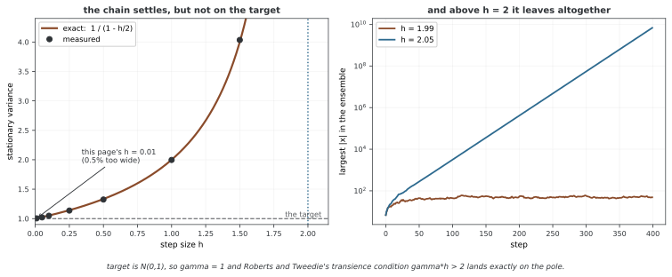

# 뉴럴 넷트웍 에너지 기반 모델

연속 이미지에 에너지를 부여하는 뉴럴 넷트웍을 만들면 그 입력 그래디언트로 샘플을 이동시킬 수 있다. 학습에서는 실제 데이터와 이동시킨 음의 샘플의 에너지 차이를 사용한다. 이 예제의 짧은 샘플링 사슬이 어떤 온도와 분포를 가정하는지 살펴보아야 학습을 정확한 최대 우도로 과장하지 않을 수 있다.

## 1. 코드

```python
"""
뉴럴 넷트웍 에너지 바탕 모델: 에너지 함수를 위한 깊은 러닝
============================================================

요즘 에너지 바탕 모델은 깊은 뉴럴 넷트웍을 너그러운 에너지 함수로 쓴다.
이 단원은 익히기 재주, 랑주뱅 액션, 그림 만들어 내기를 다룬다.

걸리는 시간: 120~150분
미리 알 것: 단원 01-06, 깊은 러닝 바탕
"""

import torch
import torch.nn as nn
import torch.nn.functional as F
from torchvision import datasets, transforms
from torch.utils.data import DataLoader
import matplotlib.pyplot as plt
import numpy as np

# ========================================================================
# 메인
# ========================================================================

class ConvEnergyNetwork(nn.Module):
    """그림 에너지를 위한 겹말기 뉴럴 넷트웍."""
    
    def __init__(self):
        super().__init__()
        self.conv = nn.Sequential(
            nn.Conv2d(1, 64, 3, 1, 1),
            nn.SiLU(),
            nn.Conv2d(64, 128, 4, 2, 1),  # 14x14
            nn.SiLU(),
            nn.Conv2d(128, 256, 4, 2, 1),  # 7x7
            nn.SiLU(),
        )
        self.fc = nn.Sequential(
            nn.Flatten(),
            nn.Linear(256 * 7 * 7, 512),
            nn.SiLU(),
            nn.Linear(512, 1)
        )
    
    def forward(self, x):
        x = self.conv(x)
        return self.fc(x).squeeze()


def langevin_dynamics(energy_net, x_init, n_steps=100, step_size=0.01, noise_scale=0.005):
    """
    랑주뱅 액션으로 뽑는다: x ← x - ε∇E(x) + √(2ε)ξ
    """
    x = x_init.clone().requires_grad_(True)
    
    for _ in range(n_steps):
        energy = energy_net(x).sum()
        grad = torch.autograd.grad(energy, x)[0]
        
        noise = torch.randn_like(x) * noise_scale
        x = x.data - step_size * grad + noise
        x = x.requires_grad_(True)
    
    return x.detach()


def train_neural_ebm():
    """MNIST으로 뉴럴 넷트웍 에너지 바탕 모델을 익힌다."""
    print("Training Neural EBM on MNIST...")
    
    # 데이터를 불러온다
    transform = transforms.ToTensor()
    train_data = datasets.MNIST(root='./data', train=True, download=True, transform=transform)
    loader = DataLoader(train_data, batch_size=64, shuffle=True)
    
    # 모델 생성
    energy_net = ConvEnergyNetwork()
    optimizer = torch.optim.Adam(energy_net.parameters(), lr=0.0001)
    
    # 익히기 되풀이(단순하게)
    n_epochs = 2
    for epoch in range(n_epochs):
        for batch_idx, (data, _) in enumerate(loader):
            if batch_idx > 50:  # Quick demo
                break
            
            # 양의 표본(자료)
            pos_energy = energy_net(data).mean()
            
            # 음의 표본(랑주뱅으로)
            neg_samples = torch.rand_like(data)
            neg_samples = langevin_dynamics(energy_net, neg_samples, n_steps=20)
            neg_energy = energy_net(neg_samples).mean()
            
            # 대조 로스
            loss = pos_energy - neg_energy
            
            optimizer.zero_grad()
            loss.backward()
            optimizer.step()
            
            if batch_idx % 10 == 0:
                print(f"Epoch {epoch}, Batch {batch_idx}, Loss: {loss.item():.4f}")
    
    print("✓ Neural EBM training complete")
    return energy_net


def main():
    print("="*70)
    print("NEURAL ENERGY-BASED MODELS")
    print("="*70)
    
    train_neural_ebm()
    
    print("\nKey Takeaways:")
    print("  ✓ Deep networks as flexible energy functions")
    print("  ✓ Langevin dynamics for sampling")
    print("  ✓ Modern EBM architectures")


if __name__ == "__main__":
    main()
```

## 2. CNN의 에너지 출력

입력은 B×1×28×28이다. 컨볼루션 경로는 64×28×28→128×14×14→256×7×7이고, 펼친 12,544차원 피처를 512차원을 거쳐 스칼라로 바꾼다. 해상도를 바꾸면 고정된 첫 Linear 입력 크기도 함께 검토해야 한다.

forward의 squeeze는 배치 크기까지 제거할 수 있다. B>1에서는 길이 B 벡터지만 B=1이면 스칼라다. 현재 학습 코드의 mean·sum은 이를 처리하지만, 일반적인 관측치별 출력 인터페이스로 연결할 때는 반환 모양을 확인한다.

pθ(x)∝exp(−Eθ(x))를 정의하려면 Z가 유한해야 한다. 임의의 CNN 출력만으로 Rᵈ 전체에서 적분 가능성이 보장되지는 않는다. 유계 이미지 영역을 모델 공간으로 삼으려면 그 영역과 경계에서의 샘플링 처리도 정의해야 한다.

## 3. 랑주뱅 계수의 대응

단위 온도에서 연속시간 랑주뱅 SDE는 dX=−∇E(X)dt+√2dW다. 오일러 이산화의 스텝 h에서는 다음을 사용한다.

$$x_{k+1}=x_k-h\nabla E(x_k)+\sqrt{2h}\xi_k,
\qquad\xi_k\sim\mathcal N(0,I)$$

코드의 기본 h=0.01에 대응하는 노이즈 표준편차는 √0.02≈0.1414다. 실제 noise_scale=0.005는 이보다 훨씬 작다. drift가 같은 연속시간 해석에서는 유효 온도가 noise_scale²/(2h)=0.00125이며, 단위 온도의 exp(−E)를 목표로 하는 계수가 아니다. 유한 이산화의 추가 바이어스도 있으므로 exp(−E/0.00125)의 정확한 표본이라고 단정하지도 않는다.

각 단계에서 이전 상태의 그래프를 끊어 전체 20단계에 역전파하지 않는다. 반환 샘플도 detach하므로 에너지 차이 학습에서 사슬의 파라미터 의존성을 미분하지 않는다. 이는 음의 샘플을 고정해 모델 통계를 근사하는 방식이다.

<div class="storybox" markdown>

**그림으로 보는 AI 1.** 연속시간에서 참인 것이 이산화에서도 참은 아니다

위 문단이 "유한 이산화의 추가 바이어스도 있다"고 한 줄로 덮어 둔 그 바이어스는, 목표가 가우시안이면 **닫힌 식으로 적을 수 있다.**

$E(x)=x^2/2$ 로 두면 위 갱신식은 $x_{k+1}=(1-h)x_k+\sqrt{2h}\,\xi_k$ 가 되어 AR(1)이고, 정상분포의 분산은 이렇게 나온다.

$$\operatorname{Var}_\infty = \frac{2h}{1-(1-h)^2} = \frac{1}{1-h/2}$$

$h\to0$ 이면 1로 가므로 연속시간 극한에서는 옳다. 그런데 **어떤 $h>0$ 에서도 1보다 크다.** 사슬은 멈추기는 하는데 목표보다 늘 조금 넓은 곳에 멈춘다.



이 쪽의 기본값 $h=0.01$ 에서는 0.5%다 — 걱정할 양이 아니다. 하지만 $h=1$ 이면 분산이 **두 배**가 되고, $h=2$ 에서 식이 아예 터진다. 오른쪽 그림이 그 자리를 보여 준다. $h=1.99$ 로는 사슬이 머무는데 $h=2.05$ 로는 400걸음 만에 $10^{10}$ 으로 달아난다.

그 경계는 우연이 아니다. 1996년에 개러스 로버츠(Gareth Roberts)와 리처드 트위디(Richard Tweedie)가 《베르누이》에 실은 글이 바로 이것을 다뤘다. 연속시간 확산은 얌전한데 **오일러 이산화는 그 성질을 물려받지 못한다**는 것이고, 그들의 표현으로는 "quite startlingly it may actually be a transient chain even though $L$ has a very well-behaved invariant distribution"이다. 가우시안 꼬리에서는 $\gamma h<2$ 면 지수적으로 수렴하지만 $\gamma h>2$ 면 **발산한다**고 못 박는다 — 목표가 $N(0,1)$ 이라 $\gamma=1$ 이고, 위 식의 극점과 정확히 같은 자리다. 그 글이 이어서 내놓는 처방이 메트로폴리스 보정을 붙인 MALA다.

**이 쪽 코드에는 그 보정이 없다.** 그리고 위 문단이 적어 둔 대로 `noise_scale` 이 $\sqrt{2h}$ 와 맞지도 않는다. 그러니 돌아온 샘플은 "$\exp(-E)$ 에서 뽑은 것"이 아니라 **어떤 다른 분포에 머문 상태**이고, 얼마나 다른지는 에너지가 가우시안이 아닌 순간 닫힌 식으로 적을 수조차 없다. 5절이 에너지 차이 로스를 정확한 최대 우도로 읽지 말라고 하는 까닭이 여기에 있다 — 음의 샘플이 목표 분포의 표본이 아니면, 그 차이도 우도 그래디언트가 아니다.

_확인한 곳 — G. O. Roberts, R. L. Tweedie, "Exponential convergence of Langevin distributions and their discrete approximations", *Bernoulli* **2**(4), 341–363 (1996). 인용한 문장은 1.4절, 가우시안 꼬리의 $\gamma h$ 조건은 3절의 정리 3.1(b)과 3.2에 대한 논의이며, MALA 도입은 1.4.2절이다. 그림의 수는 그림을 그리는 코드가 닫힌 식과 실제 사슬을 함께 돌려 얻는다._

</div>

## 4. 실제 학습 예산과 영역

MNIST는 ToTensor의 [0,1] 범위로 읽고 클래스 라벨은 사용하지 않는다. 음의 초기 상태도 같은 모양의 균등 난수지만, 이후 사슬에는 clipping·반사 경계가 없어 값이 [0,1] 밖으로 나갈 수 있다. 초기값의 범위가 샘플러의 상태 공간을 제한하는 것은 아니다.

각 에포크에서 batch_idx=0부터 50까지 **51개 배치만** 처리한다. 배치 64, 두 에포크에서 102번 파라미터를 갱신하고 6,528개의 관측을 사용한다. 에포크를 다시 섞으므로 서로 다른 6,528개라고 보장하지 않는다. 에포크마다 MNIST 60,000개 전체를 학습하는 코드가 아니다.

각 업데이트에서 새로운 음의 초기값을 뽑아 20회 입력 그래디언트를 계산한다. 전체 음의 샘플 갱신 횟수는 배치 기준 2,040회다. replay buffer나 persistent chain은 구현되어 있지 않다.

## 5. 에너지 차이 로스의 해석

loss=mean E(data)−mean E(negative)를 최소화한다. 음의 샘플을 고정해 미분하면 실제 데이터 에너지를 낮추고 음의 샘플 에너지를 높이는 방향이다. 그러나 짧고 다른 온도의 사슬이 만든 샘플은 단위 온도 모델의 평형 표본과 일반적으로 다르므로 정확한 NLL 그래디언트로 설명할 수 없다.

두 에너지가 같은 양만큼 이동해도 차이는 그대로다. 반면 둘이 반대 방향으로 멀어지면 로스의 절댓값이 커질 수 있어 로스 감소만으로 정규화된 분포의 품질을 판단하기 어렵다. 코드에는 생성 그림·검증 우도·혼합 진단이나 체크포인트 저장이 없다.

## 6. 안정화 기법의 범위

replay buffer는 이전 음의 상태에서 이어 시작하는 방법이다. 혼합을 도울 수 있지만 오래된 상태·특정 모드에 갇힐 수도 있어 일정 비율의 새 초기화와 사슬 진단을 함께 설계한다. 이 예제에 이미 구현된 기능은 아니다.

스펙트럴 정규화는 웨이트의 스케일을 제어한다. 다만 컨볼루션 커널의 펼친 행렬 정규화가 공간 전체 컨볼루션 연산자의 정확한 노름 제한과 동일하지는 않으며, SiLU 같은 활성화와 계층 합성까지 고려해야 한다. 이를 적용했다고 전체 모델이 자동으로 1-Lipschitz가 되거나 정상 분포·안정성이 보장되지는 않는다.

연습문제의 안정화 코드는 새로운 클래스를 정의하지만 학습 루프에 연결하지 않는다. 마지막 loss 식의 pos_energy·neg_energy도 해당 함수 바깥에 정의되어 있지 않아 그대로 실행 가능한 후속 학습 코드가 아니다. 또한 두 변수가 이미 배치 평균 스칼라라 제곱합은 **개별 에너지 제곱의 평균과 다르다**. 이 차이를 다음 풀이에서 확인한다.

## 연습문제

<div class="drillbox" markdown>

**연습문제 1.** <span class="diff hard" title="어려움"></span>
단위 온도 랑주뱅 SDE의 정상 밀도를 확인하고, 코드의 h=0.01·노이즈 표준편차 0.005와 비교하라.

</div>

??? success "풀이"

    포커–플랑크 식은 ∂ₜρ=∇·(ρ∇E+∇ρ)다. p∝exp(−E)이면 ∇p=−p∇E라 우변이 0이다. 정규화 가능성·경계 조건과 에르고딕성 등은 별도 필요하다. 코드의 계수는 단위 온도 √0.02와 다르고 유효 온도 0.00125에 해당한다. 작은 스텝의 유한 시간 근사와 무한 시간 수렴도 균일한 안정 조건 없이 자동으로 교환할 수 없다.


---

<div class="drillbox" markdown>

**연습문제 2.** <span class="diff med" title="중간"></span>
이 학습 함수의 실제 업데이트 수와 replay buffer 유무를 설명하라.

</div>

??? success "풀이"

    두 에포크에서 각각 51개 배치이므로 optimizer 업데이트는 102번이다. 매번 독립 균등 초기값에서 20단계 사슬을 시작하고 이전 음의 샘플을 저장하지 않아 replay buffer가 없다. 버퍼를 추가해도 모든 모드 탐색이나 정확한 평형을 보장하지 않는다.


---

<div class="drillbox" markdown>

**연습문제 3.** <span class="diff med" title="중간"></span>
아래 안정화 코드의 적용 범위와 에너지 규제의 평균 순서를 검토하라.

</div>

??? success "풀이"

    StableConvEnergyNetwork를 생성해 학습 루프에 연결하는 부분이 없고 마지막 loss 식의 두 에너지는 해당 범위에 정의되어 있지 않다. 기존 학습 함수처럼 두 값을 먼저 mean하면 규제는 (mean E+)²+(mean E−)²다. 의도한 mean(E+²)+mean(E−²)와 달리 배치 내 양·음 에너지가 상쇄될 수 있다. 스펙트럴 정규화도 전체 CNN의 정확한 1-Lipschitz나 분포 정규화를 보장하는 기능으로 설명하지 않는다.

    ```python
    from torch.nn.utils import spectral_norm
    
    class StableConvEnergyNetwork(nn.Module):
        def __init__(self):
            super().__init__()
            self.conv = nn.Sequential(
                spectral_norm(nn.Conv2d(1, 64, 3, 1, 1)),
                nn.SiLU(),
                spectral_norm(nn.Conv2d(64, 128, 4, 2, 1)),
                nn.SiLU(),
                spectral_norm(nn.Conv2d(128, 256, 4, 2, 1)),
                nn.SiLU(),
            )
            self.fc = nn.Sequential(
                nn.Flatten(),
                spectral_norm(nn.Linear(256 * 7 * 7, 512)),
                nn.SiLU(),
                spectral_norm(nn.Linear(512, 1))
            )
        
        def forward(self, x):
            return self.fc(self.conv(x)).squeeze()
    
    # 고친 로스
    reg_lambda = 0.1
    loss = pos_energy - neg_energy + reg_lambda * (pos_energy**2 + neg_energy**2).mean()
    ```


## 정리하며

뉴럴 넷트웍 EBM은 스칼라 에너지와 입력 그래디언트로 학습·샘플링을 연결한다. 노이즈와 drift의 온도 대응, 상태 영역과 평형 근사 조건을 확인해야 한다. 짧은 사슬의 에너지 차이 로스와 정확한 우도, 제안된 안정화 기법과 실제 연결된 코드를 구분한다.
