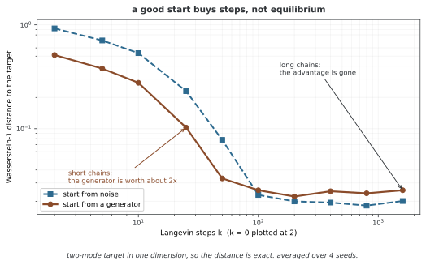

# 생성기와 에너지 모델의 협력 학습

에너지 모델의 짧은 사슬을 더 유용한 위치에서 시작하려면 생성기를 초기화 분포로 사용할 수 있다. 생성 결과를 에너지 그래디언트로 다듬고, 생성기는 그 수정 결과를 따라가도록 학습한다. 이 방식은 [MCMC teaching 연구](https://ojs.aaai.org/index.php/AAAI/article/view/11834)와 연결된다. 핵심은 초기 생성과 사슬 수정, 두 모델의 업데이트를 구분하는 것이다.

## 1. 본문 코드의 범위

```python
"""
함께 익히기: 생성기와 함께하는 에너지 바탕 모델
========================================

더 효율 좋게 익히려 에너지 바탕 모델과 생성기 뉴럴 넷트웍을 합친다.

걸리는 시간: 120~150분
"""

import torch
import torch.nn as nn

# ========================================================================
# 메인
# ========================================================================

print("Module 08: Cooperative Training")
print("Combining EBMs with generators for improved efficiency")
print("See modules 07 and 09 for related concepts")

def main():
    print("✓ Module complete")

if __name__ == "__main__":
    main()
```

**보존된 출력:**

```
Module 08: Cooperative Training
Combining EBMs with generators for improved efficiency
See modules 07 and 09 for related concepts
✓ Module complete
```

본문 코드는 주제 안내 문구만 출력한다. 생성기·에너지 뉴럴 넷트웍의 구조와 데이터셋, optimizer 또는 훈련 루프가 없다. 실제 한 번의 교대 업데이트는 연습문제의 함수 골격에서 다룬다. 출력이 협력 학습의 실행이나 효율 향상을 보여 주는 것은 아니다.

## 2. 생성기로 초기화한 사슬

잠재 노이즈 z에서 초기 이미지 x⁽⁰⁾=Gφ(z)를 만든다. 에너지 모델을 고정하고 다음과 같이 k단계 수정한다.

$$x^{(j+1)}=x^{(j)}-h\nabla_x E_\theta(x^{(j)})+\sqrt{2h}\xi_j$$

표준정규 ξⱼ를 사용하는 단위 온도 랑주뱅 이산화다. 잘 학습된 생성기가 유용한 초기 위치를 제공하면 무작위 픽셀에서 출발하는 것보다 짧은 수정으로 의미 있는 샘플을 얻을 수 있다. 그러나 생성기가 일부 모드만 만들거나 에너지 모델이 빨리 변하면 다른 모드를 놓칠 수 있다. 유한 k와 h의 이산화는 정확한 평형 표본을 보장하지 않는다.

<div class="storybox" markdown>

**그림으로 보는 AI 1.** "가르친다"는 말이 비유가 아닌 곳

이 방식에 이름을 준 글은 2018년 AAAI의 「Cooperative Learning of Energy-Based Model and Latent Variable Model via **MCMC Teaching**」이다. 셰젠원(Jianwen Xie)·루양(Yang Lu)·가오루이치(Ruiqi Gao)·우잉녠(Ying Nian Wu)이 썼고, 제목의 "가르치기"가 꾸밈말이 아니다. 에너지 모델은 생성기가 만든 표본에서 **사슬을 시작하고**, 생성기는 그 사슬이 자기 표본을 **어떻게 고쳤는지로부터** 배운다.

아래 4절이 평균 에너지가 아니라 회귀를 쓰는 까닭도 그 글이 밝혀 둔다. 어떤 $z$ 가 어떤 초기 표본을 만들었는지 **이미 알고 있으므로**, 고쳐진 결과를 목표로 삼으면 그 학습은 "essentially supervised", 곧 사실상 지도학습이 된다. 짝이 맞는 입력과 목표가 공짜로 생긴 셈이다.

그러면 생성기로 시작하는 것이 실제로 얼마나 버는가. 봉우리 둘인 1차원 목표에서는 바서슈타인 거리를 정렬만으로 정확히 셈할 수 있어 바로 잴 수 있다.



짧은 사슬에서는 분명히 번다. $k=25$ 에서 생성기로 시작한 쪽이 0.103, 잡음에서 시작한 쪽이 0.230으로 **두 배 넘게 가깝다.** 이 쪽의 코드가 짧은 수정으로도 쓸 만한 표본을 얻는다고 말할 수 있는 근거가 그것이다.

**그런데 $k$ 가 100을 넘으면 두 곡선이 만나고, 그 뒤로는 차이가 없다.** 1,600걸음에서는 오히려 잡음에서 출발한 쪽이 아주 조금 낮다. 당연한 일이다 — 사슬이 충분히 길면 어디서 출발했는지를 잊어버린다. **생성기가 사 주는 것은 더 좋은 평형이 아니라 거기까지 가는 걸음 수다.**

그래서 위 문단의 마지막 두 문장이 서로 맞물린다. 생성기가 일부 모드만 만들면 짧은 사슬은 그 치우침을 **고칠 시간이 없고**, 긴 사슬이라면 애초에 생성기가 필요하지 않았을 것이다. 이 방법이 사는 자리는 그 사이의 좁은 구간이며, $k$ 와 $h$ 를 고를 때 재어 보지 않고 고정값을 쓸 수 없다고 5절이 못 박는 까닭이 여기에 있다.

_확인한 곳 — J. Xie, Y. Lu, R. Gao, Y. N. Wu, "Cooperative Learning of Energy-Based Model and Latent Variable Model via MCMC Teaching", *AAAI* **32**(1) (2018). 에너지 모델의 사슬이 생성기의 표본에서 시작한다는 것과, 잠재변수를 알고 있어 생성기의 학습이 사실상 지도학습이 된다는 것이 그 글의 초록에 있다. 그림의 수는 그림을 그리는 코드가 씨앗 넷으로 직접 재어 평균한 것이다._

</div>

## 3. 에너지 모델의 업데이트

수정된 표본 x̃를 고정해 다음 로스를 최소화한다.

$$L_E=\mathbb E_{x\sim p_{\mathrm{data}}}E_\theta(x)
-\mathbb E_{z,\xi}E_\theta(\tilde x)$$

positive phase와 negative phase의 차이를 사용하는 학습이다. 샘플을 detach해 수정 사슬 전체의 θ 의존성을 역전파하지 않는다. x̃가 모델 평형에 가깝지 않으면 정확한 최대 우도 그래디언트와 차이가 있다.

## 4. 생성기의 수정 결과 모방

아래 함수의 생성기 로스는 평균 에너지가 아니라 **수정된 결과에 대한 회귀**다.

$$L_G=\mathbb E_{z,\xi}\|G_\phi(z)-\operatorname{stopgrad}(\tilde x)\|^2$$

같은 z에서 만든 결과를 수정된 목표에 가깝게 만든다. 구현은 모든 배치·픽셀 원소의 제곱 오차 평균을 사용한다. 평균 Eθ(Gφ(z))를 직접 최소화하는 방식도 생각할 수 있지만 위 회귀와 같은 목적은 아니며, 에너지 최소화만으로 분포의 엔트로피나 모드 다양성을 유지하지는 못한다.

이 생성기는 관측 x의 잠재 사후분포 q(z|x)를 계산하는 인코더가 아니다. 사전 노이즈를 데이터 공간으로 옮기는 생성 분포를 학습한다. 따라서 단지 두 모델을 함께 학습한다고 VAE의 변분 사후 추론과 동일해지지 않는다.

## 5. 함수 골격의 실행 조건

연습문제 함수는 생성기로 초기화하고 사슬을 수정한 다음 **에너지 업데이트 한 번, 생성기 업데이트 한 번**을 수행한다. n_G·n_E 반복이나 비율 조절을 구현하지 않는다. 모델 구조·학습 데이터·평가와 별도로 이러한 함수들을 호출하는 바깥 루프가 필요하다.

latent_dim은 함수 인수가 아니라 외부 변수이며 z는 CPU에서 만들어진다. 생성기와 데이터·에너지 모델의 장치를 맞추어야 한다. 초기 생성 결과, 에너지 입력과 실제 데이터의 모양도 일치해야 한다. 배치 통계·Dropout이 있는 구조에서는 모델 모드와 샘플별 에너지 정의를 추가로 확인한다.

사슬의 각 수정 뒤 detach하고, 생성기 학습을 위해 같은 z로 순방향을 다시 계산한다. 수정 목표는 에너지 파라미터를 갱신하기 **전**에 만든 값이다. 이 순서도 구현의 학습 신호를 이해하는 데 중요하다. 러닝레이트·사슬 길이·교대 횟수의 최적 조합은 측정 없이 고정값으로 단정할 수 없다.

## 연습문제

<div class="drillbox" markdown>

**연습문제 1.** <span class="diff med" title="중간"></span>
아래 협력 학습 함수의 에너지 로스와 생성기 로스를 각각 적고, 직접 에너지 최소화와 구분하라.

</div>

??? success "풀이"

    에너지 로스는 mean E(data)−mean E(refined.detach())다. 생성기 로스는 같은 z의 새 출력과 refined.detach() 사이 원소별 MSE다. 생성기가 에너지 자체를 직접 최소화하는 로스과는 다르며, 수정된 샘플을 교사로 삼는 회귀다. detach는 사슬을 통해 두 모델의 이전 계산으로 역전파하지 않게 한다.


---

<div class="drillbox" markdown>

**연습문제 2.** <span class="diff med" title="중간"></span>
생성기 초기화가 도움이 되는 조건과 실패할 수 있는 조건을 설명하라.

</div>

??? success "풀이"

    생성기가 주요 데이터 영역과 모드를 넓게 덮고 에너지 모델 변화에 맞추어 개선되면 초기 사슬의 이동 부담을 줄일 수 있다. 반대로 생성기 모드 붕괴, 잘못된 에너지 그래디언트, 느린 모드 간 혼합이나 빠른 파라미터 변화는 짧은 사슬로 보완되지 않을 수 있다. 속도와 품질 향상은 별도로 평가해야 한다.


---

<div class="drillbox" markdown>

**연습문제 3.** <span class="diff hard" title="어려움"></span>
아래 함수가 n_G/n_E를 조절하는 완전한 학습 루프인지 검토하라. 실행에 필요한 외부 정의도 설명하라.

</div>

??? success "풀이"

    함수는 두 optimizer를 각각 한 번 업데이트해 비율은 1:1이며 여러 교대 횟수의 반복은 없다. latent_dim, 두 뉴럴 넷트웍·optimizer, 데이터와 바깥 반복을 따로 정의해야 한다. CPU에서 만든 z와 모든 모델·데이터의 장치·모양도 맞아야 한다. n_G/n_E의 효과는 사슬 길이와 러닝레이트까지 고정하거나 명시한 조건에서 비교해야 한다. 어느 비율이 항상 가장 좋다는 결론은 없다.

    ```python
    def cooperative_training_step(energy_net, generator, data_batch, 
                                   opt_E, opt_G, n_langevin=10, lr_langevin=0.01):
        # 스텝 1: 생성기에서 처음 표본을 만든다
        z = torch.randn(data_batch.size(0), latent_dim)
        gen_samples = generator(z).detach()
        
        # 스텝 2: 랑주뱅 액션으로 다듬는다
        refined = gen_samples.clone().requires_grad_(True)
        for _ in range(n_langevin):
            energy = energy_net(refined).sum()
            grad = torch.autograd.grad(energy, refined)[0]
            refined = refined - lr_langevin * grad + (2*lr_langevin)**0.5 * torch.randn_like(refined)
            refined = refined.detach().requires_grad_(True)
        
        # 스텝 3: 에너지 바탕 모델을 고친다
        pos_energy = energy_net(data_batch).mean()
        neg_energy = energy_net(refined.detach()).mean()
        loss_E = pos_energy - neg_energy
        opt_E.zero_grad()
        loss_E.backward()
        opt_E.step()
        
        # 스텝 4: 생성기를 고친다(다듬은 표본에서 배운다)
        gen_samples = generator(z)
        loss_G = ((gen_samples - refined.detach())**2).mean()
        opt_G.zero_grad()
        loss_G.backward()
        opt_G.step()
    ```


## 정리하며

협력 학습은 생성기 초기화, 에너지 기반의 짧은 수정 사슬과 수정 결과의 회귀를 연결한다. 이 코드의 생성기 목표는 평균 에너지 최소화가 아니며, 함수 하나의 교대 업데이트와 완전한 훈련·평가 파이프라인을 구분해야 한다.
