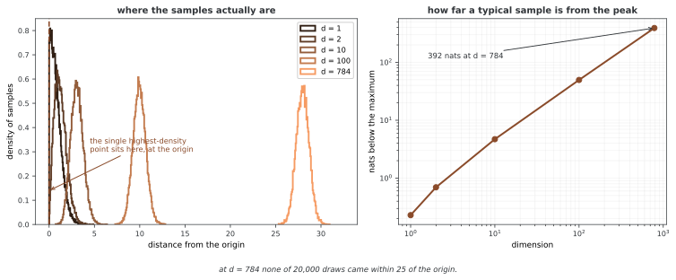

# 에너지 기반 모델의 응용

에너지는 생성뿐 아니라 입력의 상대 점수나 사전분포로도 사용할 수 있다. 다만 “낮은 에너지면 정상 데이터” 같은 해석은 모델과 평가 조건에 따라 검증해야 한다. 이 페이지는 OOD 탐지, 이미지 복원과 에너지 조합의 수학적 의미를 구분한다.

## 1. 본문 코드와 출력

```python
"""
에너지 바탕 모델의 쓰임새: 분포 밖 찾기, 잡음 없애기, 얽어 만들어 내기
================================================================================

만들어 내기 너머 에너지 바탕 모델의 실제 쓰임새.

걸리는 시간: 90~120분
"""

import torch
import torch.nn as nn
import numpy as np

# ========================================================================
# 메인
# ========================================================================

def out_of_distribution_detection():
    """분포 밖 찾기에 에너지 바탕 모델의 에너지를 쓴다."""
    print("\nOut-of-Distribution Detection with EBMs")
    print("Lower energy → In-distribution")
    print("Higher energy → Out-of-distribution")
    print("✓ Can identify anomalies and novel inputs")

def image_denoising_with_ebm():
    """에너지 가장 작게 하기로 그림의 잡음을 없앤다."""
    print("\nImage Denoising via Energy Minimization")
    print("Start with noisy image, minimize energy")
    print("✓ Preserves structure while removing noise")

def compositional_generation():
    """에너지를 더해 여러 개념을 합친다."""
    print("\nCompositional Generation")
    print("E_combined = E_concept1 + E_concept2")
    print("✓ Generate images with multiple attributes")

def main():
    print("="*70)
    print("EBM APPLICATIONS")
    print("="*70)
    
    out_of_distribution_detection()
    image_denoising_with_ebm()
    compositional_generation()
    
    print("\nKey Applications:")
    print("  ✓ Anomaly/OOD detection")
    print("  ✓ Image denoising and inpainting")
    print("  ✓ Compositional generation")
    print("  ✓ Adversarial robustness")

if __name__ == "__main__":
    main()
```

```
======================================================================
EBM APPLICATIONS
======================================================================

Out-of-Distribution Detection with EBMs
Lower energy → In-distribution
Higher energy → Out-of-distribution
✓ Can identify anomalies and novel inputs

Image Denoising via Energy Minimization
Start with noisy image, minimize energy
✓ Preserves structure while removing noise

Compositional Generation
E_combined = E_concept1 + E_concept2
✓ Generate images with multiple attributes

Key Applications:
  ✓ Anomaly/OOD detection
  ✓ Image denoising and inpainting
  ✓ Compositional generation
  ✓ Adversarial robustness
```

위 코드는 응용의 이름과 설명을 출력할 뿐 모델을 학습하거나 입력을 평가하지 않는다. 출력의 이상 탐지·구조 보존·강건성 문구는 측정 결과가 아니다. 실제 함수 골격은 연습문제에 있으며 의존 함수와 장치·배치 조건을 따로 갖추어야 한다.

## 2. 에너지로 OOD를 판정하기

같은 모델에서 낮은 Eθ(x)는 높은 밀도에 대응하지만, 높은 밀도가 곧 데이터의 전형성이나 올바른 입력이라는 뜻은 아니다. 고차원에서는 밀도와 질량이 집중되는 영역이 다를 수 있고, 학습 모델이 OOD 입력에 낮은 에너지를 줄 수도 있다. 탐지 성능은 별도의 OOD 데이터에서 평가한다.

<div class="storybox" markdown>

**그림으로 보는 AI 1.** 모델이 가장 좋아하는 점을 모델은 한 번도 그리지 않는다

위 문단의 경고는 이론적인 염려가 아니다. 2019년 ICLR에서 에릭 날리스닉(Eric Nalisnick)과 동료들이 「Do Deep Generative Models Know What They Don't Know?」로 보인 것이 바로 그것이다. CIFAR-10으로 학습한 모델이 **본 적 없는 SVHN 집 번호 사진에 더 높은 우도를 준다.** 개구리와 트럭으로 배운 모델이 숫자판을 더 그럴듯하다고 말한 것이다. 더 묘한 것은 그 모델에서 표본을 뽑아 보면 SVHN처럼 생긴 그림은 **나오지 않는다**는 점이다. 높은 우도를 주는 것과 그런 것을 만들어 내는 것이 서로 다른 일이다.

왜 그런지는 정확히 셈할 수 있는 경우에서 보인다. $N(0,I_d)$ 를 생각하면 밀도가 가장 높은 점은 두말할 것 없이 원점이다.



그런데 표본은 원점에 가지 않는다. 차원이 오를수록 질량은 반지름 $\sqrt d$ 의 **껍질**로 밀려나고, 784차원 — MNIST 한 장의 차원이다 — 에서는 2만 개를 뽑아 **단 하나도** 원점에서 25 안쪽에 들어오지 않는다. 전형적인 표본의 로그 밀도는 최대보다 **392나트** 낮다.

**그러니 "가장 그럴듯한 입력"과 "이 모델이 만들어 낼 법한 입력"은 고차원에서 아예 다른 자리를 가리킨다.** 낮은 에너지가 가리키는 곳은 봉우리이고, 모델이 실제로 사는 곳은 껍질이다. 에너지 하나로 OOD를 가르는 규칙이 흔들리는 까닭이 여기에 있다 — 어떤 OOD 입력은 봉우리 쪽에 더 가까울 수 있고, 그러면 **에너지가 낮다는 이유로 정상으로 판정된다.**

이 쪽이 임계 $\tau$ 를 독립 검증 자료에서 정하라고 하고, 아래 문단이 같은 자료에 95% 분위수를 다시 적용하는 연습문제 코드를 두고 "독립 테스트 성능을 보장하는 절차가 아니다"라고 못 박는 것도 같은 맥락이다. **에너지는 순위를 줄 뿐 판정을 주지 않는다.** 판정은 어디서 끊을지를 정해야 생기고, 그 자리는 모델이 아니라 평가 설계가 정한다.

_확인한 곳 — E. Nalisnick, A. Matsukawa, Y. W. Teh, D. Gorur, B. Lakshminarayanan, "Do Deep Generative Models Know What They Don't Know?", ICLR 2019. CIFAR-10 으로 학습한 Glow 가 SVHN 에 더 높은 우도를 준다는 것과, 그런데도 그 모델의 표본에 SVHN 같은 그림이 나오지 않는다는 것이 그 글의 결과다. 밀도와 질량이 갈리는 전형성 논의는 같은 저자들의 후속 글 arXiv:1906.02994 에서 다룬다. 그림의 수는 그림을 그리는 코드가 직접 뽑아 재어 얻는다._

</div>

한 가지 규칙은 Eθ(x)≥τ이면 OOD로 판정하는 것이다. τ는 독립적인 ID 검증 데이터에서 목표 거짓 양성률에 맞추어 정하고, 테스트 데이터에서는 고정한다. AUROC는 임계값 전체의 순위 구분을 요약하며 실제 운영 임계값의 오탐·미탐 비율과 다르다.

연습문제의 함수는 in_dist_loader에서 계산한 에너지의 95% 분위수를 같은 데이터에 다시 적용한다. 이는 독립 테스트 성능을 보장하는 절차가 아니다. OOD를 양성으로 보면 in_dist_correct는 특이도, ood_detected는 민감도다. 동률이 있으면 엄격한 ID 비교 `<τ` 때문에 기대한 비율과 차이가 날 수 있다.

compute_auroc는 정의되어 있지 않고, eval이나 입력 장치 이동도 함수 안에서 하지 않는다. 배치 1에서도 각 샘플당 하나의 값을 갖는 벡터가 필요하며, 앞 CNN의 squeeze가 스칼라를 반환하면 torch.cat과 맞지 않을 수 있다. 빈 로더도 처리하지 않는다.

## 3. 이미지 복원: 사전분포와 관측모형

노이즈 관측 y=x+n, n∼N(0,σ²I)와 사전 pθ(x)∝exp(−Eθ(x))를 사용하면 MAP 복원의 목적은 다음과 같다.

$$x_{\mathrm{MAP}}\in\arg\min_x
\left[E_\theta(x)+\frac{\|y-x\|^2}{2\sigma^2}\right]$$

에너지만 최소화하면 관측 y를 보존할 이유가 없어 사전의 임의 모드로 이동할 수 있다. 관측 항은 y와의 일치를, 사전 항은 모델이 선호하는 구조를 반영한다. 비선형 모델의 이 목적은 일반적으로 볼록하지 않아 전역 최적 복구를 보장하지 않는다.

그래디언트 최적화로 하나의 MAP 후보를 찾는 것과, 같은 사후분포를 목표로 하는 올바른 랑주뱅 샘플링은 다르다. 최적화에 임의의 작은 노이즈를 더했다고 곧 유효한 사후 샘플러가 되는 것도 아니다.

## 4. 인페인팅 마스크와 관측값 유지

연습문제의 이진 mask는 **1=관측된 픽셀, 0=결측 픽셀**이다. 함수는 결측 부분을 난수로 초기화하지만 이후에는 전체 x를 optimizer가 바꾼다. data_weight·||mask⊙(x−y)||²는 유한한 벌점이므로 **관측 픽셀을 정확하게 고정하지 않는다**. 정확한 조건화가 필요하면 관측 좌표를 고정하고 결측 좌표만 갱신하는 별도 정의가 필요하다.

배치별 에너지 벡터를 반환하는 모델에서는 loss.backward를 위해 스칼라로 집계해야 한다. 현재 함수는 energy를 그대로 더하므로 배치가 여러 개이면 실패할 수 있다. 이미지 범위 clipping도 없고, x만 optimizer로 관리해 에너지 뉴럴 넷트웍 파라미터의 gradient는 누적될 수 있다. 이는 이미지 복원의 의도와 구분해야 한다.

## 5. 에너지 합과 product of experts

같은 공간·기준 측도에서 E₁+E₂는 비정규화 밀도의 곱에 해당한다.

$$p_{\mathrm{comb}}(x)\propto e^{-E_1(x)-E_2(x)}
\propto p_1(x)p_2(x)$$

이 등식 자체에 두 확률변수의 독립성 가정은 필요하지 않다. 곱의 적분이 양의 유한값이어야 하며 에너지들의 스케일·지지집합이 적합해야 한다. 두 조건을 동시에 만족하는 의미론적 분포를 얻는 문제는 추가 가정이 필요하다.

예를 들어 c₁,c₂가 x가 주어졌을 때 조건부 독립이면 p(x|c₁,c₂)∝p(x)p(c₁|x)p(c₂|x)다. 반면 p(x|c₁)p(x|c₂)를 그대로 곱하면 사전 p(x)가 두 번 들어간다. 이 경우 원하는 결합 조건부에 맞추려면 p(x)로 한 번 나누어야 한다. 따라서 개념별 모델을 더하기만 하면 항상 정확한 “교집합” 생성이 된다고 설명하지 않는다.

이런 조합은 다른 생성 모델이 제공하는 밀도나 조건부 점수와도 연결할 수 있다. 에너지 표현이 편리하다는 사실을 GAN·VAE에서는 원리적으로 불가능하다는 주장으로 확대하지 않는다.

## 연습문제

<div class="drillbox" markdown>

**연습문제 1.** <span class="diff hard" title="어려움"></span>
아래 OOD 함수의 판정 규칙·두 정확도와 실행 조건을 검토하라.

</div>

??? success "풀이"

    규칙은 E≥τ이면 OOD, E<τ이면 ID다. OOD를 양성으로 놓으면 ID 정확도는 특이도이고 OOD 검출률은 민감도다. τ를 평가 ID 자체의 95% 분위수로 잡으면 별도 검증·테스트를 분리한 절차가 아니다. compute_auroc 정의, eval·장치 일치와 각 배치의 벡터 출력이 필요하다. 유한 표본과 동률 때문에 5% 오탐을 정확히 보장하지 않는다.

    ```python
    def ood_detection(energy_net, in_dist_loader, ood_loader, threshold=None):
        in_energies = []
        ood_energies = []
        
        with torch.no_grad():
            for x, _ in in_dist_loader:
                in_energies.append(energy_net(x).cpu())
            for x, _ in ood_loader:
                ood_energies.append(energy_net(x).cpu())
        
        in_energies = torch.cat(in_energies)
        ood_energies = torch.cat(ood_energies)
        
        if threshold is None:
            threshold = in_energies.quantile(0.95).item()
        
        in_detected = (in_energies < threshold).float().mean()
        ood_detected = (ood_energies >= threshold).float().mean()
        
        return {
            'threshold': threshold,
            'in_dist_correct': in_detected.item(),
            'ood_detected': ood_detected.item(),
            'auroc': compute_auroc(in_energies, ood_energies)
        }
    ```


---

<div class="drillbox" markdown>

**연습문제 2.** <span class="diff med" title="중간"></span>
조건별 생성 밀도 p(x|c₁), p(x|c₂)의 곱이 항상 p(x|c₁,c₂)에 비례하는가?

</div>

??? success "풀이"

    일반적으로 아니다. c₁,c₂가 x에서 조건부 독립이면 결합 조건부는 p(x)p(c₁|x)p(c₂|x)에 비례한다. 두 조건부 밀도의 곱에는 사전 p(x)가 두 번 있어 p(x|c₁)p(x|c₂)/p(x)가 필요한 형태다. 단순 product of experts의 정의와 정확한 조건 결합이라는 해석을 구분해야 한다.


---

<div class="drillbox" markdown>

**연습문제 3.** <span class="diff hard" title="어려움"></span>
아래 inpaint 함수가 관측 픽셀을 정확히 고정하는지, 사후 표본을 만드는지 설명하라.

</div>

??? success "풀이"

    mask=1이 관측 영역이며 유한한 제곱 벌점만 주므로 관측값도 바뀔 수 있다. 모든 픽셀을 Adam으로 최적화하는 MAP형 골격으로, 사후분포에서 여러 완성을 샘플링하는 절차는 아니다. 배치 에너지의 스칼라 집계, 상태 범위와 모델 파라미터 gradient 누적도 처리해야 한다. data_weight가 크다고 결측 픽셀의 에너지 그래디언트가 사라지는 것은 아니다.

    ```python
    def inpaint(energy_net, corrupted_image, mask, n_steps=500, lr=0.01, 
                data_weight=100.0):
        """
        mask: 알려진 화소는 1, 빠진 화소는 0
        """
        # 빠진 화소를 잡음으로 첫자리매김한다
        x = corrupted_image.clone()
        x = x + (1 - mask) * torch.randn_like(x) * 0.5
        x = x.requires_grad_(True)
        
        optimizer = torch.optim.Adam([x], lr=lr)
        
        for step in range(n_steps):
            optimizer.zero_grad()
            
            # 에너지 바탕 모델 사전 분포: x이 자료 다양체 위에 놓이도록 이끈다
            energy = energy_net(x)
            
            # 자료 충실: 알려진 화소를 붙박이로 둔다
            fidelity = data_weight * ((x - corrupted_image) * mask).pow(2).sum()
            
            loss = energy + fidelity
            loss.backward()
            optimizer.step()
        
        return x.detach()
    ```


## 정리하며

에너지는 OOD 순위 점수와 복원의 사전항, product of experts의 표현으로 사용할 수 있다. 각 응용의 검증 데이터·관측모형·정규화 조건을 명시하고, 출력 안내문과 실제 실행 결과, MAP 최적화와 사후 샘플링을 구분한다.
