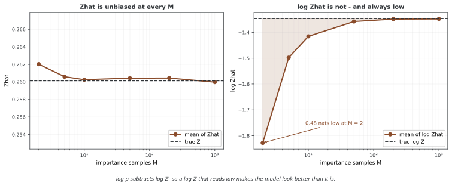

# 에너지 모델과 확산·흐름·잠재변수의 연결

서로 다른 생성 모델도 로그 밀도를 에너지로 표현하면 공통 구조를 볼 수 있다. 그러나 같은 표기만으로 샘플링 방법이나 정규화 계산까지 같아지는 것은 아니다. 이 페이지는 스코어, 흐름을 기준으로 한 에너지 보정과 잠재변수의 결합 에너지를 구분한다.

## 1. 본문 코드와 출력

```python
"""
나아간 에너지 바탕 모델 주제: 확산 모델 및 요즘 연구와의 이음
======================================================================

최신 발전과 다른 만들어 내는 모델과의 이음을 살핀다.

걸리는 시간: 90~120분
"""

import torch
import torch.nn as nn

# ========================================================================
# 메인
# ========================================================================

def ebm_diffusion_connection():
    """에너지 바탕 모델과 확산 모델의 이음을 이해한다."""
    print("\nEBMs and Diffusion Models")
    print("-" * 50)
    print("Score-based generative models are EBMs where:")
    print("  E(x,t) defines the score at noise level t")
    print("  ∇ₓ log p(x,t) = -∇ₓ E(x,t)")
    print("\nDiffusion process:")
    print("  Forward: Add noise gradually x → x_T")
    print("  Reverse: Denoise using learned score")
    print("\n✓ EBMs provide theoretical foundation for diffusion")

def flow_based_ebms():
    """다룰 만한 가능도를 위한 흐름 바탕 에너지 바탕 모델."""
    print("\nFlow-Based Energy Models")
    print("-" * 50)
    print("Combine flows with EBMs:")
    print("  - Flows provide tractable Z")
    print("  - EBM refines the distribution")
    print("✓ Best of both worlds")

def latent_variable_ebms():
    """숨은 변수를 가진 에너지 바탕 모델."""
    print("\nLatent Variable EBMs")
    print("-" * 50)
    print("E(x,z) with latent z:")
    print("  - More expressive models")
    print("  - Hierarchical representations")
    print("✓ Combines EBMs with VAE-like structure")

def modern_research_directions():
    """에너지 바탕 모델의 지금 연구."""
    print("\nModern Research Directions")
    print("-" * 50)
    print("1. Improved sampling (HMC, ULA, MALA)")
    print("2. Better architectures (transformers, diffusion UNets)")
    print("3. Theoretical understanding (convergence, capacity)")
    print("4. Applications (video, 3D, multimodal)")
    print("5. Connections to physics and causality")

def main():
    print("="*70)
    print("ADVANCED EBM TOPICS")
    print("="*70)
    
    ebm_diffusion_connection()
    print()
    flow_based_ebms()
    print()
    latent_variable_ebms()
    print()
    modern_research_directions()
    
    print("\n" + "="*70)
    print("CURRICULUM COMPLETE")
    print("="*70)

if __name__ == "__main__":
    main()
```

```
======================================================================
ADVANCED EBM TOPICS
======================================================================

EBMs and Diffusion Models
--------------------------------------------------
Score-based generative models are EBMs where:
  E(x,t) defines the score at noise level t
  ∇ₓ log p(x,t) = -∇ₓ E(x,t)

Diffusion process:
  Forward: Add noise gradually x → x_T
  Reverse: Denoise using learned score

✓ EBMs provide theoretical foundation for diffusion


Flow-Based Energy Models
--------------------------------------------------
Combine flows with EBMs:
  - Flows provide tractable Z
  - EBM refines the distribution
✓ Best of both worlds


Latent Variable EBMs
--------------------------------------------------
E(x,z) with latent z:
  - More expressive models
  - Hierarchical representations
✓ Combines EBMs with VAE-like structure


Modern Research Directions
--------------------------------------------------
1. Improved sampling (HMC, ULA, MALA)
2. Better architectures (transformers, diffusion UNets)
3. Theoretical understanding (convergence, capacity)
4. Applications (video, 3D, multimodal)
5. Connections to physics and causality

======================================================================
CURRICULUM COMPLETE
======================================================================
```

본문은 연구 주제의 안내 문구를 출력한다. SDE 솔버, normalizing flow나 잠재변수 학습을 실제로 수행하지 않는다. 특히 출력의 “flows provide tractable Z”는 아래 두 종류의 흐름 결합을 구분해서 읽어야 한다.

## 2. 스코어와 시간별 에너지

각 시간의 매끄럽고 양인 밀도 pₜ가 있다면 Eₜ(x)=−log pₜ(x)+상수로 두어 스코어를 −∇Eₜ로 표현할 수 있다. 하지만 벡터 뉴럴 넷트웍이 직접 출력한 근사 스코어는 보존 벡터장이라는 제약을 자동으로 만족하지 않는다. 따라서 모든 스코어 네트워크가 정규화 가능한 하나의 스칼라 에너지를 정확히 미분한 것과 같다고 볼 수 없다.

확산의 역 SDE는 전방 drift와 diffusion 계수, 감소하는 시간 방향과 학습 스코어를 함께 사용한다. 고정 에너지의 단순 랑주뱅 갱신과 일반적으로 같은 동역학이 아니다. 노이즈 수준별 에너지라는 관점은 유용하지만 정확한 역과정 계수를 대체하지 않는다.

가우스 노이즈 y=x+σε에서 최적 제곱 오차 디노이저 D*(y)=E[x|y]와 스코어의 관계는 다음과 같다.

$$\nabla_y\log p_\sigma(y)=\frac{D^*(y)-y}{\sigma^2}$$

유한하게 학습된 Dθ에는 근사 오차가 있다. 또한 VP 확산처럼 xₜ=aₜx₀+bₜε라면 E[x₀|xₜ]의 계수 aₜ까지 반영해야 하며, 단순 가산 노이즈 식을 그대로 적용하지 않는다.

## 3. 흐름의 변수변환과 에너지 보정

정규화된 기준 밀도를 가역 흐름으로 옮기면 Jacobian을 포함해 정확한 밀도를 계산할 수 있다. 기존의 비정규화 EBM을 좌표변환만 한다면 올바른 Jacobian을 포함한 적분에서 원래 Z가 그대로 보존되며, 모르는 Z가 자동으로 알려지는 것은 아니다.

별개의 구성은 이미 정규화된 p_flow를 기준으로 에너지 보정항을 곱하는 것이다.

$$p_\theta(x)=\frac{p_{\mathrm{flow}}(x)e^{-E_\theta(x)}}{Z_\theta},
\qquad Z_\theta=\mathbb E_{p_{\mathrm{flow}}}[e^{-E_\theta(X)}]$$

새 Zθ는 일반적으로 미지다. 흐름에서 독립 표본을 뽑아 exp(−E)의 평균으로 추정할 수 있지만, 유한 표본 추정이 정확한 log p를 제공하는 것은 아니다. 양의 적분 가능 웨이트에서 Ẑ는 불편할 수 있어도 log Ẑ는 일반적으로 바이어스된다. 기준 흐름과 보정 후 목표의 겹침이 나쁘면 웨이트 분산이 크거나 필요한 적률이 존재하지 않을 수도 있다.

<div class="storybox" markdown>

**그림으로 보는 AI 1.** 불편한 추정량에 로그를 씌우는 순간

위 문단의 "Ẑ는 불편할 수 있어도 log Ẑ는 바이어스된다"는 한 줄은 그냥 넘기기 쉬운데, 이 장에서 가장 자주 사람을 속이는 자리다. 그리고 까닭은 1906년에 증명된 부등식 하나다.

덴마크의 요한 옌센(Johan Jensen)이 그해 《악타 마테마티카》에 실은 「볼록 함수와 평균값 사이의 부등식에 관하여」가 그것이다. 옌센은 대학에 자리를 둔 수학자가 아니라 **코펜하겐 전화회사의 기술자**였고 수학은 본업 밖에서 했다. 부등식 자체는 간단하다 — $\log$ 는 오목하므로 $\mathbb E[\log \hat Z] \le \log \mathbb E[\hat Z] = \log Z$ 이고, 등호는 $\hat Z$ 가 전혀 흔들리지 않을 때뿐이다.

기준 흐름이 표준정규이고 보정이 이차식이면 참 $Z$ 를 가우스 적분으로 정확히 알 수 있다. 위 문단의 두 주장을 모두 재어 보면 이렇다.



왼쪽이 앞 절반이다. $\hat Z$ 의 평균은 표본이 **둘뿐일 때도** 참값과 맞는다. 불편하다는 말 그대로다.

오른쪽이 뒤 절반이다. $\log \hat Z$ 의 평균은 모든 표본 수에서 참값 **아래**에 있고, 표본 둘에서는 0.48나트 낮다. 흔들림이 클수록 틈이 벌어지고 표본을 늘리면 줄어든다.

**치우치는 방향이 문제다.** $\log p$ 를 적을 때 $\log Z$ 를 **빼므로**, $\log Z$ 를 작게 잡으면 $\log p$ 가 그만큼 **커진다.** 이 추정은 모델을 실제보다 **좋아 보이게** 틀린다. 운이 나빠서가 아니라 옌센의 부등식이 보장하는 방향이고, 되풀이해 평균을 내도 사라지지 않는다.

그래서 위 문단의 마지막 경고가 따라붙는다. 겹침이 나쁘면 웨이트의 분산이 커지고, 분산이 커지면 **바로 그 틈이 커진다.** 보고하는 우도가 가장 후한 쪽으로 틀어지는 순간이 하필 모델이 기준 흐름과 가장 어긋난 순간인 셈이다. $Z$ 를 추정해 우도를 적을 때 표본 수와 겹침 진단을 함께 적어야 하는 까닭이 여기에 있다.

_확인한 곳 — J. L. W. V. Jensen, "Sur les fonctions convexes et les inégalités entre les valeurs moyennes", *Acta Mathematica* **30**, 175–193 (1906). 옌센이 코펜하겐 전화회사의 기술자였다는 것도 함께 확인했다. 그림의 수는 그림을 그리는 코드가 참 $Z$ 를 가우스 적분으로 정확히 구해 놓고 4,000번씩 되풀이해 재어 얻는다._

</div>

## 4. 결합 에너지와 잠재변수 주변화

일반 잠재변수 EBM은 p(x,z)∝exp(−E(x,z))를 정의하고 z를 적분해 p(x)를 얻는다. 결합 정규화와 조건부 추론은 별개의 계산 문제다. 일반 뉴럴 넷트웍 에너지에서 둘 다 어려울 수 있지만, **아래 클래스는 특별히 정규화 가능한 가우스 생성모델**이다.

에너지는 E(x,z)=0.5||x−gθ(z)||²+0.5||z||²다. x∈R^d_x, z∈R^d_z 전체를 적분하면 모든 z에 대해 x의 이동 가우스 적분이 (2π)^(d_x/2)이므로 다음과 같다.

$$Z=(2\pi)^{(d_x+d_z)/2}$$

따라서 z∼N(0,I), x|z∼N(gθ(z),I)로 직접 생성할 수 있다. 정규화 상수는 알려져 있어도 p(x)의 z 적분과 사후 p(z|x)는 비선형 g에서 일반적으로 닫힌 형태가 아니다. 결합 분포의 Z와 가시 데이터의 주변 우도를 구분하는 예다.

## 5. 클래스가 제공하지 않는 기능

연습문제의 encoder는 x를 z 크기의 벡터로 보내는 뉴럴 넷트웍일 뿐, 평균·분산을 갖는 qφ(z|x)를 정의하지 않는다. energy 메서드는 decoder만 사용하므로 encoder에 대한 학습 경로가 없다. 클래스에는 forward, 샘플링, ELBO나 optimizer·학습 루프도 없다.

이 에너지는 Gaussian decoder VAE가 사용하는 생성모델과 양립한다. VAE의 핵심 차이는 반드시 다른 생성분포라는 데 있지 않고 사후 근사와 변분 학습 절차를 갖춘다는 데 있다. VAE도 비선형 생성모델의 참 사후는 다중 모드일 수 있으며, 가우스 변분족이 그중 제한된 근사라는 점을 구분한다.

HMC·MALA 같은 보정된 샘플러와 ULA는 서로 다른 전이·바이어스·계산 비용을 갖는다. 모델 구조가 유연하다고 정규화·혼합·수치 안정성의 문제가 자동 해결되는 것은 아니다. 안내 코드의 연구 방향을 현재 성능 순위나 검증된 구현으로 해석하지 않는다.

## 연습문제

<div class="drillbox" markdown>

**연습문제 1.** <span class="diff hard" title="어려움"></span>
가산 가우스 노이즈에서 최적 디노이저와 스코어의 관계를 유도하라.

</div>

??? success "풀이"

    pσ(y)=∫p(x)N(y;x,σ²I)dx를 y로 미분하면 ∇pσ(y)=∫p(x)N(y;x,σ²I)(x−y)/σ²dx다. pσ(y)로 나누면 (E[x|y]−y)/σ²를 얻는다. 최적 제곱 오차 디노이저는 이 조건부 평균이다. 학습된 Dθ로 대체하면 일반적으로 근사 관계다.


---

<div class="drillbox" markdown>

**연습문제 2.** <span class="diff easy" title="쉬움"></span>
흐름에 에너지 보정을 곱하면 Z와 로그 우도를 정확히 계산할 수 있는가?

</div>

??? success "풀이"

    새 Z=E_flow[exp(−E)]가 필요하다. 흐름 표본의 웨이트 평균은 조건 아래 Z의 불편 추정일 수 있지만 정확한 값은 아니며 log Z 추정에는 바이어스가 생긴다. 따라서 log p_flow−E−log Ẑ를 정확한 우도라고 보고하지 않는다. 좌표변환만 하는 경우도 원래 미지의 Z가 사라지는 것은 아니다.


---

<div class="drillbox" markdown>

**연습문제 3.** <span class="diff hard" title="어려움"></span>
아래 LatentVariableEBM의 Z를 구하고 encoder와 VAE의 관계를 설명하라.

</div>

??? success "풀이"

    x를 먼저 적분하면 z마다 (2π)^(d_x/2), z 적분에서 (2π)^(d_z/2)를 얻어 Z=(2π)^((d_x+d_z)/2)다. z∼N(0,I), x|z∼N(decoder(z),I)로 직접 생성할 수 있다. encoder는 energy에서 사용하지 않고 q(z|x)의 분산·학습 목적도 정의하지 않는다. 이 생성모델에 변분 사후와 ELBO 학습을 추가하면 VAE 방식으로 다룰 수 있다. 비선형 decoder의 주변 우도와 사후가 쉬워지는 것은 아니다.

    ```python
    class LatentVariableEBM(nn.Module):
        def __init__(self, x_dim, z_dim, hidden_dim=256):
            super().__init__()
            self.decoder = nn.Sequential(
                nn.Linear(z_dim, hidden_dim), nn.ReLU(),
                nn.Linear(hidden_dim, x_dim)
            )
            self.encoder = nn.Sequential(
                nn.Linear(x_dim, hidden_dim), nn.ReLU(),
                nn.Linear(hidden_dim, z_dim)
            )
        
        def energy(self, x, z):
            x_recon = self.decoder(z)
            E_recon = 0.5 * ((x - x_recon)**2).sum(dim=1)
            E_prior = 0.5 * (z**2).sum(dim=1)
            return E_recon + E_prior
    ```


## 정리하며

에너지 표기는 모델들의 공통 구조를 보여 주지만 정규화와 추론의 난이도는 구성에 따라 달라진다. 근사 스코어의 적분 가능성, 흐름 보정의 새 Z와 로그 추정 바이어스, 가우스 잠재모델의 알려진 결합 Z·어려운 주변 우도를 구분한다.
