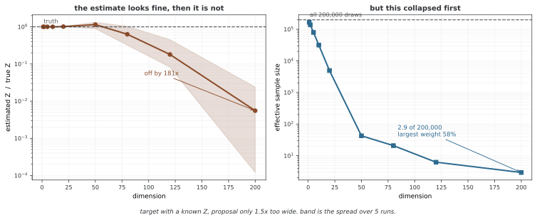

# 분배 함수와 자유 에너지

[볼츠만 분포](boltzmann.md)의 분배 함수는 모든 상태의 비정규화 확률을 합친 값이다. 입력에 대해서는 상수지만 온도와 모델 파라미터에 따라 달라진다. 이 페이지는 분배 함수의 미분이 에너지 통계와 연결되는 이유, 고차원 계산의 어려움과 근사 코드의 범위를 설명한다.

## 1. 정규화와 에너지 통계

β=1/T, T>0에서 Z(β)=∫exp(−βE(x))dλ(x)로 정의한다. E가 온도에 직접 의존하지 않고 미분과 적분을 교환할 수 있으면 다음과 같다.

$$\frac{\partial\log Z}{\partial\beta}=-\mathbb E_p[E],\qquad
\frac{\partial^2\log Z}{\partial\beta^2}=\operatorname{Var}_p(E)$$

첫 식은 분자를 미분한 −∫Eexp(−βE)를 Z로 나누어 얻는다. 다시 미분하면 에너지의 두 번째 모멘트와 평균 제곱의 차이가 된다. k_B=1의 관례에서 아래 양들을 계산할 수 있다.

| 양 | 정의·관계 |
|---|---|
| 자유 에너지 | F=−T log Z |
| 평균 에너지 | U=EₚE |
| 엔트로피 | S=(U−F)/T=βU+log Z |
| 비열 | C=dU/dT=Varₚ(E)/T² |

연속 변수의 S는 선택한 기준 측도에 대한 미분 엔트로피다. 온도만의 함수 Z(T)가 주어졌다고 모든 관측량의 분포를 복원할 수는 없다. 일반적인 통계량 A의 적률을 얻으려면 E−hA 같은 외부 항을 넣고 h에 대한 미분을 추가로 고려해야 한다.

## 2. 격자 적분 코드의 의미

```python
import torch
import numpy as np
import matplotlib.pyplot as plt

def compute_thermodynamic_quantities(energy_fn, x_range, T):
    """
    나눔 함수에서 열역학 양을 셈한다.
    
    파라메터
    ----------
    energy_fn : callable
        Energy function E(x)
    x_range : torch.Tensor
        수치 적분을 위한 자리의 점
    T : float
        Temperature
    
    반환값
    -------
    사전
        열역학 양을 담은 사전
    """
    dx = x_range[1] - x_range[0]
    E = energy_fn(x_range)
    
    # 나눔 함수(안정을 위해 로그 합 지수)
    log_unnorm = -E / T
    log_Z = torch.logsumexp(log_unnorm, dim=0) + torch.log(dx)
    Z = torch.exp(log_Z)
    
    # 확률 분포
    p = torch.exp(log_unnorm - log_Z)
    
    # 평균 에너지
    avg_E = torch.sum(p * E) * dx
    
    # 자유 에너지
    F = -T * log_Z
    
    # 엔트로피
    S = (avg_E - F) / T
    
    # 에너지의 흩어짐(열 담이용)
    var_E = torch.sum(p * (E - avg_E)**2) * dx
    C = var_E / (T**2)  # Heat capacity
    
    return {
        'Z': Z.item(),
        'F': F.item(),
        'avg_E': avg_E.item(),
        'S': S.item(),
        'C': C.item()
    }

# 온도에 걸쳐 두 우물 퍼텐셜을 살핀다
x = torch.linspace(-4, 4, 1000)
double_well = lambda x: 0.5 * (x**2 - 4)**2

print("Thermodynamic quantities for double-well potential:")
print(f"{'T':>5} {'⟨E⟩':>10} {'F':>10} {'S':>10} {'C':>10}")
print("-" * 50)
for T in [0.5, 1.0, 2.0, 5.0]:
    q = compute_thermodynamic_quantities(double_well, x, T)
    print(f"{T:5.1f} {q['avg_E']:10.3f} {q['F']:10.3f} {q['S']:10.3f} {q['C']:10.3f}")
```

**보존된 출력:**

```
Thermodynamic quantities for double-well potential:
    T        ⟨E⟩          F          S          C
--------------------------------------------------
  0.5      0.257      0.054      0.405      0.530
  1.0      0.534     -0.254      0.788      0.586
  2.0      1.159     -1.279      1.219      0.623
  5.0      2.545     -5.776      1.664      0.327
```

코드는 E(x)=0.5(x²−4)²를 [−4,4]의 등간격 1,000점에서 계산한다. logsumexp와 log(dx)를 이용해 직사각형 합의 정규화 상수를 구한다. 이는 **유한 구간·유한 격자 근사**이며 R 전체의 정확한 Z가 아니다. 꼬리 누락과 간격 오차를 따로 확인해야 한다.

에너지 분산으로 계산한 비열은 해당 근사분포의 값이다. 출력의 자릿수가 많다고 연속 적분의 그 자릿수까지 정확한 것은 아니다. 온도를 비교할 때는 고온에서 질량이 계산 구간 밖으로 퍼지는지도 살핀다.

```python
def visualize_phase_transition_analogy():
    """
    열역학 양이 구조 바뀜을 어떻게 알리는지 보여 준다
    볼츠만 분포에서.
    """
    x = torch.linspace(-4, 4, 1000)
    E = 0.5 * (x**2 - 4)**2  # Double-well
    
    temperatures = torch.linspace(0.1, 8.0, 100)
    quantities = {'T': [], 'avg_E': [], 'S': [], 'C': []}
    
    for T in temperatures:
        q = compute_thermodynamic_quantities(lambda x: 0.5*(x**2-4)**2, x, T.item())
        quantities['T'].append(T.item())
        quantities['avg_E'].append(q['avg_E'])
        quantities['S'].append(q['S'])
        quantities['C'].append(q['C'])
    
    fig, axes = plt.subplots(1, 3, figsize=(15, 4))
    
    axes[0].plot(quantities['T'], quantities['avg_E'], 'r-', linewidth=2)
    axes[0].set_xlabel('Temperature T')
    axes[0].set_ylabel('⟨E⟩')
    axes[0].set_title('Average Energy')
    axes[0].grid(True, alpha=0.3)
    
    axes[1].plot(quantities['T'], quantities['S'], 'b-', linewidth=2)
    axes[1].set_xlabel('Temperature T')
    axes[1].set_ylabel('Entropy S')
    axes[1].set_title('Entropy')
    axes[1].grid(True, alpha=0.3)
    
    axes[2].plot(quantities['T'], quantities['C'], 'g-', linewidth=2)
    axes[2].set_xlabel('Temperature T')
    axes[2].set_ylabel('Heat Capacity C')
    axes[2].set_title('Heat Capacity (Peak ≈ Transition)')
    axes[2].grid(True, alpha=0.3)
    
    plt.tight_layout()
    plt.show()

visualize_phase_transition_analogy()
```

두 번째 코드는 같은 근사를 온도별로 반복해 그린다. 비열의 매끄러운 봉우리가 생겨도 유한 계에서 상전이 특이점을 증명한 것은 아니다. 그림 제목의 “Peak ≈ Transition”은 정성적 비유로 읽는다. 또한 고정 대칭 이중 우물의 밀도 모드는 모든 유한 T>0에서 ±2이므로, 특정 온도에서 하나로 합쳐진다는 해석은 맞지 않는다. 샘플러의 모드 간 이동 속도와 평형 밀도의 모드 개수도 구분한다.

## 3. 왜 계산이 어려운가

차원별 n점의 직적 격자는 d차원에서 nᵈ점을 요구한다. 이산 이진 변수 d개도 전체 상태가 2ᵈ개다. 하지만 고차원이라는 이유만으로 모든 Z가 계산 불가능한 것은 아니다. 가우스나 독립 성분, 특수한 그래프 구조에서는 정확한 계산이나 효율적인 분해가 가능하다.

유계 영역 A에서 균등 샘플을 뽑으면 Z_A≈|A|N⁻¹Σexp(−E(xᵢ)/T)다. **영역 부피 |A|가 필요**하며 Rᵈ 전체의 균등 확률분포는 없다. 일반 제안분포 r에서는 Z≈N⁻¹Σexp(−E(xᵢ)/T)/r(xᵢ)를 사용하고, 목표 질량이 있는 곳에서 r>0이어야 한다. 겹침이 나쁘면 소수 웨이트가 지배해 분산이 커진다.

<div class="storybox" markdown>

**그림으로 보는 AI 1.** 이름이 이미 할 일을 적어 두었다

$Z$ 라는 글자는 아무렇게나 고른 것이 아니다. 독일어 **Zustandssumme**, 곧 "상태들의 합"의 첫 글자다. 영어 이름 *partition function* 은 그 뜻을 썩 옮기지 못하지만 독일어 쪽은 할 일을 그대로 적어 둔 셈이다 — **상태를 하나도 빠짐없이 더하라.** 이 쪽이 "왜 계산이 어려운가"를 묻고 있지만, 어려움은 숨어 있던 것이 아니라 처음부터 이름에 적혀 있었다.

바로 위 문단이 적어 둔 우회로가 중요도 샘플링이다. 전부 더하는 대신 제안분포에서 뽑아 웨이트를 매긴다. 그 길이 어디서 끊기는지를 재어 보면 이렇다.



참 $Z$ 를 정확히 아는 목표를 두고, 제안분포의 폭만 **1.5배** 어긋나게 했다. 그것뿐이다.

낮은 차원에서는 아무 문제가 없다. 그런데 차원이 오르면서 추정이 무너져 200차원에서는 참값의 **181분의 1**이 되고, 다섯 번 돌린 값이 서로 자릿수가 다르다.

**눈여겨볼 곳은 오른쪽이 먼저 무너진다는 점이다.** 50차원에서 추정값은 아직 1 근처라 그럴듯해 보이는데, 유효표본수는 이미 20만에서 **수십**으로 떨어져 있다. 200차원에서는 **2.9**다 — 20만 개를 뽑아 놓고 실제로 쓰는 것은 세 개가 채 안 되고, 그중 하나가 전체 웨이트의 **58%**를 쥔다. 위 문단의 "소수 웨이트가 지배해"가 바로 이 수다.

**그러니 추정값만 보아서는 틀린 줄 알 수 없다.** 겹침이 나빠질 때 $\hat Z$ 는 요란하게 틀리는 것이 아니라 **조용히, 한쪽으로** 틀린다. 아래 5절이 AIS로 중간 분포를 여럿 놓아 겹침을 이어 붙이는 까닭이고, 어떤 $Z$ 추정이든 **유효표본수 같은 진단을 함께 보고해야 하는** 까닭이다. 그리고 4절이 보이듯 학습에는 $Z$ 가 필요 없다 — 필요한 순간은 우도라는 **수를 적어 내야 할 때**이고, 이 그림은 그 수가 얼마나 믿기 어려운지를 말한다.

_확인한 곳 — $Z$ 가 독일어 Zustandssumme("상태들의 합")에서 왔다는 것은 통계역학의 표준적인 설명이다. 그림의 수는 그림을 그리는 코드가 참 $Z$ 를 아는 목표에 폭이 1.5배인 제안분포로 20만 개를 뽑아 다섯 번씩 직접 재어 얻는다._

</div>

## 4. 학습에서 남는 모델 기댓값

정규화한 모델의 파라미터를 미분하면 다음과 같다.

$$\nabla_\theta\log p_\theta(x)=
-\frac1T\nabla_\theta E_\theta(x)+
\frac1T\mathbb E_{p_\theta}[\nabla_\theta E_\theta(X)]$$

Z를 직접 계산하지 않아도 모델 표본으로 두 번째 항을 근사할 수 있다. 다만 MCMC의 혼합과 유한 단계 바이어스를 고려해야 한다. 데이터에서 시작하는 짧은 contrastive divergence 사슬은 이 근사를 단순화하지만 정확한 최대 우도 그래디언트와 일반적으로 같지는 않다.

스코어 매칭은 입력 미분에서 Z가 사라지는 성질을 사용한다. Noise-Contrastive Estimation(NCE)은 데이터와 알려진 노이즈 분포의 분류로 바꾸고, 정규화 상수에 대응하는 추가 모수를 학습할 수 있다. 따라서 NCE에서 정규화 문제가 아무 역할도 하지 않는다고 설명하지 않는다.

## 5. AIS의 올바른 비율

[Annealed Importance Sampling(AIS)](https://arxiv.org/abs/physics/9803008)은 정규화 상수 Z₀와 샘플링 방법을 아는 기준 비정규화 밀도 f₀에서 목표 f_K로 이동한다. 예를 들어 fₖ=f₀^(1−βₖ)f_K^βₖ인 중간 밀도를 정할 수 있다.

처음 x⁽⁰⁾∼f₀/Z₀를 뽑고 단계 k에서 **이전 상태**로 비율 fₖ(x⁽ᵏ⁻¹⁾)/fₖ₋₁(x⁽ᵏ⁻¹⁾)을 웨이트에 곱한다. 이후 fₖ/Zₖ를 불변분포로 갖는 전이로 상태를 갱신한다. 독립 실행들의 웨이트 평균에 Z₀를 곱해 Z_K를 추정한다. 정규화한 pₖ/pₖ₋₁를 사용하면 이미 모르는 Z의 비율이 식에 들어가므로 해결책이 되지 않는다.

```python
def annealed_importance_sampling(energy_fn, dim, n_chains=100,
                                  n_intermediate=100, n_gibbs=10):
    """
    식힘 중요도 뽑기로 log Z을 어림한다.
    
    파라메터
    ----------
    energy_fn : callable
        Energy function E(x)
    dim : int
        Dimensionality
    n_chains : int
        나란한 사슬의 개수
    n_intermediate : int
        중간 분포의 개수
    n_gibbs : int
        중간 분포마다 깁스 스텝 수
    
    반환값
    -------
    float
        어림한 log Z
    """
    # 역온도를 0(고른 분포)에서 1(목표)까지
    betas = torch.linspace(0, 1, n_intermediate + 1)
    
    # 바탕 분포(표준 정규)에서 첫자리매김한다
    x = torch.randn(n_chains, dim)
    
    # 로그 중요도 무게
    log_weights = torch.zeros(n_chains)
    
    for k in range(1, n_intermediate + 1):
        # 지금 온도와 앞 온도의 에너지
        E = energy_fn(x)
        
        # 로그 무게를 쌓는다
        log_weights += -(betas[k] - betas[k-1]) * E
        
        # 옮김: 중간 온도의 랑주뱅 액션
        for _ in range(n_gibbs):
            x.requires_grad_(True)
            E_current = energy_fn(x) * betas[k]
            grad = torch.autograd.grad(E_current.sum(), x)[0]
            x = x.detach() - 0.01 * grad + 0.005 * torch.randn_like(x)
    
    # 로그 평균 지수로 얻은 log Z 어림
    log_Z_ref = 0.5 * dim * np.log(2 * np.pi)  # Log Z of standard normal
    log_Z = torch.logsumexp(log_weights, dim=0) - np.log(n_chains) + log_Z_ref
    
    return log_Z.item()
```

위 함수는 올바른 AIS의 조건을 갖추지 못한다. x를 표준정규에서 초기화하지만 중간 에너지를 βE로만 두므로 β=0의 기준은 Rᵈ에서 상수인 **정규화 불가능한 밀도**가 된다. 그런데 log_Z_ref에는 표준정규의 비정규화 적분 (d/2)log(2π)를 사용한다. 실제 기준 에너지 ||x||²/2가 중간 밀도와 웨이트 비율에서 빠져 있다.

전이도 −0.01∇(βE)에 0.005ξ를 더한다. 단위 온도 랑주뱅 규약에서 이 drift에 대응하는 노이즈 표준편차는 √0.02이며 현재 값과 다르다. Metropolis 보정 없는 유한 단계 오차도 남는다. 따라서 이 반환값을 유효한 AIS의 log Z 추정치나 불편 추정치라고 사용할 수 없다.

올바른 AIS도 중간 분포의 겹침과 전이 효율에 따라 큰 웨이트 변동을 보일 수 있다. 적절한 조건의 Z 추정이 불편하더라도 **로그를 취한 추정은 일반적으로 불편하지 않다**. 필요한 중간 단계 수에 보편적인 정답은 없다.

## 6. 자유 에너지의 변분 원리

임의의 정규화 분포 q에 대해 에너지 평균에서 온도×엔트로피를 뺀 양을 정의한다.

$$\mathcal F[q]=\mathbb E_q[E]-T H(q)
=F+T D_{\mathrm{KL}}(q\|p_T)\geq F$$

마이너스 부호에 유의한다. q=p_T이면 등호가 성립한다. 제한된 변분족에서 최소화한 값은 참 자유 에너지의 상한이다. 이 관계는 적절한 에너지 정의 아래 −ELBO 최소화와 연결되지만, 양의 엔트로피 항을 더한 식은 같은 원리가 아니다.

또 다른 계산법인 열역학 적분에서는 Eλ=(1−λ)E₀+λE₁로 보간한다. 고정 T에서 미분하면 다음 부호를 얻는다.

$$\log Z_1-\log Z_0=-\frac1T\int_0^1
\mathbb E_{p_\lambda}[E_1-E_0]\,d\lambda$$

각 λ의 기댓값 추정과 수치 적분에도 오차가 있다. 알고 있는 상수 에너지 이동을 예제로 넣어 부호를 검산할 수 있다.

## 연습문제

<div class="drillbox" markdown>

**연습문제 1. 에너지 이동으로 검산**

E₁=E₀+c일 때 Z와 자유 에너지, 정규화 분포가 어떻게 바뀌는가?

</div>

??? success "풀이"
    Z₁=e^(−c/T)Z₀이므로 log Z₁−log Z₀=−c/T, F₁=F₀+c다. 분포는 같은 배수가 약분되어 변하지 않는다. 열역학 적분에 E₁−E₀=c를 대입해도 −c/T가 나온다.

---

<div class="drillbox" markdown>

**연습문제 2. 변분 자유 에너지의 부호**

왜 E_qE+TH(q)가 아니라 E_qE−TH(q)를 최소화하는가?

</div>

??? success "풀이"
    KL(q||p_T)=−H(q)+(E_qE)/T+log Z를 T배 하면 E_qE−TH(q)=F+TKL이다. KL의 비음수성으로 참 자유 에너지가 하한이다. 엔트로피에 양의 부호를 붙이면 이 등식과 최적 분포를 얻지 못한다.

---

<div class="drillbox" markdown>

**연습문제 3. AIS 골격의 기준분포**

제시한 코드에서 표준정규 초기화와 βE 중간 에너지가 일치하지 않는 이유는 무엇인가?

</div>

??? success "풀이"
    β=0이면 중간 에너지가 0이라 Rᵈ 전체에서 정규화할 수 없다. 표준정규 기준을 쓰려면 기준 에너지 ||x||²/2와 알려진 Z₀를 중간 밀도·웨이트에 일관되게 넣어야 한다. 전이도 해당 중간 분포를 불변으로 유지하도록 구성해야 한다.

## 정리하며

분배 함수의 온도 미분은 에너지 평균과 분산을 주지만 그 계산은 구조·차원에 따라 달라진다. 격자 근사와 AIS의 조건을 구분하고, 기준 밀도·웨이트·불변 전이를 일치시킨다. 변분 자유 에너지는 E_qE−TH(q)이며 열역학 적분의 부호도 에너지 이동으로 확인할 수 있다.

**참고 문헌**

- Neal, R. M. (2001). Annealed Importance Sampling. *Statistics and Computing*.
- Meng, X.-L., & Wong, W. H. (1996). Simulating ratios of normalizing constants via a simple identity. *Statistica Sinica*.
- Salakhutdinov, R., & Murray, I. (2008). On the quantitative analysis of deep belief networks. *ICML*.
