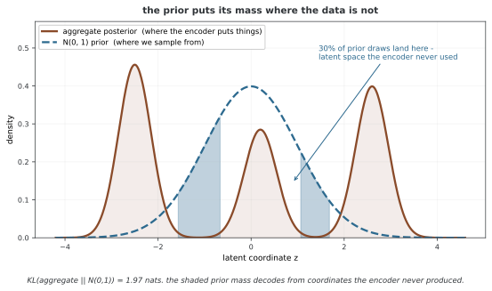

# 에너지 모델과 다른 뉴럴 넷트웍의 결합

에너지 모델을 인코더·디코더나 생성기와 연결하면 표현 학습과 샘플링을 나누어 설계할 수 있다. 결합의 이점은 모델 이름을 함께 쓰는 데 있지 않고 각 모듈이 정의하는 분포, 로스와 그래디언트 경로를 맞추는 데 있다. 이 페이지는 구현 코드 대신 설계 원리와 계산 조건을 다룬다. 구체적인 한 단계 함수는 [MCMC teaching 예제](../ebm_foundations/08_cooperative_training.md)에 있다.

## 1. 결합 로스를 쓸 때 먼저 정할 것

모든 항을 최소화하는 관례로 두면 다음처럼 쓸 수 있다.

$$L=L_{\mathrm{task}}+\lambda L_{\mathrm{density}}+\gamma L_{\mathrm{coupling}},
\qquad\lambda,\gamma\geq0$$

각 항이 어떤 분포와 데이터를 사용하는지, 어느 파라미터로 미분하는지 명시해야 한다. 단순히 KL(p_EBM||p_aux)라고 적어도 두 분포의 정규화 밀도와 공통 기준 측도, 필요한 기대값을 계산할 수 있는 것은 아니다. GAN 같은 암시적 생성기의 밀도를 알 수 없다면 이 KL을 직접 계산하는 단계도 정의되지 않는다.

서로 다른 로스는 합산 축과 단위가 다르다. 픽셀 합·평균, 토큰 수와 에너지 스케일에 따라 수치 크기가 바뀌므로 0.1 또는 0.5 같은 웨이트를 보편적인 기본값으로 해석하지 않는다. 각 로스와 그래디언트 크기, 검증 지표를 함께 확인한다.

## 2. 오토인코더 잠재공간의 EBM

오토인코더는 z=fφ(x), x̂=gψ(z)를 만들고 재구성 로스를 최소화한다. 먼저 학습한 인코더를 고정하고 z들의 분포 pθ(z)∝exp(−Eθ(z))를 맞춘 뒤, z를 샘플링해 디코더로 옮기는 두 단계 생성 구성을 사용할 수 있다.

차원이 줄면 계산 부담을 줄일 수 있지만 잠재공간이 단순해지거나 모든 모드가 보존된다는 보장은 없다. 결정적·차원 축소 인코더의 pθ(z)만으로 원본 x의 정규화 밀도를 얻지는 못한다. 단순 변수변환식은 가역성과 Jacobian 조건이 필요하다.

공동 학습에서는 재구성 로스에 Eθ(fφ(x))+log Zθ를 더할 수 있다. θ를 고정하고 φ만 미분하면 log Zθ는 상수이지만 z를 낮은 에너지로 모으는 압력이 생긴다. 인코더·디코더의 스케일 조절이나 표현 붕괴를 점검해야 한다. 밀도 항이 자동으로 유용한 표현을 보장하는 것은 아니다.

결정적 인코더를 qφ(z|x)=δ(z−fφ(x))로 보면서 연속 EBM 사전과의 KL을 일반 밀도처럼 쓰면 통상 유한하지 않다. 확률적 인코더, 집계분포의 정합이나 다른 규제 목적을 명시적으로 정의해야 한다.

## 3. VAE의 에너지 기반 사전분포

확률적 인코더 qφ(z|x), 관측모형 pψ(x|z)와 정규화 가능한 EBM 사전 pθ(z)를 선택하면 다음 ELBO를 최대화할 수 있다.

$$\operatorname{ELBO}(x)=\mathbb E_{q_\phi}\log p_\psi(x\mid z)
-D_{\mathrm{KL}}(q_\phi(z\mid x)\|p_\theta(z))$$

최소화 관례라면 전체에 음의 부호를 붙인다. EBM 사전의 KL에는 E_qEθ와 log Zθ가 들어가므로 정규화 문제가 없어진 것은 아니다. 사전 θ 업데이트에는 모델 기댓값, 인코더 φ 업데이트에는 리파라메리제이션 등의 추정이 필요하다.

정규 사전과 EBM 사전을 동시에 붙일 때도 두 밀도의 곱인지, 혼합인지, 잔차 에너지 보정인지 구성을 정해야 한다. 생성기가 빠르다는 사실만으로 EBM 사전의 정확한 샘플을 곧바로 얻지는 못한다. 우도·꼬리 표현력·안정성이 개선되는지는 같은 학습 예산에서 평가해야 한다.

**그림으로 보는 AI 1.** 1985년의 규칙이 잠재공간에서 다시 나타난다

왜 사전분포를 **배우려** 하는가. 표준정규는 공짜이고 샘플링도 쉬운데 말이다.

까닭은 인코더가 자료를 실제로 어디에 두는지를 보면 드러난다. 자료에 무리가 여럿이면 모든 $x$ 의 사후를 평균한 **집계 사후**도 봉우리가 여럿이 되는데, 표준정규는 가운데가 가장 두껍다. 두 분포가 어긋나는 만큼이 그대로 손해다.

봉우리 **사이**가 문제다. 집계 사후가 거의 0인 그 골짜기에서 표준정규는 여전히 두껍다. 세어 보면 $N(0,1)$ 표본의 **29.6%** 가 집계 사후 밀도의 하위 1% 아래 영역에 떨어진다. 인코더가 한 번도 쓴 적 없는 좌표를 디코더에 넣고 있는 셈이고, 두 분포의 KL은 1.97나트다. 학습을 아무리 잘해도 **사전과 인코더가 서로 다른 곳을 가리키고 있으면** 생성 품질이 거기서 샌다.

위 식의 EBM 사전은 그 자리를 메우자는 것이다. 2020년에 팡보(Bo Pang)와 동료들이 낸 「Learning Latent Space Energy-Based Prior Model」은 이것을 분명하게 적는다 — 보통 잠재벡터에 두는 것은 "a **non-informative** prior distribution, such as uniform or isotropic Gaussian"이고, 대신 "an **informative** prior model"을 배울 수 있으며, 그것은 "the philosophy of **empirical Bayes** where the prior model is learned from the observed data"를 따른다는 것이다.

**그런데 그 사전을 어떻게 배우는가가 이 장을 한 바퀴 돌아오게 한다.** 같은 글이 갱신 규칙을 이렇게 적는다 — 파라메터는 "the difference between $z$ inferred from empirical observation $x$, and $z$ sampled from the current prior"로 갱신된다. 자료 쪽에서 뽑은 표본의 통계에서 모델 쪽에서 뽑은 표본의 통계를 뺀다. [볼츠만 기계](../classical_ebm/boltzmann_machines.md) 쪽에서 본 1985년의 그 규칙이고, 바뀐 것은 무대가 픽셀에서 잠재공간으로 옮겨졌다는 것뿐이다.

**그래서 값도 함께 따라온다.** 그 쪽에서 보았듯 두 통계를 **따로** 추정해 빼는 구조는 양쪽의 잡음을 함께 들여온다. 바로 위 문단이 "생성기가 빠르다는 사실만으로 EBM 사전의 정확한 샘플을 곧바로 얻지는 못한다"고 적은 것이 그 말이고, 잠재공간이 저차원이라 사슬이 잘 섞인다는 것은 **비용이 줄었다는 뜻이지 없어졌다는 뜻이 아니다.** 같은 학습 예산에서 재어 보라는 단서가 붙는 까닭이 여기에 있다.

_확인한 곳 — B. Pang, T. Han, E. Nijkamp, S.-C. Zhu, Y. N. Wu, "Learning Latent Space Energy-Based Prior Model", arXiv:2006.08205 (NeurIPS 2020). 인용한 세 대목은 모두 그 글의 도입부와 학습 규칙 서술이다. 그림의 수는 그림을 그리는 코드가 봉우리 셋인 집계 사후를 두고 직접 재어 얻는다._

## 4. 생성기와의 협력·적대적 결합

[MCMC teaching](https://ojs.aaai.org/index.php/AAAI/article/view/11834)은 생성기 결과로 사슬을 시작하고 수정된 결과를 같은 잠재값의 생성기 목표로 사용한다. 에너지 모델은 데이터와 수정 표본의 에너지 차이를 학습한다. 이는 생성기가 평균 에너지만 최소화하는 방식과 다른 목적이다.

에너지를 이진 판별 점수에 사용할 수도 있지만 D(x)=sigmoid(−E(x))처럼 확률로 바꾸는 함수를 정의해야 한다. “p(E(x))”라는 표기만으로 정규화 이미지 밀도나 GAN 판별 확률이 정해지지는 않는다. 이진 분류 로스와 EBM 최대 우도는 일반적으로 같은 목적이 아니다.

생성기의 모드 붕괴, 짧은 사슬의 혼합 실패와 두 모델의 학습 속도 차이는 결합 뒤에도 남을 수 있다. 협력이라는 이름이 다양성이나 안정성의 보장을 뜻하지 않는다. 반복마다 샘플을 detach하는지와 어떤 목표로 생성기를 갱신하는지 명시한다.

## 5. 분류 모델과 표현 공유

분류 교차 엔트로피와 데이터 NLL을 함께 최소화하는 구성을 생각할 수 있다. 이때 NLL은 −log pθ(x)이므로 양의 log p를 더해 최소화하면 밀도를 낮추는 반대 방향이 된다. 레이블이 없는 입력의 생성 로스와 레이블이 있는 입력의 분류 로스를 어느 배치에서 계산하는지도 정한다.

표현을 공유하더라도 분류 오류가 반드시 높은 에너지에 대응하지는 않는다. 분류기는 클래스 비율을, 생성모델은 입력 분포를 학습하는 서로 다른 질문을 다룬다. 낮은 에너지만으로 OOD·오분류·강건성을 보장할 수는 없다.

## 6. 학습 순서와 평가

분리 학습은 각 모듈을 진단하기 쉽고, 공동 미세 조정은 표현을 작업에 맞게 바꿀 수 있다. 일부 모듈을 고정하면 그 파라미터는 갱신되지 않지만 입력에 대한 그래디언트는 다른 모듈에 전달할 수 있다. no_grad로 계산 전체를 끊는 것과 구분해야 한다.

검증에는 같은 데이터 분할·예산의 단독 모델과 비교하고 모듈을 제거하는 ablation을 사용한다. 높은 값이 좋은 정확도와 낮은 값이 좋은 NLL에서 “전체−제거” 차이의 부호 해석도 다르다. 실제 시간·메모리는 측정해야 하며 결합 모델의 비용을 항상 단독 모델의 두 배로 정할 수 없다.

시계열에 적용한다면 학습·검증·테스트를 시간 순서로 분리한다. t에서 만든 예측의 오차는 실제 t+1 관측이 도착한 뒤에만 계산할 수 있다. 잠재 에너지와 예측 오차를 합치려면 검증 데이터에서 스케일·임계값을 맞추고, 합산 점수가 모든 종류의 이상을 찾아낸다고 단정하지 않는다.

## 연습문제

**연습문제 1.** 
θ가 고정된 잠재 EBM, z=fφ(x)에서 −log pθ(z)의 인코더 그래디언트를 구하라. θ도 φ를 통해 공유되면 무엇이 달라지는가?

??? success "풀이"

    온도 1에서 ∇φ[−log pθ(fφ(x))]=J_fᵀ∇zEθ(z)다. 독립적인 고정 θ의 log Zθ는 φ에 의존하지 않는다. 하지만 에너지 파라미터가 φ와 공유되면 직접 파라미터 미분과 ∇φlog Z 항도 필요하다. 전체 로스에서는 재구성·결합 항의 그래디언트를 더하며, 서로 상충할 수도 있다.

---

**연습문제 2.** 
결정적 오토인코더에 KL(qφ(z|x)||pθ(z))를 추가할 때 무엇을 확인해야 하는가?

??? success "풀이"

    결정적 q는 점질량이며 일반적인 연속 사전과 같은 기준 측도에서 유한 KL을 갖지 않는다. 확률적 인코더를 정의하거나 집계 잠재분포의 다른 정합 목적을 택해야 한다. 차원 축소 잠재 밀도를 곧 원본 데이터 우도로 해석하지 않으며 공동 학습의 스케일·표현 붕괴도 확인한다.

---

**연습문제 3.** 
LSTM 예측 오차와 은닉 에너지로 이상 점수를 만들 때 사용 시점과 평가를 설명하라.

??? success "풀이"

    t까지의 입력에서 예측 r̂ₜ₊₁와 hₜ를 만든다. E(hₜ)는 t에 계산할 수 있지만 |rₜ₊₁−r̂ₜ₊₁|는 실제 rₜ₊₁이 관측된 뒤에 계산한다. 합친 점수는 그 시점을 표시하고, 두 항의 스케일과 웨이트·임계값은 검증 구간에서 정한다. 시간 누출 없는 테스트와 단독 항의 ablation으로 보완 효과를 평가해야 한다.

---

**연습문제 4.** 
양의 정부호 공분산을 갖는 p=N(μ₁,Σ₁), q=N(μ₂,Σ₂)의 KL을 적고 적용 범위를 설명하라.

??? success "풀이"

    KL(p||q)=0.5[log(detΣ₂/detΣ₁)−d+tr(Σ₂⁻¹Σ₁)+(μ₂−μ₁)ᵀΣ₂⁻¹(μ₂−μ₁)]다. 두 정규분포의 정규화 밀도에 대한 식이며 같으면 0이다. 임의의 뉴럴 넷트웍 EBM을 평균·공분산만으로 바꾸어 이 값을 계산하면 원래 두 분포의 정확한 KL이 아니라 가우스 근사의 KL이다. 특이 공분산은 지지집합과 절대연속성을 별도로 검토해야 한다.

## 정리하며

결합 모델은 분포·로스의 부호와 그래디언트 경로를 명확히 정의해야 한다. 잠재 EBM의 정규화, 결정적 인코더 KL과 원본 우도의 차이, 회귀형 MCMC teaching을 구분한다. 성능과 효율의 이점은 시간 누출 없는 검증과 ablation으로 확인한다.
