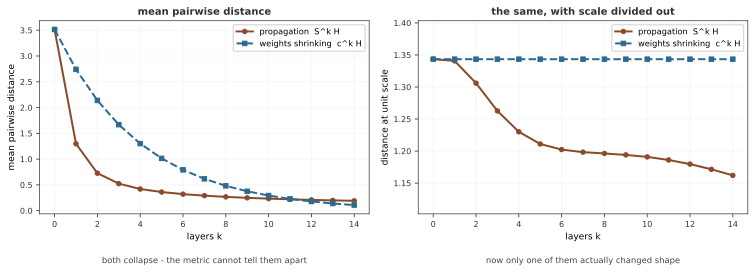

# 과도한 평활화(Over-smoothing)

메시지 패싱을 반복하면 서로 다른 노드를 구분하는 표현이 약해질 수 있다. 이를 과도한 평활화라고 한다. 그러나 노드 사이 거리가 작아졌다는 사실만으로 원인을 단정할 수는 없다. 웨이트가 전체 벡터 크기를 줄이거나 활성화가 출력을 0으로 만들어도 비슷한 지표가 나오기 때문이다. 표현의 기하와 과제 성능을 함께 살펴야 한다.

## 1. 코드와 출력

```python
"""
29.4.2: 지나친 매끄러워짐 - 재기와 누그러뜨리기.
"""
import torch, torch.nn as nn, torch.nn.functional as F
import numpy as np, networkx as nx

# ========================================================================
# 메인
# ========================================================================

def measure_smoothness(H, edge_index):
    """평균 절대 거리와 디리클레 에너지를 셈한다."""
    n = H.shape[0]
    # 평균 절대 거리
    diffs = H.unsqueeze(0) - H.unsqueeze(1)
    mad = diffs.norm(dim=-1).mean().item()
    # 디리클레 에너지
    src, dst = edge_index[0], edge_index[1]
    energy = ((H[src] - H[dst])**2).sum().item()
    return mad, energy

class SimpleGCN(nn.Module):
    def __init__(self, in_ch, hidden_ch, num_layers):
        super().__init__()
        self.input = nn.Linear(in_ch, hidden_ch)
        self.convs = nn.ModuleList()
        for _ in range(num_layers):
            self.convs.append(nn.Linear(hidden_ch, hidden_ch))
    def forward(self, x, edge_index):
        n = x.shape[0]; x = F.relu(self.input(x))
        src, dst = edge_index[0], edge_index[1]
        loop = torch.arange(n, device=x.device)
        src_a = torch.cat([src, loop]); dst_a = torch.cat([dst, loop])
        deg = torch.zeros(n, device=x.device)
        deg.scatter_add_(0, dst_a, torch.ones(dst_a.shape[0], device=x.device))
        norm = (deg[src_a] * deg[dst_a]).pow(-0.5)
        norm[norm==float('inf')] = 0
        for lin in self.convs:
            h = lin(x); msg = h[src_a] * norm.unsqueeze(1)
            out = torch.zeros(n, h.shape[1], device=x.device)
            out.scatter_add_(0, dst_a.unsqueeze(1).expand_as(msg), msg)
            x = F.relu(out)
        return x

def demo_over_smoothing():
    print("=" * 60); print("Over-Smoothing Analysis"); print("=" * 60)
    torch.manual_seed(42)
    G = nx.karate_club_graph(); n = G.number_of_nodes()
    edges = list(G.edges())
    src = [e[0] for e in edges]+[e[1] for e in edges]
    dst = [e[1] for e in edges]+[e[0] for e in edges]
    ei = torch.tensor([src, dst], dtype=torch.long)
    x = torch.eye(n)
    print(f"{'Layers':>8} {'MAD':>10} {'Dirichlet':>12}")
    for nl in [1, 2, 4, 8, 16, 32]:
        model = SimpleGCN(n, 16, nl); model.eval()
        with torch.no_grad():
            H = model(x, ei)
            mad, energy = measure_smoothness(H, ei)
        print(f"{nl:>8} {mad:>10.4f} {energy:>12.4f}")

if __name__ == "__main__":
    demo_over_smoothing()
```

```
============================================================
Over-Smoothing Analysis
============================================================
  Layers        MAD    Dirichlet
       1     0.1786      24.2646
       2     0.1157      12.8935
       4     0.1644      28.5002
       8     0.1583      25.9448
      16     0.1455      20.6601
      32     0.1231      15.4138
```

데모는 학습하지 않은 무작위 SimpleGCN을 깊이별로 새로 만들고 지표를 측정한다. 기존 출력은 학습된 분류기의 정확도나 같은 모델을 한 레이어씩 연장한 결과가 아니다. 이번 편집에서는 재실행하지 않았다.

## 2. 두 지표의 정확한 정의

measure_smoothness의 MAD는 모든 순서 있는 노드 쌍의 유클리드 거리 평균이다. 자기 쌍의 0 거리도 분모 N²에 포함한다. 코사인 거리 기반 MAD 등 다른 문헌의 정의와 구분한다.

$$\operatorname{MAD}(H)=\frac1{N^2}\sum_{i,j}\lVert h_i-h_j\rVert_2$$

두 번째 지표는 edge_index의 각 열에 대해 피처 차이의 제곱을 더한다. 데모는 무방향 엣지를 양방향으로 저장하므로 각 단순 엣지를 두 번 센다. 조합 라플라시안 L=D−A에 대해 코드의 값은 다음과 같다.

$$E_{\mathrm{code}}(H)=\sum_{(i,j)\in E_{\mathrm{directed}}}\lVert h_i-h_j\rVert_2^2
=2\operatorname{tr}(H^\top LH)$$

MAD는 H를 a배 하면 |a|배, 에너지는 a²배가 된다. 두 값이 작아져도 노드의 상대 방향이나 분류 정보가 같은 비율로 사라졌다고 결론낼 수 없다. 정규화한 거리·비연결 노드 간 차이와 지도 과제 성능을 함께 확인한다.

MAD 계산은 N×N×d 차이 텐서를 만들므로 O(N²d) 시간·중간 메모리가 필요하다. 엣지 기반 에너지는 O(md)로 계산할 수 있다. 큰 그래프에서 두 지표의 비용은 상당히 다르다.

## 3. 데모가 비교하는 것

Karate Club의 무웨이트 연결과 34차원 단위 행렬 피처를 사용한다. 입력 Linear·ReLU 뒤에 폭 16의 정규화 집계·Linear·ReLU를 1·2·4·8·16·32번 적용한다. 각 모델은 별도로 초기화하고 시드를 매 모델마다 다시 설정하지 않으므로 깊이와 무작위 웨이트가 함께 달라진다.

학습·로스·optimizer는 없다. 따라서 출력은 특정 초기화의 표현 변화를 보여 주며, 지표의 단조 감소나 8~16레이어에서 1% 이하가 된다는 보편적 임계값을 증명하지 않는다. bias·ReLU·웨이트의 크기와 방향도 지표에 영향을 준다.

## 4. 선형 전파에서 성립하는 에너지 경계

학습 웨이트와 비선형을 제외하고 H_k=S^kH_0를 생각하자. S는 루프를 포함한 무방향 대칭 정규화 인접 행렬이며 연결성과 양의 자기 루프를 가정한다. 고유값은 1=λ₁이고 나머지의 절댓값은 1보다 작다.

이때 코드의 조합 라플라시안 대신 **S와 대응하는 정규화 라플라시안** L_S=I−S의 에너지를 정의한다.

$$\mathcal E_S(H)=\operatorname{tr}(H^\top(I-S)H)$$

S의 직교 고유벡터 u_i로 전개하면 다음과 같다.

$$\mathcal E_S(S^kH_0)=\sum_{i\ge2}(1-\lambda_i)\lambda_i^{2k}\lVert u_i^\top H_0\rVert_F^2
\le\rho^{2k}\mathcal E_S(H_0),\qquad
\rho=\max_{i\ge2}|\lambda_i|$$

λ₂만 쓰려면 나머지 모든 고유값의 절댓값이 λ₂ 이하라는 추가 조건이 필요하다. 양의 자기 루프가 있어도 음의 고유값이 존재할 수 있다. 선형 웨이트를 곱한다면 에너지 경계에 그 웨이트 곱의 연산자 노름 제곱이 추가된다. 임의의 학습 웨이트를 생략하고 같은 감소율을 주장할 수는 없다.

S의 정상 방향은 상수 벡터가 아니라 √d̃에 비례한다. 따라서 이 극한에서 정규화 에너지가 0이어도 코드가 재는 원래 피처의 조합 에너지는 0이 아닐 수 있다. 어떤 라플라시안과 피처 좌표계를 쓰는지 일치시켜야 한다.

## 5. PairNorm과 완화 방법

[PairNorm](https://arxiv.org/abs/1909.12223)은 노드 표현을 중심화하고 전체 스케일을 조정해 평균적인 쌍별 거리의 붕괴를 줄인다. 아래 연습문제의 함수는 노드별 평균을 뺀 뒤 노드 벡터의 RMS 노름으로 나누는 기본 형태다.

분모의 작은 상수를 무시하고 중심화된 분산이 양수라면, 출력의 평균 제곱 노름은 s²이고 모든 순서 있는 쌍의 평균 제곱 거리는 2s²다. **평균 거리 자체**가 정확히 고정되는 것은 아니다. 모든 노드가 이미 같아 중심화 결과가 0이면 원래 차이를 복원할 수 없다.

잔차·초기 피처 재주입·Jumping Knowledge·엣지 샘플링도 고려할 수 있다. 각 방법은 정보 전달과 과제에 맞춰 비교해야 한다. 거리를 크게 유지하는 것만으로 정확도 개선이나 구조 정보 보존을 보장하지 않는다.

<div class="storybox" markdown>

**그림으로 보는 AI 1.** 잘 되게 하는 바로 그것이 망가뜨린다

과도한 평활화라는 이름은 2018년에 리치마이(Qimai Li)·한즈차오(Zhichao Han)·우샤오밍(Xiao-Ming Wu)이 붙였다. 그런데 그 논문의 요지는 "GCN에 이런 고장이 있다"가 아니었다. 거꾸로였다.

그들이 먼저 보인 것은 **GCN의 겹말기가 사실 라플라스 평활화(Laplacian smoothing)라는 것**이고, 그것이야말로 GCN이 잘 되는 까닭이라는 것이었다. 같은 무리의 노드를 서로 닮게 만들어 주니 분류가 쉬워진다. 그리고 바로 그 문장 다음에 결론이 따라온다 — 같은 연산을 되풀이하면 **다른 무리의 노드까지** 섞여 구분이 사라진다. 고장과 효능이 다른 장치가 아니라 **같은 장치의 양이 달라진 것**이다. 이 쪽이 레이어 수를 손잡이로 다루는 까닭이 여기에 있다.



이 쪽 머리말이 "거리가 작아졌다는 사실만으로 원인을 단정할 수 없다"고 적어 두었다. 그것을 수로 보면 이렇다. 가라테 클럽 그래프에 두 가지를 걸었다 — 하나는 진짜 전파 $S^kH_0$, 다른 하나는 **전파 없이 전체 크기만** $c^k$ 배로 줄인 것이다. 평균 쌍별 거리는 둘 다 3.51에서 0.1~0.2로 무너지고, 레이어가 열쯤 되면 **두 곡선이 겹친다.** 이 지표만 보고 있었다면 둘을 가를 방법이 없다.

전체 크기를 1로 맞추고 다시 재면 갈린다. 전파한 쪽은 1.3434에서 1.1620으로 내려가고 — 모양이 정말 바뀌었다 — 크기만 줄인 쪽은 **1.3434에 조금도 움직이지 않는다.** 애초에 기하가 바뀐 적이 없으니 당연하다.

**그러니 지표 하나로 과도한 평활화를 진단할 수는 없다.** 위 문단이 거리를 크게 유지하는 것만으로는 아무것도 보장되지 않는다고 적은 것과 같은 이야기를 반대쪽에서 한 셈이다 — 거리가 작아진 것으로 원인을 단정할 수 없고, 거리를 크게 만든 것으로 해결을 주장할 수도 없다. PairNorm이 크기를 고정하는 장치인 만큼, 그것이 올린 수가 **기하를 되살린 것인지 눈금을 되돌린 것인지**는 따로 확인해야 한다.

_확인한 곳 — Q. Li, Z. Han, X.-M. Wu, "Deeper Insights into Graph Convolutional Networks for Semi-Supervised Learning", AAAI 2018. GCN의 겹말기가 라플라스 평활화의 특수한 꼴이라는 것, 그것이 잘 되는 까닭이라는 것, 되풀이하면 다른 무리가 섞여 구분이 사라진다는 것이 모두 그 논문이다. 그림의 수는 그림을 그리는 코드가 가라테 클럽 그래프에 직접 재며, 두 경우 모두 평균 거리가 무너진다는 것과 정규화하면 한쪽만 변한다는 것을 먼저 확인한 뒤에만 그린다._

</div>

## 연습문제

<div class="drillbox" markdown>

**연습문제 1.** <span class="diff med" title="중간"></span>
MAD와 코드의 에너지가 피처를 a배 했을 때 어떻게 변하는가? 이 사실이 해석에 주는 주의점을 설명하라.

</div>

??? success "풀이"

    MAD는 |a|배, 제곱 차이의 합인 에너지는 a²배다. 단순 스케일 축소만으로 두 지표가 작아질 수 있으므로 평활화로 인한 정보 로스와 구분한다. 정규화된 지표와 과제 성능, 같은 웨이트·초기화 조건을 함께 확인해야 한다.


---

<div class="drillbox" markdown>

**연습문제 2.** <span class="diff med" title="중간"></span>
선형 전파의 에너지 경계에서 λ₂ 대신 ρ=max(i≥2)|λ_i|를 써야 하는 이유와 웨이트가 있을 때의 변화를 설명하라.

</div>

??? success "풀이"

    음의 고유값이 λ₂보다 큰 절댓값을 가질 수 있어 λ_i^(2k)≤λ₂^(2k)가 일반적으로 성립하지 않는다. 정규화 라플라시안 에너지를 고유벡터로 전개하면 각 항은 (1−λ_i)λ_i^(2k)||u_iᵀH||²이며 ρ^(2k)로 묶을 수 있다. 오른쪽에 웨이트 곱 W를 추가하면 ||W||₂² 인수도 필요하다. 비선형 모델이나 다른 라플라시안에 그대로 적용하지 않는다.


---

<div class="drillbox" markdown>

**연습문제 3.** <span class="diff hard" title="어려움"></span>
아래 PairNorm 함수가 보존하는 양과 모든 노드가 같은 벡터일 때의 동작을 설명하라.

</div>

??? success "풀이"

    중심화 후 RMS 노름으로 나누므로 ε의 영향을 무시하면 평균 제곱 노름이 s², 전체 순서 쌍의 평균 제곱 거리가 2s²가 된다. 평균 거리나 각 쌍의 거리를 따로 고정하지 않는다. 모든 노드가 같으면 중심화 결과가 0이고 출력도 0이라 잃은 차이를 복원하지 못한다. 적용 후 분류 성능의 특정 배수 개선은 보장할 수 없다.

    ```python
    def pairnorm(x, s=1.0):
        x = x - x.mean(dim=0, keepdim=True)  # Center
        norm = x.pow(2).sum(dim=-1, keepdim=True).mean().sqrt()
        return s * x / (norm + 1e-8)
    ```


## 정리하며

거리와 디리클레 에너지는 표현 변화를 보는 도구지만 스케일·중복 엣지·라플라시안 정의에 민감하다. 데모는 무작위 비선형 모델의 비교이며, 선형 전파의 엄밀한 경계에는 대응 에너지·최대 절대 고유값·웨이트 조건이 필요하다.
