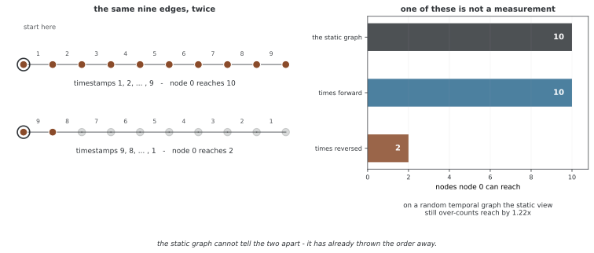

# 시간 그래프 뉴럴 넷트웍

시간 그래프는 연결·노드·피처의 변화나 시각이 기록된 상호작용을 표현한다. 시간 GNN은 그래프 구조와 사건의 순서·간격을 함께 이용한다. 핵심은 모델 이름보다 **예측 시점에 어떤 정보를 알고 있는가**다. 과거에 일어난 사건이라도 나중에 관측·확정된 정보라면 당시 예측 입력으로 사용할 수 없다.

## 1. 스냅숏과 사건 스트림

이산 시간 동적 그래프는 G₁,…,G_T처럼 스냅숏의 열로 나타낸다. 일별·월별 등 일정 간격이 흔하지만 간격이 반드시 같아야 하는 것은 아니다. 집계 창 안의 사건 순서·정확한 시각을 보존하지 않으면 그 정보가 사라진다.

연속 시간 동적 그래프는 (u,v,t,e)와 같은 시각 t의 사건을 기록한다. 연속 시간이라는 말은 모든 순간에 연속적인 상태 변화가 있다는 뜻은 아니다. 사건이 발생한 시각마다 메모리를 갱신하는 모델도 포함한다. 엣지 추가·삭제·속성 변경이나 반복 상호작용 중 무엇을 나타내는지 정해야 한다.

거래 기록 하나가 생겼다고 영구적인 거래 관계가 생긴 것은 아니고, 마지막 거래가 오래되었다고 엣지가 삭제된 것도 아니다. 사건과 지속되는 상태를 구분해 그래프를 구성한다.

**그림으로 보는 AI 1.** 시간을 넣으면 "이어져 있다"가 추이적이지 않게 된다

위 문단이 "집계 창 안의 사건 순서·정확한 시각을 보존하지 않으면 그 정보가 사라진다"고 적었다. 사라지는 것이 **얼마나 근본적인지**는 2000년에 데이비드 켐프(David Kempe)·존 클라인버그(Jon Kleinberg)·아미트 쿠마르(Amit Kumar)가 STOC에 낸 「시간 그래프의 연결성과 추론 문제」가 정리해 두었다. 그들은 시각을 거스르지 않는 길을 **시간을 지키는 경로(time-respecting path)** 라 부르고, 그것으로 재면 정적 그래프의 성질이 여럿 무너진다는 것을 보였다.

보기는 사슬 하나면 된다. 노드 열 개를 줄로 이은 **똑같은 엣지 아홉 개**에 시각만 다르게 붙여 보았다. 앞에서 뒤로 1, 2, …, 9를 붙이면 노드 0에서 **열 개 모두**에 닿는다. 거꾸로 9, 8, …, 1을 붙이면 **두 개**에 그친다. 늦게 열린 다리를 먼저 건널 수는 없기 때문이다. **정적 그래프는 두 경우가 완전히 같다** — 같은 아홉 엣지이므로 구별할 방법이 없다.

더 깊은 곳은 이것이다. 사건이 둘뿐인 그래프를 만들어 보자 — $a$–$b$ 가 시각 2, $b$–$c$ 가 시각 1이다. 그러면 $a$ 는 $b$ 에 닿고 $b$ 는 $c$ 에 닿는데, **$a$ 는 $c$ 에 닿지 않는다.** 시각 2에 $b$ 에 이르렀을 때 $b$–$c$ 는 이미 지나간 뒤다. 정적 그래프에서는 셋이 한 덩어리라 세 문장이 모두 참인데, 시간을 넣으면 **"닿는다"가 추이적이기를 그만둔다.**

무작위 시간 그래프에서도 정적 관점은 닿는 쌍을 1.22배 부풀려 센다. 사슬처럼 극단적으로 짜지 않아도 늘 과다하게 센다는 뜻이다.

**그러니 스냅숏으로 모을 때 잃는 것은 "정밀도"가 아니라 성질 자체다.** 창 안에서 순서를 지우면 닿지 않는 쌍이 닿는 것으로 바뀌고, 그 위에서 센 이웃·경로·연결 성분은 모두 있지도 않은 경로를 포함한다. 위 문단이 사건과 지속되는 상태를 구분하라고 적은 까닭이 여기에 있다 — 창의 폭은 정밀도의 손잡이가 아니라 **어떤 길이 존재하는가를 바꾸는 손잡이**다.

_확인한 곳 — D. Kempe, J. Kleinberg, A. Kumar, "Connectivity and inference problems for temporal networks", STOC 2000. 시간을 지키는 경로와 정적 그래프의 성질이 무너진다는 결과가 그 논문이다. 그림과 본문의 수 — 사슬의 10 대 2, 무작위 그래프의 1.22배, 그리고 $a\to b$, $b\to c$ 인데 $a\not\to c$ 인 보기 — 는 모두 그림을 그리는 코드가 직접 재고 확인한 뒤에만 그린다._

## 2. 스냅숏 기반 인코더

각 스냅숏에서 GNN으로 노드 표현을 구하고 시간 모델로 결합할 수 있다.

$$Z_t=\operatorname{GNN}(G_t,X_t),\qquad
H_t=\operatorname{RNN}(Z_t,H_{t-1})$$

노드별 순환 상태를 사용하려면 스냅숏 사이의 노드 ID를 정렬하고 신규·탈퇴·누락 노드를 처리해야 한다. 노드 집합이 바뀌면 같은 행 번호가 같은 실체를 뜻하는지 확인한다. 전체 시퀀스를 보는 양방향 모델이나 마스크 없는 Transformer는 미래 예측에서 사용할 수 없다.

예를 들어 일별 거래를 하루 끝에 모아 만든 G_t는 그날 시작 시점의 예측에 쓸 수 없다. 당일 종료 후 다음 날을 예측하는 설정처럼 정보 가용 시점을 명시해야 한다.

## 3. EvolveGCN: 웨이트의 시간 변화

[EvolveGCN](https://arxiv.org/abs/1902.10191)은 노드별 기억 상태 대신 GCN의 웨이트 행렬을 시간에 따라 갱신한다. EvolveGCN-H는 현재 노드 표현을 요약해 GRU형 갱신에 넣고, EvolveGCN-O는 웨이트의 순환적 변화를 모델링한다.

일반적인 GRU(H_t,W_{t−1}) 식은 아이디어의 축약일 뿐이다. 노드 수×피처 차원의 표현과 GCN 웨이트 행렬은 모양이 다르므로 요약·행렬 상태 처리 없이 표준 GRU에 그대로 넣을 수는 없다. 웨이트를 시간에 따라 공유·갱신한다는 설계와 구체적인 구현 차원을 구분한다.

## 4. TGAT: 과거 이웃과 시간 인코딩

[TGAT](https://arxiv.org/abs/2002.07962)은 질의 시각 t 이전의 상호작용을 이웃으로 사용하고 시간차를 함수형 인코딩에 넣어 어텐션으로 집계한다. 예를 들어 여러 주파수에 대한 cos(ω_jΔt+φ_j)를 벡터로 사용할 수 있다.

코사인 인코딩은 시간 차이를 표현하지만 시간이 멀어질수록 단조롭게 작아지지 않는다. 따라서 최근 사건을 반드시 더 크게 가중하는 구조는 아니다. 어텐션·피처·학습 목적에 따라 어떤 시간 간격이 중요한지 달라진다. 고정된 시간 감쇠가 필요하면 그 가정을 별도로 설계한다.

노드 v의 과거 사건 이웃은 다음처럼 나타낼 수 있다.

$$\mathcal N(v,t)=\{(u,t',e):(u,v,t',e)\text{가 관측되었고 }t'<t\}$$

같은 u와의 반복 사건을 하나의 정적 이웃으로 합치면 빈도·순서가 사라질 수 있다. 재귀적으로 이웃을 조회할 때도 각 메시지 시점의 cutoff를 지켜 미래 사건이 섞이지 않게 해야 한다.

## 5. TGN: 사건에 따른 메모리

[TGN](https://arxiv.org/abs/2006.10637)은 노드별 메모리, 사건 메시지, 메시지 집계·메모리 갱신, 최종 임베딩 모듈을 결합하는 틀이다. 사건 직전의 메모리와 허용된 과거 이웃으로 예측한 다음, 그 사건을 관측한 뒤 메모리를 갱신하는 순서를 사용할 수 있다.

예측할 사건으로 메모리를 먼저 갱신하면 자신의 정답을 본 표현으로 평가할 위험이 있다. 같은 시각의 사건과 미니배치 안의 갱신 순서도 명시해야 한다. 병렬 처리를 위해 상태 갱신을 지연할 수 있지만 그 선택이 어떤 사건을 참조하는지 바꿀 수 있다.

모든 연속 시간 모델이 노드 메모리를 유지하는 것은 아니다. TGAT의 과거 이웃 조회와 TGN의 상태 갱신은 서로 다른 설계다. 신규 노드의 초기 상태와 피처, 긴 이력의 저장·샘플링 비용도 함께 고려한다.

## 6. 시간 평가와 응용

학습→검증→테스트를 시간순으로 나누고, 각 단계 시작의 메모리 상태와 관측 이력을 정의한다. 검증·테스트에서 레이블 없이 관측 사건으로 상태를 갱신하는 온라인 평가는 가능하지만, 그 규칙을 모든 모델에 동일하게 적용해야 한다. 학습에 없던 노드까지 평가하면 기존 노드 예측과 분리해 보고한다.

거래 이상 탐지에서는 금액·상대방·시간 간격·과거 액션을 함께 모델링할 수 있다. 의심 계좌와의 연결이 곧 부정행위의 정답은 아니며, 이웃의 레이블이 확정된 시점도 고려해야 한다. 지연 레이블과 클래스 불균형을 반영해 오탐·재현율·시간별 성능을 평가한다.

상관 네트워크의 변화를 입력으로 쓸 때도 계산 창이 예측 시점 이전인지 확인한다. 이 절은 모델링 방법을 설명하며 실제 위험 경보나 투자 성과의 개선을 측정한 결과를 제시하지 않는다.

## 연습문제

**연습문제 1.** 
스냅숏과 연속 시간 사건 표현의 차이를 설명하라. 연속 시간 모델은 상태가 항상 연속적으로 변해야 하는가?

??? success "풀이"

    스냅숏은 특정 시점·창의 그래프를 열로 기록하고, 사건 표현은 각 상호작용의 시각을 보존한다. 연속 시간 모델도 사건 시각에만 메모리를 갱신할 수 있다. 정적 창으로 묶을 때 순서·간격이 사라지는지, 사건이 지속 엣지인지 일회 기록인지 정해야 한다.

---

**연습문제 2.** 
TGAT의 시간차 코사인 인코딩만으로 최근 사건에 더 높은 웨이트가 보장되는가?

??? success "풀이"

    아니다. 코사인은 주기적이며 시간차에 대해 단조 감소하지 않는다. 인코딩은 간격 정보를 제공하고 실제 웨이트는 어텐션과 학습으로 정해진다. 명시적인 최근성 바이어스가 필요하면 감쇠 함수 등 별도 설계가 필요하다.

---

**연습문제 3.** 
시각 t의 링크 발생을 예측하는 TGN에서 예측과 메모리 갱신의 순서를 설명하라.

??? success "풀이"

    t 직전까지 허용된 과거 상태로 후보 점수를 계산하고, 사건을 관측한 뒤 그 정보로 상태를 갱신한다. 정답 사건으로 먼저 갱신한 메모리를 같은 사건의 예측에 쓰면 누출된다. 같은 시각·미니배치의 사건은 처리 규약을 명시해야 한다.

---

**연습문제 4.** 
하루 전체 거래로 만든 그래프와 다음 주에 확정되는 사기 레이블을 그날 오전 예측에 사용하면 어떤 문제가 생기는가?

??? success "풀이"

    당일 나중 거래와 미래에 확정되는 레이블은 오전에 관측할 수 없어 정보가 누출된다. 사건 발생 시점과 데이터 가용·레이블 확정 시점을 따로 관리하고 과거에 실제 알 수 있었던 정보로 피처·이웃·메모리를 구성해야 한다.

## 정리하며

시간 GNN은 스냅숏 인코딩, 웨이트 변화, 과거 이웃 어텐션, 사건별 메모리 등 여러 설계를 사용한다. 시간 인코딩은 자동적인 최근성 보장이 아니며, 예측 전후의 상태 갱신과 정보 가용 시점이 평가의 핵심이다.

**참고 문헌**

[Kazemi et al. -- Representation Learning for Dynamic Graphs: A Survey (JMLR 2020)](https://jmlr.org/papers/v21/19-447.html)
