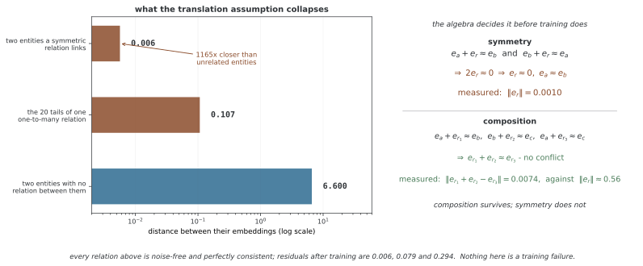

# 지식 그래프 완성

지식 그래프는 (주체 h, 관계 r, 객체 t)의 삼중항으로 사실을 표현한다. 지식 그래프 완성은 주어진 h·r에 대한 t 또는 r·t에 대한 h 같은 누락 항목의 후보를 순위화하는 문제다. 이 페이지는 TransE 임베딩 모델을 사용하며, 이웃을 집계하는 GNN 구현은 아니다.

## 1. 코드와 출력

```python
"""29.7.5: 앎 그래프 채우기."""
import torch, torch.nn as nn, torch.nn.functional as F
import numpy as np

# ========================================================================
# 메인
# ========================================================================

class TransE(nn.Module):
    def __init__(self, n_entities, n_relations, dim=32):
        super().__init__()
        self.ent_emb = nn.Embedding(n_entities, dim)
        self.rel_emb = nn.Embedding(n_relations, dim)
        nn.init.xavier_uniform_(self.ent_emb.weight)
        nn.init.xavier_uniform_(self.rel_emb.weight)
    def score(self, h, r, t):
        return -torch.norm(self.ent_emb(h) + self.rel_emb(r) - self.ent_emb(t), dim=-1)
    def forward(self, triples, neg_tails):
        h, r, t = triples[:, 0], triples[:, 1], triples[:, 2]
        pos_score = self.score(h, r, t)
        neg_score = self.score(h.unsqueeze(1).expand_as(neg_tails),
                                r.unsqueeze(1).expand_as(neg_tails), neg_tails)
        return -F.logsigmoid(pos_score).mean() - F.logsigmoid(-neg_score).mean()

def demo():
    print("=" * 60); print("Knowledge Graph Completion (TransE)"); print("=" * 60)
    torch.manual_seed(42); np.random.seed(42)
    n_ent, n_rel = 50, 5
    # 세 쌍 만들기
    triples = []
    for _ in range(500):
        h = np.random.randint(n_ent); r = np.random.randint(n_rel); t = np.random.randint(n_ent)
        triples.append([h, r, t])
    triples = torch.tensor(triples)
    train, test = triples[:400], triples[400:]
    model = TransE(n_ent, n_rel, dim=32)
    opt = torch.optim.Adam(model.parameters(), lr=0.01)
    for epoch in range(100):
        opt.zero_grad()
        neg_t = torch.randint(0, n_ent, (train.shape[0], 5))
        loss = model(train, neg_t)
        loss.backward(); opt.step()
        if (epoch+1) % 20 == 0:
            with torch.no_grad():
                h, r, t = test[:,0], test[:,1], test[:,2]
                pos_s = model.score(h, r, t)
                all_scores = torch.stack([model.score(h, r, torch.full_like(t, e)) for e in range(n_ent)], dim=1)
                ranks = (all_scores >= pos_s.unsqueeze(1)).sum(dim=1).float()
                mrr = (1.0/ranks).mean()
                hits10 = (ranks <= 10).float().mean()
            print(f"  Epoch {epoch+1}: Loss={loss.item():.4f}, MRR={mrr:.4f}, Hits@10={hits10:.4f}")

if __name__ == "__main__":
    demo()
```

```
============================================================
Knowledge Graph Completion (TransE)
============================================================
  Epoch 20: Loss=1.4485, MRR=0.1013, Hits@10=0.1900
  Epoch 40: Loss=1.3705, MRR=0.0819, Hits@10=0.2300
  Epoch 60: Loss=1.3581, MRR=0.0751, Hits@10=0.1500
  Epoch 80: Loss=1.3598, MRR=0.0775, Hits@10=0.1600
  Epoch 100: Loss=1.3591, MRR=0.0757, Hits@10=0.1700
```

기존 출력은 합성 삼중항의 학습 로스·객체 예측 지표다. 이번 편집에서는 재실행하지 않았다. 실세계 사실을 학습했거나 지식 추론 성능을 검증한 기록으로 읽지 않는다.

## 2. TransE의 이동 가정

[TransE](https://proceedings.neurips.cc/paper_files/paper/2013/hash/1cecc7a77928ca8133fa24680a88d2f9-Abstract.html)는 관계를 벡터 이동으로 표현한다. 코드의 점수는 L2 거리의 음수다.

$$s(h,r,t)=-\lVert e_h+e_r-e_t\rVert_2$$

거리 0에서 최대 점수 0이며, 더 음수일수록 적합도가 낮다. 내적 기반 점수와 달리 점수 범위가 0 이하로 제한된다. 같은 h·r에서 여러 t의 점수를 모두 최대화하려면 해당 객체 벡터들이 같은 e_h+e_r 부근에 있어야 하므로 일대다 관계 등에 표현 제약이 생길 수 있다.

엔티티 50개와 관계 5개를 각각 32차원 테이블에 저장해 파라미터는 (50+5)×32=1,760개다. 노드 피처·관계의 설명·그래프 이웃은 입력하지 않는다. 테이블에 없는 엔티티는 그대로 점수를 낼 수 없다.

<div class="storybox" markdown>

**그림으로 보는 AI 1.** 1860년에 이미 분류해 둔 성질들

바로 위에서 "일대다 관계 등에 표현 제약이 생길 수 있다" 고 적은 그 제약은, 관계가
가질 수 있는 성질들을 따져 보면 **학습 전에 이미 정해진다.** 그 성질들의 목록을 처음
만든 사람은 그래프를 본 적이 없다. Augustus De Morgan 이 1860년 "On the Syllogism IV;
and on the Logic of Relations" 에서 삼단논법의 계사 "이다" 를 일반적인 **두 자리 관계**로
바꾸면서 관계의 **합성**과 **역관계**를 끌어들였고, C. S. Peirce 가 1870년
"Description of a Notation for the Logic of Relatives" 에서 그것을 대수로 세웠다.
합성·역·대칭이라는 이름은 거기서 왔다. 지금 지식 그래프 임베딩을 재는 잣대가 그 목록이다.

이동 가정이 그 목록의 어디까지 감당하는지는 흠 없는 자료로 확인할 수 있다. 잡음도
모순도 없는 삼중항만 주고 학습시키면, 남는 것은 모델의 몫뿐이다.

- **대칭** — $r(a,b)$ 와 $r(b,a)$ 가 둘 다 참이면 $e_a+e_r\approx e_b$ 와
  $e_b+e_r\approx e_a$ 가 함께 성립해야 하므로 $2e_r\approx 0$ 이다. 실제로 재면
  $\lVert e_r\rVert = 0.0010$ 으로 관계가 **사라지고**, 짝지어진 두 엔티티가 거리
  **0.006** 까지 포개진다. 아무 관계 없는 두 엔티티 사이가 **6.600** 인 눈금에서
  1,165배 가까운 거리다.
- **일대다** — 머리 하나와 관계 하나에 꼬리 스물을 걸면 $e_h+e_r$ 이 한 점이므로 꼬리
  스물이 모두 그 자리로 모인다. 서로 평균 **0.107** 까지 붙는다. 스무 개의 다른 대상이
  사실상 한 대상이 된다.



반대쪽도 재야 공평하다. **합성** — $r_1$ 다음 $r_2$ 가 $r_3$ 와 같다는 관계 — 은
이동 가정과 다투지 않는다. $e_{r_1}+e_{r_2}\approx e_{r_3}$ 이면 그만이고, 재 보면
어긋남이 **0.0074** 로 관계 벡터의 전형적 크기 0.56 의 1.3% 다. 곧 TransE 가 모자란
모델이라는 뜻이 아니라, 이동이라는 가정이 **De Morgan 의 목록 가운데 어느 칸을 고르는지**
가 정해져 있다는 뜻이다.

그림은 여기까지다. 여기서 쓴 자료는 완벽히 깨끗하므로 **학습의 실패가 아니라 표현의
한계**이고, 거꾸로 말하면 실제 자료에서 대칭 관계의 점수가 낮게 나오더라도 그 원인이
자료인지 가정인지는 이 그림이 가려 주지 않는다. 그리고 여기서 잰 것은 이동 가정 하나다.
다른 점수 함수는 다른 칸을 고르며, 어느 칸이 필요한지는 **모델이 아니라 다루려는 관계가**
정한다.

_확인한 곳 — A. De Morgan, "On the Syllogism: IV; and on the Logic of Relations",
Transactions of the Cambridge Philosophical Society 10, 1860, 331–358;
C. S. Peirce, "Description of a Notation for the Logic of Relatives…",
Memoirs of the American Academy of Arts and Sciences 9, 1870, 317–378. 수는 모두
이 쪽의 `figures/make_figures.py` 에서 이 쪽의 점수 함수와 로스로 직접 잰다._

</div>

## 3. 이 코드의 학습 목적

양성 삼중항마다 객체 ID 다섯 개를 균등하게 뽑아 음성 객체로 사용한다. 주체·관계는 바꾸지 않는다. 실제 양성 객체, 다른 알려진 사실, 자기 관계와의 충돌을 걸러 내지 않는다. 미관측 사실이 거짓이라고 단정할 수도 없다.

로스는 다음 두 평균의 합이다.

$$\mathcal L=-\operatorname{mean}\log\sigma(s^+)
-\operatorname{mean}\log\sigma(-s^-)$$

음성 다섯 개를 합산하지 않고 전체 평균하므로, 음성 개수를 늘려도 기대 상대 웨이트가 다섯 배가 되지는 않는다. 원 논문의 마진 순위 로스·엔티티 정규화 제약을 그대로 구현한 것도 아니다. 이 코드는 별도 노름 제약 없이 로지스틱 목적을 사용한다.

점수가 0 이하라 양성의 시그모이드 값은 최대 0.5이고 양성 로스는 적어도 log 2다. 따라서 시그모이드 값을 잘 보정된 사실 확률처럼 설명할 수 없다. 음성보다 양성의 점수를 높게 만드는 순위 학습과 확률 추정의 의미를 구분한다.

## 4. 합성 삼중항과 학습량

500개 레코드에서 h·r·t를 각각 균등 무작위로 선택한다. 의미 있는 관계 규칙을 심지 않으며 같은 삼중항이 중복될 수 있다. 앞 400개로 학습하고 뒤 100개로 평가한다. 중복을 제거하거나 엔티티·관계별 분할을 하지 않는다.

매 반복은 400개 양성과 2,000개 새 음성 객체를 사용한 전체 배치 업데이트 한 번이며 총 100회 수행한다. 학습 로스는 감소할 수 있어도 무작위 테스트 삼중항에서 실제 지식 일반화를 기대할 근거는 없다. 여러 시드·의미 있는 데이터·별도 검증 분할이 필요하다.

## 5. 순위 지표의 정확한 정의

각 테스트 h·r에 대해 엔티티 50개를 모두 객체 후보로 채점한다. 정답 점수 이상인 후보 수를 순위로 사용하므로 정답 자신도 포함되고 최소 순위는 1이다. 동점 후보는 모두 정답보다 앞선 것으로 세는 **비관적 동점 순위**다.

$$\operatorname{MRR}=\frac1Q\sum_{q=1}^Q\frac1{\operatorname{rank}_q},\qquad
\operatorname{Hits@10}=\frac1Q\sum_q\mathbf1[\operatorname{rank}_q\le10]$$

다른 알려진 정답 객체를 후보에서 빼는 filtered 평가를 하지 않으므로 raw 객체 예측이다. 주체 예측까지 평균하는 양방향 평가와도 다르다. 동점이 없고 정답이 50개 후보에 균등 독립일 때 무작위 기준의 기대 Hits@10은 10/50=0.2, 기대 MRR은 (Σ_{k=1}^{50}1/k)/50이다. 동점·중복·평가 규약이 달라지면 이 비교 조건도 다시 확인한다.

20회마다 같은 테스트를 출력하지만 모델 선택용 검증 집합은 없다. 이 지표로 설정을 반복 선택하면 테스트를 검증처럼 사용하게 된다. 실제 지식 그래프에서는 알려진 사실의 필터·역관계 누출·후보 유형과 시간 조건을 명시해 비교해야 한다.

## 연습문제

<div class="drillbox" markdown>

**연습문제 1.** <span class="diff med" title="중간"></span>
TransE의 점수 범위와 양성 로지스틱 로스의 하한을 구하라.

</div>

??? success "풀이"

    s=−||e_h+e_r−e_t||₂≤0이므로 σ(s)≤0.5다. 양성 로스 −log σ(s)는 s=0에서 최소 log 2다. 따라서 이 구현의 시그모이드 값을 높은 신뢰도의 사실 확률로 읽을 수 없으며 상대 순위와 구분해야 한다.


---

<div class="drillbox" markdown>

**연습문제 2.** <span class="diff med" title="중간"></span>
정답 점수가 −1이고 세 후보 점수가 −0.5, −1, −1일 때 정답이 그 동점 후보 중 하나라면 코드의 순위는 얼마인가?

</div>

??? success "풀이"

    정답 점수 이상인 후보가 세 개이므로 순위 3이다. 하나가 엄격히 높고 두 개가 동점이라 동점 중 마지막으로 두는 비관적 순위다. 코드에서는 후보 50개 전체를 같은 방식으로 세며 정답 자신도 포함한다.


---

<div class="drillbox" markdown>

**연습문제 3.** <span class="diff hard" title="어려움"></span>
raw 객체 예측과 filtered 평가의 차이, 그리고 이 데모의 합성 데이터가 보여 주지 못하는 것을 설명하라.

</div>

??? success "풀이"

    raw는 모든 객체 후보를 그대로 비교하고 filtered는 현재 정답 이외의 다른 알려진 정답 후보를 규약에 따라 제외한다. 이 데모는 무작위 삼중항·고정 엔티티 테이블의 객체 예측만 평가하며 이웃 GNN, 새로운 엔티티, 의미 있는 관계 추론이나 실제 지식 일반화의 검증은 아니다.


## 정리하며

TransE는 엔티티·관계 테이블의 이동 거리로 삼중항을 점수화한다. 보존된 구현의 로지스틱 목적·무필터 음성·비관적 동점 raw 객체 순위와 합성 데이터의 한계를 알아야 로스·MRR·Hits@10을 해석할 수 있다.
