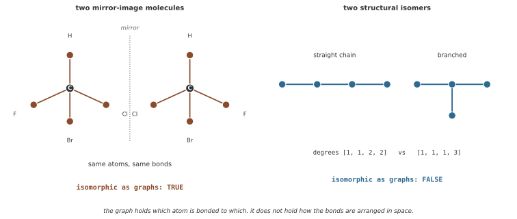

# GNN을 이용한 분자 특성 예측

분자를 그래프로 나타내면 원자가 노드, 결합이 엣지가 된다. 노드 표현을 메시지 패싱으로 갱신하고 분자 단위로 모아 연속 특성을 예측할 수 있다. 다만 이 페이지의 데모는 실제 원자·결합·측정값을 사용하지 않는 **합성 그래프 회귀**다. 분자 특성 모델의 계산 흐름과 화학적 검증을 구분해 읽어야 한다.

## 1. 코드와 출력

```python
"""29.7.1: 그래프 뉴럴 넷트웍으로 하는 분자 성질 헤아리기."""
import torch, torch.nn as nn, torch.nn.functional as F
import numpy as np

# ========================================================================
# 메인
# ========================================================================

class MoleculeGNN(nn.Module):
    def __init__(self, atom_features=10, hidden_ch=64, out_ch=1, num_layers=3):
        super().__init__()
        self.atom_enc = nn.Linear(atom_features, hidden_ch)
        self.convs = nn.ModuleList([nn.Linear(hidden_ch, hidden_ch) for _ in range(num_layers)])
        self.bns = nn.ModuleList([nn.BatchNorm1d(hidden_ch) for _ in range(num_layers)])
        self.predictor = nn.Sequential(nn.Linear(hidden_ch, hidden_ch), nn.ReLU(), nn.Linear(hidden_ch, out_ch))

    def forward(self, x, edge_index, batch=None):
        n = x.shape[0]
        if batch is None: batch = torch.zeros(n, dtype=torch.long, device=x.device)
        x = self.atom_enc(x); src, dst = edge_index[0], edge_index[1]
        loop = torch.arange(n, device=x.device)
        sa = torch.cat([src, loop]); da = torch.cat([dst, loop])
        deg = torch.zeros(n, device=x.device)
        deg.scatter_add_(0, da, torch.ones(da.shape[0], device=x.device))
        norm = (deg[sa]*deg[da]).pow(-0.5); norm[norm==float('inf')]=0
        for lin, bn in zip(self.convs, self.bns):
            h = lin(x); msg = h[sa]*norm.unsqueeze(1)
            out = torch.zeros(n, h.shape[1], device=x.device)
            out.scatter_add_(0, da.unsqueeze(1).expand_as(msg), msg)
            x = F.relu(bn(out))
        ng = batch.max().item()+1
        pool = torch.zeros(ng, x.shape[1], device=x.device)
        pool.scatter_add_(0, batch.unsqueeze(1).expand_as(x), x)
        return self.predictor(pool).squeeze(-1)

def create_molecule(n_atoms, label_fn):
    x = torch.randn(n_atoms, 10)
    edges = [(i,i+1) for i in range(n_atoms-1)]
    for _ in range(n_atoms//3):
        u,v = np.random.choice(n_atoms, 2, replace=False); edges.append((u,v))
    src = [e[0] for e in edges]+[e[1] for e in edges]
    dst = [e[1] for e in edges]+[e[0] for e in edges]
    ei = torch.tensor([src,dst], dtype=torch.long)
    y = label_fn(x, len(edges))
    return x, ei, y

def demo():
    print("=" * 60); print("Molecular Property Prediction"); print("=" * 60)
    torch.manual_seed(42); np.random.seed(42)
    label_fn = lambda x, ne: x[:, 0].mean().item() + ne * 0.01 + np.random.randn()*0.05
    mols = [create_molecule(np.random.randint(5,15), label_fn) for _ in range(200)]
    model = MoleculeGNN(); opt = torch.optim.Adam(model.parameters(), lr=0.001)
    model.train()
    for epoch in range(50):
        total_loss = 0
        for x, ei, y in mols[:160]:
            opt.zero_grad(); pred = model(x, ei)
            loss = F.mse_loss(pred, torch.tensor([y])); loss.backward(); opt.step()
            total_loss += loss.item()
        if (epoch+1) % 10 == 0:
            model.eval()
            tl = sum(F.mse_loss(model(x,ei), torch.tensor([y])).item() for x,ei,y in mols[160:])
            print(f"  Epoch {epoch+1}: Train={total_loss/160:.4f}, Test={tl/40:.4f}")
            model.train()

if __name__ == "__main__":
    demo()
```

```
============================================================
Molecular Property Prediction
============================================================
  Epoch 10: Train=0.1142, Test=1.9186
  Epoch 20: Train=0.0922, Test=2.2959
  Epoch 30: Train=0.0663, Test=10.2538
  Epoch 40: Train=0.0545, Test=4.2409
  Epoch 50: Train=0.0522, Test=3.3942
```

기존 출력은 인위적으로 정한 목표값의 학습·테스트 MSE다. 이번 편집에서는 재실행하지 않았으며 용해도·독성·분자 에너지 등 실제 물성을 측정한 성능으로 해석하지 않는다.

## 2. 데이터 생성 규칙

노드 수는 5~14이고 노드마다 10차원 표준정규 피처를 만든다. 기본 경로에 floor(n/3)개의 무작위 노드 쌍을 더한다. 이미 있는 쌍인지 검사하지 않아 중복·역방향으로 같은 무방향 연결이 추가될 수 있다. 각 목록 항은 양방향 메시지 엣지로 변환한다.

목표는 첫 번째 피처 좌표의 노드 평균, 원래 엣지 목록 길이 m, 독립 잡음으로 정한다.

$$y=\frac1n\sum_{v=1}^n X_{v0}+0.01m+\epsilon,\qquad
\epsilon\sim\mathcal N(0,0.05^2)$$

m은 중복을 포함한 목록 길이다. 유효 원자가·결합 유형·3차원 좌표 등 화학 제약은 없다. 알려진 생성식의 잡음 없는 부분을 직접 계산하면 조건부 평균 기준모델이 되며 기대 MSE는 0.0025다. 유한 테스트 MSE가 정확히 이 값이라는 뜻은 아니다.

## 3. 모델의 계산 흐름

atom_enc가 10→64로 투영한다. 이어 세 레이어에서 선형 변환, 자기 루프를 더한 대칭 정규화 메시지 집계, BatchNorm1d, ReLU를 적용한다. Linear의 bias는 집계 전에 들어간다. 동일한 엣지가 중복되면 집계와 차수 모두에서 중복을 센다.

노드 표현을 그래프별로 **합산**한 뒤 64→64→1 predictor에 넣는다. 평균 readout은 아니다. 목표의 피처 평균·엣지 개수와 sum readout이 어떤 크기 정보를 전달하는지 비교할 수 있지만, sum만으로 목표의 모든 통계를 정확히 복원한다고 보장할 수는 없다. 기본 모델 파라미터는 총 17,793개다.

batch=None이면 모든 노드를 한 그래프로 본다. 여러 그래프를 한 번에 처리하려면 노드별 batch ID와 엣지 인덱스 offset을 일치시키고 그래프 사이에 의도하지 않은 엣지가 없게 해야 한다. 출력은 기본 out_ch=1에서 그래프 수 G에 대한 길이 G 벡터다. 빈 입력은 batch.max에서 처리되지 않는다.

## 4. BatchNorm과 학습·평가 차이

데모는 그래프 하나씩 학습하므로 BatchNorm은 그 그래프의 노드들에 걸쳐 피처별 평균·분산을 계산한다. eval에서는 학습 중 누적한 running statistics를 사용한다. 따라서 학습 시 개별 분자 안의 정규화와 평가 시 기준이 다르다. 그래프 배치를 바꾸면 학습 통계의 구성도 달라진다.

앞 160개 그래프를 매번 같은 순서로 50번 순회해 총 8,000회 업데이트한다. 뒤 40개의 오차를 10에포크마다 출력한다. 학습 MSE는 에포크 중 변하는 모델에서 모은 온라인 로스며 테스트 MSE는 고정된 평가 모델의 값이다. 별도 검증 분할은 없고 평가 루프에 no_grad도 없어 불필요한 계산 그래프를 만든다.

## 5. 실제 분자 데이터로 확장하기

실제 모델에는 원소·전하·방향족성 등 원자 피처와 결합 유형·입체화학 등 필요한 정보를 제공해야 한다. 결합 속성을 입력하지 않는 현재 모델은 연결이 같고 노드 피처도 같으면 결합 유형의 차이를 구분할 수 없다. 3차원 정보가 필요한 목표라면 기하와 회전·이동 대칭성도 설계한다.

<div class="storybox" markdown>

**그림으로 보는 AI 1.** 원자가 노드, 결합이 엣지라는 생각은 1858년 것이다

이 쪽 첫 문장이 "분자를 그래프로 나타내면 원자가 노드, 결합이 엣지"라고 적는다. 그 표기는 GNN을 위해 고른 것이 아니다. **컴퓨터보다 백 년 앞선다.**

1858년에 스코틀랜드의 아치볼드 스콧 쿠퍼(Archibald Scott Couper)가 「새로운 화학 이론에 관하여」에서 원자 기호 사이에 **선을 그어** 결합을 나타냈다. 1864년에 알렉산더 크럼 브라운(Alexander Crum Brown)이 원자를 동그라미 안에 넣고 선으로 이어 원자가를 맞추는 그림을 그렸고, 그것이 오늘 화학 교과서의 구조식이다. 화학자들은 **그래프를 그리고 있다는 말을 쓰지 않은 채** 백육십 년 동안 그래프를 그려 왔다.

그래서 이 쪽의 모델이 물려받는 것은 그 표기의 힘만이 아니라 **그 표기의 경계**이기도 하다.



재어 보면 경계가 어디인지 분명하다. 탄소 하나에 서로 다른 네 가지가 붙은 분자는 거울에 비춘 짝이 있고, 그 둘은 겹쳐 놓을 수 없는 **다른 분자**다. 그런데 **그래프로는 동형이다** — 같은 원자, 같은 결합. 연결만 적는 표기에는 네 방향을 어떻게 배치했는지가 **애초에 들어갈 자리가 없다.**

반대로 곧은 사슬과 가지 친 사슬처럼 **연결이 다른** 이성질체는 그래프가 바로 가른다. 차수열부터 $[1,1,2,2]$ 와 $[1,1,1,3]$ 로 다르다.

**그러니 구성은 담기고 배치는 담기지 않는다.** 바로 위 문단이 입체화학을 "제공해야 한다"고 적은 까닭이 이것이다. 모델이 약해서가 아니라 **입력 표기에 그 칸이 없어서**이고, 메시지 패싱을 아무리 깊게 쌓아도 없는 칸에서 읽어 낼 수는 없다. 거울상 둘이 서로 다르게 행동하는 자리 — 몸속처럼 그 자체가 비대칭인 환경 — 를 예측해야 한다면, 키랄 태그든 3차원 좌표든 **그 정보를 따로 넣어 주는 것 말고는 길이 없다.**

_확인한 곳 — A. S. Couper, "On a new chemical theory" (1858) 가 원자 사이에 선을 그어 결합을 나타낸 첫 구조식으로 꼽힌다. A. Crum Brown 의 1864년 표기가 원자를 동그라미에 넣고 선으로 잇는 오늘의 구조식 꼴을 세웠다. 그림의 동형 여부는 그림을 그리는 코드가 `networkx` 로 직접 판정하며, 거울상이 같은 그래프이고 구조 이성질체가 다른 그래프라는 것을 먼저 확인한 뒤에만 그린다._

</div>

화학적으로 유사한 분자가 학습·테스트에 반복되면 신규 구조에 대한 성능을 과대평가할 수 있다. 분자 중복·scaffold·시간 분할 등 사용 목적에 맞는 분할을 정하고, 목표 단위·결측 레이블·측정 조건과 단순 피처 기준모델을 확인해야 한다. 이 합성 데모의 로스 감소가 실제 분자 예측에 대한 검증을 대신하지는 않는다.

## 연습문제

<div class="drillbox" markdown>

**연습문제 1.** <span class="diff med" title="중간"></span>
첫 피처 좌표의 평균이 0.4이고 원래 엣지 목록 길이가 8일 때 잡음 없는 목표와 조건부 평균 기준모델의 기대 MSE를 구하라.

</div>

??? success "풀이"

    목표 평균은 0.4+0.01×8=0.48이다. 독립 잡음만 남기면 기대 MSE는 0.05²=0.0025다. 중복을 제거한 엣지 개수로 바꾸면 코드가 생성한 목표와 다른 식이 된다.


---

<div class="drillbox" markdown>

**연습문제 2.** <span class="diff med" title="중간"></span>
BatchNorm이 이 데모의 train과 eval에서 사용하는 통계와 readout 방식을 설명하라.

</div>

??? success "풀이"

    train은 그래프 한 개의 노드들에 걸친 피처별 통계, eval은 누적된 running statistics를 사용한다. readout은 노드 평균이 아닌 합이다. 배치 구성과 분자 크기를 바꾸면 이 계산이 주는 신호도 달라질 수 있으므로 로스 차이를 단순한 과적합 하나로 단정하지 않는다.


---

<div class="drillbox" markdown>

**연습문제 3.** <span class="diff hard" title="어려움"></span>
합성 그래프를 실제 분자 데이터로 바꿀 때 입력과 평가에서 확인할 점을 제시하라.

</div>

??? success "풀이"

    원자·결합·입체화학·필요한 기하 정보를 유효하게 표현하고, 측정 목표의 단위·결측·조건을 정해야 한다. 분자 중복과 구조 유사성을 고려한 분할 및 기준모델을 사용한다. 무작위 피처·임의 목표의 성능을 실제 물성 예측 성능으로 보고하지 않는다.


## 정리하며

이 코드는 분자 모델 형태의 합성 그래프 회귀를 보여 준다. 목표 생성식·중복 엣지·sum readout·BatchNorm의 통계와 알려진 기준모델을 확인하고, 실제 화학 데이터에 필요한 입력·분할·측정 검증을 별도로 설계한다.
