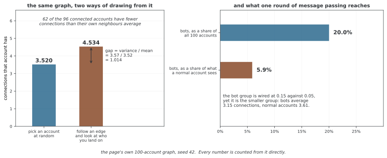

# 소셜 네트워크의 노드 분류

소셜 네트워크에서는 계정 피처와 연결 구조를 이용해 계정을 분류할 수 있다. 이 예제는 계정 100개를 두 그룹으로 생성하고 소수 그룹을 bot이라고 부르는 합성 문제다. 실제 자동화 계정의 액션·레이블을 수집한 데이터가 아니므로, 출력으로 실제 봇 탐지 능력을 주장할 수는 없다.

## 1. 코드와 출력

```python
"""29.7.3: 그래프 뉴럴 넷트웍으로 하는 사회 넷트웍 살피기."""
import torch, torch.nn as nn, torch.nn.functional as F
import numpy as np, networkx as nx

# ========================================================================
# 메인
# ========================================================================

def demo():
    print("=" * 60); print("Social Network: Bot Detection"); print("=" * 60)
    torch.manual_seed(42); np.random.seed(42)
    # 사회 넷트웍 흉내: 실제 쓰는 이 80명 + 로봇 계정 20개
    G = nx.stochastic_block_model([80, 20], [[0.05, 0.01],[0.01, 0.15]], seed=42)
    n = G.number_of_nodes()
    # 피처: [활동, 따르는 이 비, 올리는 잦음, 계정 나이]
    x = torch.randn(n, 4)
    x[80:, 0] += 2.0  # 로봇 계정: 활동이 더 많다
    x[80:, 1] -= 1.0  # 로봇 계정: 따르는 이 비가 더 낮다
    y = torch.tensor([0]*80 + [1]*20)
    edges = list(G.edges())
    src = [e[0] for e in edges]+[e[1] for e in edges]
    dst = [e[1] for e in edges]+[e[0] for e in edges]
    ei = torch.tensor([src, dst], dtype=torch.long)
    # 단순 GCN
    lin1 = nn.Linear(4, 16); lin2 = nn.Linear(16, 2)
    opt = torch.optim.Adam(list(lin1.parameters())+list(lin2.parameters()), lr=0.01)
    tm = torch.zeros(n, dtype=torch.bool); tm[::3] = True
    for epoch in range(200):
        # GCN 앞으로 가기
        sa = torch.cat([ei[0], torch.arange(n)]); da = torch.cat([ei[1], torch.arange(n)])
        deg = torch.zeros(n); deg.scatter_add_(0, da, torch.ones(da.shape[0]))
        norm = (deg[sa]*deg[da]).pow(-0.5); norm[norm==float('inf')]=0
        h = lin1(x); msg = h[sa]*norm.unsqueeze(1)
        out = torch.zeros(n, 16); out.scatter_add_(0, da.unsqueeze(1).expand_as(msg), msg)
        h2 = lin2(F.relu(out))
        opt.zero_grad(); F.cross_entropy(h2[tm], y[tm]).backward(); opt.step()
    pred = h2.argmax(1).detach()
    print(f"  Overall acc: {(pred==y).float().mean():.4f}")
    print(f"  Bot recall: {(pred[80:]==1).float().mean():.4f}")

if __name__ == "__main__":
    demo()
```

```
============================================================
Social Network: Bot Detection
============================================================
  Overall acc: 0.9700
  Bot recall: 1.0000
```

기존 출력은 전체 정확도와 bot 그룹의 재현율이다. 이번 편집에서는 실행·재측정하지 않았다. 두 지표 모두 학습 노드와 비학습 노드를 함께 포함하며 별도 테스트 성능이 아니다.

## 2. 데이터에 심은 두 가지 단서

확률적 블록 모델로 일반 그룹 80개, bot 그룹 20개 노드를 만든다. 그룹 내부 연결 확률은 각각 0.05와 0.15, 그룹 사이에는 0.01이다. 같은 유형끼리 연결될 구조적 바이어스를 생성 규칙으로 넣은 것이다.

각 노드의 4차원 표준정규 피처에서 bot 그룹의 첫 좌표에 2를 더하고 둘째 좌표에서 1을 뺀다. 구조뿐 아니라 피처에도 정답 그룹의 신호가 들어 있다. 합성 분포를 정의한 규칙이지만 실제 예측할 정답을 읽어 피처를 만드는 절차로 옮겨서는 안 된다.

피처만 사용하는 MLP와 그래프를 사용하는 모델을 같은 분할에서 비교해야 연결이 추가로 주는 정보를 평가할 수 있다. 조밀한 그룹이나 특정 계정과의 연결 자체가 실제 부정행위의 정답이라는 뜻도 아니다.

<div class="storybox" markdown>

**그림으로 보는 AI 1.** 이웃은 표본이 아니다

메시지 패싱은 한 계정이 **제 이웃들을 보고** 판단하게 한다. 그런데 이웃을 보는 것과
전체를 보는 것은 같은 추출이 아니다. 이것을 또렷하게 적어 둔 사람은 사회학자
Scott L. Feld 로, 1991년 American Journal of Sociology 에 "Why Your Friends Have
More Friends Than You Do" 를 실었다. 노드를 하나 고르는 것과 **엣지를 하나 따라가는
것**은 다른 추출이고, 뒤쪽은 이어진 선이 많은 노드를 그만큼 자주 집어낸다.

이 쪽의 그래프에서 그대로 확인된다. 계정을 아무거나 고르면 평균 **3.520** 개의 연결을
가지는데, 엣지를 아무거나 따라가 닿은 계정은 평균 **4.534** 개다. 두 값의 차는 정확히
분산/평균($3.57/3.52=1.014$)이고, 소수점 끝까지 맞는다. 연결이 하나라도 있는 96개
계정 가운데 **62개**가 자기보다 이웃들이 더 많이 이어져 있다. 어느 계정도 제 이웃에서
전체를 가늠할 수 없다는 뜻이다.



이 쪽의 문제로 옮기면 더 구체적이다. 봇은 전체 100개 가운데 20개지만, **보통 계정이
이웃으로 보는 것 가운데 봇은 5.9%** 뿐이다. 무리 사이 확률이 0.01 로 낮아 구조가
갈라져 있기 때문이고, 한 번의 메시지 패싱이 닿는 범위가 그만큼 치우쳐 있다는 뜻이다.

그리고 바로 위 §2 가 "그룹 내부 연결 확률은 각각 0.05와 0.15" 라고 적은 대목은 읽기에
주의가 필요하다. 확률이 세 배라도 **무리가 작다.** 재 보면 봇의 평균 연결 수는 **3.15**
로, 보통 계정의 **3.61** 보다 오히려 **적다.** 봇이 촘촘히 뭉쳐 있다는 것은 맞지만
연결이 많다는 뜻은 아니다. 연결 수 하나로 봇을 가려내려는 규칙은 이 그래프에서
거꾸로 간다.

그림은 여기까지다. 이 수들은 전부 **생성 규칙이 정한 것**이지 실제 계정에서 관측한
것이 아니므로, 실제 자동화 계정이 평균보다 많이 이어져 있는지 적게 이어져 있는지는
여기서 알 수 없다. 말할 수 있는 것은 Feld 의 항등식이 그래프의 성질이라는 것뿐이다 —
**차수의 분산이 0 이 아닌 한 이웃은 언제나 전체보다 촘촘해 보인다.** 이웃에서 읽은
비율을 전체의 비율로 옮겨 적기 전에 그 차이를 한 번 재 보아야 한다.

_확인한 곳 — S. L. Feld, "Why Your Friends Have More Friends Than You Do",
American Journal of Sociology 96(6), 1991, 1464–1477. 수는 모두 이 쪽의
`figures/make_figures.py` 에서 이 쪽의 그래프(시드 42)를 그대로 써서 직접 센다._

</div>

## 3. 실제 모델 구조

첫 Linear가 4→16으로 변환한다. 자기 루프를 추가하고 차수로 대칭 정규화한 이웃 상태를 한 번 집계한 뒤 ReLU, 16→2 Linear를 적용한다. 학습 파라미터는 80+34=114개다.

두 Linear가 있지만 메시지 패싱은 **한 번**이므로 두 홉 GCN이 아니다. 마지막 분류기는 노드마다 독립적으로 로짓을 만들며 추가 이웃 집계를 하지 않는다. 입력 그래프가 무방향이고 양방향 레코드로 제공된다는 조건에서 정규화를 해석한다.

정적인 엣지의 차수·정규화를 매 반복 다시 계산한다. 모든 버퍼는 CPU를 기준으로 만들고 GPU 배치·이웃 샘플링·드롭아웃·별도 모델 클래스는 구현하지 않는다. 큰 그래프에 적용하려면 장치·메모리·학습 인터페이스를 따로 정리해야 한다.

## 4. 감독 마스크와 출력 시점

tm[::3]은 0·3·…·99번, 총 34개 노드를 학습 대상으로 선택한다. 일반 그룹 27개와 bot 그룹 7개다. 나머지 66개는 일반 53개와 bot 13개다. 교차 엔트로피는 학습 마스크에서만 계산하지만 전체 구조·피처는 메시지 패싱에 사용한다.

200번 업데이트한 뒤 새 forward를 하지 않고 마지막 반복에서 계산해 둔 h2로 예측한다. 따라서 출력은 **마지막 optimizer.step 직전 파라미터의 로짓**에 해당한다. detach는 이 값을 분리할 뿐 업데이트 후 결과를 재계산하지 않는다. 현재 레이어에는 dropout·BatchNorm이 없어 train·eval 전환에 따른 차이는 없지만 평가 범위와 시점은 여전히 분명히 해야 한다.

## 5. 불균형 지표와 해석

전체 정확도는 100개 노드 모두의 정답 비율이다. bot 재현율은 정답 bot 20개 중 1로 예측한 비율이다. 학습 노드도 포함하므로 이 값을 홀드아웃 정확도·재현율이라고 부르면 안 된다.

모든 계정을 일반으로 예측해도 전체 정확도는 80%지만 bot 재현율은 0이다. 반대로 모두 bot으로 예측하면 재현율은 1이어도 오탐이 많다. 비학습 마스크에서 정밀도·재현율·혼동행렬과 임계값별 지표를 확인해야 탐지 목적에 맞게 판단할 수 있다.

실제 시간 예측에서는 이후에 생긴 연결·피처와 지연 확정 레이블을 제외하고, 신규 계정·다른 기간에서도 평가한다. 이 합성 한 그래프의 결과가 그런 일반화를 검증하는 것은 아니다.

## 연습문제

<div class="drillbox" markdown>

**연습문제 1.** <span class="diff med" title="중간"></span>
학습 마스크가 선택하는 노드 수와 클래스별 구성을 구하라. 출력 지표는 그 마스크 밖만 평가하는가?

</div>

??? success "풀이"

    0부터 99까지 3 간격으로 선택해 총 34개다. 0~79에서 27개, 80~99에서 7개로 일반·bot의 학습 구성이 된다. 출력은 전체 100개 정확도와 bot 20개 재현율이라 학습 노드를 포함한다. 비학습 66개만의 지표는 별도로 계산해야 한다.


---

<div class="drillbox" markdown>

**연습문제 2.** <span class="diff med" title="중간"></span>
모두 일반 계정으로 예측할 때 전체 정확도와 bot 재현율을 구하고 정확도만의 한계를 설명하라.

</div>

??? success "풀이"

    정답 일반 계정이 80개이므로 정확도는 0.8이다. bot 20개를 하나도 찾지 못해 재현율은 0이다. 클래스 불균형에서 정확도가 높아도 탐지 목적을 달성하지 못할 수 있어 정밀도·재현율·오탐 등을 함께 본다.


---

<div class="drillbox" markdown>

**연습문제 3.** <span class="diff hard" title="어려움"></span>
이 모델의 메시지 패싱 횟수와 마지막 예측에 사용한 파라미터 시점을 설명하라.

</div>

??? success "풀이"

    Linear는 두 개지만 이웃 집계는 한 번이다. pred는 마지막 업데이트 전에 계산한 h2를 재사용하므로 최종 optimizer.step 이후 파라미터의 새 예측이 아니다. 업데이트 후 같은 입력을 다시 forward하고 비학습 마스크로 평가해야 그 시점의 홀드아웃 성능을 얻을 수 있다.


## 정리하며

합성 계정 그래프의 한 번 메시지 패싱 분류를 살펴보았다. 피처·구조에 심은 신호, 34개 감독 노드, 학습 노드를 포함한 출력 지표와 마지막 업데이트 전 로짓을 구분하고 불균형에 맞는 평가를 설계해야 한다.
