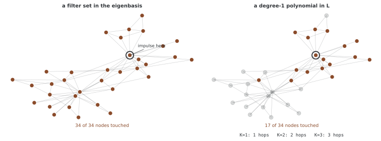

# ChebNet: 체비쇼프 다항식 그래프 필터

일반 스펙트럼 필터를 계산하려면 전체 고유기저가 필요할 수 있다. [ChebNet](https://arxiv.org/abs/1606.09375)은 라플라스의 다항식 근사를 재귀적으로 계산해 고유분해 없이 국소 필터를 적용한다. 여기서 사용하는 라플라스 종류와 스펙트럼 스케일이 중요하며, 제시한 코드에는 그 두 설정의 불일치가 있다.

## 1. 코드와 보존된 출력

```python
"""
29.3.3: ChebNet
체비쇼프 다항식 스펙트럼 그래프 겹말기.
"""

import torch
import torch.nn as nn
import torch.nn.functional as F
import numpy as np
import networkx as nx

# ========================================================================
# 메인
# ========================================================================


class ChebConv(nn.Module):
    """체비쇼프 스펙트럼 그래프 겹말기 레이어."""

    def __init__(self, in_channels, out_channels, K=3):
        super().__init__()
        self.K = K
        self.lins = nn.ModuleList([
            nn.Linear(in_channels, out_channels, bias=False) for _ in range(K)
        ])
        self.bias = nn.Parameter(torch.zeros(out_channels))

    def forward(self, x, edge_index, lambda_max=2.0):
        n = x.shape[0]
        # 성긴 라플라스 짓기
        L = self._compute_laplacian(edge_index, n)
        L_tilde = (2.0 / lambda_max) * L - torch.eye(n, device=x.device)

        # 체비쇼프 회귀
        Tx_0 = x
        out = self.lins[0](Tx_0)

        if self.K > 1:
            Tx_1 = L_tilde @ x
            out = out + self.lins[1](Tx_1)

        for k in range(2, self.K):
            Tx_2 = 2 * L_tilde @ Tx_1 - Tx_0
            out = out + self.lins[k](Tx_2)
            Tx_0, Tx_1 = Tx_1, Tx_2

        return out + self.bias

    def _compute_laplacian(self, edge_index, n):
        A = torch.zeros(n, n, device=edge_index.device)
        src, dst = edge_index[0], edge_index[1]
        A[src, dst] = 1.0
        D = torch.diag(A.sum(dim=1))
        return D - A


class ChebNet(nn.Module):
    """마디 가름을 위한 여러 레이어 ChebNet."""

    def __init__(self, in_ch, hidden_ch, out_ch, K=3, num_layers=2, dropout=0.5):
        super().__init__()
        self.convs = nn.ModuleList()
        self.convs.append(ChebConv(in_ch, hidden_ch, K))
        for _ in range(num_layers - 2):
            self.convs.append(ChebConv(hidden_ch, hidden_ch, K))
        self.convs.append(ChebConv(hidden_ch, out_ch, K))
        self.dropout = dropout

    def forward(self, x, edge_index):
        for i, conv in enumerate(self.convs[:-1]):
            x = conv(x, edge_index)
            x = F.relu(x)
            x = F.dropout(x, p=self.dropout, training=self.training)
        return self.convs[-1](x, edge_index)


def demo_chebyshev_polynomials():
    """체비쇼프 다항식을 그린다."""
    print("=" * 60)
    print("Chebyshev Polynomials")
    print("=" * 60)

    x = np.linspace(-1, 1, 200)
    T = [np.ones_like(x), x.copy()]
    for k in range(2, 6):
        T.append(2 * x * T[-1] - T[-2])

    for k in range(6):
        print(f"  T_{k}: max={np.max(np.abs(T[k])):.4f}, "
              f"zeros={np.sum(np.abs(np.diff(np.sign(T[k]))) > 0)}")


def demo_chebnet_node_classification():
    """가라테 동아리에서 마디를 가르는 ChebNet."""
    print("\n" + "=" * 60)
    print("ChebNet Node Classification")
    print("=" * 60)

    torch.manual_seed(42)
    G = nx.karate_club_graph()
    n = G.number_of_nodes()
    edges = list(G.edges())
    src = [e[0] for e in edges] + [e[1] for e in edges]
    dst = [e[1] for e in edges] + [e[0] for e in edges]
    edge_index = torch.tensor([src, dst], dtype=torch.long)

    x = torch.eye(n, dtype=torch.float)
    y = torch.tensor([0 if G.nodes[i].get('club', '') == 'Mr. Hi' else 1
                       for i in range(n)], dtype=torch.long)

    train_mask = torch.zeros(n, dtype=torch.bool)
    train_mask[::2] = True

    for K in [1, 2, 3, 5]:
        torch.manual_seed(42)
        model = ChebNet(n, 16, 2, K=K, num_layers=2)
        optimizer = torch.optim.Adam(model.parameters(), lr=0.01, weight_decay=5e-4)

        model.train()
        for epoch in range(200):
            optimizer.zero_grad()
            out = model(x, edge_index)
            loss = F.cross_entropy(out[train_mask], y[train_mask])
            loss.backward()
            optimizer.step()

        model.eval()
        with torch.no_grad():
            pred = model(x, edge_index).argmax(dim=1)
            test_acc = (pred[~train_mask] == y[~train_mask]).float().mean()
        print(f"  K={K}: Test Accuracy = {test_acc:.4f}")


def demo_filter_localization():
    """K이 거르개가 한곳에 모이는 정도를 어떻게 다스리는지 보인다."""
    print("\n" + "=" * 60)
    print("Filter Localization (K-hop)")
    print("=" * 60)

    G = nx.path_graph(20)
    A = nx.adjacency_matrix(G).toarray().astype(float)
    D = np.diag(A.sum(axis=1))
    L = D - A
    n = 20
    lmax = np.max(np.linalg.eigvalsh(L))
    L_tilde = 2 * L / lmax - np.eye(n)

    # 가운데 마디에 충격
    impulse = np.zeros(n)
    impulse[10] = 1.0

    for K in [1, 2, 3, 5, 10]:
        T0 = impulse.copy()
        response = T0.copy()
        if K > 1:
            T1 = L_tilde @ impulse
            response += T1
        T_prev, T_curr = T0, T1 if K > 1 else T0
        for k in range(2, K):
            T_next = 2 * L_tilde @ T_curr - T_prev
            response += T_next
            T_prev, T_curr = T_curr, T_next

        nonzero = np.where(np.abs(response) > 1e-10)[0]
        spread = nonzero[-1] - nonzero[0] + 1 if len(nonzero) > 0 else 0
        print(f"  K={K:2d}: spread={spread} nodes, "
              f"support=[{nonzero[0] if len(nonzero)>0 else '-'}, "
              f"{nonzero[-1] if len(nonzero)>0 else '-'}]")


if __name__ == "__main__":
    demo_chebyshev_polynomials()
    demo_chebnet_node_classification()
    demo_filter_localization()
```

```
============================================================
Chebyshev Polynomials
============================================================
  T_0: max=1.0000, zeros=0
  T_1: max=1.0000, zeros=1
  T_2: max=1.0000, zeros=2
  T_3: max=1.0000, zeros=3
  T_4: max=1.0000, zeros=4
  T_5: max=1.0000, zeros=5

============================================================
ChebNet Node Classification
============================================================
  K=1: Test Accuracy = 0.5294
  K=2: Test Accuracy = 0.5294
  K=3: Test Accuracy = 0.4706
  K=5: Test Accuracy = 0.4118

============================================================
Filter Localization (K-hop)
============================================================
  K= 1: spread=1 nodes, support=[10, 10]
  K= 2: spread=3 nodes, support=[9, 11]
  K= 3: spread=5 nodes, support=[8, 12]
  K= 5: spread=9 nodes, support=[6, 14]
  K=10: spread=19 nodes, support=[1, 19]
```

출력은 기존 실행 기록으로 보존하며 새로 학습하거나 측정하지 않는다. 아래에서는 스펙트럼 정규화의 한계와 실제 실험 조건을 구분해 읽는다.

## 2. 다항식 재귀와 텐서 모양

스펙트럼을 [−1,1]로 옮길 수 있도록 L̃=2L/λmax−I로 둔다. 체비쇼프 다항식은 T₀(z)=1, T₁(z)=z, Tₖ(z)=2zTₖ₋₁(z)−Tₖ₋₂(z)다. 행렬 다항식에는 원소별 곱이 아니라 행렬 곱을 사용한다.

코드의 ChebConv는 K개 항 **0부터 K−1까지**를 사용한다.

$$Y=\sum_{k=0}^{K-1}T_k(\tilde L)X\Theta_k+b$$

X는 n×d_in, 각 Tₖ(L̃)X도 n×d_in이며 Linear를 거쳐 n×d_out을 만든다. Θₖ와 단일 출력 bias가 학습 파라미터다. K=1이면 T₀X=X뿐이라 해당 레이어에서 이웃 정보를 전파하지 않는다.

최대 차수는 K−1이므로 한 레이어의 영향 범위도 최대 K−1홉이다. K=3인 두 레이어는 최대4홉까지 영향을 전달할 수 있다. 모든 해당 노드에 항상 비영 계수가 생기는 것은 아니며, 출력 문구의 “K-hop”을 코드의 항 수 K와 그대로 같다고 읽지 않는다.

## 3. 기본 λmax=2의 문제

_compute_laplacian은 **조합 라플라스 L=D−A**를 만든다. 입력 엣지에1을 대입하므로 스칼라 웨이트·엣지 피처는 사용하지 않고 같은 끝점의 중복도 합산하지 않는다. Karate 데모는 양방향 엣지를 명시해 대칭의 비가중 그래프를 만든다.

조합 라플라스의 최대 고유값은 일반적으로2가 아니다. 정규화 라플라스의 [0,2] 범위를 이 연산자에 그대로 적용할 수 없다. 그런데 ChebConv 기본 lambda_max=2.0이 ChebNet 호출에서도 그대로 사용된다. **그래프의 스펙트럼이 [−1,1] 밖으로 옮겨질 수 있어** 다항식 응답과 수치 크기가 커진다.

예를 들어 고유값 λ=4를 2로 스케일하면 L̃의 대응 값은3이고 T₂(3)=17이다. [−1,1]에서 |Tₖ|≤1이라는 성질을 더 이상 기대할 수 없다. 이는 다항식 차수가 커질 때 불안정할 수 있는 이유이며, 모든 설정의 결과가 반드시 실패한다고 단정하는 것은 아니다.

조합 L의 실제 λmax 또는 유효한 양의 상한을 사용하거나, 라플라스 자체를 정규화하는 설계를 일치시켜야 한다. ChebConv는 인수로 값을 받을 수 있지만 ChebNet.forward는 이를 전달하는 인수를 제공하지 않는다. 마지막 localization 데모는 자체 고유값으로 스케일을 계산하므로 앞 분류 클래스와 다른 조건이다.

## 4. 지역성과 실제 구현 비용

다항식 재귀 자체에는 고유벡터가 필요 없다. 희소 L과 d차원 신호를 곱하면 각 재귀 항을 엣지 수에 비례한 비용으로 계산할 수 있다. 하지만 **이 구현은 n×n 밀집 A·D·L을 매 forward마다 새로 만든다**. 따라서 희소 ChebNet의 선형 그래프 연산 효율을 그대로 구현한 것은 아니다.

각 레이어마다 밀집 행렬 저장 O(n²), 곱셈 O(Kn²d_in)과 K개의 피처 투영 비용이 든다. x·edge_index·모델의 장치와 dtype을 맞춰야 하며 함수가 자동으로 전부 이동하지 않는다. 방향 그래프를 그대로 넣으면 대칭 PSD 라플라스의 스펙트럼 해석도 적용되지 않는다.

<div class="storybox" markdown>

**그림으로 보는 AI 1.** 고유기저에서는 "가까운 곳만"이 공짜가 아니다

그래프에 겹말기를 처음 가져온 것은 2014년 조앙 브루나(Joan Bruna)·보이치에흐 자렘바(Wojciech Zaremba)·아서 슐람(Arthur Szlam)·얀 르쿤(Yann LeCun)의 「스펙트럼 넷트웍」이다. 생각은 깔끔했다. 이미지의 겹말기가 푸리에 영역의 곱셈이니, 그래프에서도 라플라시안의 고유기저를 푸리에 삼아 **고유값마다 계수 하나**를 학습하면 된다.

깔끔한데 두 가지가 걸렸고, 둘 다 재어 보면 바로 보인다.



첫째는 **국소성이다.** 노드 0에만 임펄스를 넣고 고유기저에서 계수를 준 필터를 통과시키면 34개 노드가 **전부** 켜진다. 고유벡터가 그래프 전체에 퍼져 있으니 당연한 일이다. 겹말기를 쓰는 까닭이 "가까운 곳만 본다"였는데, 그 성질이 사라진다.

둘째는 **비용이다.** 그 필터를 쓰려면 고유분해가 필요하고, 그것은 노드 수의 세제곱에 붙는다.

위 식의 다항식이 둘을 한꺼번에 푼다. 같은 임펄스에 라플라시안의 $K$차 다항식을 걸면 닿는 범위가 **정확히 $K$홉**이다 — $K=1$이면 1홉에 17개, $K=2$면 2홉에 26개, $K=3$이면 3홉에 34개. 국소성이 **차수로 적히는 값**이 되고, 고유벡터는 한 번도 필요하지 않다.

**다만 이 쪽이 적어 둔 대로, 그 이득은 구현이 받아 와야 받는 것이다.** 다항식 재귀 자체는 엣지 수에 비례하는데 위 구현은 매 forward마다 $n \times n$ 밀집 행렬을 새로 만들어, 고유분해만 피했을 뿐 $O(n^2)$ 로 되돌아간다. 이론의 비용과 코드의 비용은 따로 읽어야 한다.

덧붙여, 2절이 "행렬 다항식에는 원소별 곱이 아니라 행렬 곱을 사용한다"고 굳이 적어 둔 까닭도 재어 보니 분명해졌다. 이 상자의 수를 처음 잴 때 바로 그 자리에서 원소별 거듭제곱을 써서, $K=1$ 다항식이 3홉까지 닿는다는 말이 안 되는 값이 나왔다. 그 한 줄이 괜히 있는 것이 아니다.

_확인한 곳 — J. Bruna, W. Zaremba, A. Szlam, Y. LeCun, "Spectral Networks and Locally Connected Networks on Graphs", ICLR 2014 (arXiv:1312.6203) 가 라플라시안 고유기저로 겹말기를 일반화한 글이다. M. Defferrard, X. Bresson, P. Vandergheynst (arXiv:1606.09375) 가 이 쪽의 다항식 필터다. 그림의 수는 그림을 그리는 코드가 가라테 클럽 그래프에 직접 재며, 고유기저 필터가 모든 노드에 닿는다는 것과 K차 다항식이 정확히 K홉에 닿는다는 것을 먼저 확인한 뒤에만 그린다._

</div>

## 5. Karate Club 분류의 조건

노드 피처는 노드별 one-hot인34×34 단위행렬이다. 라벨은 두 club이고, 짝수 인덱스17개를 학습·홀수17개를 테스트에 사용한다. 구조와 전체 노드 ID는 모두 보이는 **transductive 분할**이며 새 그래프·새 노드 일반화를 검증하지 않는다.

K=1,2,3,5를 각각200회 업데이트한다. 한 은닉 레이어16채널과 마지막2채널의 두 ChebConv 사이에 ReLU·Dropout을 사용한다. K를 바꾸면 도달 범위뿐 아니라 파라미터 수도 바뀐다. 기본 두 레이어의 수는 34×16×K+16×2×K+16+2=576K+18이다.

num_layers=1을 지정해도 생성자는 첫 레이어와 마지막 레이어를 둘 다 추가한다. 의도한1레이어 옵션이 구현되어 있지 않으므로2 이상이라는 계약을 정해야 한다. K도 양의 정수여야 하지만 검사는 없다. 테스트 정확도 표만으로 K의 보편 최적값이나 데이터셋 전체의 우열을 단정하지 않는다.

## 6. localization 데모가 확인하는 것

경로 그래프20개 노드의 인덱스10에 impulse를 놓고0~K−1 다항식을 합한다. λmax는 해당 그래프의 고유값으로 계산한다. 응답이 K−1홉 밖에서0이라는 지역성을 관찰하는 예다.

spread는 비영 위치의 최솟값부터 최댓값까지의 **구간 폭**이며, 일반 그래프의 비영 노드 수나 정확한 홉 반경과 같은 지표는 아니다. 수치적으로1e−10보다 큰 항만 세며 계수 상쇄·경계의 영향도 있다. 다항식 재귀 예제와 별도의 분류 품질 실험을 같은 검증으로 취급하지 않는다.

## 연습문제

<div class="drillbox" markdown>

**연습문제 1.** <span class="diff med" title="중간"></span>
K=3인 ChebConv의 최대 다항식 차수와 두 레이어의 최대 도달 홉 수를 구하라.

</div>

??? success "풀이"

    항은 T₀,T₁,T₂여서 차수2, 한 레이어는 최대2홉이다. 두 레이어를 합하면 최대4홉이다. K=1이면 항등 항만 사용해 해당 레이어의 이웃 전파가 없다. 도달 상한과 모든 노드의 실제 비영 영향을 구분한다.


---

<div class="drillbox" markdown>

**연습문제 2.** <span class="diff med" title="중간"></span>
조합 라플라스에 lambda_max=2를 무조건 쓰면 왜 체비쇼프의 안정 범위를 벗어날 수 있는가?

</div>

??? success "풀이"

    조합 L의 스펙트럼은 일반적으로 [0,2]가 아니다. λ=4라면 스케일 후3이고 T₂(3)=17이라 [−1,1]에서의 |Tₖ|≤1 성질을 잃는다. 실제 양의 최대값·상한 또는 정규화 라플라스와 일치하는 스케일이 필요하다. 코드의 localization 데모만 실제 λmax를 따로 계산한다.


---

<div class="drillbox" markdown>

**연습문제 3.** <span class="diff hard" title="어려움"></span>
기본 두 레이어 모델에서 K=1과 K=5의 파라미터 수를 구하고 공정한 품질 비교 조건을 설명하라.

</div>

??? success "풀이"

    576K+18이므로 각각594개와2,898개다. K 변경은 수용 범위와 용량을 동시에 바꾼다. 같은 데이터 분할·예산·초기화 조건과 별도의 검증을 사용하고 라플라스 스케일을 먼저 맞추어야 한다. 밀집 구현의 비용을 희소 이론의 선형 비용으로 보고하지 않는다.


## 정리하며

ChebNet은 K개의 다항식 항으로 최대 K−1홉 필터를 계산한다. 정규화 종류와 λmax를 일치시켜야 하며, 이 코드의 밀집 행렬 구현·one-hot transductive 분할과 이론적 희소 효율을 구분해야 한다.
