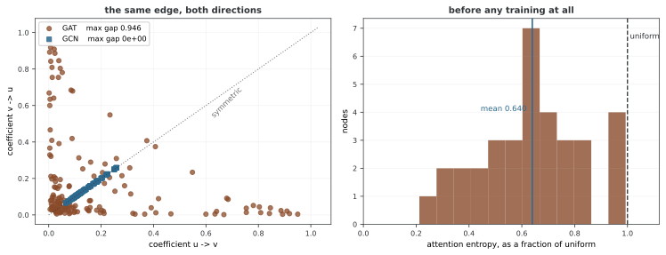

# 그래프 어텐션 뉴럴 넷트웍(GAT)

[GAT](https://arxiv.org/abs/1710.10903)는 수신 노드의 이웃들에 피처 기반 웨이트를 부여한다. 차수에서 정한 계수 대신 학습한 점수를 정규화해 메시지를 합하는 방식이다. 이 코드는 엣지별 점수, 수신 노드별 softmax와 다중 헤드를 직접 구현한다. 어텐션 값을 인과적 중요도나 관계 유형의 자동 처리로 해석하지 않는 것이 중요하다.

## 1. 코드와 보존된 출력

```python
"""
29.3.6: 그림 눈여겨보기 넷트웍(GAT)
그래프 위의 여러 머리 어텐션.
"""

import torch
import torch.nn as nn
import torch.nn.functional as F
import numpy as np
import networkx as nx

# ========================================================================
# 메인
# ========================================================================


class GATConvManual(nn.Module):
    """여러 머리 어텐션을 쓰는 GAT 겹말기 레이어."""

    def __init__(self, in_ch, out_ch, heads=1, concat=True,
                 dropout=0.0, negative_slope=0.2):
        super().__init__()
        self.heads = heads
        self.out_ch = out_ch
        self.concat = concat
        self.dropout = dropout

        self.W = nn.Linear(in_ch, heads * out_ch, bias=False)
        self.att = nn.Parameter(torch.randn(heads, 2 * out_ch))
        self.leaky_relu = nn.LeakyReLU(negative_slope)
        self.bias = nn.Parameter(torch.zeros(heads * out_ch if concat else out_ch))

        nn.init.xavier_uniform_(self.W.weight)
        nn.init.xavier_uniform_(self.att.unsqueeze(0))

    def forward(self, x, edge_index):
        n = x.shape[0]
        src, dst = edge_index[0], edge_index[1]

        # 스스로 이음 더하기
        loop = torch.arange(n, device=x.device)
        src = torch.cat([src, loop])
        dst = torch.cat([dst, loop])

        # 선형 바꿈
        h = self.W(x).view(n, self.heads, self.out_ch)

        # 주의 점수
        h_src = h[src]  # [E, heads, out_ch]
        h_dst = h[dst]
        cat = torch.cat([h_src, h_dst], dim=-1)  # [E, heads, 2*out_ch]
        e = (cat * self.att.unsqueeze(0)).sum(dim=-1)  # [E, heads]
        e = self.leaky_relu(e)

        # 도착 마디마다 소프트맥스
        e_max = torch.full((n, self.heads), float('-inf'), device=x.device)
        e_max.scatter_reduce_(0, dst.unsqueeze(1).expand_as(e), e, reduce='amax')
        alpha = torch.exp(e - e_max[dst])
        alpha_sum = torch.zeros(n, self.heads, device=x.device)
        alpha_sum.scatter_add_(0, dst.unsqueeze(1).expand_as(alpha), alpha)
        alpha = alpha / alpha_sum[dst].clamp(min=1e-10)
        alpha = F.dropout(alpha, p=self.dropout, training=self.training)

        # 무게 매긴 모으기
        weighted = h_src * alpha.unsqueeze(-1)
        out = torch.zeros(n, self.heads, self.out_ch, device=x.device)
        out.scatter_add_(0, dst.unsqueeze(1).unsqueeze(2).expand_as(weighted), weighted)

        if self.concat:
            out = out.view(n, self.heads * self.out_ch)
        else:
            out = out.mean(dim=1)

        return out + self.bias


class GAT(nn.Module):
    """여러 레이어 GAT."""

    def __init__(self, in_ch, hidden_ch, out_ch, heads=4, num_layers=2, dropout=0.6):
        super().__init__()
        self.convs = nn.ModuleList()
        self.convs.append(GATConvManual(in_ch, hidden_ch, heads=heads, concat=True, dropout=dropout))
        for _ in range(num_layers - 2):
            self.convs.append(GATConvManual(hidden_ch * heads, hidden_ch, heads=heads, concat=True, dropout=dropout))
        self.convs.append(GATConvManual(hidden_ch * heads, out_ch, heads=1, concat=False, dropout=dropout))
        self.dropout = dropout

    def forward(self, x, edge_index):
        for conv in self.convs[:-1]:
            x = conv(x, edge_index)
            x = F.elu(x)
            x = F.dropout(x, p=self.dropout, training=self.training)
        return self.convs[-1](x, edge_index)


def demo_gat():
    """가라테 동아리에서의 GAT."""
    print("=" * 60)
    print("GAT: Karate Club Node Classification")
    print("=" * 60)

    torch.manual_seed(42)
    G = nx.karate_club_graph()
    n = G.number_of_nodes()
    edges = list(G.edges())
    src = [e[0] for e in edges] + [e[1] for e in edges]
    dst = [e[1] for e in edges] + [e[0] for e in edges]
    edge_index = torch.tensor([src, dst], dtype=torch.long)
    x = torch.eye(n)
    y = torch.tensor([0 if G.nodes[i].get('club','')=='Mr. Hi' else 1
                       for i in range(n)], dtype=torch.long)
    train_mask = torch.zeros(n, dtype=torch.bool)
    train_mask[[0,1,2,3,33,32,31,30]] = True

    for heads in [1, 4, 8]:
        torch.manual_seed(42)
        model = GAT(n, 8, 2, heads=heads, num_layers=2)
        optimizer = torch.optim.Adam(model.parameters(), lr=0.005, weight_decay=5e-4)

        model.train()
        for epoch in range(300):
            optimizer.zero_grad()
            loss = F.cross_entropy(model(x, edge_index)[train_mask], y[train_mask])
            loss.backward()
            optimizer.step()

        model.eval()
        with torch.no_grad():
            pred = model(x, edge_index).argmax(1)
            test_acc = (pred[~train_mask] == y[~train_mask]).float().mean()
        print(f"  heads={heads}: Test Acc = {test_acc:.4f}")


def demo_attention_visualization():
    """어텐션 계수를 그린다."""
    print("\n" + "=" * 60)
    print("Attention Coefficient Analysis")
    print("=" * 60)

    torch.manual_seed(42)
    n = 6
    edge_index = torch.tensor([
        [0,1,0,2,1,2,1,3,2,4,3,5,4,5],
        [1,0,2,0,2,1,3,1,4,2,5,3,5,4]], dtype=torch.long)
    x = torch.randn(n, 4)

    layer = GATConvManual(4, 4, heads=1, concat=False)
    layer.eval()

    with torch.no_grad():
        # 어텐션을 손으로 뽑아내기
        src, dst = edge_index[0], edge_index[1]
        loop = torch.arange(n)
        src_all = torch.cat([src, loop])
        dst_all = torch.cat([dst, loop])

        h = layer.W(x).view(n, 1, 4)
        h_src = h[src_all]
        h_dst = h[dst_all]
        cat = torch.cat([h_src, h_dst], dim=-1)
        e = (cat * layer.att.unsqueeze(0)).sum(dim=-1)
        e = layer.leaky_relu(e)

        e_max = torch.full((n, 1), float('-inf'))
        e_max.scatter_reduce_(0, dst_all.unsqueeze(1).expand_as(e), e, reduce='amax')
        alpha = torch.exp(e - e_max[dst_all])
        alpha_sum = torch.zeros(n, 1)
        alpha_sum.scatter_add_(0, dst_all.unsqueeze(1).expand_as(alpha), alpha)
        alpha = alpha / alpha_sum[dst_all].clamp(min=1e-10)

    print("Edge attention coefficients:")
    for i in range(edge_index.shape[1]):
        print(f"  {src[i].item()} -> {dst[i].item()}: {alpha[i, 0].item():.4f}")


if __name__ == "__main__":
    demo_gat()
    demo_attention_visualization()
```

```
============================================================
GAT: Karate Club Node Classification
============================================================
  heads=1: Test Acc = 0.9231
  heads=4: Test Acc = 0.9231
  heads=8: Test Acc = 0.9231

============================================================
Attention Coefficient Analysis
============================================================
Edge attention coefficients:
  0 -> 1: 0.2291
  1 -> 0: 0.3105
  0 -> 2: 0.2084
  2 -> 0: 0.3720
  1 -> 2: 0.2037
  2 -> 1: 0.2683
  1 -> 3: 0.1381
  3 -> 1: 0.2786
  2 -> 4: 0.3111
  4 -> 2: 0.3439
  3 -> 5: 0.2659
  5 -> 3: 0.5110
  4 -> 5: 0.3470
  5 -> 4: 0.3482
```

출력은 기존 학습·데모 기록이다. 이번 편집에서는 재학습·새 평가를 수행하지 않는다. Attention Coefficient Analysis는 아래에서 설명하듯 별도의 무작위 계층을 사용한다.

## 2. 헤드별 투영과 점수

입력 X는 n×d_in이다. Linear가 n×(H d_out)을 만들고 이를 n×H×d_out으로 바꾼다. source와 destination 피처를 각 엣지에 가져와 [h_src∥h_dst] 순서로 이어 붙인다. 헤드 k에서 점수는 다음과 같다.

$$e_{u\to v}^{(k)}=\operatorname{LeakyReLU}
\left((a^{(k)})^T[h_u^{(k)}\Vert h_v^{(k)}]\right)$$

a의 앞·뒤 성분은 그 순서에 맞는 파라미터다. 문헌의 [수신∥발신] 표기를 사용할 수도 있지만 어느 쪽이든 구현과 정의를 일치시킨다. 이 예제는 엣지 피처·유형을 사용하지 않는 동종 그래프 계층이다.

## 3. 수신 노드별 softmax

각 헤드에서 같은 수신 v의 진입 엣지 전체에 대해 정규화한다.

$$\alpha_{u\to v}^{(k)}=
\frac{e^{e_{u\to v}^{(k)}}}{\sum_{w\in\tilde{\mathcal N}_{\mathrm{in}}(v)}e^{e_{w\to v}^{(k)}}}$$

코드는 dst별 최댓값을 빼고 지수화한 뒤 dst별 합으로 나누어 안정성을 높인다. source별 정규화가 아니다. 무방향 엣지를 양쪽으로 저장해도 수신 이웃 집합과 점수가 달라 α_u→v와 α_v→u가 같을 필요는 없다.

각 노드에 자기 루프를 추가해 자기 메시지도 포함한다. 이미 있는 루프나 중복 엣지를 제거하지 않으므로 그런 입력은 softmax에서 여러 항으로 세어진다. 노드별로 같은 source가 여러 번 나타나면 합친 단순 엣지와 어텐션 질량이 달라질 수 있다.

## 4. Dropout과 헤드 결합

학습 중에는 정규화한 α에 Dropout을 적용하고 다시 정규화하지 않는다. 따라서 **학습 시 한 수신 노드의 실제 사용 웨이트 합이1일 필요는 없다**. 평가 모드에서 유한 점수를 사용하는 모든 진입·자기 엣지를 포함하면 헤드별 합은1이다.

각 헤드는 Σᵤα_u→v hᵤ를 계산한다. concat=True면 H개를 이어 붙여 n×(H d_out), False면 헤드 평균으로 n×d_out을 반환한다. GAT의 중간레이어는 concat·ELU·피처 Dropout을 사용하고 마지막은1헤드·concat=False로2 logits를 만든다. 여기서 마지막 헤드 평균은 헤드가1개라 값이 그대로다.

어텐션 Dropout과 중간 노드 피처 Dropout은 다른 위치에 적용된다. 두 개를 사용한다는 사실과 어느 것이 성능에 도움을 주는지는 구분해 실험해야 한다.

## 5. Karate Club 분류와 헤드 수

34개 노드를 one-hot 피처로 만들고 무방향 엣지를 양쪽으로 저장한다. 원본의 엣지 weight는 사용하지 않는다.8개 라벨로300회 학습하고 나머지26개 정확도를 계산하는 transductive 설정이다. 전체 구조와 노드 식별 피처가 보인다.

헤드 수를1·4·8로 바꾸지만 각 헤드의 hidden_ch=8을 고정하므로 첫 출력 폭은8·32·64로 함께 바뀐다. 기본 두 레이어의 총 파라미터 수는312H+6으로 각각318·1,254·2,502개다. 따라서 점수 차이를 헤드 분할만의 효과로 해석할 수 없다.

GCN·ChebNet 예제와도 학습 횟수·러닝레이트·숨은 폭·분할 등이 달라 출력 수치를 그대로 공정한 모델 순위로 만들지 않는다. 별도 검증·반복 시드·동일 예산 조건이 필요하다.

## 6. 어텐션 분석 함수의 범위

demo_attention_visualization은 노드6개, 임의 피처와 **새 무작위 GATConvManual**을 만든다. 앞서 학습한 Karate 모델을 분석하지 않는다. 그림을 저장하지도 않고 원래 입력 엣지의 계수를 출력한다.

정규화에는 추가한 자기 루프도 들어가지만 출력 반복문은 원래 엣지만 보여 준다. 따라서 화면에 표시된 수신 엣지 계수만 합하면1보다 작을 수 있다. 이는 softmax 오류가 아니라 표시에서 루프를 생략한 결과다.

학습된 계수라도 다른 입력·정규화와 모델 표현의 영향을 받는다. 큰 α 하나를 해당 엣지의 인과 효과나 반드시 중요한 과학적·경제적 관계로 해석하려면 별도 분석이 필요하다. 무작위 계수 출력은 더더욱 그런 근거가 아니다.

<div class="storybox" markdown>

**그림으로 보는 AI 1.** 설계서에 적힌 기대 하나가 이 절의 경고가 되었다

GAT 논문의 초록은 이 레이어가 무엇을 하려는 것인지를 한 문장에 담았다 — 이웃마다 **다른 웨이트를 암묵적으로 매기되**, "without requiring any kind of costly matrix operation (such as inversion) or depending on knowing the graph structure upfront". 앞 쪽들의 내력을 그대로 뒤집은 설계다. 고유분해도 없고, 그래프 전체를 미리 알 필요도 없다.

그 목록에 기대가 하나 더 들어 있었다. 논문 2.2절이 GCN 대비 장점을 꼽으며 이렇게 적는다.

> "analyzing the learned attentional weights may lead to benefits in **interpretability**, as was the case in the machine translation domain (e.g. the qualitative analysis of Bahdanau et al. (2015))."

기계 번역에서 어텐션 그림이 그랬듯 그래프에서도 **읽을 수 있을 것**이라는 기대다. 바로 위 문단이 길게 경고하고 있는 것이 그 기대의 뒷이야기다.



두 가지를 재어 보았다. 하나는 **비대칭**이다. GCN의 계수는 차수만으로 정해지므로 같은 엣지의 양방향이 **정확히 같다** — 잰 차이가 0이다. GAT의 α는 수신 노드별 softmax라 방향마다 다르고, 최대 **0.946**까지 벌어진다. 같은 연결을 두고 "u가 v에게 얼마나 중요한가"와 그 반대가 전혀 다른 수가 된다. 해석할 때 **어느 방향의 수인지**부터 정해야 하는 까닭이다.

다른 하나가 이 절의 경고에 수를 붙인다. **학습을 한 번도 하지 않은** 무작위 GAT의 어텐션을 재면 엔트로피가 균등의 **0.640배**다. 균등하지 않다는 뜻이고, 눈으로 보면 "이 이웃이 중요하다"고 말하는 것처럼 보인다는 뜻이다. 임의의 웨이트와 임의의 피처만으로 그렇다.

**그러니 큰 α는 그 자체로 아무 주장도 아니다.** softmax는 무엇을 넣든 뾰족한 분포를 만들어 내고, 뾰족함은 학습의 증거가 아니라 softmax의 성질이다. 위 문단이 "무작위 계수 출력은 더더욱 그런 근거가 아니다"라고 적어 둔 자리가 여기이고, 2018년의 설계서가 기대로 적어 둔 해석 가능성이 오늘 **따로 증명해야 할 주장**으로 남은 까닭도 여기에 있다.

_확인한 곳 — P. Veličković, G. Cucurull, A. Casanova, A. Romero, P. Liò, Y. Bengio, "Graph Attention Networks", ICLR 2018 (arXiv:1710.10903). 인용한 두 문장은 초록과 2.2절이며, 같은 2.2절이 "No eigendecompositions or similar costly matrix operations are required" 라고 적는다. 그림의 수는 그림을 그리는 코드가 가라테 클럽 그래프에 직접 재며, GCN 계수가 완전히 대칭이라는 것과 학습 전 어텐션이 균등하지 않다는 것을 먼저 확인한 뒤에만 그린다._

</div>

## 7. 실행 계약과 계산 비용

edge_index는2×m 정수 인덱스이고 x·모델과 같은 장치를 사용해야 한다. 새 중간 텐서는 x 장치에 만들지만 dtype을 명시적으로 따르지 않는 부분이 있어 혼합 정밀도·배정밀도 사용을 자동 지원한다고 가정하지 않는다. scatter_reduce 등 연산의 장치·자동 미분 지원도 사용하는 PyTorch 환경에서 확인한다.

num_layers=1이어도 생성자는 첫·마지막 레이어를 모두 넣는다. 헤드·채널 수와 실제 계층 수의 유효 조건을 명시해야 한다. 비용은 노드 투영 O(nd_in H d_out)과 엣지별 점수·합산 O((m+n)H d_out), 중간 엣지 텐서 저장 등으로 나뉜다.

이 계층은 주어진 엣지 안에서만 어텐션을 계산하며 모든 노드 쌍의 전역 Transformer 어텐션과 다르다. 더 많은 헤드가 항상 더 좋은 성능이나 이종 관계 처리를 보장하는 것은 아니다.

## 연습문제

<div class="drillbox" markdown>

**연습문제 1.** <span class="diff med" title="중간"></span>
한 수신 노드의 서로 다른 두 진입 점수가0과log3일 때 Dropout 전 계수는 얼마인가?

</div>

??? success "풀이"

    exp 점수는1과3이므로1/4,3/4다. 계산 범위에 자기 루프가 있다면 그 점수도 분모에 포함해야 하므로 이 두 값은 오직 해당 두 항만 있을 때의 결과다. source별이 아니라 같은 dst의 이웃끼리 정규화한다.


---

<div class="drillbox" markdown>

**연습문제 2.** <span class="diff med" title="중간"></span>
분석 출력의 계수 합이1이 아니어도 되는 두 가지 경우를 설명하라.

</div>

??? success "풀이"

    학습 모드의 어텐션 Dropout 뒤에는 웨이트를 다시 정규화하지 않아 합이1일 필요가 없다. 별도 분석 데모는 평가 모드지만 분모에 포함한 자기 루프 계수를 화면에 출력하지 않으므로 표시된 엣지 합만으로1을 기대하면 안 된다.


---

<div class="drillbox" markdown>

**연습문제 3.** <span class="diff hard" title="어려움"></span>
헤드 수에 따른 실험과 어텐션 분석 데모가 각각 무엇을 검증하는지 설명하라.

</div>

??? success "풀이"

    헤드 실험은34노드의8개 라벨 학습·26개 테스트에서 H와 함께 숨은 폭·파라미터 수도 바꾼다. 같은 총 폭에서 헤드만 나눈 효과는 아니다. 분석 데모는 별도의 무작위6노드 계층으로 학습된 모델의 중요도를 설명하지 않는다. 계수는 인과적 엣지 효과를 직접 측정한 값도 아니다.


## 정리하며

GAT은 수신 이웃별 softmax와 헤드별 합산을 사용한다. 자기 루프·중복·Dropout과 concat·평균의 위치를 확인하고, 헤드 수에 따른 용량 변화와 무작위 계수 데모의 해석 범위를 구분한다.
