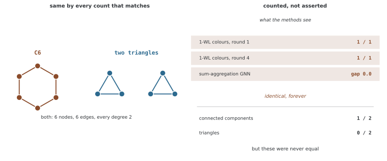

# 그래프 동형 뉴럴 넷트웍(GIN)

메시지 패싱이 이웃들을 너무 빨리 같은 값으로 합치면 뒤의 뉴럴 넷트웍으로 원래 차이를 복원할 수 없다. [GIN 연구](https://arxiv.org/abs/1810.00826)는 이 다중집합 구분 능력을1-WL 색 정제와 연결하고 합 기반 업데이트를 제안한다. 여기서 표현력은 구조를 구분할 수 있는 조건이며 모든 작업의 예측 성능 순위를 뜻하지 않는다.

## 1. 1-WL과 단사성 조건

1-WL은 현재 노드 색과 이웃 색의 다중집합을 새 색으로 해시한다. 다른 입력 쌍을 다른 새 색으로 보내는 단사적 연산을 이상적으로 사용한다. 그래프별 색의 빈도가 다르면 비동형을 판정하지만 같아도 동형을 증명하지는 못한다.

표준 순열 등변 국소 집계 GNN이 이 구분 능력을 달성하려면, 이웃 다중집합과 자기 상태의 정보를 잃지 않는 집계·업데이트가 필요하다. 그래프 수준에서는 노드 상태 다중집합을 구분할 수 있는 readout도 필요하다. 원 연구의 충분조건은 가산 피처 공간과 유계 크기 다중집합 등 이론적 설정을 사용한다.

적절한 피처 변환 뒤 합이 단사적 표현을 만들 수 있다는 존재 결과와 **원시 피처의 합이 항상 단사라는 주장**은 다르다. 유한한 폭·정밀도의 MLP와 실제 학습도 이 조건을 자동으로 보장하지 않는다.

## 2. 합·평균·최대가 남기는 정보

| 집계 | 같은 출력이 되는 예 |
|---|---|
| 평균 | {1}과{1,1,1}은 모두1 |
| 최대 | {3}과{1,3}은 모두3 |
| 원시값 합 | {1,3}과{2,2}는 모두4 |

합은 중복도에 민감하지만 모든 다른 다중집합을 구분하지는 않는다. 평균·최대도 작업에 따라 유용할 수 있다. 어떤 정보를 버리는지와 대상 레이블이 그 정보를 필요로 하는지를 함께 판단한다.

## 3. GIN 업데이트

자기 루프를 제외한 이웃 N(v)에 대해 다음을 사용한다.

$$h_v^{l+1}=\operatorname{MLP}_l\left((1+\epsilon_l)h_v^l+
\sum_{u\in\mathcal N(v)}h_u^l\right)$$

자기 상태와 이웃 합을 같은 차원에서 더한다. 입력 그래프에 이미 자기 루프가 있고 집계가 이를 포함하면 자기 항이 추가로 세어질 수 있으므로 구현의 루프 처리를 확인한다.

1+ε는 확률 웨이트나0~1 게이트가 아니다. ε=0의 GIN-0와 학습 가능한 GIN-ε를 사용할 수 있지만 어느 쪽이 항상 더 낫다는 보장은 없다. MLP가 단사인지, 가중 합이 자기 상태·다중집합 쌍을 구분하는지는 별도 조건이다. 예를 들어 ε=−1이면 자기 정보가 이 식에서 완전히 사라진다.

원시 스칼라에서 ε=0이면 “자기1·이웃{2}”와 “자기2·이웃{1}”이 모두3이 된다. 뒤의 MLP는 같은3을 받아 이 단계에서 둘을 다시 구분할 수 없다. 따라서 합과 MLP를 썼다는 사실만으로 각 유한 구현의 단사성을 선언하지 않는다.

## 4. 여러 레이어의 그래프 readout

그래프 분류에서는 레이어별 노드 표현의 합 등을 이어 붙이는 구성을 사용할 수 있다.

$$h_G=\operatorname{CONCAT}_{l=0}^{L}
\left(\sum_{v\in V}h_v^l\right)$$

초기·얕은 레이어의 구분을 최종레이어만 사용하는 것보다 더 직접적으로 전달한다. 하지만 readout이 집계한 정보나 뒤의 예측 head가 모든 구조를 보존한다는 뜻은 아니다. 연결을 추가했다고 과평활화가 원천적으로 사라지는 것도 아니다.

평균 readout은 같은 노드 다중집합의 반복을 구분하지 못할 수 있다. 그래프 크기에 따른 합의 스케일도 예측 목표에 맞추어 고려한다. 레이어별 상태 폭이 다르면 concat의 최종 차원은 각 폭의 합이다.

## 5. 표현력 결과의 범위

같은 초기 정보 아래 충분조건을 만족하는 GIN은1-WL 수준의 구분 능력을 얻을 수 있다.1-WL이 구분하지 못하는 C₆과 분리된 삼각형 두 개처럼, 모든 노드가 같은 피처가고 차수가 같은 예는 여전히 한계가 된다.

고차 GNN, 위치·구조 인코딩과 고유 식별자를 가진 모델은 비교 정보·상태가 다를 수 있다. GIN을 모든 종류의 그래프 모델보다 강한 구조로 부르지 않는다. 표현력의 이론적 상한·최적화·데이터 일반화는 서로 다른 문제다.

**그림으로 보는 AI 1.** 천장을 그린 사람들은 학습을 생각하고 있지 않았다

이 쪽은 GIN의 표현력을 1-WL에 붙여 재고 있다. 그 1-WL이 어디서 왔는가. 1968년 모스크바에서 나온 여섯 쪽짜리 글이다 — 보리스 바이스파일러(Boris Weisfeiler)와 안드레이 레만(Andrei Leman)의 「그래프를 표준형으로 줄이는 일과 그 과정에서 나타나는 대수」.

**그 글은 동형 판정법을 내놓은 것이 아니었다.** 번역본에서 `test` 라는 낱말은 **한 번도 나오지 않고**, `canonical` 은 **스무 번** 나온다. 그들이 하려던 것은 그래프를 표준형으로 줄이는 일이었고, 줄이는 도중에 나타나는 **대수** $A(\Gamma)$ 가 새 불변량이라는 것이 요지였다. 그 1절에 적힌 절차가 이것이다.

> "Associate with every vertex of the graph the characteristic vector which has one component equal to the number of neighbors of this vertex. Then divide vertices into classes… associate with every vertex the characteristic vector $v_i = (l, v_{i1}, v_{i2}, \dots)$, where $v_{ik}$ is the number of neighbors of vertex $i$ from class $k$… Now again divide vertices into classes according to new characteristic vectors…"

이웃의 분류를 세어 제 분류를 고치고, 그것을 되풀이한다. **이 쪽 1절의 색 정제와 글자 그대로 같은 절차**이고, 메시지 패싱이 하는 일과도 같다. 쉰 해 뒤에 표현력의 천장으로 불리게 되는 것이, 학습이라는 말이 없던 자리에서 표준형을 구하려다 적힌 셈이다.

바로 위 문단이 든 보기를 실제로 돌려 보았다. $C_6$ 과 떨어진 삼각형 둘은 노드도 엣지도 차수도 모두 같다. 1-WL은 **첫 라운드부터 넷째 라운드까지 색을 한 번도 가르지 못하고**(양쪽 다 색이 하나), 합 집계에 합 readout을 쓴 최대 표현력 GNN도 두 그래프에 **차이가 정확히 0.0인** 임베딩을 준다. 그런데 연결성분은 하나와 둘이고 삼각형은 영과 둘이다. **세면 바로 갈리는 것을 이 방법들은 끝내 못 본다.**

**그러니 "1-WL만큼 강하다"는 말은 칭찬인 동시에 한계의 이름이다.** 위 문단이 GIN을 모든 그래프 모델보다 강하다고 부르지 않는 까닭이고, 표현력과 일반화를 따로 두라는 까닭이기도 하다. 천장이 높아서 거기 닿은 것이 아니라, 1968년에 다른 목적으로 그어진 선이 마침 거기 있었던 것이다. 삼각형을 세야 하는 문제라면 더 강한 집계를 찾을 것이 아니라 **삼각형 수를 피처로 넣는 쪽**이 빠르다.

_확인한 곳 — B. Yu. Weisfeiler, A. A. Leman, "A reduction of a graph to canonical form and an algebra arising during this reduction", *NTI* Ser. 2, No. 9, 12–16 (1968). 인용한 1절과 낱말 횟수는 [영역본](https://www.iti.zcu.cz/wl2018/pdf/wl_paper_translation.pdf) 을 내려받아 직접 세었다. K. Xu, W. Hu, J. Leskovec, S. Jegelka, "How Powerful are Graph Neural Networks?", ICLR 2019. 그림의 수는 그림을 그리는 코드가 직접 세며, 두 그래프가 동형이 아니고 1-WL이 색을 가르지 못한다는 것을 먼저 확인한 뒤에만 그린다._

## 6. 계산과 평가

단순 합의 비용은 엣지 수와 피처 폭에 비례하고 노드별 MLP 비용이 추가된다. 큰 차수에서 합의 크기, 폭·정규화·레이어 수와 gradient 상태를 함께 확인한다. 이 페이지는 구조·이론 설명이며 학습 구현이나 성능 실험을 제공하지 않는다.

비교에서는 같은 데이터·초기 피처·분할·예산에서 합/평균과 ε·MLP·readout을 개별적으로 바꾸어 본다. 여러 설정을 동시에 바꾼 점수 차이를 합 집계만의 효과로 해석하지 않는다.

## 연습문제

**연습문제 1.** 
h_v=(1,0), 이웃(0,1),(1,1), ε=0.5에서 MLP 직전 벡터를 구하라.

??? success "풀이"

    자기 항은(1.5,0), 이웃 합은(1,2)이므로 합은(2.5,2)다. 자기 루프를 이웃에도 넣으면 별도의 자기 피처가 더해져 다른 값이 된다.

---

**연습문제 2.** 
합·평균·최대가 모든 다중집합에서 단사인지 반례로 설명하라.

??? success "풀이"

    평균은{1}과{1,1,1}, 최대는{3}과{1,3}, 원시 합은{1,3}과{2,2}에서 각각 같은 출력을 낸다. 적절한 피처 변환과 제한된 입력족에 대한 단사 구성의 존재 결과와 임의 원시값의 단순 합을 구분해야 한다.

---

**연습문제 3.** 
MLP를 사용하면 ε=0의 자기1·이웃{2}와 자기2·이웃{1}을 항상 구분할 수 있는가?

??? success "풀이"

    둘의 MLP 입력이 모두3이므로 이 단계의 결정적 MLP는 구분하지 못한다. 자기 상태와 다중집합 쌍의 결합이 이미 충돌했다. MLP가 크거나 학습 가능하다는 사실이 같은 입력을 서로 다른 출력으로 만들지는 못한다.

---

**연습문제 4.** 
GIN의1-WL 대응이 테스트 정확도의 보편적인 우위를 보장하지 않는 이유를 설명하라.

??? success "풀이"

    대응은 충분한 단사 집계·업데이트·readout 등의 조건에서 구조를 구분하는 능력에 대한 결과다. 실제 유한 모델·학습은 조건을 자동 만족하지 않으며,1-WL 자체의 구분 한계도 있다. 데이터 잡음·분할·최적화와 목표의 성질은 별도이므로 동일 조건의 평가가 필요하다.

## 정리하며

GIN은 다중집합과 자기 상태의 구분을 합 기반 업데이트·MLP·readout으로 연결한다. 이론적 존재 조건과 실제 구현의 단사성, 구조 구분 능력과 예측 일반화를 구분해야 한다.
