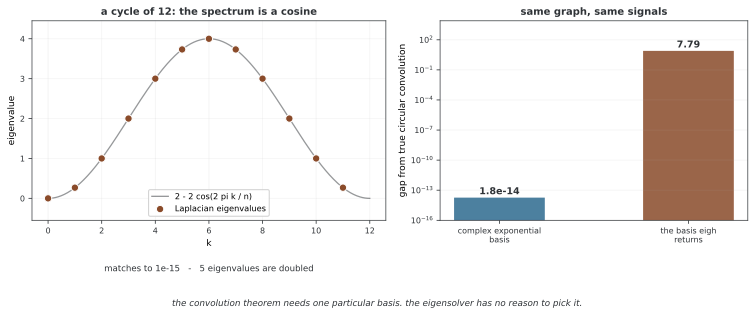

# 그래프 푸리에 변환의 계산과 필터

그래프 푸리에 변환(GFT)은 노드 신호를 라플라스의 직교 고유벡터 좌표로 바꾸는 연산이다. 이 코드는 NumPy의 밀집 고유분해로 기저·변환·필터를 직접 계산한다. 이어 하나의 그래프 신호에 필터 계수를 맞추는 회귀 데모를 제공하며, 일반화된 노드 분류 실험과는 구분해야 한다.

## 1. 코드와 보존된 출력

```python
"""
29.3.2: 그래프 푸리에 변환
그래프 푸리에 바꿈 짜기, 스펙트럼 컨볼루션, 파세발 정리.
"""

import numpy as np
import networkx as nx
import matplotlib.pyplot as plt

# ========================================================================
# 메인
# ========================================================================


def compute_gft_basis(A):
    """그래프 푸리에 변환의 바탕(라플라스 고유 벡터)을 셈한다."""
    D = np.diag(A.sum(axis=1))
    L = D - A
    eigenvalues, U = np.linalg.eigh(L)
    idx = np.argsort(eigenvalues)
    return eigenvalues[idx], U[:, idx], L


def gft(signal, U):
    """앞으로 가는 그래프 푸리에 변환."""
    return U.T @ signal


def igft(spectral_coeffs, U):
    """거꾸로 가는 그래프 푸리에 변환."""
    return U @ spectral_coeffs


def spectral_convolution(f, g, U):
    """스펙트럼 자리를 거친 그래프 위 겹말기."""
    f_hat = gft(f, U)
    g_hat = gft(g, U)
    return igft(f_hat * g_hat, U)


def demo_gft():
    """그래프 푸리에 변환을 보여 준다."""
    print("=" * 60)
    print("Graph Fourier Transform")
    print("=" * 60)

    G = nx.path_graph(50)
    A = nx.adjacency_matrix(G).toarray().astype(float)
    eigenvalues, U, L = compute_gft_basis(A)
    n = 50

    # 서로 다른 신호
    signals = {
        'Low-freq (sin 1 cycle)': np.sin(np.linspace(0, 2*np.pi, n)),
        'High-freq (sin 10 cycles)': np.sin(np.linspace(0, 20*np.pi, n)),
        'Step function': np.concatenate([np.ones(25), -np.ones(25)]),
        'Random': np.random.randn(n),
    }

    for name, f in signals.items():
        f_hat = gft(f, U)
        # 에너지 분포
        total_energy = np.sum(f_hat**2)
        low_energy = np.sum(f_hat[:n//4]**2) / total_energy
        high_energy = np.sum(f_hat[3*n//4:]**2) / total_energy
        print(f"  {name:30s}: low={low_energy:.3f}, high={high_energy:.3f}")


def demo_parseval():
    """그래프에서 파세발 정리를 따져 본다."""
    print("\n" + "=" * 60)
    print("Parseval's Theorem")
    print("=" * 60)

    G = nx.karate_club_graph()
    A = nx.adjacency_matrix(G).toarray().astype(float)
    _, U, _ = compute_gft_basis(A)

    np.random.seed(42)
    for trial in range(5):
        f = np.random.randn(A.shape[0])
        f_hat = gft(f, U)
        spatial_energy = np.sum(f**2)
        spectral_energy = np.sum(f_hat**2)
        print(f"  Trial {trial+1}: spatial={spatial_energy:.4f}, "
              f"spectral={spectral_energy:.4f}, "
              f"match={np.isclose(spatial_energy, spectral_energy)}")


def demo_spectral_convolution():
    """스펙트럼 자리에서의 그래프 겹말기를 보여 준다."""
    print("\n" + "=" * 60)
    print("Spectral Convolution")
    print("=" * 60)

    G = nx.karate_club_graph()
    A = nx.adjacency_matrix(G).toarray().astype(float)
    eigenvalues, U, L = compute_gft_basis(A)
    n = A.shape[0]

    np.random.seed(42)
    signal = np.random.randn(n) + np.array(
        [0 if G.nodes[i].get('club', '') == 'Mr. Hi' else 2 for i in range(n)],
        dtype=float)

    # 배울 수 있는 스펙트럼 거르개(흉내)
    # 낮은 진동수 통과 거르개
    theta_lowpass = np.exp(-eigenvalues / eigenvalues[-1])
    filtered = U @ (theta_lowpass * (U.T @ signal))

    # 같은 뜻: g_theta(L) @ signal
    g_L = U @ np.diag(theta_lowpass) @ U.T
    filtered_matrix = g_L @ signal

    print(f"Spectral filtering match: {np.allclose(filtered, filtered_matrix)}")
    print(f"Original signal range: [{signal.min():.2f}, {signal.max():.2f}]")
    print(f"Filtered signal range: [{filtered.min():.2f}, {filtered.max():.2f}]")


def demo_learnable_spectral_filter():
    """스펙트럼 거르개 잡을 배우는 것을 흉내 낸다."""
    print("\n" + "=" * 60)
    print("Learnable Spectral Filter")
    print("=" * 60)

    G = nx.karate_club_graph()
    A = nx.adjacency_matrix(G).toarray().astype(float)
    eigenvalues, U, L = compute_gft_basis(A)
    n = A.shape[0]

    # 타깃: 무리 이름표
    labels = np.array([0 if G.nodes[i].get('club', '') == 'Mr. Hi' else 1
                        for i in range(n)], dtype=float)

    # 들임: 잡소리 섞인 신호
    np.random.seed(42)
    signal = labels + np.random.randn(n) * 0.5

    # 그래디언트 내려가기로 theta 배우기
    theta = np.random.randn(n) * 0.1
    lr = 0.01

    for epoch in range(200):
        filtered = U @ (theta * (U.T @ signal))
        error = filtered - labels
        loss = np.mean(error**2)

        # 그래디언트: d_loss/d_theta
        f_hat = U.T @ signal
        grad = 2 * (U.T @ error) * f_hat / n
        theta -= lr * grad

        if (epoch + 1) % 50 == 0:
            print(f"  Epoch {epoch+1}: Loss={loss:.4f}")

    # 마지막 거르개 꼴
    print(f"\nLearned filter (first 5): {np.round(theta[:5], 3)}")
    print(f"Ideal low-pass (first 5): {np.round(np.exp(-eigenvalues[:5]), 3)}")


def visualize_gft():
    """그래프 푸리에 변환 성분을 그린다."""
    fig, axes = plt.subplots(2, 3, figsize=(15, 8))

    G = nx.path_graph(50)
    A = nx.adjacency_matrix(G).toarray().astype(float)
    eigenvalues, U, _ = compute_gft_basis(A)

    # 고유 벡터(바탕 함수)
    for k in range(6):
        ax = axes[k // 3, k % 3]
        ax.plot(U[:, k], 'b-', linewidth=1.5)
        ax.set_title(f"Eigenvector u_{k} (λ={eigenvalues[k]:.3f})")
        ax.axhline(y=0, color='gray', linestyle='--', alpha=0.5)

    plt.suptitle("Graph Fourier Basis (Path Graph)", fontsize=14)
    plt.tight_layout()
    plt.savefig("graph_fourier.png", dpi=150, bbox_inches='tight')
    plt.close()
    print("\nVisualization saved to graph_fourier.png")


if __name__ == "__main__":
    demo_gft()
    demo_parseval()
    demo_spectral_convolution()
    demo_learnable_spectral_filter()
    visualize_gft()
```

```
============================================================
Graph Fourier Transform
============================================================
  Low-freq (sin 1 cycle)        : low=0.999, high=0.000
  High-freq (sin 10 cycles)     : low=0.023, high=0.001
  Step function                 : low=0.968, high=0.006
  Random                        : low=0.087, high=0.288

============================================================
Parseval's Theorem
============================================================
  Trial 1: spatial=29.4642, spectral=29.4642, match=True
  Trial 2: spatial=27.1009, spectral=27.1009, match=True
  Trial 3: spatial=28.3457, spectral=28.3457, match=True
  Trial 4: spatial=36.8336, spectral=36.8336, match=True
  Trial 5: spatial=28.0226, spectral=28.0226, match=True

============================================================
Spectral Convolution
============================================================
Spectral filtering match: True
Original signal range: [-1.91, 3.85]
Filtered signal range: [-1.25, 3.33]

============================================================
Learnable Spectral Filter
============================================================
  Epoch 50: Loss=0.3909
  Epoch 100: Loss=0.3009
  Epoch 150: Loss=0.2354
  Epoch 200: Loss=0.1875

Learned filter (first 5): [ 0.644  0.431  0.076 -0.189 -0.129]
Ideal low-pass (first 5): [1.    0.305 0.091 0.053 0.051]

Visualization saved to graph_fourier.png
```

출력과 저장 그림은 기존 내용을 보존한다. 이번 편집에서는 실행·재학습이나 그림 재생성을 하지 않는다.

## 2. 기저 계산과 입력 가정

compute_gft_basis는 D=diag(A의 행합), L=D−A를 만든 뒤 eigh로 직교 고유기저 U를 구한다. 표준 그래프 주파수 해석은 **대칭·비음수 웨이트**에 맞는 코드다. 방향 A를 그대로 넣으면 L은 일반적으로 대칭이 아니며 eigh를 사용하는 가정이 깨진다. 입력 모양·대칭·웨이트 검사는 함수에 없다.

GFT와 역변환은 f̂=Uᵀf, f=Uf̂다. 아래 데모는 길이 n의 실수 벡터를 사용한다. 신호의 노드 순서는 A의 행 순서와 같아야 한다. NetworkX adjacency_matrix의 기본 웨이트 키는 weight이며 [Karate Club 그래프](https://networkx.org/documentation/stable/reference/generated/networkx.generators.social.karate_club_graph.html)는 엣지 웨이트를 갖는다. 따라서 해당 데모는 기본적으로 **가중 그래프 라플라스**를 사용한다.

## 3. 신호 에너지와 주파수 구간

정규직교 U에서는 ||f||²=||Uᵀf||²가 성립한다. demo_parseval은 임의 신호에서 이 좌표변환의 노름 보존을 수치적으로 확인한다. 이것은 학습 성능이나 필터 품질의 검증이 아니라 선형대수 관계의 확인이다.

demo_gft는 경로 그래프의 신호를 변환하고 앞·뒤 고유모드 구간의 에너지 비율을 출력한다. n=50에서 앞 구간은 인덱스0~11, 뒤는37~49이므로 정확히 같은 크기의 사분위 구간은 아니다. 시간축 사인 주기 수와 그래프 고유모드 번호도 정확히 같다고 가정할 수 없다. 높은 주기 사인이 있다고 반드시 에너지가 마지막 구간에 집중하는 것은 아니다.

0 신호에서는 total_energy=0으로 비율이 정의되지 않는다. 첫 demo의 Random 신호는 해당 함수 이전에 NumPy 시드를 설정하지 않아 뒤 데모와 같은 재현성 조건도 아니다.

## 4. 두 신호 컨볼루션과 연산자 필터의 차이

spectral_convolution은 선택한 U에서 f̂와 ĝ를 원소별 곱하고 역변환한다. 이 정의는 해당 **기저 관례에 의존**한다. 고유벡터의 부호를 바꾸면 두 변환 계수의 부호는 서로 약분되지만 마지막 역변환의 기저 부호가 남아, 결과가 바뀔 수 있다. 반복 고유값의 회전에도 주의해야 한다.

반면 demo_spectral_convolution에서 사용하는 것은 독립적으로 정한 응답 θₖ를 가진 선형 필터다.

$$f_{\mathrm{out}}=U\operatorname{diag}(\theta)U^Tf$$

θₖ=g(λₖ)처럼 고유값 함수로 정하면 부호와 반복 고유공간의 기저 회전에 영향을 받지 않는다. 함수 이름이 비슷해도 두 신호의 스펙트럼 곱과 고유값 함수 필터는 구분한다.

<div class="storybox" markdown>

**그림으로 보는 AI 1.** 고리에서는 비유가 아니라 같은 것이다

"그래프 푸리에"라는 이름이 비유처럼 들린다면, **고리 그래프에서는 비유가 아니라 등식**이라는 것을 보면 생각이 달라진다.

노드 $n$ 개를 둥글게 이은 고리의 라플라시안을 풀면 고유값이 정확히 $2-2\cos(2\pi k/n)$ 이다. $n=12$ 로 재어 보면 **$10^{-15}$ 자리까지** 맞는다. 그리고 복소 지수 $e^{-2\pi i jk/n}$ 이 그 고유벡터다 — 역시 $10^{-15}$ 자리까지. 곧 **고전 이산 푸리에 변환은 고리 그래프에서의 그래프 푸리에 변환**이다. 일반화가 아니라 특수한 경우를 되찾은 것이다.



**그런데 바로 위 문단이 경고한 것이 여기서 터진다.** 고전 푸리에에는 겹말기 정리가 있다 — 두 신호를 겹말면 주파수 영역에서 곱이 된다. 고리는 진짜 순환 겹말기가 정의되는 **유일한 자리**이므로, 스펙트럼 곱이 그것과 맞는지 실제로 맞춰 볼 수 있다.

맞춰 보면 **기저에 달려 있다.** 복소 지수를 기저로 쓰면 스펙트럼 곱이 순환 겹말기와 $1.8\times10^{-14}$ 안에서 같다. 그런데 `numpy` 의 `eigh` 가 돌려주는 실수 기저로 같은 일을 하면 **7.79만큼 어긋난다.** 까닭은 위 문단이 적은 그대로다 — $C_{12}$ 의 고유값 가운데 **다섯 개가 겹쳐 있고**, 겹친 고유공간 안에서 `eigh` 는 아무 직교 기저나 고른다. 겹말기 정리가 요구하는 그 하나를 고를 까닭이 없다.

**그리고 일반 그래프에서는 이 어긋남을 알아챌 방법조차 없다.** 비교할 순환 겹말기가 없기 때문이다. 고리는 정답이 있는 유일한 자리이고, 거기서 기본 고유분해가 정답을 빗나간다. 그래서 바로 아래 문단이 권하는 $\theta_k = g(\lambda_k)$ 가 요령이 아니라 **제대로 된 처방**이다 — 고유값만 보는 필터는 기저를 고를 일이 없으니 애초에 이 문제를 만들지 않는다.

_확인한 곳 — 고리 그래프 라플라시안의 고유값이 $2-2\cos(2\pi k/n)$ 이고 복소 지수가 고유벡터라는 것, 그 기저에서 스펙트럼 곱이 순환 겹말기와 같다는 것, `eigh` 의 실수 기저에서는 그렇지 않다는 것을 그림을 그리는 코드가 모두 직접 재어 확인하며, 네 가지가 다 맞지 않으면 그리지 않는다._

</div>

이 데모의 g(λ)=exp(−λ/λmax)는 부드러운 저역 통과다. λmax>0에서 최저 이득은 e⁻¹이므로 높은 모드를0으로 완전히 차단하는 이상적 필터는 아니다. 고유분해 방식과 명시적 g_L=Udiag(θ)Uᵀ의 계산이 같은지 allclose로 확인하지만 둘 다 같은 밀집 연산의 다른 표현이다.

## 5. 학습 가능한 모드별 필터

demo_learnable_spectral_filter는 모든 노드의 club 레이블에 노이즈를 더한 값을 입력으로 쓰고, **같은 모든 레이블을 목표로** MSE를200회 갱신한다. 따라서 알려진 신호의 잡음을 줄이는 학습 예이며, 레이블이 없는 노드를 예측하는 독립 테스트 정확도를 제공하지 않는다.

고정 f와 y에서 L=||Udiag(θ)Uᵀf−y||²/n의 그래디언트는 다음과 같다.

$$\frac{\partial L}{\partial\theta_k}=
\frac2n\bigl(U^T(f_{\mathrm{out}}-y)\bigr)_k\hat f_k$$

코드의 수동 업데이트는 이 그래디언트를 사용한다. 각 f̂ₖ≠0인 모드의 제한 없는 최적값은 θₖ*=ŷₖ/f̂ₖ이며 음수·1 초과도 가능하다. 따라서 출력에 비교한 exp(−λₖ)가 이 회귀의 “이상적인” 최적 필터라는 근거는 없다. f̂ₖ가0이면 해당 모드의 목표 성분을 이 입력 필터로 만들 수 없다.

## 6. 그림과 규모의 제한

visualize_gft는 경로 그래프의 처음6개 고유벡터를 노드 순서에 따라 그린다. 낮은 모드의 완만한 변화를 관찰할 수 있지만 각 벡터의 전체 부호는 임의다. 같은 그래프의 다른 고유분해에서 그림이 반전되어도 다른 주파수가 된 것은 아니다.

전체 밀집 U와 g_L은 O(n²) 저장을 요구하고 전체 고유분해는 일반적으로 O(n³) 비용이다. 이 교육용 코드를 큰 그래프에 그대로 확장할 수 있다고 설명하지 않는다. 다항식 필터·희소 연산과 일부 고유모드의 근사는 다른 계산 설계다.

## 연습문제

<div class="drillbox" markdown>

**연습문제 1.** <span class="diff med" title="중간"></span>
GFT가 노름을 보존하는 이유를 증명하고0 신호의 에너지 비율을 해석하라.

</div>

??? success "풀이"

    ||Uᵀf||²=fᵀUUᵀf=||f||²다. 단,0 신호는 전체 에너지가0이므로 구간 에너지를 전체로 나눈 비율은0/0이다. 별도의 정의·검사가 필요하며 Parseval 관계 자체가 실패하는 것은 아니다.


---

<div class="drillbox" markdown>

**연습문제 2.** <span class="diff med" title="중간"></span>
고유벡터 부호 변경에서 두 신호 컨볼루션과 Udiag(g(λ))Uᵀ 필터의 차이를 설명하라.

</div>

??? success "풀이"

    U를 US, S의 대각을±1로 바꾸면 두 신호 변환에는 각각 S가 붙어 곱에서는 사라지지만 역변환의 S가 남는다. 반면 Udiag(g)Uᵀ는 S가 양쪽에서 약분되어 같은 연산자다. 반복 고유값의 기저 회전에도 같은 g값을 주는 조건이 중요하다.


---

<div class="drillbox" markdown>

**연습문제 3.** <span class="diff hard" title="어려움"></span>
모드별 필터 회귀가 노드 분류 일반화를 입증하지 않는 이유와 제한 없는 최적 계수를 구하라.

</div>

??? success "풀이"

    입력부터 모든 노드의 정답에 노이즈를 더한 값이고 같은 레이블로200회 학습한다. 독립 레이블 분할이 없어 일반화 분류 실험이 아니다. 직교 좌표에서 각 항은(θₖf̂ₖ−ŷₖ)²이므로 f̂ₖ≠0이면 θₖ=ŷₖ/f̂ₖ가 최적이다. 반드시 exp(−λₖ)나 저역 통과가 되는 것은 아니다.


## 정리하며

GFT는 라플라스 기저의 좌표변환이며 노드 순서·웨이트·기저 관례를 맞춰야 한다. 부호에 민감한 두 신호 컨볼루션과 고유값 함수 필터를 구분하고, 전체 레이블 신호 회귀를 독립 분류 평가로 해석하지 않는다.
