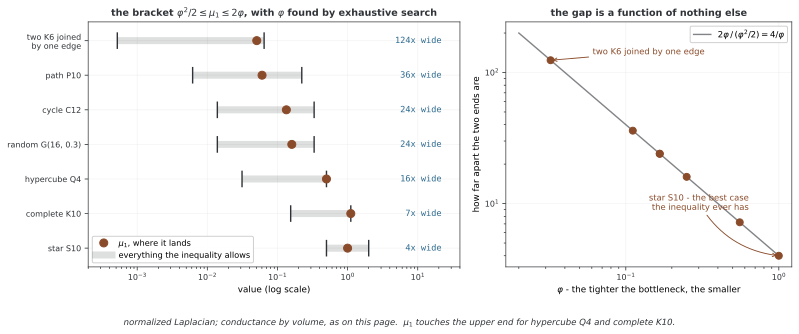

# 스펙트럼 그래프 이론

노드별 신호가 연결된 노드 사이에서 얼마나 달라지는지 행렬로 측정할 수 있다. 라플라스의 고유벡터는 그 변화량에 따라 정렬된 신호 기저를 제공한다. 이 관점은 그래프 푸리에 변환과 필터의 출발점이다. 아래에서는 비음수 대칭 웨이트의 무방향 그래프와 조합 라플라스 L=D−A를 사용한다.

## 1. 라플라스의 직교 기저

실대칭 L은 L=UΛUᵀ로 분해할 수 있다. U의 열 u₀,…,uₙ₋₁은 정규직교 고유벡터이고 0=λ₀≤λ₁≤…다.0 고유값의 개수는 양의 웨이트 엣지가 만드는 연결 성분 수다.

연결 그래프의0 고유벡터는 1/√n의 상수 벡터로 고를 수 있다. 분리된 그래프에서는0 고유공간이 여러 차원이라 단 하나의 DC 성분만 있다고 말할 수 없다. 같은 고유값의 공간에서는 기저 선택도 유일하지 않다.

차수가 양수이면 정규화 라플라스 Lsym=I−D⁻¹/²AD⁻¹/²를 사용할 수 있다. 고유값은 [0,2]에 있지만 조합 라플라스의 고유값은 같은 범위로 제한되지 않는다. 고립 노드의 정의는 [인접 행렬](../foundations/adjacency_matrix.md)에서 설명한 관례를 따로 정한다.

## 2. 신호의 변화량과 주파수

노드별 실수 신호 f를 n차원 벡터로 두면 다음 이차형식을 얻는다.

$$f^TLf=\frac12\sum_{i,j}A_{ij}(f_i-f_j)^2
=\sum_{\{i,j\}\in E}w_{ij}(f_i-f_j)^2$$

무방향 엣지를 한 번 세는 마지막 합에는 1/2가 없다. 고유벡터 uₖ를 단위 노름으로 정하면 변화량이 λₖ다. 따라서 작은 λ를 낮은 그래프 주파수, 큰 λ를 높은 주파수라고 부른다. 이는 그래프 위 엣지 차이의 척도이며 시간 주파수나 모든 엣지에서의 진동 횟수를 직접 세는 값은 아니다.

정규화 라플라스는 원시 fᵢ 대신 fᵢ/√dᵢ의 차이에 대응한다. 두 연산자를 바꿨는데도 같은 주파수·매끄러움 해석을 그대로 유지하지 않는다.

## 3. 그래프 푸리에 변환

정규직교 기저로 좌표를 바꾸어 다음을 정의한다.

$$\hat f=U^Tf,\qquad f=U\hat f$$

UᵀU=I이므로 ||f||²=||f̂||²이고, fᵀLf=Σₖλₖf̂ₖ²다. 이 식은 높은 주파수 계수가 전체 변화량에 더 크게 기여한다는 해석을 준다. 같은 고유값의 기저를 회전하면 개별 계수는 바뀌어도 해당 고유공간의 총 제곱 에너지는 같다.

연속적인 곡선처럼 보이는 신호도 노드 순서를 임의로 바꾸면 그림의 모양이 달라질 수 있다. 그래프와 신호를 함께 순열해야 실제 관계를 보존한다. 구체적인 코드와 기저의 모호성은 [그래프 푸리에 변환](graph_fourier.md)에서 다룬다.

## 4. 스펙트럼 필터

고유값의 함수 g를 사용하면 g(L)=Ug(Λ)Uᵀ와 출력 f_out=g(L)f를 정의한다. 고유벡터의 부호는 이 연산에서 약분된다. 반복 고유값에는 같은 함수값을 주므로 그 공간의 기저 회전에도 연산이 변하지 않는다.

예를 들어 g(λ)=exp(−tλ), t≥0는 열 확산 필터다. t가 커지면 높은 주파수를 더 줄이며 연결 성분별 상수 성분은 남긴다. 모든 분류 레이블이 그래프에서 저주파라는 가정은 별도이며, 저역 통과가 언제나 좋은 예측을 보장하지 않는다.

차수 K의 다항식 g(L)=Σₖ₌₀ᴷaₖLᵏ는 최대 K홉 밖에 영향을 전달하지 않는다. L의 비영 구조가 엣지와 대각에 제한되어 각 곱셈이 최대 한 홉을 확장하기 때문이다. K홉 안의 모든 노드에 반드시0이 아닌 영향이 생기는 것은 아니다.

## 5. 연결성과 스펙트럼 절단

연결 그래프의 조합 라플라스에서 두 번째 고유값은 다음 Rayleigh 최소화로 표현된다.

$$\lambda_1=\min_{f\perp\mathbf1,\,f\ne0}\frac{f^TLf}{f^Tf}$$

여기서는 고유값 번호를0부터 세므로 λ₁이 두 번째다. 그 고유벡터를 피들러 벡터라고 하며 절단의 연속 완화와 연결된다. 부호만 나누는 규칙이 항상 균형 잡힌 최적 절단을 주는 것은 아니다. 정렬 후 여러 임계값을 평가하는 sweep cut을 사용할 수 있다.

정규화 라플라스의 두 번째 고유값 μ₁과 conductance φ를 비교할 때는 정의를 맞춰야 한다. cut(S,Sᶜ)를 두 집합 사이 웨이트 합, vol(S)를 차수 합이라 두고 φ=min cut/min(vol(S),vol(Sᶜ))로 정의하면 표준 Cheeger 관계는 다음과 같다.

$$\frac{\phi^2}{2}\leq\mu_1\leq2\phi$$

조합 라플라스·노드 수 기준 edge expansion의 식과 혼합하지 않는다. 스펙트럼 간격으로 랜덤워크 혼합을 말할 때도 이분 그래프의 주기성·절댓값 고유값을 고려해야 한다. 관련 관례는 [그래프의 성질](../foundations/graph_properties.md)에서 다룬다.

**그림으로 보는 AI 1.** 굽은 면에서 건너온 부등식

위의 $\phi^2/2 \le \mu_1 \le 2\phi$ 에는 그래프가 없다. Cheeger 가 1970년에 증명한
것은 **콤팩트 리만 다양체**에 대한 것이었다. 굽은 면을 둘로 가르는 데 필요한 둘레를
재는 상수 $h(M)$ 을 두고 라플라시안의 가장 작은 양의 고유값이 $\lambda_1 \ge h^2/4$
이라는 것 — 면의 모양에 대한 기하학의 정리다. 그것을 이산 쪽으로 옮겨 그래프의 확장성과
묶은 것은 Alon 과 Milman 의 1985년 작업이고, 그들의 관심은 확장 그래프를 만드는 것이었다.
위의 식은 그 번역본이다.

번역이 얼마나 쓸모 있는지는 재 보면 된다. 작은 그래프 일곱 개에서 $\phi$ 를 **모든
쪽집합을 완전열거해** 정확히 구하고 $\mu_1$ 을 함께 재면, 부등식은 일곱 번 모두 참이다.
그런데 양 끝이 얼마나 벌어져 있는지가 문제다. $2\phi \big/ (\phi^2/2) = 4/\phi$ 이므로
**두 끝의 비는 $\phi$ 만으로 정해진다.** 그래프의 다른 무엇도 끼어들지 않는다.

그래서 **병목이 좁을수록 부등식이 말해 주는 것이 줄어든다.** $K_6$ 두 개를 엣지 하나로
이은 그래프는 $\phi = 0.0323$ 인데, 부등식이 허락하는 구간이 $[0.0005,\ 0.0645]$ 로
**124배**나 벌어져 있다. 별 그래프($\phi = 1$)에서 4배인 것과 견주면, 절단을 가장 알고
싶은 그래프에서 가장 적게 말해 주는 셈이다. 위쪽 끝은 실제로 닿기도 한다 — 하이퍼큐브
$Q_4$ 와 완전 그래프 $K_{10}$ 에서 $\mu_1 = 2\phi$ 다.

그림은 여기까지다. 느슨하다는 것이 쓸모없다는 뜻은 아니다. $\mu_1$ 이 작다는 것은
좋은 절단이 **있다는 보증**이고, 이 쪽이 피들러 벡터와 sweep cut 을 말하는 까닭은
보증과 **찾기**가 다른 일이기 때문이다. 다만 $\mu_1$ 하나를 보고 절단의 품질을 수로
옮겨 적을 수는 없다. 그리고 여기서 잰 것은 노드 16개 이하의 그래프 일곱 개뿐이다.

_확인한 곳 — J. Cheeger, "A lower bound for the smallest eigenvalue of the
Laplacian", in Problems in Analysis, Princeton Univ. Press, 1970, 195–199;
N. Alon, V. D. Milman, "$\lambda_1$, isoperimetric inequalities for graphs, and
superconcentrators", J. Combin. Theory Ser. B 38, 1985, 73–88. 수는 모두 이 쪽의
`figures/make_figures.py` 에서 직접 잰다._

## 6. 계산·지역성·다른 그래프로의 전달

전체 밀집 고유분해는 일반적으로 O(n³) 시간과 O(n²) 저장이 들어 큰 그래프에 부담이다. 하지만 일부 고유쌍을 구하는 희소 반복법이나 다항식 필터까지 모두 같은 비용인 것은 아니다. 모든 스펙트럼 방법이 고유분해를 반드시 실행한다고 설명하지 않는다.

고유모드마다 자유로운 계수 하나를 학습한 필터는 그래프 크기·기저 정렬이 바뀌면 직접 대응하기 어렵다. 반면 같은 g(λ) 함수나 다항식 계수를 다른 그래프의 L에 적용할 수 있다. 이때도 그래프·주파수 스케일과 통계적 일반화는 별도로 확인해야 한다.

일반적인 g(L)는 멀리 떨어진 노드를 연결하는 밀집 연산자가 될 수 있다. [ChebNet](chebnet.md)은 다항식 근사와 재귀로 국소성과 효율을 얻는다. 스펙트럼과 공간 메시지 패싱은 완전히 분리된 두 진영이 아니라 같은 연산을 다른 관점에서 설명할 수 있는 경우가 있다.

## 연습문제

**연습문제 1.** 
엣지 하나로 연결한 두 노드에서 L의 고유값과 f=(1,−1)의 변화량을 구하라.

??? success "풀이"

    L=[[1,−1],[−1,1]]이고 단위 고유벡터(1,1)/√2와(1,−1)/√2의 고유값은0과2다. f는 높은 모드만 가지며 ||f||²=2, fᵀLf=4다. 엣지를 한 번 센 합(1−(−1))²=4와 같다.

---

**연습문제 2.** 
반복 고유값의 기저를 바꾸어도 g(L)가 같은 이유를 설명하라.

??? success "풀이"

    같은 고유값 λ의 공간에서 g(Λ)는 g(λ)I다. 직교 회전 R을 적용해도 Rg(λ)IRᵀ=g(λ)I이므로 연산자는 같다. 같은 공간의 각 기저벡터에 서로 다른 임의 계수를 매기면 이 성질이 일반적으로 사라진다.

---

**연습문제 3.** 
차수2 다항식 a₀I+a₁L+a₂L²가3홉 노드에 직접 영향을 줄 수 있는가?

??? success "풀이"

    L의 한 곱은 대각에 머물거나 엣지를 한 번 건너므로 L²도 최대2홉까지만 닿는다. 따라서3홉 노드의 해당 원소는0이다.2홉 안의 계수는 상쇄될 수 있어 모두 비영이라는 결론은 없다.

---

**연습문제 4.** 
정규화 conductance의 Cheeger 관계를 조합 라플라스 고유값에 그대로 적용할 수 없는 이유는 무엇인가?

??? success "풀이"

    연산자와 절단의 분모가 다르기 때문이다. 위 관계는 μ₁(Lsym)와 차수 부피 기준 φ 사이의 식이다. 조합 라플라스와 노드 수 기준 expansion은 웨이트·최대 차수에 따른 다른 스케일을 갖는다. 같은 기호 h·λ를 사용하더라도 정의를 먼저 일치시켜야 한다.

## 정리하며

라플라스 고유값은 그래프 신호 변화량을 정렬하고 직교 기저·필터를 정의한다. 조합·정규화 연산자와 절단 지표의 정의를 맞추고, 기저의 모호성·다항식 지역성·고유분해 비용을 구분한다.
