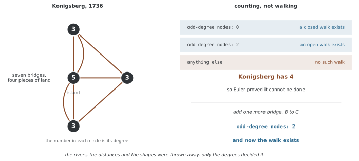

# 그래프의 기초 개념

그래프는 객체와 그 사이의 관계를 분리해 표현한다. 객체를 노드, 관계를 엣지로 두고 각자 피처를 붙이면 분자·거래·추천 데이터 등을 같은 계산 틀로 다룰 수 있다. 그래프 뉴럴 넷트웍을 정의하기 전에 방향·중복·자기 루프와 정보 전달 방향의 관례를 정해야 한다.

## 1. 단순 그래프와 방향

유한 노드 집합 V를 사용한다. **단순 무방향 그래프** G=(V,E)는 서로 다른 노드의 순서 없는 쌍 {u,v}를 엣지로 사용한다. 같은 쌍을 중복해서 세거나 자기 루프 {u,u}를 포함하지 않는다. 행렬에 (u,v)와 (v,u)를 모두 저장해도 무방향 엣지 하나를 두 개의 독립 관계로 세는 것은 아니다.

**방향 그래프**에서는 순서쌍 (u,v)가 u→v를 뜻한다. 역방향 엣지는 자동으로 생기지 않는다. 자기 루프를 허용하는지 따로 정한다. 웨이트 w:E→R는 거리·비용·관계 강도 등을 표현하지만, 음의 웨이트를 허용하면 확률 전이와 양의 준정부호 라플라스의 표준 성질에 추가 조건이 필요하다.

**다중 그래프**는 같은 노드 쌍의 서로 다른 엣지를 허용한다. 이를 구분하려면 엣지별 식별자나 중복도·피처를 담는 구조가 필요하며 단순한 쌍의 집합만으로 충분하지 않다. 자기 루프 허용 여부는 다중 엣지 허용과 별도로 정할 수 있다.

## 2. 이웃과 차수

단순 무방향 그래프의 이웃 N(v)는 v와 연결된 노드 집합이고 차수 d(v)=|N(v)|다. 이 가정에서 모든 엣지가 양 끝의 차수에 한 번씩 기여하므로 다음 악수 정리를 얻는다.

$$\sum_{v\in V}d(v)=2|E|$$

다중 엣지는 중복도만큼 세고, 무방향 자기 루프는 통상 차수에 2를 기여한다. 이런 경우 서로 다른 이웃 수가 곧 차수는 아니다. 비음수 웨이트를 합한 weighted degree도 엣지 개수와 구분한다.

**그림으로 보는 AI 1.** 이 분야의 첫 정리는 "할 수 없다" 였다

위에서 증명한 악수 정리 $\sum_v d(v) = 2|E|$ 는 그 자체로도 쓸모가 있지만, 그래프라는 생각이 **처음 쓰인 자리**에서 결정적인 구실을 했다.

1736년 상트페테르부르크에서 레온하르트 오일러(Leonhard Euler)가 「위치의 기하학에 관한 문제의 풀이」를 냈다. 쾨니히스베르크라는 도시에 강이 흐르고 땅이 넷으로 갈라져 있는데, 다리 일곱을 **하나도 빠뜨리지 않고 한 번씩만** 건너는 산책이 가능한가 하는 물음이었다. 널리 알려진 소일거리였다.

오일러가 한 일이 그래프의 시작이다. **지도를 버렸다.** 강의 폭도, 다리의 길이도, 땅의 모양도 답과 무관하다는 것을 알아차리고, 어느 땅이 어느 땅에 **몇 번** 이어져 있는지만 남겼다.

남은 것은 네 수뿐이다 — **5, 3, 3, 3.** 섬에 다리가 다섯, 나머지 셋에 각각 셋이다(합이 14이고 다리가 일곱이니 악수 정리가 맞는다). 그리고 산책이 있으려면 중간에 지나가는 땅마다 **들어온 다리와 나가는 다리가 짝을 이뤄야** 하므로, 홀수 차수인 땅은 출발점이나 도착점일 수밖에 없다. 그런 땅이 **넷**이면 — 쾨니히스베르크가 그렇다 — 시작과 끝이 둘뿐이니 불가능하다.

이 쪽의 악수 정리가 여기서 한 번 더 쓰인다. 차수의 합이 짝수이므로 **홀수 차수인 노드는 반드시 짝수 개**다. 그래서 오일러의 규칙에 "홀수가 1개인 경우"가 아예 없는 것이다.

다리를 하나만 더 놓아 보면 답이 뒤집힌다. B와 C를 잇는 다리를 더하면 홀수 차수가 **2개**로 줄고 산책이 생긴다. 땅의 모양은 하나도 바뀌지 않았다.

**다만 오일러는 운이 좋았다.** 그가 던진 전역적인 물음 — 그런 산책이 존재하는가 — 이 마침 **완전히 국소적인 답**(차수의 홀짝)을 가졌다. 모든 물음이 그렇지는 않다. [GIN](../convolutions/gin.md) 쪽이 보이듯, 이웃을 세어 가는 절차로는 끝내 갈리지 않는 구조가 있다. 그래프가 강력한 까닭도 그 한계가 생기는 까닭도 같다 — **버린 것이 많다.**

_확인한 곳 — L. Euler, "Solutio problematis ad geometriam situs pertinentis", *Commentarii Academiae Scientiarum Imperialis Petropolitanae* **8**, 128–140 (1736). 그래프 이론의 첫 논문으로 꼽힌다. 그림의 차수와 산책의 존재 여부는 그림을 그리는 코드가 `networkx` 로 직접 세고 판정하며, 네 땅이 모두 홀수라는 것과 다리 하나로 답이 뒤집힌다는 것을 먼저 확인한 뒤에만 그린다._

방향 그래프에서는 진출 이웃 N_out(v)={u:(v,u)∈E}, 진입 이웃 N_in(v)={u:(u,v)∈E}를 나눈다. 진출·진입 차수의 합은 각각 |E|다. GNN에서 어느 이웃이 메시지를 보내는지 명시하지 않으면 같은 그래프에서도 다른 연산을 정의하게 된다.

## 3. 경로·사이클·연결성

| 용어 | 이 페이지의 관례 |
|---|---|
| 보행(walk) | 연속한 노드가 엣지로 연결된 순서, 노드·엣지 반복 허용 |
| 경로(path) | 노드를 반복하지 않는 보행 |
| 길이 | 이동에 사용한 엣지 수 |
| 사이클 | 시작·끝만 같고 나머지 노드는 반복하지 않는 닫힌 보행 |
| 연결 그래프 | 무방향 그래프의 모든 노드 쌍 사이에 경로가 있음 |
| 연결 성분 | 경로로 서로 도달하는 극대 노드 집합 |

단순 무방향 사이클의 길이는 최소 3이다. 방향 그래프의 경로는 화살표를 따라야 하며, 모든 순서쌍이 서로 도달하면 강연결이다. 방향을 지웠을 때 연결되는 약연결과 다르다.

부분 그래프는 일부 노드와 그 사이의 일부 엣지를 선택한 그래프다. 유도 부분 그래프는 선택한 노드 사이에 원래 있던 엣지를 모두 포함한다. “일부 노드를 골랐다”는 설명만으로 두 경우를 혼동하지 않는다.

## 4. 자주 쓰는 구조

완전 그래프 K_n은 서로 다른 모든 노드 쌍을 연결해 n(n−1)/2개의 무방향 엣지를 갖는다. 이 페이지에서 별 그래프는 중심 하나와 잎 n−1개인 K_(1,n−1)을 뜻한다. 연결·무사이클인 트리는 n≥1에서 n−1개 엣지를 갖는다.

클리크는 모든 노드 쌍이 연결된 부분 그래프다. 이분 그래프는 노드를 두 집합으로 나누어 엣지가 서로 다른 집합 사이에만 놓인다. DAG는 방향 사이클이 없는 방향 그래프다. DAG 구조를 그렸다는 사실만으로 인과 관계가 검증되는 것은 아니다.

## 5. 저장 구조와 피처

인접 리스트는 O(|V|+|E|) 저장으로 희소 그래프의 이웃 순회에 적합하다. 밀집 인접 행렬은 O(|V|²) 저장을 사용하고 노드 쌍별 값을 바로 찾기 쉽다. 엣지 리스트는 끝점 쌍을 저장하지만 **고립 노드**는 목록에 나타나지 않으므로 전체 노드 수나 별도 노드 목록이 필요하다.

노드·엣지 피처와 그래프 구조는 서로 다른 입력이다. 고립 노드에도 피처를 줄 수 있고, 같은 구조의 그래프도 피처에 따라 다른 예측을 낼 수 있다. 인접·접속 행렬의 자세한 관례는 [인접 행렬](adjacency_matrix.md)과 [그래프 표현](representations.md)에서 다룬다.

## 6. 메시지 패싱의 정보 범위

한 레이어에서 직접 이웃만 집계하는 모델은 한 번에 최대 한 홉의 정보를 전달한다. 방향을 고려한 최단 거리가 k라면 k레이어보다 적은 레이어로 그 경로를 통한 영향을 전달할 수 없다. 하지만 k레이어를 썼다고 학습된 집계가 해당 정보를 반드시 보존하는 것은 아니다.

깊어질 때 생기는 과평활화(over-smoothing)는 노드 표현의 구분이 줄어드는 현상이다. 과압축(over-squashing)은 많은 원거리 정보를 제한된 표현과 좁은 연결 통로에 담는 어려움이다. 이웃 수가 언제나 지수적으로 늘거나 깊은 모델이 반드시 동일 벡터로 수렴한다는 것은 아니다. 그래프·정규화·비선형성·잔차 구조를 함께 봐야 한다.

## 7. 관계 데이터의 설계

자산의 상관, 계좌 간 자금 이동과 공급 관계는 각각 대칭·방향·웨이트가 다른 그래프를 만든다. 상관의 절댓값은 부호를 잃고, 정적인 거래 합계는 시간 순서를 잃는다. 예측 시점 이후의 엣지를 사용하면 정보 누출이 생길 수 있다.

그래프를 만들 수 있다는 것만으로 이상 탐지나 예측이 정확해지는 것은 아니다. 노드·엣지의 의미와 관측 시점, 방향과 평가 분할을 정해 모델의 입력 가정을 명시한다.

## 연습문제

**연습문제 1.** 
5개 노드의 무방향 사이클 1–2–3–4–5–1에 hᵢ=(i,1)을 두고 hᵢ′=mean_{j∈N(i)}hⱼ를 계산하라.

??? success "풀이"

    노드 순서대로 (3.5,1),(2,1),(3,1),(4,1),(2.5,1)이다. 각 노드의 두 이웃만 평균하며 자기 피처는 직접 포함하지 않는다. 자기 루프나 잔차 연결을 추가하면 다른 업데이트가 된다.

---

**연습문제 2.** 
평균 집계가 구분하지 못하고 합 집계가 구분하는 다중집합을 들고, 합도 항상 단사인지 설명하라.

??? success "풀이"

    {1,1,1}과 {1}은 평균1로 같지만 합은3과1이다. 반면 {1,3}과 {2,2}는 둘 다 합4여서 단순 원시값 합도 모든 다중집합을 구분하지 못한다. 피처 변환·집계·업데이트의 표현력을 따로 고려해야 한다.

---

**연습문제 3.** 
한 홉 메시지 패싱에서 최단 거리 k인 정보가 도달하는 최소 레이어 수와 보존의 한계를 설명하라.

??? success "풀이"

    엣지 방향을 따라 전달할 수 있다면 최소 k레이어가 필요하다. 단, k레이어이면 반드시 해당 정보가 남는다는 뜻은 아니다. 집계에서 구분이 사라지거나 다수 정보가 좁은 표현에 압축될 수 있다. 도달 범위, 과평활화와 과압축을 같은 현상으로 취급하지 않는다.

---

**연습문제 4.** 
자기 루프 하나가 있는 노드의 차수와 엣지 리스트의 고립 노드 처리를 설명하라.

??? success "풀이"

    무방향 그래프의 조합적 차수에서 자기 루프는2를 기여한다. 서로 다른 이웃 수나 행렬 대각을 한 번 합한 값과 다를 수 있다. 엣지 리스트에는 아무 엣지도 없는 고립 노드가 나타나지 않으므로 별도 노드 집합·전체 수를 함께 저장해야 한다.

## 정리하며

그래프는 노드·엣지·피처로 관계를 표현하며 방향·중복·자기 루프의 관례가 연산을 결정한다. 경로와 반복 보행, 이웃 수와 차수, 저장 구조와 실제 정보 전달 범위를 구분한다.
