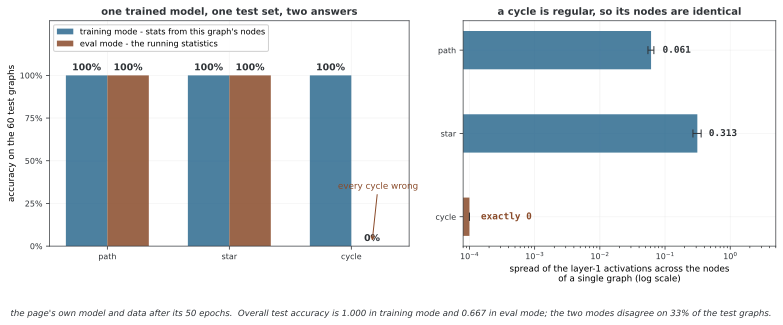

# 그래프 전체의 분류

노드 분류는 각 노드의 레이블을 예측하지만 그래프 분류는 입력 그래프 하나에 레이블 하나를 부여한다. 이 예제는 경로·별·사이클의 합성 그래프를 GCN으로 처리하고 global readout 뒤3개 클래스를 예측한다. 구조와 데이터 분할이 단순하므로 독립적인 복잡한 그래프에 대한 일반화로 확대하지 않는다.

## 1. 코드와 보존된 출력

```python
"""
29.5.1: 그래프 가름
끝에서 끝까지의 그래프 가름 흐름.
"""
import torch, torch.nn as nn, torch.nn.functional as F
import numpy as np

# ========================================================================
# 메인
# ========================================================================

class GCNLayer(nn.Module):
    def __init__(self, in_ch, out_ch):
        super().__init__()
        self.lin = nn.Linear(in_ch, out_ch)
    def forward(self, x, edge_index):
        n = x.shape[0]; src, dst = edge_index[0], edge_index[1]
        loop = torch.arange(n, device=x.device)
        src_a = torch.cat([src, loop]); dst_a = torch.cat([dst, loop])
        deg = torch.zeros(n, device=x.device)
        deg.scatter_add_(0, dst_a, torch.ones(dst_a.shape[0], device=x.device))
        norm = (deg[src_a]*deg[dst_a]).pow(-0.5); norm[norm==float('inf')]=0
        h = self.lin(x); msg = h[src_a]*norm.unsqueeze(1)
        out = torch.zeros(n, h.shape[1], device=x.device)
        out.scatter_add_(0, dst_a.unsqueeze(1).expand_as(msg), msg)
        return out

class GraphClassifier(nn.Module):
    def __init__(self, in_ch, hidden_ch, out_ch, num_layers=3, readout='sum'):
        super().__init__()
        self.convs = nn.ModuleList()
        self.bns = nn.ModuleList()
        self.convs.append(GCNLayer(in_ch, hidden_ch))
        self.bns.append(nn.BatchNorm1d(hidden_ch))
        for _ in range(num_layers-1):
            self.convs.append(GCNLayer(hidden_ch, hidden_ch))
            self.bns.append(nn.BatchNorm1d(hidden_ch))
        self.classifier = nn.Sequential(nn.Linear(hidden_ch, hidden_ch), nn.ReLU(), nn.Linear(hidden_ch, out_ch))
        self.readout = readout

    def forward(self, x, edge_index, batch=None):
        if batch is None: batch = torch.zeros(x.shape[0], dtype=torch.long, device=x.device)
        for conv, bn in zip(self.convs, self.bns):
            x = F.relu(bn(conv(x, edge_index)))
        ng = batch.max().item()+1
        pool = torch.zeros(ng, x.shape[1], device=x.device)
        pool.scatter_add_(0, batch.unsqueeze(1).expand_as(x), x)
        if self.readout == 'mean':
            cnt = torch.zeros(ng, device=x.device)
            cnt.scatter_add_(0, batch, torch.ones(batch.shape[0], device=x.device))
            pool = pool / cnt.clamp(min=1).unsqueeze(1)
        return self.classifier(pool)

def create_dataset(n_graphs=300):
    np.random.seed(42); graphs = []
    for i in range(n_graphs):
        label = i % 3
        if label == 0: n = np.random.randint(5,10); edges = [(j,j+1) for j in range(n-1)]
        elif label == 1: n = np.random.randint(5,10); edges = [(0,j) for j in range(1,n)]
        else: n = np.random.randint(5,10); edges = [(j,(j+1)%n) for j in range(n)]
        src = [e[0] for e in edges]+[e[1] for e in edges]
        dst = [e[1] for e in edges]+[e[0] for e in edges]
        graphs.append({'x': torch.ones(n,1), 'ei': torch.tensor([src,dst],dtype=torch.long), 'y': label, 'n': n})
    return graphs

def demo_graph_classification():
    print("=" * 60); print("Graph Classification"); print("=" * 60)
    torch.manual_seed(42)
    graphs = create_dataset(300); train_g, test_g = graphs[:240], graphs[240:]
    model = GraphClassifier(1, 32, 3, num_layers=3, readout='sum')
    opt = torch.optim.Adam(model.parameters(), lr=0.01)
    model.train()
    for epoch in range(50):
        np.random.shuffle(train_g); correct = 0
        for g in train_g:
            opt.zero_grad()
            out = model(g['x'], g['ei'])
            loss = F.cross_entropy(out, torch.tensor([g['y']]))
            loss.backward(); opt.step()
            correct += (out.argmax(1).item() == g['y'])
        if (epoch+1) % 10 == 0:
            model.eval(); tc = sum(1 for g in test_g if model(g['x'], g['ei']).argmax(1).item() == g['y'])
            print(f"  Epoch {epoch+1}: Train={correct/len(train_g):.3f}, Test={tc/len(test_g):.3f}")
            model.train()

if __name__ == "__main__":
    demo_graph_classification()
```

```
============================================================
Graph Classification
============================================================
  Epoch 10: Train=1.000, Test=0.667
  Epoch 20: Train=1.000, Test=0.667
  Epoch 30: Train=1.000, Test=0.667
  Epoch 40: Train=1.000, Test=0.667
  Epoch 50: Train=1.000, Test=0.667
```

출력은 기존 학습 기록이다. 이번 편집에서는 코드를 실행하거나 정확도를 새로 측정하지 않는다.

## 2. 합성 데이터가 포함하는 구조

그래프300개를 생성하며 레이블은 순서대로 경로0·별1·사이클2를 반복한다. 노드 수는5~9에서 뽑고 모든 노드 피처는1이다. 엣지는 양방향으로 저장한다. 가능한 비표지 구조는 **3종류×5개 크기인15가지**에서 반복된다.

앞240개를 학습, 뒤60개를 테스트에 사용하므로 각 클래스는 학습80개·테스트20개다. 그래프 행은 다르지만 같은 종류·크기의 그래프는 동형 사본일 수 있다. 따라서 이 분할은15개 가능한 구조와 겹치지 않는 새로운 구조 유형에 대한 검증은 아니다. 동형 그룹 분할이나 크기 외삽을 원하면 별도 설계가 필요하다.

## 3. 노드 인코더와 bias 위치

GCNLayer는 자기 루프를 추가하고 dst 차수를 사용해 양 끝점을 정규화한 뒤 source 피처를 수신 노드로 합산한다. 무방향 양방향 입력에서 대칭 정규화 S̃에 해당한다. 여기서는 먼저 **Linear의 bias까지** 적용하므로 출력은 S̃(XW+b)다.

앞의 수동 GCN처럼 S̃XW+b인 구현과 일반적으로 다르다. S̃1이 모든 노드에서1은 아니기 때문이다. 자기 루프·중복 엣지와 방향에 대한 가정, 새 텐서의 장치·dtype도 맞춰야 한다.

기본3개 GCN 레이어는 모두32채널이며 매 레이어 뒤 BatchNorm1d와 ReLU를 적용한다. num_layers는1 이상의 정수라는 계약이 필요하다. 구조가 아무리 같아도 초기 피처·정규화·readout이 다르면 같은 표현력이 된다고 가정하지 않는다.

## 4. BatchNorm과 그래프별 학습

학습 루프는 그래프를 하나씩 전달하므로 BatchNorm은 **한 그래프의 노드들**에서 채널별 통계를 계산한다. 평가 때는 학습 중 누적한 running 통계를 사용한다. 그래프마다 크기·피처 분포가 달라지면 이 학습·평가 동작 차이를 고려해야 한다.

모든 노드가 같은 벡터인 정규 그래프에서는 대칭 정규화가 상수 벡터를 보존할 수 있다. 이 예제의 사이클도 그렇다. 차수 구조가 표현에 들어가는 방식과 BatchNorm이 그것을 바꾸는 방식을 함께 살펴야 한다. 노드1개 입력은 훈련 모드 BatchNorm의 표본 수 조건에도 맞지 않을 수 있지만 데모는5개 이상을 쓴다.

<div class="storybox" markdown>

**그림으로 보는 AI 1.** 배치가 한 그래프의 노드들일 때

BatchNorm 을 내놓은 Ioffe 와 Szegedy(ICML 2015)는 그것이 무엇에 기대는지를 분명히
적어 두었다. *"the BN transform does not independently process the activation in
each training example. Rather, $\mathrm{BN}_{\gamma,\beta}(x)$ depends both on the
training example and **the other examples in the mini-batch**."* 그리고 평가 때
running 통계로 갈아 끼우는 까닭도 적었다 — *"we want the output to depend only on
the input, deterministically."* 여기서 "다른 예제들" 은 함께 뽑힌 **독립적인 표본**이다.
그런데 이 쪽은 그래프를 하나씩 넣으므로, 그 배치는 분류하려는 **그래프 자신의 노드들**
이다. 섞여 들어오는 것이 다른 표본이 아니라 입력 그 자체다.

이 쪽이 적어 둔 Test=0.667 이 그래서 나온다. 학습을 마친 같은 모델에 같은 테스트
그래프를 넣고 모드만 바꾸어 재면 — **학습 모드에서 1.000, 평가 모드에서 0.667** 이고,
60개 가운데 **33%** 에서 예측이 달라진다. 무리별로 보면 더 또렷하다. 평가 모드에서
경로와 별은 각각 100% 인데 **사이클은 0%** 로, 하나도 맞히지 못한다. 학습 모드에서는
셋 다 100% 다. 곧 0.667 은 일반화의 실패가 아니라 **모드 사이의 불일치**다.



무너지는 자리가 사이클인 것도 우연이 아니다. 위 §4 에 적힌 대로 **정규 그래프에서
대칭 정규화는 상수 벡터를 보존**하므로, 사이클의 노드들은 레이어를 지나도 서로 완전히
같다. 첫 레이어에서 노드들 사이의 흩어짐을 재면 경로가 0.061, 별이 0.313 인데 사이클은
**정확히 0** 이다. 학습 모드의 BatchNorm 은 이 상수 벡터를 $\beta$ 하나로 보내고,
평가 모드는 다른 그래프들에서 쌓은 running 분산으로 나누어 전혀 다른 곳으로 보낸다.
같은 입력에 두 답이 나오는 지점이 바로 여기다.

그림은 여기까지다. **BatchNorm 을 빼면 된다는 뜻이 아니다** — 빼고 같은 조건으로
학습하면 두 모드가 일치하는 대신 테스트 정확도가 0.333 으로 떨어져, 세 무리 가운데
하나만 맞힌다. 정규화는 실제로 일을 하고 있다. 말할 수 있는 것은 하나다. **그래프를
하나씩 넣는 한, 이 쪽에 적힌 두 수(Train·Test)는 같은 저울로 잰 값이 아니다.**
비교하려면 적어도 두 수를 같은 모드에서 다시 재야 한다.

_확인한 곳 — S. Ioffe, C. Szegedy, "Batch Normalization: Accelerating Deep Network
Training by Reducing Internal Covariate Shift", ICML 2015 (arXiv:1502.03167), 3절.
수는 모두 이 쪽의 `figures/make_figures.py` 에서 이 쪽의 모델·자료·에포크를 그대로
써서 직접 잰다._

</div>

## 5. 그래프 readout과 logits

batch=None이면 모든 노드를 하나의 그래프로 간주한다. 여러 그래프를 넣으려면 피처·엣지의 disjoint union과 올바른 batch 번호를 함께 제공한다. 그래프 번호별 sum을 계산하고 readout이 정확히 'mean'이면 개수로 나눈다. 다른 문자열은 모두 sum으로 동작하며 지원값을 검증하지 않는다.

pool은 G×32, classifier 출력은 G×3이다. 그래프 하나의 정답은 길이1의 정수 레이블로 교차 엔트로피에 전달한다. 노드마다3개 레이블을 예측하는 모델이 아니다. 빈 batch·고립 노드·번호 간격의 계약은 pooling과 마찬가지로 별도 확인한다.

## 6. 학습·평가 지표의 범위

240개 그래프를50에포크 동안 하나씩 사용해 총12,000번 업데이트한다. 학습 accuracy는 에포크 동안 계속 바뀌는 파라미터의 예측을 누적한 값이고, 테스트 accuracy는 해당 체크포인트의 고정 모델을 eval 모드로 측정한다. 둘을 같은 파라미터·모드의 정확도로 해석하지 않는다.

10에포크마다 테스트 값을 출력하지만 별도 검증 집합·선택 규칙은 없다. 테스트 점수로 설정을 고르면 독립 성능 추정이 아니게 된다. 테스트 루프에 no_grad도 없어 불필요한 그래프를 만들 수 있으나 역전파는 하지 않는다.

더 큰 그래프·다른 피처·실제 분자나 사회 네트워크의 성능을 주장하려면 목적에 맞는 분할과 기준모델이 필요하다. 이 예제의 출력은 교육용 세 구조의 분류 흐름을 보여 주는 범위로 읽는다.

## 연습문제

<div class="drillbox" markdown>

**연습문제 1.** <span class="diff med" title="중간"></span>
GraphClassifier가 그래프 하나의 n×1 입력에서 반환하는 모양과 정답 레이블의 모양을 설명하라.

</div>

??? success "풀이"

    기본3개 레이어 뒤 노드 상태는 n×32, sum readout은1×32, 최종 logits는1×3이다. 정답은 그래프당 하나의 클래스 인덱스이므로 길이1 정수 벡터다. batch를 생략하면 서로 다른 그래프를 자동 구분하지 않는다.


---

<div class="drillbox" markdown>

**연습문제 2.** <span class="diff med" title="중간"></span>
이 데이터의 가능한 비표지 구조 수와 train/test 분할의 한계를 설명하라.

</div>

??? success "풀이"

    경로·별·사이클3종류와 노드 수5~9의5가지 조합으로15개 구조다.300개 행은 이 조합을 반복 추출하므로 테스트에 학습과 동형인 사본이 있을 수 있다. 행 단위 분리가 새로운 구조 유형이나 더 큰 크기의 일반화를 검증하지는 않는다.


---

<div class="drillbox" markdown>

**연습문제 3.** <span class="diff hard" title="어려움"></span>
GCNLayer의 bias 위치와 BatchNorm의 학습·평가 차이를 설명하라.

</div>

??? success "풀이"

    Linear가 먼저 bias를 더해 S̃(XW+b)를 계산하므로 집계 뒤 bias를 더하는 S̃XW+b와 다를 수 있다. 학습은 그래프 하나의 노드 통계로 BatchNorm을 계산하고 평가는 누적 running 통계를 쓴다. 모드와 통계의 차이가 출력에 영향을 줄 수 있어 학습 누적 정확도와 테스트 정확도를 같은 조건으로 읽지 않는다.


## 정리하며

그래프 분류는 노드 인코더·그래프 readout·그래프당 logits를 연결한다. 합성 구조의 반복과 그래프별 BatchNorm·bias 위치, batch·레이블 모양 및 테스트 선택 조건을 확인해 결과의 범위를 정한다.
