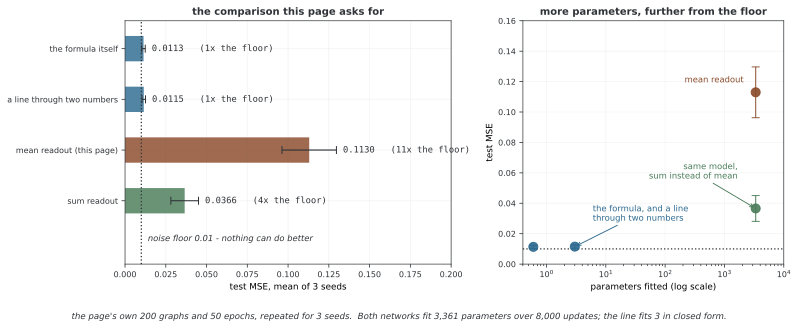

# 그래프 전체의 회귀

그래프 회귀는 노드 피처·연결 구조를 바탕으로 그래프당 연속값을 예측한다. 이 예제는 인위적으로 정한 피처 총합·엣지 수의 함수를 목표로 사용한다. 모델의 계산 흐름과 함께 readout이 그 총량을 얼마나 잘 보존하는지, 데이터가 어떤 정보를 주는지 살펴보자.

## 1. 코드와 보존된 출력

```python
"""29.5.2: 그래프 회귀 맞춤"""
import torch, torch.nn as nn, torch.nn.functional as F
import numpy as np

# ========================================================================
# 메인
# ========================================================================

class GraphRegressor(nn.Module):
    def __init__(self, in_ch, hidden_ch, num_layers=3):
        super().__init__()
        self.convs = nn.ModuleList([nn.Linear(in_ch if i==0 else hidden_ch, hidden_ch) for i in range(num_layers)])
        self.predictor = nn.Sequential(nn.Linear(hidden_ch, hidden_ch), nn.ReLU(), nn.Linear(hidden_ch, 1))
    def forward(self, x, edge_index, batch=None):
        n = x.shape[0]
        if batch is None: batch = torch.zeros(n, dtype=torch.long, device=x.device)
        src, dst = edge_index[0], edge_index[1]
        loop = torch.arange(n, device=x.device)
        src_a = torch.cat([src, loop]); dst_a = torch.cat([dst, loop])
        deg = torch.zeros(n, device=x.device)
        deg.scatter_add_(0, dst_a, torch.ones(dst_a.shape[0], device=x.device))
        norm = (deg[src_a]*deg[dst_a]).pow(-0.5); norm[norm==float('inf')]=0
        for lin in self.convs:
            h = lin(x); msg = h[src_a]*norm.unsqueeze(1)
            out = torch.zeros(n, h.shape[1], device=x.device)
            out.scatter_add_(0, dst_a.unsqueeze(1).expand_as(msg), msg)
            x = F.relu(out)
        ng = batch.max().item()+1
        pool = torch.zeros(ng, x.shape[1], device=x.device)
        pool.scatter_add_(0, batch.unsqueeze(1).expand_as(x), x)
        cnt = torch.zeros(ng, device=x.device)
        cnt.scatter_add_(0, batch, torch.ones(n, device=x.device))
        pool = pool / cnt.clamp(min=1).unsqueeze(1)
        return self.predictor(pool).squeeze(-1)

def demo():
    print("=" * 60); print("Graph Regression"); print("=" * 60)
    torch.manual_seed(42); np.random.seed(42)
    graphs = []
    for i in range(200):
        n = np.random.randint(5, 15); x = torch.randn(n, 4)
        edges = [(j, j+1) for j in range(n-1)]
        for _ in range(n//3):
            u,v = np.random.choice(n, 2, replace=False); edges.append((u,v))
        src = [e[0] for e in edges]+[e[1] for e in edges]
        dst = [e[1] for e in edges]+[e[0] for e in edges]
        ei = torch.tensor([src, dst], dtype=torch.long)
        target = x.sum().item() * 0.1 + len(edges) * 0.05 + np.random.randn() * 0.1
        graphs.append((x, ei, target))

    model = GraphRegressor(4, 32); opt = torch.optim.Adam(model.parameters(), lr=0.005)
    model.train()
    for epoch in range(50):
        total_loss = 0
        for x, ei, y in graphs[:160]:
            opt.zero_grad()
            pred = model(x, ei)
            loss = F.mse_loss(pred, torch.tensor([y]))
            loss.backward(); opt.step(); total_loss += loss.item()
        if (epoch+1) % 10 == 0:
            model.eval(); test_loss = sum(F.mse_loss(model(x,ei), torch.tensor([y])).item() for x,ei,y in graphs[160:])
            print(f"  Epoch {epoch+1}: Train={total_loss/160:.4f}, Test={test_loss/40:.4f}")
            model.train()

if __name__ == "__main__":
    demo()
```

```
============================================================
Graph Regression
============================================================
  Epoch 10: Train=0.0855, Test=0.1255
  Epoch 20: Train=0.0739, Test=0.1216
  Epoch 30: Train=0.0617, Test=0.1261
  Epoch 40: Train=0.0537, Test=0.1514
  Epoch 50: Train=0.0564, Test=0.1186
```

출력은 기존 실행의 MSE 기록이며 이번 편집에서 재학습하거나 확인한 값이 아니다. 실제 분자 특성이나 위험을 예측한 데이터가 아니라 합성 그래프의 교육용 실험이다.

## 2. 그래프와 목표값의 생성

노드 수 n은5~14이며 노드마다4차원 표준정규 피처를 만든다. 기본 경로의 n−1개 엣지에 floor(n/3)개의 무작위 노드 쌍을 추가한다. 이미 존재하는 쌍을 검사하지 않아 **중복·역방향으로 같은 무방향 쌍**이 추가될 수 있다.

각 레코드를 양방향으로 저장하므로 edge_index 열 수는2·len(edges)다. 여기서 len(edges)는 서로 다른 단순 엣지 수가 아니라 **중복을 포함한 원래 목록 길이**다. 메시지 패싱도 중복을 개별 항으로 세어 그 중복도에 영향을 받는다.

목표는 다음과 같다.

$$y=0.1\sum_{v,j}X_{vj}+0.05m+\epsilon,
\qquad m=\operatorname{len}(\mathrm{edges}),\quad\epsilon\sim\mathcal N(0,0.1^2)$$

이 입력 통계의 결정적 부분을 그대로 계산한 함수를 중요한 기준모델로 삼을 수 있다. 입력에 조건부인 정답 평균은 그 결정적 부분이며 기대 MSE는 잡음 분산0.01이다. 유한 테스트의 실제 오차가 정확히0.01이 된다는 뜻은 아니다.

## 3. 노드별 계산과 정규화

기본3개 선형 레이어를 사용해4→32→32→32로 변환한다. 각 레이어에서 먼저 Linear의 bias를 포함해 투영하고, 자기 루프를 더한 source→dst 메시지를 양 끝의 진입 차수로 정규화해 합산한다. 그 뒤 ReLU를 적용한다.

데모는 무방향 엣지를 양쪽으로 저장해 대칭 정규화로 읽을 수 있다. 임의 방향·엣지 웨이트를 사용하는 일반 회귀 계층은 아니다. 차수는 forward당 한 번 계산해 세 레이어에 재사용한다. 기존 루프·중복 제거를 하지 않는다는 계약도 확인한다.

Linear의 bias는 집계 전에 들어가므로 정규화 뒤 별도로 bias를 더하는 GCN과 다를 수 있다. x·edge_index·모델의 장치와 dtype, 인덱스 범위도 호출자가 일치시켜야 한다.

## 4. mean readout과 총량 목표

노드 상태를 그래프별로 더한 뒤 노드 수로 나누어 **평균** readout을 만든다. predictor는 G×32를 G×1로 바꾸고 마지막 축만 squeeze해 길이 G를 반환한다. batch=None이면 모든 입력을 한 그래프로 본다.

그러나 목표에는 피처 합과 엣지 개수처럼 크기에 따라 늘어나는 총량이 들어 있다. mean readout과 차수 정규화가 이 정보를 명시적으로 보존하는 것은 아니다. 예를 들어 동일한 상수 피처의 정규 그래프들은 노드 수가 달라도 같은 mean 표현을 만들 수 있다.

이는 현재 합성 표본에서 학습이 반드시 실패한다는 뜻은 아니다. 간접적인 크기 신호를 사용할 수 있지만, sum readout·노드 수·엣지 수 피처와 비교해 어떤 정보를 보존하는지 검증해야 한다. 모든 회귀에 mean이 좋거나 모든 총량에 sum만 쓰면 충분하다는 보편 규칙도 아니다.

<div class="storybox" markdown>

**그림으로 보는 AI 1.** 세는 양과 나누는 양

이 쪽의 목표 $y=0.1\sum X+0.05m+\epsilon$ 은 **그래프가 커지면 함께 커지는 양**이다.
노드를 더하면 $\sum X$ 가 늘고 엣지를 더하면 $m$ 이 는다. 물리학은 이런 양에 이름을
붙여 두었다 — 크기를 따라 늘어나는 **extensive** 와 크기로 나누어 크기와 무관한
**intensive**. 두 낱말을 지금의 뜻으로 처음 쓴 사람은 Richard C. Tolman 으로, 1917년
Physical Review 에 실은 "The Measurable Quantities of Physics" 에서였다. 질량·부피는
extensive 고 밀도·온도는 intensive 다. mean readout 은 노드 수로 나누므로 **구조적으로
intensive 한 양만** 낼 수 있다. 이 구분은 학습을 시작하기 전에 이미 답을 알려 준다.

쪽이 §4 와 §6 에서 직접 권한 비교를 그대로 돌려 보았다. 목표의 잡음 분산이 $0.1^2=0.01$
이므로 그것이 아무도 못 내려가는 바닥이다.

| | 테스트 MSE | 맞춘 파라미터 |
|---|---|---|
| 생성 공식 그대로 (오라클) | **0.0113** ± 0.0011 | 0 |
| $\sum X$ 와 $m$ 두 수에 직선 하나 | **0.0115** ± 0.0011 | 3 |
| mean readout — 이 쪽의 모델 | **0.1130** ± 0.0167 | 3,361 |
| sum readout — 한 줄만 바꿈 | **0.0366** ± 0.0085 | 3,361 |



두 수를 뽑아 직선 하나를 그으면 **파라미터 셋**으로 오라클과 구분되지 않는다. 같은
자료에서 3,361개를 8,000번 업데이트한 이 쪽의 모델은 바닥의 **11배**에 머문다. 그리고
mean 을 sum 으로 바꾸는 **한 줄**이 오차를 1/3 로 줄인다. 위에서 "간접적인 크기 신호를
사용할 수 있지만" 이라고 적은 그 간접 신호가 실제로 얼마나 비싼지가 이 숫자다.

그림은 여기까지다. sum 이 언제나 낫다는 뜻이 아니다 — sum 도 바닥의 4배이고, 목표가
intensive 한 양(이를테면 노드당 평균)이었다면 순위가 뒤집힌다. 그리고 여기서 쓴 그래프는
노드 5~14개의 지어낸 것이라 이 배수를 다른 자료로 옮길 수 없다. 이 그림이 말하는 것은
하나다 — **readout 을 고르는 일은 목표가 extensive 인지 intensive 인지를 묻는 일**이고,
그 물음은 학습이 아니라 종이 위에서 답이 난다.

_확인한 곳 — R. C. Tolman, "The Measurable Quantities of Physics", Physical Review
9(3), 1917, 237–253. 수는 모두 이 쪽의 `figures/make_figures.py` 에서 이 쪽의
자료 생성과 모델을 그대로 써서 직접 잰다._

</div>

## 5. 학습과 지표

200개 그래프 중 앞160개를50에포크 동안 하나씩 처리해8,000번 업데이트한다. 입력 순서는 학습 반복마다 섞지 않는다. 뒤40개의 MSE를10에포크마다 출력하며 별도 검증 분할은 없다.

학습 MSE는 에포크 동안 변하는 모델의 개별 그래프 로스를 평균한 것이고 테스트는 고정 체크포인트의 eval 결과다. MSE의 단위는 목표값 단위의 제곱이며 RMSE·MAE와 수치가 다르다. 실제 목표 스케일과 잡음 기준모델을 함께 보고해야 값의 의미를 판단할 수 있다.

평가 루프는 no_grad를 사용하지 않아 불필요한 계산 그래프를 만든다. batch의 빈 입력·누락 번호와 그래프 간 엣지 offset도 일반 배치 확장 전에 확인해야 한다. 파라미터·폭·학습 예산을 바꾸는 실험은 별도의 공정한 비교가 필요하다.

## 6. 일반화 범위

이 분할은 같은 생성 규칙과 크기 범위에서 나온 합성 그래프를 비교한다. 더 큰 그래프, 다른 구조·피처 분포나 실제 데이터로의 외삽을 보여 주지 않는다. 목표의 해석 가능한 생성 규칙을 기준으로 구조·피처·크기·readout의 기여를 나누어 평가한다.

## 연습문제

<div class="drillbox" markdown>

**연습문제 1.** <span class="diff med" title="중간"></span>
피처 원소 전체 합이12이고 원래 엣지 목록 길이가7일 때 잡음을 제외한 목표값을 구하라. edge_index 열 수는 얼마인가?

</div>

??? success "풀이"

    목표 평균은0.1×12+0.05×7=1.55다. 각 목록 항을 양방향으로 저장하므로 edge_index 열은14개다. 중복 항을 제거해 서로 다른 엣지만 세면 코드의 목표와 다른 양이 된다.


---

<div class="drillbox" markdown>

**연습문제 2.** <span class="diff med" title="중간"></span>
mean readout이 총량 목표에 필요한 크기 정보를 항상 보존하지 않는 예를 설명하라.

</div>

??? success "풀이"

    같은 상수 노드 피처를 가진 서로 다른 크기의 정규 그래프에서는 대칭 정규화가 상수 상태를 보존할 수 있고, 공유 레이어 뒤의 노드 상태도 같아 mean이 동일할 수 있다. 반면 피처 총합·엣지 개수는 크기와 함께 바뀐다. 크기 피처가나 sum 등과 비교해 정보 경로를 확인해야 한다.


---

<div class="drillbox" markdown>

**연습문제 3.** <span class="diff hard" title="어려움"></span>
알려진 목표 생성식이 제공하는 기준모델과 학습·테스트 MSE의 해석을 설명하라.

</div>

??? success "풀이"

    입력에서0.1ΣX+0.05m을 계산하면 조건부 평균을 얻고, 독립 잡음의 기대 MSE는0.1²=0.01이다. 유한40개 테스트 평균은 변동한다. 학습 MSE는 바뀌는 모델의 온라인 로스고 테스트는 체크포인트의 고정 모델 결과이므로 같은 조건의 값은 아니다. 알려진 식과 비교하지 않고 낮은 수치만으로 복잡한 구조 학습을 주장하지 않는다.


## 정리하며

이 회귀 예제의 목표는 피처 총합·중복 포함 엣지 수와 노이즈다. 입력의 중복 규칙과 mean readout의 크기 정보, 기준모델·MSE 단위와 평가 분할을 함께 확인한다.
