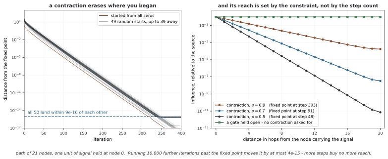

# 메시지 패싱의 업데이트 함수

이웃에서 모은 메시지는 노드 상태를 바꾸는 재료다. 업데이트 함수는 이를 기존 상태와 결합해 다음 레이어의 표현을 만든다. 자기 피처를 입력에 포함하는 것과 원래 정보를 로스 없이 보존하는 것은 다르므로, 차원·그래디언트 경로와 집계에서 이미 잃은 정보를 구분해야 한다.

## 1. 입력과 출력의 역할

현재 상태 hᵥ∈R^d_h와 집계 메시지 mᵥ∈R^d_m에 대해 hᵥ′=U(hᵥ,mᵥ)를 정의한다. 출력 차원은 다음 레이어의 설계에 맞추어 정한다. 같은 U를 모든 노드에 공유하면 순서 불변 메시지 집계와 함께 노드 순열에 대한 등변성을 유지할 수 있다.

고립 노드도 처리해야 한다. sum의 빈 집계는0으로 정의할 수 있지만 mean·max의 빈 집합 처리는 별도 규칙이 필요하다. 메시지가0이어도 기존 상태·바이어스·게이트에 따라 출력은0이 아닐 수 있다.

## 2. 메시지로 대체하는 방식

가장 단순한 형태는 hᵥ′=σ(mᵥ)다. 자기 상태를 메시지에 넣으려면 자기 루프나 자기 의존 메시지를 사용할 수 있다. GCN은 보통 자기 루프를 추가한 정규화 집계 뒤 비선형을 적용한다.

하지만 자기 루프가 있어도 자기 정보를 로스 없이 보존하는 것은 아니다. 합·평균·투영과 비선형에서 다른 값과 섞이거나 사라질 수 있다. 반대로 메시지 함수 자체가 hᵥ에 의존한다면 자기 루프가 없어도 자기 상태를 사용할 수 있으므로 업데이트 식과 메시지 정의를 함께 읽어야 한다.

## 3. 이어 붙이기와 MLP

자기·이웃 정보를 서로 다른 입력 위치로 보관하는 형태는 다음과 같다.

$$h_v'=\sigma(W[h_v\Vert m_v]+b)$$

W는 출력 폭×(d_h+d_m)다. 이를 여러 레이어 MLP로 확장할 수 있다. mean GraphSAGE의 업데이트도 이 구조와 연결된다. 이어 붙이기는 두 입력을 구분할 기회를 주지만 학습된 W가 한쪽을0으로 만들면 해당 정보는 사라진다.

GIN은 일반적인 이어 붙이기와 다른 결합을 사용한다.

$$h_v'=\operatorname{MLP}\left((1+\epsilon)h_v+\sum_{u\in\mathcal N(v)}h_u\right)$$

합하는 항은 같은 차원이어야 한다. ε는 고정하거나 학습할 수 있고, 1+ε는 확률이나0~1 게이트로 제한된 값이 아니다. 충분한 집계·업데이트 단사성 등 조건의 표현력 분석과 실제 유한 MLP의 구분 능력은 따로 확인한다.

## 4. 잔차 연결

같은 출력 폭에서는 hᵥ′=hᵥ+F(hᵥ,mᵥ)로 직접 경로를 만든다. 폭이 바뀌면 P hᵥ+F처럼 투영을 넣어 차원을 맞출 수 있다. 항등 경로는 gradient 전달을 도울 수 있지만 전체 Jacobian은 I+∂F/∂h이므로 항상 사라지거나 폭발하지 않는다는 보장은 없다.

또한 F=−h 같은 경우 출력은0이 될 수 있다. 따라서 잔차 합 자체가 원래 피처의 정확한 복원이나 단사성을 보장하지 않는다. “자기 정보 경로를 제공한다”와 “자기 정보를 로스 없이 보존한다”를 구분한다.

## 5. GRU와 LSTM 업데이트

GRU형 업데이트는 메시지를 입력, 이전 노드 상태를 hidden으로 사용한다. 예를 들어 유지 게이트 g를 정의한 관례에서는 h′=g⊙h+(1−g)⊙h̃로 쓸 수 있다. 실제 라이브러리의 게이트 이름·부호 관례를 맞추어야 하며 입력·은닉 차원의 선형 투영도 필요하다.

LSTM형은 hidden뿐 아니라 cell 상태 c도 유지한다. 각 노드의 (h,c) 초기화와 여러 레이어·반복 사이의 공유 여부를 정해야 한다. 여러 메시지 패싱 레이어에 게이트를 썼다고 실제 관측 시계열의 시간 기억을 자동으로 학습한 것은 아니다. 레이어 반복과 달력 시간은 다른 축이다.

GRU·LSTM은 더 많은 선형 연산과 상태를 필요로 한다. 게이트가 장거리 정보를 선택하는 데 도움을 줄 수 있지만 어떤 그래프·작업에서도 단순 MLP보다 더 표현력이 높거나 깊은 모델을 안정하게 학습한다는 일반 순위는 없다.

**그림으로 보는 AI 1.** 게이트가 치운 것은 기억이 아니라 제약이었다

노드 상태에 GRU 를 얹는다는 생각은 Li·Tarlow·Brockschmidt·Zemel 의 Gated Graph
Sequence Neural Networks(ICLR 2016)에서 왔는데, 그들이 적어 둔 이유는 "장거리 기억"
이 아니다. 출발점이 된 Scarselli 등의 2009년 GNN 은 전파를 **고정점까지** 돌리고 그
수렴한 해에서 그래디언트를 얻었다(Almeida–Pineda). 그러려면 전파가 **축약 사상**이어야
한다. 논문의 말 그대로, *"parameters must be constrained so that the propagation step
is a contraction map. This is needed to ensure convergence, but it may limit the
expressivity of the model."* 고정 횟수 $T$ 만큼만 돌리는 쪽으로 바꾼 것은 메모리를
더 쓰는 대신 **그 제약을 없애기 위해서**였다.

축약이 무엇을 강제하는지는 재 보면 또렷하다. 노드 21개 경로 그래프에서 $h \leftarrow
\rho Sh + b$ 를 돌리되 출발점을 50가지로 — 하나는 영벡터, 나머지는 서로 39 만큼이나
떨어진 난수로 — 잡으면, 50개가 모두 **$9\times10^{-16}$ 안쪽의 같은 점**에 내려앉는다.
고정점이 초기값을 지우는 것이다. 논문이 *"there is no point in initializing node
representations"* 이라고 적은 것이 이것이고, 그래서 원래 모델에는 노드 피처를 넣을
자리가 없었다. GG-NN 이 노드 주석을 입력으로 받을 수 있게 된 것은 고정점을 버린 덕이다.

두 번째가 더 중요하다. 축약 상수가 $\rho$ 면 $\delta$ 홉 떨어진 노드의 영향이
$\rho^{\delta}$ 로 줄어든다 — 논문 Appendix A 의 계산이고, 재 보면 $\rho=0.9$ 에서
20홉 떨어진 노드의 영향이 $1.8\times10^{-4}$, $\rho=0.5$ 에서는 $7\times10^{-12}$ 다.
그리고 **더 오래 돌려도 소용이 없다.** $\rho=0.9$ 의 고정점은 303번째 반복에서 정해지고,
거기서 10,000번을 더 돌려도 $4\times10^{-15}$ 밖에 움직이지 않는다. 고정점 모델의
도달 거리는 반복 횟수가 아니라 $\rho$ 가 정한다. 제약을 걸지 않은 쪽은 그럴 까닭이
없어서, 열어 둔 게이트는 같은 경로에서 20홉까지 값을 **정확히 1.0** 으로 나른다.

그림은 여기까지다. 열어 둔 게이트는 **할 수 있는 일의 범위**를 보인 것이지 학습이
실제로 그런 게이트를 찾는다는 뜻이 아니고, 위에서 이미 적었듯 게이트가 어떤 그래프·작업
에서도 더 낫다는 일반 순위는 없다. 이 그림이 말해 주는 것은 하나다 — 2016년의 바꿈은
성능을 올리려는 선택이 아니라 **구조적으로 닫혀 있던 문을 연 것**이었다.

_확인한 곳 — Y. Li, D. Tarlow, M. Brockschmidt, R. Zemel, "Gated Graph Sequence
Neural Networks", ICLR 2016 (arXiv:1511.05493), 2절과 Appendix A; F. Scarselli
et al., "The Graph Neural Network Model", IEEE Trans. Neural Networks 20(1), 2009,
61–80. 수는 모두 이 쪽의 `figures/make_figures.py` 에서 직접 잰다._

## 6. 집계의 한계와 깊이

mean 집계가 {1}과 {1,1,1}을 같은 메시지로 바꾸고 자기 상태도 같다면, 이후의 결정적 U는 이 두 입력을 구분할 수 없다. 업데이트를 복잡하게 해도 이미 집계에서 잃은 다중도 정보를 되살리는 것은 아니다.

깊이에 따른 과평활화·과압축에는 메시지 정규화·그래프 구조·상태 폭도 영향을 준다. 잔차·게이트·Jumping Knowledge는 검토할 설계지만 고정된 치료법은 아니다. 작업·깊이를 맞춘 ablation에서 정확도와 노드 구분·메모리·시간을 함께 살핀다.

## 7. 설계 비교의 기준

| 방식 | 명시적 자기 입력 | 확인할 비용·제한 |
|---|---|---|
| 메시지 대체 | 메시지 정의에 따라 다름 | 자기·고립 처리, 집계 로스 |
| concat+선형·MLP | 있음 | 투영 폭·파라미터, 정보 삭제 가능 |
| 잔차 | 직접 경로 | 차원 정합, 합의 상쇄와 gradient |
| GRU·LSTM | hidden·cell | 게이트 연산, 상태 저장·초기화 |
| GIN형 합 | 가중 자기 항 | 같은 차원, 집계·MLP 단사성 조건 |

이 비교는 구현의 구성 차이이며 보편적인 성능 등급표가 아니다. 전체 메시지 패싱의 정의는 [MPNN](mpnn.md)에서, 구체적인 계층은 각 컨볼루션 페이지에서 이어서 다룬다.

## 연습문제

**연습문제 1.** 
h=(1,2), m=(3,−1)에서 h′=h+ReLU(m)를 계산하라. 차원이 바뀌는 잔차에는 무엇이 필요한가?

??? success "풀이"

    ReLU(m)=(3,0)이므로 h′=(4,2)다. 다음 상태가 다른 폭이면 기존 h를 같은 출력 폭으로 투영하는 P 등 차원 대응이 필요하다. 덧셈이 가능하다는 조건과 정보의 정확한 보존은 다르다.

---

**연습문제 2.** 
mean 집계의 다중도 로스를 뒤의 GRU 업데이트가 언제나 복구할 수 있는가?

??? success "풀이"

    자기 상태가 같고 이웃 다중집합이{1}과{1,1,1}이면 두 mean 메시지는1이다. U에 들어가는 두 인수가 같아 결정적 GRU·MLP 모두 같은 출력을 만든다. 차수·다중도 같은 추가 정보를 입력하거나 집계 설계를 바꾸어야 한다.

---

**연습문제 3.** 
자기 루프와 잔차 연결이 단사성을 보장하지 않는 반례를 들어라.

??? success "풀이"

    두 노드 피처가1과−1이고 자기·이웃을 합하면 둘 다0이 될 수 있다. 자기 루프가 있어도 원래 값은 복원되지 않는다. 잔차에서도 F(h,m)=−h이면 h+F=0이다. 직접 경로가 있다는 것과 전체 변환이 단사라는 것은 다르다.

---

**연습문제 4.** 
노드별 LSTM 업데이트에 필요한 추가 상태와 실험 조건을 설명하라.

??? success "풀이"

    각 노드의 cell c와 hidden h 초기값, 메시지 입력 차원과 게이트 폭을 정한다. 반복·레이어 사이에 파라미터와 상태를 어떻게 공유하는지도 명시한다. 비교에서는 같은 집계·피처·깊이 조건에서 정확도뿐 아니라 파라미터·메모리·시간을 평가하며, 레이어 반복을 실제 시간 시계열 처리와 혼동하지 않는다.

## 정리하며

업데이트 함수는 자기 상태와 집계 메시지의 결합 방식이다. 입력 경로·차원·게이트를 명시하고 로스 없는 정보 보존과 구분한다. 집계가 버린 정보는 뒤의 복잡한 업데이트만으로 복구되지 않으며 깊이·비용의 효과는 전체 모델에서 평가해야 한다.
