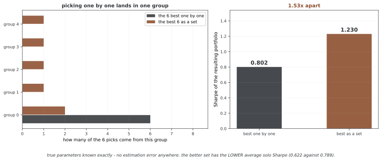

# 추천 시스템으로 하는 꾸러미 권하기

개인화된 꾸러미 추천은 추천 시스템과 계량 금융을 아우르는 최전선의 쓰임새다. 자산이나 펀드 하나하나를 권하는 대신, 꾸러미 추천 시스템은 투자자마다의 프로필, 위험 취향, 제약에 맞춘 완전한 배분을 내놓는다. 그런 시스템은 서로 겨루는 여러 목표를 저울질해야 한다. 꾸러미 수익률(사용자 취향에 맞음), 분산 투자(여러 자산 클래스를 덮음), 위험 다루기(적합성 제약), 참신성(개인 투자자에게 뻔하지 않은 효율적인 배분 찾기)이 그것이다.

꾸러미 추천은 일반 아이템 추천과 근본에서 다르다. 위험 다루기가 고를 수 있는 것이 아니라 반드시 해야 할 일이고, 규제 제약(적합성 요건)이 걸리며, 잘못되면 돈으로 값을 치른다. 이런 요구 때문에 추천 시스템 기법에 꾸러미 최적화, 위험 모델링, 규제 가드레일을 더한 하이브리드 방법이 필요하다.

이 절은 꾸러미 추천의 실제 시스템을 세우고 규제 제약을 다루며 로보어드바이저와 자산 관리 쓰임새의 구현을 보여 준다.

---

## 1. 핵심 개념

### 꾸러미 추천의 목표
- **수익률 맞추기**: 권한 꾸러미의 수익률이 사용자의 기대에 맞는다
- **위험 적합성**: 꾸러미 위험(변동성, 낙폭)이 사용자가 견딜 만큼이다
- **분산 투자**: 배분이 여러 자산 클래스와 지역에 걸친다
- **규제 준수**: 추천이 적합성과 공시 요건을 채운다
- **실행**: 거래 비용과 세금 영향을 가장 작게 한다

**그림으로 보는 AI 1.** 가장 좋은 여섯 개와 가장 좋은 여섯 개 묶음은 다른 것이다

이 쪽 맨 앞이 "자산이나 펀드 하나하나를 권하는 대신 완전한 배분을 내놓는다"고 적었다. 그 한 줄이 이 장의 다른 추천과 꾸러미 추천을 가른다. 그런데 **왜** 그렇게 해야 하는지는 흔히 "불확실하니까"로 설명되곤 한다. 그것은 까닭의 절반이다.

나머지 절반은 불확실성이 **하나도 없어도** 남는다. 참 기대수익과 참 공분산을 **정확히 안다**고 두고, 자산 서른 개에서 여섯 개를 골라 보았다. 한 번은 개별 샤프가 높은 순으로 여섯 개를 집고, 한 번은 **여섯 개 묶음**을 통째로 가장 좋게 골랐다.

개별로 가장 좋은 여섯 개는 **모두 같은 군집**에서 나왔다. 개별로 좋아 보이는 자산들이 서로 닮은 것은 흔한 일이다 — 같은 업종이 함께 좋을 때가 많기 때문이다. 그렇게 모은 꾸러미의 샤프는 **0.802**이고, 묶음으로 고른 것은 **1.230**이다. 1.53배 차이다.

눈여겨볼 것은 이긴 쪽의 구성이다. 묶음으로 고른 여섯 개는 **개별 샤프의 평균이 오히려 더 낮다**(0.622 대 0.789). 더 나쁜 자산들을 모아 더 좋은 꾸러미를 만든 것이다. 자산 하나의 값어치가 그 자산 안에만 있는 것이 아니라 **이미 가진 것과 어떻게 어긋나는가**에 달려 있기 때문이다.

그래서 꾸러미 추천은 **순위를 매겨 위에서 여섯 개를 자르는 일이 아니다.** 위 목록의 "분산 투자"가 수익률·위험과 나란히 놓인 목표인 까닭도 이것이다 — 곁들임이 아니라 묶음의 값어치를 이루는 한 부분이다.

**다만 이 그림은 추정 오차를 일부러 지워 둔 세상이다.** 참 공분산을 안다고 두었기 때문에 묶음 고르기가 깨끗하게 이긴다. 실제로는 공분산도 추정해야 하고, 자산 수가 늘면 추정할 것이 제곱으로 늘어난다. 묶음으로 고르는 일이 **옳은 방향**이라는 것과 **추정한 공분산으로 묶음 최적화를 돌리면 이긴다**는 것은 다른 주장이며, 뒤의 것은 이 쪽 아래의 제약과 적합성 규칙이 함께 걸려야 겨우 말이 된다.

_확인한 곳 — 자산의 값어치가 개별 성질이 아니라 다른 자산과의 공분산에 달려 있다는 것은 H. Markowitz, "Portfolio Selection", *Journal of Finance* **7**(1), 77–91 (1952) 이 세운 틀이다. 그림의 수는 그림을 그리는 코드가 만든 자산으로 직접 재며, 참 모수를 아는 상태에서 묶음 고르기가 더 낫고 그 묶음의 개별 샤프 평균이 더 낮은지를 먼저 확인한 뒤에만 그린다._

### 사용자 프로파일링
- **위험 허용도**: 투자자가 변동성을 받아들이려는 정도
- **투자 기간**: 몇 달에서 몇십 년
- **현금화 필요**: 언제든 쓸 수 있어야 하는 꾸러미의 몫
- **가치관/제약**: ESG 취향, 윤리적 이유로 제외할 종목
- **재무 상황**: 소득, 이미 가진 자산, 목표

---

## 2. 수학적 틀

### 협업 필터링으로 본 꾸러미 추천

꾸러미 배분을 추천 문제로 적는다:

$$\text{Score}(u, p) = w_1 \cdot \text{Risk Match}(u, p) + w_2 \cdot \text{Return Match}(u, p) + w_3 \cdot \text{Novelty}(p)$$

여기서 각 기호는 다음과 같다.

- u = 사용자(투자자)
- p = 꾸러미(배분)
- 위험 적합성: 꾸러미 위험이 사용자의 허용도와 얼마나 맞는가
- 수익률 적합성: 기대 수익률이 기대와 얼마나 맞는가
- 참신성: 배분이 일반 추천과 얼마나 다른가

### 사용자와 꾸러미의 유사도

사용자 u와 꾸러미 p의 유사도를 정의한다:

$$\text{Sim}(u, p) = -\sqrt{(\text{var}_u - \text{var}_p)^2 + (\mathbb{E}[r_u] - \mathbb{E}[r_p])^2}$$

음의 부호: 어긋날수록 유사도가 줄어든다. 유사도가 가장 큰 꾸러미를 권한다.

### 취향이 주어졌을 때 가장 좋은 꾸러미

사용자의 취향을 담은 제약 마코위츠 최적화:

$$\max_w w^T \mu - \lambda \cdot w^T \Sigma w - \gamma \|\mu_w - \mu_{\text{target}}\|^2$$

다음 아래서:

$$\sum_i w_i = 1, \quad \text{var}(w^T r) \leq \sigma_{\text{max}}^2$$

$$w_i \in [0, w_i^{\text{max}}], \quad \sum_j w_j \text{ESG}_j \geq \text{ESG}_{\text{min}}$$

마지막 제약: ESG 점수가 최소 임계를 넘는다.

---

## 3. 꾸러미 구성 방법

### 위험 기반 분류

사용자를 위험 성향으로 나누고 표준 꾸러미를 권한다:

| 위험 성향 | 주식 | 채권 | 원자재 | 부동산 |
|--------------|--------|-------|------------|------------|
| 안정형 | 20% | 60% | 10% | 10% |
| 중립형 | 50% | 30% | 10% | 10% |
| 공격형 | 75% | 10% | 10% | 5% |

단순하고 설명하기 쉬우며 확장성이 좋다. 흠: 개인화의 폭이 좁다.

### 협업 필터링의 길

잠재 사용자 임베딩을 배워, 닮은 사용자 가운데 성과가 좋았던 사용자의 꾸러미와 닮은 꾸러미를 권한다:

$$\text{score}(u, p) = \langle u_{\text{embedding}}, p_{\text{embedding}} \rangle$$

지난 꾸러미 성과와 사용자 만족으로 학습된다. 뻔하지 않은 배분을 찾아낼 수 있게 한다.

### 하이브리드 최적화의 길

최적화와 사용자의 취향을 합친다:

1. **취향 모으기**: 위험 허용도, 제약, 목표를 사용자에게 묻는다
2. **파라미터 추정하기**: 취향에 맞춰 기대 수익률과 공분산을 추정한다
3. **최적화**: 제약과 함께 마코위츠를 푼다
4. **다듬기**: 거래 비용, 세금 효율, 실행을 보아 배분을 손본다

원칙 있는 최적화와 사용자의 입력을 저울질한다.

---

## 4. 위험 다루기와 적합성

### 규제의 적합성 제약

금융 상담사는 추천이 고객에게 "적합한지" 확인해야 한다:

$$\text{Suitability Score} = \mathbb{1}[\text{Risk}_{\text{portfolio}} \leq \text{Risk}_{\text{tolerance}}]$$

그리고 제약:

- 꾸러미 변동성 ≤ 고객이 밝힌 허용도
- 기대 낙폭 ≤ 고객이 받아들이는 정도
- 자산 집중 ≤ 한도(한 종목에 30% 넘지 않기)
- 상품 복잡도 ≤ 고객의 이해 수준

어떤 제약이든 못 채우면 적합하지 않다. 기대 수익률과 상관없이 추천이 기각된다.

### 추천의 신뢰도

추천의 불확실성을 수량으로 나타낸다:

$$\text{Confidence} = 1 - \frac{\text{Forecast Error}}{|\text{Expected Return}|}$$

신뢰도가 낮으면(상대 오차가 크면) 더 보수적인 꾸러미를 권한다.

### 적합성 백테스팅

지난 적합성을 확인한다:

1. 취향을 아는 지난 사용자에게 꾸러미를 권한다
2. 실제 성과를 고객의 제약과 견준다
3. 적합성 위반을 잰다(위험 허용도를 넘은 추천의 %)

목표: 위반율 < 5%.

---

## 5. 실전 구현

### 데이터 모으기

**명시적 피드백**:

- 투자자 설문지(위험 허용도, 투자 기간, 제약)
- 재무 목표와 가치관의 명시
- 규제가 요구하는 공시

**암묵적 피드백**:

- 지난 투자 결정(어느 자산을 샀는가)
- 꾸러미 변경(리밸런싱 패턴)
- 참여(어느 배분을 살폈고 얼마나 머물렀는가)

### 피처 만들기

사용자의 취향을 담은 피처를 만든다:

$$u = [r_{\text{target}}, \sigma_{\text{target}}, \text{equity\_preference}, \text{dividend\_preference}, \text{ESG\_score}]$$

꾸러미의 피처를 만든다:

$$p = [\mu_p, \sigma_p, \text{sharpe}_p, \text{drawdown}_p, \text{turnover}, \text{implementation\_cost}]$$

### 추천 점수 매기기

후보 꾸러미에 점수를 매긴다:

$$\text{Score}(p) = w_1 \cdot \text{Risk Match} + w_2 \cdot \text{Suitability} + w_3 \cdot \text{Diversification} + w_4 \cdot \text{Novelty}$$

흔히 쓰는 웨이트:

- w_적합성 = 1.0(반드시)
- w_위험 적합성 = 0.7
- w_분산 투자 = 0.3
- w_참신성 = 0.2

### 공시와 투명성

추천마다 다음을 밝힌다:

1. **왜 이 꾸러미인가**: "중간 수준의 위험 허용도와 10년 투자 기간에 맞추어 골랐습니다"
2. **핵심 성질**: "해마다 기대 수익률 6%, 변동성 12%, 최대 낙폭 -15%"
3. **위험**: "신흥 시장 비중이 하락장에서 변동성을 키울 수 있습니다"
4. **대안**: 위험과 수익률이 다른 대안 2~3개를 보인다

투명성이 신뢰를 쌓고 사용자의 결정을 돕는다.

---

## 6. 비교: 꾸러미 추천과 일반 추천

### 로보어드바이저(알고리즘 주도)

**좋은 점**:

- 객관적이고 규칙 기반
- 비용이 낮다(사람 손이 거의 안 든다)
- 고객이 많아도 확장된다

**나쁜 점**:

- 미리 정한 꾸러미 틀에 갇힌다
- 고객마다의 취향을 놓칠 수 있다
- 추천이 나쁘면 규제 책임이 따른다

### 사람 상담자(사람 주도)

**좋은 점**:

- 개인별로 살펴 준다
- 복잡한 상황에 유연하다
- 고객과의 관계와 신뢰

**나쁜 점**:

- 비용이 높다
- 확장하기 어렵다
- 바이어스와 이해 상충이 생길 수 있다

### 하이브리드 추천 시스템

**좋은 점**:

- 데이터 기반이면서 도메인 지식을 담는다
- 확장 가능한 개인화
- 설명할 수 있는 추천
- 위험을 살피는 추천에 가장 알맞다

**나쁜 점**:

- 좋은 사용자 데이터가 있어야 한다
- 모델 학습과 유지보수에 부담이 든다
- 추천에 대한 규제 책임이 따른다

---

## 7. 꾸러미 추천의 평가 지표

### 재무 지표

**기대 수익률 적합성**:

$$\text{Error}_{\text{return}} = |\hat{\mu}_p - \mu_p^{\text{realized}}|$$

**위험 허용도 적합성**:

$$\text{Suitability} = \mathbb{1}[\sigma_p^{\text{actual}} \leq \sigma_{\text{user}}^{\text{stated}}]$$

**추천의 분산 투자**:

$$\text{Herfindahl} = \sum_i w_i^2 \quad \text{(lower = more diversified)}$$

### 사용자 참여 지표

**채택률**: 추천을 따르는 사용자의 %
**유지율**: 권한 배분을 지키는 사용자의 %
**만족**: 사용자 설문 점수
**참여**: 리밸런싱 빈도와 추천 변화의 비교

---

## 8. 사례 연구: 로보어드바이저 구현

### 시스템 구조

1. **데이터 모으기**: 설문지 + 계좌 데이터
2. **사용자 프로파일링**: 위험 허용도와 제약을 뽑아낸다
3. **꾸러미 최적화**: 제약 아래 효율적 투자선을 푼다
4. **추천**: 효율적 투자선에서 위험 성향에 맞는 꾸러미를 고른다
5. **리밸런싱**: 드리프트를 지켜보고 배분이 임계를 넘으면 리밸런싱을 권한다

### 보기 흐름

사용자가 밝힘: 중간 수준의 위험, 15년 투자 기간, ESG 제약 없음

시스템:

1. 추정: σ_타깃 ≈ 10~12%, μ_타깃 ≈ 5~6%
2. 최적화: 효율적 투자선을 얻으려 마코위츠를 푼다
3. 추천: [미국 주식 40%, 해외 주식 30%, 채권 25%, 대체 자산 5%]
4. 공시: "기대 수익률 5.8%, 변동성 11%, 15년 투자 기간에 알맞습니다"

!!! note "꾸러미 추천"
    꾸러미 추천 시스템은 무엇보다 적합성과 위험 다루기를 앞세워야 한다. 정확도와 참신성도 중요하지만 규제 제약과 투자자 보호는 흥정할 수 없다. 협업 필터링과 꾸러미 최적화를 아우른 하이브리드 시스템이 개인화와 재무 건전성의 균형을 가장 잘 잡는다.

---

## 연습문제

**연습문제 1.** 
이 방식에서 콜드 스타트 문제가 새 사용자와 새 아이템에 어떻게 다르게 나타나는지 밝혀라. 경우마다 완화할 전략을 하나씩 내놓아라.

??? success "풀이"
    새 사용자는 취향을 배울 상호작용 이력이 없어 협업 필터링 신호를 쓸 수 없다. 완화책: 콘텐츠 기반 피처(인구 통계 특성, 직접 밝힌 취향)로 사용자 임베딩의 초깃값을 잡는다. 새 아이템은 아직 상호작용한 사용자가 없어 협업 필터링으로 점수를 매길 수 없다. 완화책: 아이템 내용 피처(설명, 범주)로 그 아이템을 임베딩 공간에서 닮은 아이템 곁에 놓는다. 두 전략 모두 상호작용이 넉넉히 쌓일 때까지 협업 신호 대신 내용 피처로 버틴다. $\square$

---

**연습문제 2.** 
이 절에서 밝힌 파라미터의 그래디언트 업데이트를 이끌어 내어라. 어느 항이 계산에 가장 비싼지 가려내고 근사를 내놓아라.

??? success "풀이"
    그래디언트에는 전체 아이템 목록에 걸친 합 — 소프트맥스의 정규화 항이나 관측되지 않은 모든 칸의 로스 — 을 계산하는 일이 든다. 아이템 수에 선형으로 늘어나므로 가장 비싼 항이다. 네거티브 샘플링은 전체 목록 대신 상호작용이 없는 아이템 가운데 무작위로 고른 작은 부분집합만 더해 이를 근사하여, 업데이트마다 비용을 $O(|\mathcal{I}|)$에서 $O(k)$로 줄인다. 여기서 $k$는 음성 표본 수(보통 5~20)다. 중요도 샘플링으로 보정하면 이 근사의 바이어스를 줄일 수 있다. $\square$

---

**연습문제 3.** 
이 추천 방식이 인기 기반 베이스라인보다 사용자의 참여를 높이는지 평가할 A/B 테스트를 설계하여라. 무작위 배정 단위, 주 지표, 최소 표본 크기 계산을 밝혀라.

??? success "풀이"
    무작위 배정 단위: 사용자(한 사용자가 두 집단에 섞이지 않도록 세션 단위로 하지 않는다). 주 지표: 추천의 클릭률. 베이스라인 클릭률이 5%이고 최소 검출 효과가 0.5%포인트(상대 10% 상승)일 때, 유의수준 $\alpha = 0.05$와 검정력 $1 - \beta = 0.80$에서 집단마다 필요한 표본 크기는 $n = 2(z_{\alpha/2} + z_\beta)^2 \cdot p(1-p) / \delta^2 \approx 15{,}000$명이다. 요일별 패턴을 담으려 적어도 2주 돌린다. 가드레일: 수익률과 다양성 지표를 보조 지표로 지켜본다. $\square$

---

**연습문제 4.** 
이 추천 방법의 평가가 오프라인(지난 데이터)과 온라인(실제 반응) 자리에서 어떻게 다른지 밝혀라. 오프라인 평가에서 어떤 바이어스가 생길 수 있는가?

??? success "풀이"
    오프라인 평가는 시간 기준으로 나눈 과거 상호작용을 쓴다(앞 시기로 학습하고 뒤 시기로 평가). 바이어스에는 다음이 있다. (1) 선택 바이어스 -- 사용자는 보여 준 아이템과만 상호작용했으므로 보지 않은 아이템이 실제로 음성인 것은 아니다. (2) 인기 바이어스 -- 인기 아이템이 테스트 집합을 지배한다. (3) 위치 바이어스 -- 위쪽에 놓인 아이템이 관련성과 상관없이 더 클릭된다. 온라인 평가(A/B 테스트)는 선택 바이어스를 피하지만 비싸고 느리다. 치우치지 않은 오프라인 평가 방법으로는 노출 확률의 역수로 관측에 웨이트를 다시 주는 역성향 점수 가중(IPS)이 있다. $\square$

## 정리하며

이 절에서는 핵심 개념, 수학적 틀, 꾸러미 구성 방법, 위험 다루기와 적합성을 살펴보았다.
