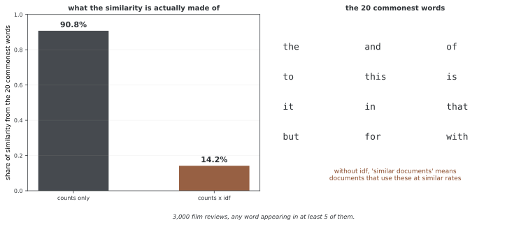

# 연구 보고서 추천 시스템

금융 연구 보고서, 곧 주식 연구, 채권 분석, 거시 논평, 투자 논지는 투자자에게 값진 앎 자산이다. 그러나 연구가 넘쳐나면서 정보 과부하가 생긴다. 한 기관이 흔히 달마다 수천 편을 내거나 받아 보지만 사람 하나가 소화할 수 있는 것은 그 일부뿐이다. 연구 추천 시스템은 관심, 전문 분야, 지금 가진 자리를 기반으로 알맞은 보고서를 애널리스트와 트레이더에게 자동으로 제시해 앎의 흐름과 결정의 효율을 크게 높인다.

연구 추천은 아이템 추천과 여러 면에서 크게 다르다. 연구 내용은 (구조 있는 아이템 피처와 달리) 주로 글이고, 값어치는 표준화된 피처가 아니라 남다른 통찰에서 나오며, 추천은 참신성(놀라운 통찰)과 관련성(사용자 관심과 정확도)을 저울질해야 한다. 앞선 시스템은 내용을 이해하는 자연어 처리, 잠재 취향을 배우는 협업 필터링, 관련성을 위한 꾸러미 맥락(애널리스트가 지금 다루는 자리)을 아우른다.

이 절은 실제 연구 추천 시스템을 세우고 내용을 나타내는 자연어 처리 기법을 보이며 금융 도메인 특유의 어려움을 다룬다.

---

## 1. 핵심 개념

### 내용 이해하기
- **글 피처**: 연구 글에서 뽑아낸다(감성, 주제, 언급된 종목)
- **개체명 인식**: 다뤄진 회사, 업종, 주요 인물을 가려낸다
- **임베딩 표현**: 연구 내용의 조밀한 벡터 표현
- **의미 유사도**: 보고서 내용 사이의 관련성을 잰다

### 연구 도메인의 사용자 프로파일링
- **전문 분야**: 애널리스트가 파고드는 업종과 종목
- **지금 자리**: 다루고 있는 꾸러미
- **열람 이력**: 앞서 읽은 보고서와 참여
- **검색 쿼리**: 드러난 관심 신호
- **동료 추천**: 동료가 값지다고 여기는 것

---

## 2. 수학적 틀

### 텍스트 표현

연구 보고서 d에 대해 여러 표현을 뽑아낸다:

**단어 주머니(bag of words)** — 순서를 버리고 단어별 등장 횟수만 센 벡터:

$$x_{\text{bow}} = [\text{count}(\text{word}_1), \ldots, \text{count}(\text{word}_V)]$$

단순하고 풀이하기 쉽지만 희소하다.

**TF-IDF 표현**:

$$x_{\text{tfidf}, i} = \text{TF}(i) \times \text{IDF}(i) = \frac{\text{count}_i}{|d|} \times \log\frac{|D|}{|d \in D: \text{word}_i \in d|}$$

문서 안에서 자주 나오는 단어에 웨이트를 주되, 문서 집합 전체에서 드문 단어에 더 큰 웨이트를 준다.

<div class="storybox" markdown>

**그림으로 보는 AI 1.** IDF 가 없으면 유사도는 "the" 를 얼마나 쓰는가가 된다

위 식의 뒤쪽 $\log(|D|/|\{d: w \in d\}|)$ 는 덧붙임처럼 보인다. 그런데 그것을 빼고 재어 보면 남는 것이 무엇인지가 꽤 또렷하다.

이 수를 처음 내놓은 사람은 1972년의 캐런 스파크 존스(Karen Spärck Jones)다. 《Journal of Documentation》에 실은 「A statistical interpretation of term specificity and its application in retrieval」에서, 찾기에 쓸 말의 값어치를 **그 말이 몇 개의 문서에 나타나는가**로 재자고 했다. 적게 나타나는 말일수록 값지다는 것이다. 이론에서 끌어낸 것이 아니라 근사로 내놓은 수였는데, 그 뒤로 놀랍도록 오래 살아남았다.

없으면 어떻게 되는지 실제 글로 재어 보았다. 영화평 3,000편을 문서로 두고 문서끼리의 코사인 유사도를 잰 다음, 그 유사도 가운데 **가장 흔한 단어 스무 개**가 기여하는 몫을 셈했다.



횟수만 쓰면 유사도의 **90.8%** 가 `the, and, of, to, this, is` 같은 스무 단어에서 온다. 곧 "닮은 문서"란 **the 를 비슷한 비율로 쓰는 문서**라는 뜻이 된다. IDF 를 곱하면 그 몫이 **14.2%** 로 떨어진다.

연구 보고서 추천에서 이 차이는 치명적이다. 모든 주식 보고서가 "실적", "전망", "투자의견" 같은 말을 쓴다. 그 말들이 유사도를 지배하면 **모든 보고서가 서로 닮아 보이고**, 정작 가르는 말인 종목 이름이나 업종 용어는 묻힌다.

**다만 IDF 가 "드문 말이 곧 중요한 말"을 뜻하지는 않는다.** 오타, 사람 이름, 문서 번호처럼 드물지만 쓸모없는 말도 함께 올라온다. 그리고 이 셈은 말을 **따로따로** 세므로 "금리 인하"처럼 붙어야 뜻이 생기는 말은 잡지 못한다. 바로 아래에서 배운 임베딩을 따로 두는 까닭이 그것이고, IDF 는 흔한 말이 가로채는 것을 막아 줄 뿐 **무엇이 중요한지를 알려 주지는 않는다.**

_확인한 곳 — K. Spärck Jones, "A statistical interpretation of term specificity and its application in retrieval", *Journal of Documentation* **28**, 11–21 (1972). 말의 값어치를 문서 빈도로 재자는 제안이 그 글의 것이며, 이론적 유도가 아니라 근사로 내놓은 것이었다. 그림의 수는 그림을 그리는 코드가 IMDB 영화평 3,000편으로 직접 재며, IDF 없이 흔한 말이 지배하는지와 IDF 가 그것을 줄이는지를 먼저 확인한 뒤에만 그린다._

</div>

**배운 임베딩**:

$$x_{\text{embed}} \in \mathbb{R}^{128}$$

뉴럴 네트워크가 글을 조밀한 벡터로 압축한다. 추천 로스로 엔드투엔드 트레인한다.

### 사용자와 글의 관련성 점수 매기기

사용자 u가 보고서 d를 알맞다고 여길지 예측한다:

$$\text{Score}(u, d) = \langle u_{\text{embedding}}, d_{\text{embedding}} \rangle + \text{context}(u, d)$$

여기서 context(u,d)는 다음을 담는다:

- **업종 일치**: 보고서의 업종이 사용자의 전문 분야 안에 드는가?
- **가진 종목**: 보고서가 사용자의 꾸러미에 든 종목을 다루는가?
- **참신성**: 보고서의 관점이 최근 읽은 것과 비교하여 새로운가?

### 연구를 위한 협업 필터링

사용자와 글의 임베딩을 배우는 행렬 분해:

$$\text{Score}(u, d) = u_{\text{latent}} \cdot d_{\text{latent}}^T$$

암묵적 신호(열람 기록, 체류 시간, 동료에게 전달)로 트레인된다:

$$\mathcal{L} = \sum_{(u,d) \in \text{read}} (1 - \text{Score}(u, d))^2 + \lambda \sum_{(u,d) \notin \text{read}} \text{Score}(u, d)^2$$

---

## 3. 연구 내용을 위한 자연어 처리 기법

### 토픽 모델링

연구 글의 잠재 주제를 가려낸다:

$$p(\text{topic}_k | d) = \frac{\sum_w p(\text{topic}_k | w) p(w | d)}{Z}$$

주제(보기로 "인공지능/머신러닝 동향", "연준 정책", "에너지 전환")별로 관련 보고서를 묶을 수 있다.

### 개체명 인식

언급된 회사, 인물, 지표를 뽑아낸다:

```
Input: "Apple's Q4 earnings beat estimates. CEO Tim Cook highlighted services growth."
Output: [COMPANY: Apple, METRIC: Q4 earnings, PERSON: Tim Cook, METRIC: services growth]
```

사용자가 다루는 종목이나 관심 업종의 보고서를 권하는 데 쓸모 있다.

### 감성 분석

종목과 업종에 대한 보고서의 감성을 수량으로 나타낸다:

$$\text{Sentiment}(d) = \sum_i w_i \cdot \text{sentiment}(\text{sentence}_i) \in [-1, 1]$$

애널리스트가 강세 관점이나 약세 관점을 콕 집어 찾을 수 있으니 추천 피처로 담는다.

### 추상적 요약

원문의 문장을 그대로 옮기지 않고 새 문장으로 다시 써서, 빠르게 훑을 수 있는 간결한 요약을 만든다:

$$\text{Summary} = \text{NeuralAbstractiveSummarizer}(document)$$

연구자가 보고서 전체를 읽기 전에 관련성을 빠르게 가늠하게 한다.

---

## 4. 콘텐츠 기반 연구 추천

### 피처 만들기

연구 보고서마다 피처를 뽑아낸다:

$$d = [\text{sector}, \text{geography}, \text{sentiment}, \text{stocks\_mentioned}, \text{themes}, \text{analyst\_quality}]$$

사용자의 취향과 닮은 보고서를 권한다:

$$\text{Score}(u, d) = \sum_i w_i \cdot \text{Sim}_i(u_{\text{pref}}, d)$$

### 업종 기반 추천

단순하지만 쓸모 있다. 사용자의 업종 보고서를 권한다:

$$\text{Score}(u, d) = \mathbb{1}[\text{sector}(d) = \text{sector}(u)]$$

규칙 기반 방식이며 도메인이 뚜렷한 사용자(기술 업종을 맡은 주식 분석가)에게 좋다.

### 주제 기반 추천

보고서의 주제(인공지능, 기후 변화, 공급망)와 사용자의 관심을 가려낸다:

$$\text{Themes}(d) = [\mathbb{1}[\text{theme}_1], \ldots, \mathbb{1}[\text{theme}_K]]$$

사용자가 관심을 두는 주제를 다룬 보고서를 권한다.

---

## 5. 연구를 위한 협업 필터링

### 사용자 기반 협업 필터링

닮은 애널리스트가 읽은 보고서를 권한다:

$$\text{Score}(u, d) = \sum_{u': \text{similar}(u, u')} \text{Sim}(u, u') \times \text{Engagement}(u', d)$$

여기서 유사도는 다음에 바탕한다:

- 열람 이력(둘 다 읽은 글)
- 업종 전문성(겹치는 맡은 범위)
- 투자 방식(닮은 자리)

### 아이템과 아이템의 협업 필터링

사용자가 이미 읽은 글과 닮은 보고서를 권한다:

$$\text{Score}(u, d) = \sum_{d': \text{read}(u, d')} \text{Sim}(d, d') \times \text{Satisfaction}(u, d')$$

여기서 글 사이의 유사도는:

$$\text{Sim}(d_1, d_2) = \cos(\text{embedding}(d_1), \text{embedding}(d_2))$$

---

## 6. 맥락을 살피는 추천

### 꾸러미 맥락

애널리스트가 다루는 종목의 보고서에 관련성을 더한다:

$$\text{Portfolio Boost}(u, d) = \frac{\sum_i w_i \times \mathbb{1}[\text{stock}_i \text{ mentioned in } d]}{|u_{\text{portfolio}}|}$$

종목 30개 꾸러미를 다루는 이에게는 종목 5개를 다룬 연구가 더 맥락에 맞다.

### 시장 맥락

지금 시장 상황이 관련성에 영향을 준다:

- **실적 시즌**: 어닝 서프라이즈를 다룬 보고서가 매우 알맞다
- **연준 발표**: 정책 결정 때 거시 연구가 알맞다
- **시장 스트레스**: 변동성이 클 때 위험 분석 보고서의 관련성이 치솟는다

시점 신호가 추천을 좋게 한다.

### 연구에서의 세렌디피티

세렌디피티(뜻밖이지만 쓸모 있는 발견)를 노려, 애널리스트가 평소 읽지 않는 연구를 권한다:

$$\text{Novelty Score} = 1 - \sum_{d': \text{read}(u)} \text{Sim}(d, d')$$

참신성이 큰 보고서는 애널리스트의 관점을 넓힌다. 참신성과 관련성을 저울질한다.

---

## 7. 실전 구현

### 연구 추천 흐름

1. **연구 수집**: Bloomberg, FactSet, 사내 애널리스트의 보고서를 받아들인다
2. **내용 처리**: 메타데이터를 뽑고 요약하며 언급된 종목과 업종을 가려낸다
3. **임베딩**: 사전 트레인 언어 모델(BERT, GPT)로 글 임베딩을 만든다
4. **사용자 프로파일링**: 열람 이력과 꾸러미로 사용자 임베딩을 만든다
5. **점수 매기기**: 협업 필터링과 맥락을 아울러 추천 점수를 계산한다
6. **필터링**: 제약을 쓴다(업종, 제외할 회사, 금지된 애널리스트)
7. **순위 매기기와 표시**: 관련성 공시와 함께 상위 k개 추천을 보여 준다

### 추천의 사용자 인터페이스

추천은 보통 다음 자리에 제시된다:

1. **일간 요약 메일**: 꾸러미에 맞춘 상위 3~5편
2. **대시보드 위젯**: 애널리스트 화면의 "당신의 업종 추천"
3. **알림**: 알맞은 보고서가 오면 실시간 알림
4. **검색 결과**: 검색 쿼리에 맞는 연구를 개인화한 순위로

### 피드백 루프

피드백으로 끊임없이 좋게 한다:

- **암묵적 피드백**: 권한 보고서 가운데 어느 것을 열었는지, 얼마나 읽었는지, 넘겼는지를 추적한다
- **명시적 피드백**: 추천에 대한 "좋아요/싫어요"(고를 수 있음)
- **결과**: 권한 연구가 투자 결정에 영향을 주었는지 잰다

---

## 8. 연구 추천의 평가 지표

### 참여 지표

**클릭률**: 사용자가 누른 권한 보고서의 %

$$\text{CTR} = \frac{\# \text{clicks on recommendations}}{\# \text{recommendations shown}}$$

**완독률**: 연 보고서 가운데 실제로 읽은 %(제목만 훑은 것 제외)

**가치 실현 시간**: 권한 연구가 얼마나 빨리 투자 결정에 인용되는가

### 정확도 지표

**순위 정확도**: 가장 높은 순위에 둔 보고서가 사용자가 좋아하는 보고서와 맞는가?

$$\text{NDCG@5} = \frac{\text{DCG@5}}{\text{IDCG@5}}$$

**관련성 정밀도**: 사용자가 실제로 알맞다고 여기는 권한 보고서의 %

**다양성**: 추천이 다채로운가 되풀이되는가?

---

## 9. 사례 연구: 주식 연구 추천

### 시스템 구성 요소

1. **연구 말뭉치**: 회사 1,000곳 넘게를 다루는 보고서가 달마다 500편
2. **사용자 집단**: 서로 다른 업종을 맡은 주식 애널리스트 200명
3. **꾸러미 데이터**: 운용 중인 꾸러미 50개의 실시간 보유 데이터

### 추천 보기

**애널리스트 프로필**:

- 맡은 범위: 기술 업종(종목 40개)
- 최근 관심: 클라우드 인프라, 사이버 보안
- 자리: AWS, Cloudflare, CrowdStrike 보유

**권한 보고서**:

1. **최상위**: "AWS의 클라우드 통합 위험" - 주제 일치(클라우드), 꾸러미 관련성(AWS 보유)
2. **차상위**: "사이버 보안 공급사 통합" - 업종 일치(기술), 보유 종목 관련성(CrowdStrike 보유)
3. **탐색**: "중국 기술 규제의 영향" - 업종을 넘나들며(기술) 관점을 넓힌다

### 결과

- **클릭률**: 35%(권한 보고서 기준)
- **완독률**: 누른 보고서의 65%를 끝까지 읽음
- **참여**: 권한 보고서의 15%가 투자 결정에 언급됨

!!! note "연구 추천의 가장 좋은 방식"
    잘된 연구 추천 시스템은 관련성(사용자의 전문 분야와 맞음)과 참신성(새 관점 들이기)을 저울질한다. 정보 과부하를 이겨 내려면 개인화가 결정적이다. 사용자의 신뢰를 쌓고 추천 품질을 확인하려 왜 그 보고서를 권했는지(업종 일치, 닮은 독자들의 반응, 꾸러미 관련성)를 늘 함께 밝힌다.

---

## 연습문제

<div class="drillbox" markdown>

**연습문제 1.** <span class="diff med" title="중간"></span>
이 방식에서 콜드 스타트 문제가 새 사용자와 새 아이템에 어떻게 다르게 나타나는지 밝혀라. 경우마다 완화할 전략을 하나씩 내놓아라.

</div>

??? success "풀이"
    새 사용자는 취향을 배울 상호작용 이력이 없어 협업 필터링 신호를 쓸 수 없다. 완화책: 콘텐츠 기반 피처(인구 통계 특성, 직접 밝힌 취향)로 사용자 임베딩의 초깃값을 잡는다. 새 아이템은 아직 상호작용한 사용자가 없어 협업 필터링으로 점수를 매길 수 없다. 완화책: 아이템 내용 피처(설명, 범주)로 그 아이템을 임베딩 공간에서 닮은 아이템 곁에 놓는다. 두 전략 모두 상호작용이 넉넉히 쌓일 때까지 협업 신호 대신 내용 피처로 버틴다. $\square$

---

<div class="drillbox" markdown>

**연습문제 2.** <span class="diff hard" title="어려움"></span>
이 절에서 밝힌 파라미터의 그래디언트 업데이트를 이끌어 내어라. 어느 항이 계산에 가장 비싼지 가려내고 근사를 내놓아라.

</div>

??? success "풀이"
    그래디언트에는 전체 아이템 목록에 걸친 합 — 소프트맥스의 정규화 항이나 관측되지 않은 모든 칸의 로스 — 을 계산하는 일이 든다. 아이템 수에 선형으로 늘어나므로 가장 비싼 항이다. 네거티브 샘플링은 전체 목록 대신 상호작용이 없는 아이템 가운데 무작위로 고른 작은 부분집합만 더해 이를 근사하여, 업데이트마다 비용을 $O(|\mathcal{I}|)$에서 $O(k)$로 줄인다. 여기서 $k$는 음성 표본 수(보통 5~20)다. 중요도 샘플링으로 보정하면 이 근사의 바이어스를 줄일 수 있다. $\square$

---

<div class="drillbox" markdown>

**연습문제 3.** <span class="diff hard" title="어려움"></span>
이 추천 방식이 인기 기반 베이스라인보다 사용자의 참여를 높이는지 평가할 A/B 테스트를 설계하여라. 무작위 배정 단위, 주 지표, 최소 표본 크기 계산을 밝혀라.

</div>

??? success "풀이"
    무작위 배정 단위: 사용자(한 사용자가 두 집단에 섞이지 않도록 세션 단위로 하지 않는다). 주 지표: 추천의 클릭률. 베이스라인 클릭률이 5%이고 최소 검출 효과가 0.5%포인트(상대 10% 상승)일 때, 유의수준 $\alpha = 0.05$와 검정력 $1 - \beta = 0.80$에서 집단마다 필요한 표본 크기는 $n = 2(z_{\alpha/2} + z_\beta)^2 \cdot p(1-p) / \delta^2 \approx 15{,}000$명이다. 요일별 패턴을 담으려 적어도 2주 돌린다. 가드레일: 수익률과 다양성 지표를 보조 지표로 지켜본다. $\square$

---

<div class="drillbox" markdown>

**연습문제 4.** <span class="diff med" title="중간"></span>
이 추천 방법의 평가가 오프라인(지난 데이터)과 온라인(실제 반응) 자리에서 어떻게 다른지 밝혀라. 오프라인 평가에서 어떤 바이어스가 생길 수 있는가?

</div>

??? success "풀이"
    오프라인 평가는 시간 기준으로 나눈 과거 상호작용을 쓴다(앞 시기로 트레인하고 뒤 시기로 평가). 바이어스에는 다음이 있다. (1) 선택 바이어스 -- 사용자는 보여 준 아이템과만 상호작용했으므로 보지 않은 아이템이 실제로 음성인 것은 아니다. (2) 인기 바이어스 -- 인기 아이템이 테스트 집합을 지배한다. (3) 위치 바이어스 -- 위쪽에 놓인 아이템이 관련성과 상관없이 더 클릭된다. 온라인 평가(A/B 테스트)는 선택 바이어스를 피하지만 비싸고 느리다. 치우치지 않은 오프라인 평가 방법으로는 노출 확률의 역수로 관측에 웨이트를 다시 주는 역성향 점수 가중(IPS)이 있다. $\square$

## 정리하며

이 절에서는 핵심 개념, 수학적 틀, 연구 내용을 위한 자연어 처리 기법, 콘텐츠 기반 연구 추천을 살펴보았다.
