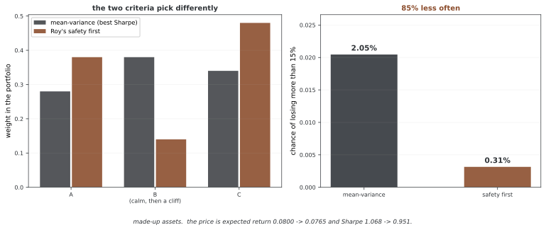

# 위험을 살피는 추천 시스템

일반 추천 시스템은 정확도를 가장 좋게 한다. 곧 사용자가 좋아할 아이템을 권한다. 금융에서는 정확도만으로는 모자란다. 추천은 위험도 다루고 규제 제약도 지켜야 한다. 위험을 살피는 추천 시스템은 권할 때 하방 위험, 꾸러미 집중, 꼬리 의존성, 시장 스트레스 상황을 드러나게 나타낸다. 평상시 시장 상황에서 가장 좋아 보이는 추천이 스트레스 상황에는 재앙이 되거나 꾸러미를 지나치게 쏠리게 할 수 있다.

위험을 살피는 시스템은 꾸러미 최적화, 스트레스 테스트, 제약 지키기를 추천 알고리즘에 아우른다. 기대 수익률이나 근사한 사용자 취향으로 아이템을 그저 매기는 대신, 위험이라는 렌즈로 추천을 평가한다. 이 추천이 꾸러미의 변동성, 낙폭, 집중, 꼬리 위험에 어떤 영향을 주는가? 추천이 위험 한도나 규제 제약을 어기는가? 추천이 여러 시장 상황에서 튼튼한가?

이 절은 위험을 살피는 추천 틀을 세우고 꾸러미 위험 다루기와의 아우름을 살피며 규제받는 금융 기관의 실제 구현을 보여 준다.

---

## 1. 핵심 개념

### 추천의 위험 클래스
- **변동성**: 추천 뒤 꾸러미 수익률의 표준편차
- **낙폭**: 꼭대기에서 골까지 기대되는 가장 큰 내림
- **집중**: 추천이 위험을 몇 자리에 몰아넣는지
- **꼬리 위험**: 위험 밸류와 기대 모자람
- **상관 붕괴**: 시장이 스트레스 상황일 때 추천의 성과

### 제약의 클래스
- **규제**: 규제 한도(한 자리 최대 30%, 레버리지 한도)
- **위험 규정**: 안쪽 위험 한도(꾸러미 최대 변동성, 최대 낙폭)
- **돈**: 적합성, 비용 제약
- **ESG**: 환경, 사회, 지배 구조에 대한 살핌

---

## 2. 수학적 틀

### 위험을 고려한 추천 점수 매기기

위험 벌을 더한 일반 추천 점수:

$$\text{Score}_{\text{risk-aware}}(u, p) = w_1 \cdot \text{Accuracy}(u, p) - w_2 \cdot \text{RiskPenalty}(u, p)$$

여기서 각 기호는 다음과 같다.

$$\text{RiskPenalty}(u, p) = \alpha_1 \cdot \text{RiskIncrease} + \alpha_2 \cdot \text{Concentration} + \alpha_3 \cdot \text{TailRisk}$$

### 꾸러미 위험의 늘어남

추천이 꾸러미 위험을 얼마나 늘리는지 수량으로 나타낸다:

$$\Delta \sigma^2 = (w_{\text{old}} + \Delta w)^T \Sigma (w_{\text{old}} + \Delta w) - w_{\text{old}}^T \Sigma w_{\text{old}}$$

$$\approx 2 \Delta w^T \Sigma w_{\text{old}} + (\Delta w)^T \Sigma (\Delta w)$$

작은 변화에 대한 1차 근사.

### 꼬리 위험 지표

추천 뒤 꾸러미의 위험 밸류:

$$\text{VaR}_\alpha = \inf\{r : P(\text{portfolio return} \leq r) \geq \alpha\}$$

위험 밸류를 늘리는 추천에 벌을 준다:

$$\text{TailRiskPenalty} = \max(0, \text{VaR}_\alpha(\text{new}) - \text{VaR}_\alpha(\text{old}))$$

---

## 3. 제약 기반 필터링

### 규제 제약

점수를 매기기 전에 굳은 제약을 어기는 추천을 거른다:

**자리 한도**: 한 자리 < 30%

$$w_i < 0.30 \quad \forall i$$

**레버리지 한도**: 총 노출 < 자본의 1.5배

$$\sum_i |w_i| < 1.5$$

**업종 집중**: 어느 업종도 꾸러미의 40%를 넘지 않음

$$\sum_{i \in \text{sector}} w_i < 0.40$$

**거래 상대 한도**: 한 기관에 대한 최대 노출 < 20%

$$\sum_{i: \text{issuer}=j} w_i < 0.20 \quad \forall j$$

### 위험 규정 제약

안쪽 위험 다루기 한도:

**변동성 천장**:

$$\sigma(\text{portfolio}_{\text{new}}) \leq \sigma_{\text{max}} = 0.15$$

**최대 낙폭**:

$$\max_{T} \min_{t \leq T} \frac{\text{portfolio}_t - \text{portfolio}_T}{\text{portfolio}_T} \leq D_{\text{max}} = -0.25$$

**상관 제약**: 이미 가진 것과 크게 상관된 자산을 더하지 않는다

$$\max_j \text{Corr}(r_{\text{new}}, r_j) \leq 0.75$$

### 제약 어김 다루기

추천이 제약을 어길 때:

1. **물리치기**: 어김이 심하면 후보에서 뺀다
2. **고치기**: 제약이 채워질 때까지 자리 크기를 줄인다
3. **바꾸기**: 제약을 채우는 다른 아이템을 권한다

---

## 4. 추천의 스트레스 테스트

### 지난 스트레스 상황

지난 시장 위기 아래에서 추천을 평가한다:

**2008년 금융 위기**: 2008년 8월에 가진 꾸러미를 2008년 10월까지의 성과로 평가한다

$$\text{Stress Loss} = -\frac{\text{portfolio value}_{10/2008} - \text{portfolio value}_{8/2008}}{\text{portfolio value}_{8/2008}}$$

스트레스 상황일 때 로스가 큰 추천에 벌을 준다.

### 지어낸 스트레스 상황

그럴듯하지만 실제로 일어나지 않은 상황을 만든다:

**상황 1 - 주식 폭락**: S&P 500이 20% 내리고 상관이 0.3 늘어남

**상황 2 - 신용 충격**: 채권 값 차이가 200bp 벌어지고 주식이 10% 내림

**상황 3 - 변동성 치솟음**: VIX이 50% 오르고 변동성에 민감한 자산이 15% 내림

상황마다 꾸러미 추천을 평가한다:

$$\text{Worst-Case Loss} = \min_{\text{scenario}} \text{Return}_{\text{scenario}}$$

가장 나쁜 경우 로스가 큰 추천에 벌을 준다.

### 상관 붕괴 상황

스트레스 상황일 때 상관이 1에 가까워진다. 상관을 높여 스트레스 테스트를 한다:

$$\rho_{\text{stress}} = \min(1.0, \rho_{\text{normal}} + 0.3)$$

상관이 무너지면 꾸러미 위험이 2~3배로 치솟을 수 있다.

---

## 5. 추천의 위험과 수익률 트레이드오프

### 파레토 최적 추천

추천 하나 대신 파레토 프런티어를 보인다:

1. **최대 정확도**: 기대 쓸모가 가장 높고 제약 없음
2. **균형**: 알맞은 정확도, 알맞은 위험
3. **조심스러움**: 낮은 정확도, 가장 작은 위험

위험을 감당할 뜻에 따라 트레이드오프 곡선 위에서 사용자가 고르게 한다.

<div class="storybox" markdown>

**그림으로 보는 AI 1.** "위험"을 변동성으로 적을지 재앙 확률로 적을지는 1952년에 갈렸다

이 쪽이 내내 미는 것은 정확도만으로 모자라고 **하방 위험**을 따로 적어야 한다는 것이다. 그 생각이 언제 나왔는가 하면, 꾸러미 이론이 태어난 바로 그 해다.

1952년에 해리 마코위츠(Harry Markowitz)가 평균과 분산으로 꾸러미를 고르는 틀을 냈다. 같은 해에 앤드루 로이(Andrew D. Roy)가 《에코노메트리카》에 「Safety First and the Holding of Assets」를 냈다. 로이의 기준은 효용 함수가 아니라 한 문장이었다 — **재앙 수준 아래로 떨어질 확률을 가장 작게 하라.** 두 사람은 서로 모른 채 같은 해에 썼고, 뒷날 마코위츠 자신이 이렇게 적었다. "Roy can claim an equal share of this honor."

두 기준은 대개 비슷한 답을 주지만, **변동성이 못 보는 꼬리**가 있으면 갈라진다. 만든 자산으로 그 자리를 만들어 보았다.



자산 B는 평소 표준편차가 0.05로 셋 중 가장 얌전한데, 3%의 확률로 70%를 잃는다. 평균-분산으로 고르면 B에 **0.38**을 담는다. 분산은 드문 큰 손실을 평균에 섞어 희석하기 때문이다. 로이의 기준으로 고르면 **0.14**만 담는다.

값은 15% 넘게 잃을 확률이다 — **2.05%에서 0.31%로, 85% 줄어든다.** 이 쪽이 "평상시에서 가장 좋아 보이는 추천이 스트레스 상황에는 재앙이 된다"고 적은 것이 이 그림이다.

**다만 공짜가 아니고, 그것이 바로 위 파레토 프런티어의 뜻이다.** 같은 바꿈이 기대 수익률을 0.0800에서 0.0765로, 샤프를 1.068에서 0.951로 낮춘다. 안전제일이 평균-분산보다 **옳은** 것이 아니라 **다른 것을 묻는** 것이다. 그리고 여기서는 참 분포를 알고 재앙 확률을 세었지만, 실제로는 그 꼬리를 추정해야 하고 드문 사건일수록 추정이 흔들린다. 위험 지표를 고르는 일은 추천에 붙이는 장식이 아니라 **무엇을 위험이라 부를지 정하는 일**이며, 1952년에 두 사람이 서로 다르게 답한 그 물음이다.

_확인한 곳 — A. D. Roy, "Safety First and the Holding of Assets", *Econometrica* **20**(3), 431–449 (1952). 재앙 수준 아래로 갈 확률을 최소화한다는 기준이 그 논문의 것이고, 마코위츠의 평균-분산 논문과 같은 해에 따로 나왔다. 인용한 마코위츠의 문장은 로이의 몫을 인정한 뒷날의 글에서 온 것으로 2차 기록에서 확인했다. 그림의 수는 그림을 그리는 코드가 만든 자산으로 직접 재며, 두 기준이 서로 다른 비중을 고르는지와 재앙 확률이 크게 줄어드는지를 먼저 확인한 뒤에만 그린다._

</div>

### 위험과 리워드 그리기

트레이드오프를 또렷이 알린다:

**추천 A**: 정확도 0.75, 기대 변동성 2% 늘어남
**추천 B**: 정확도 0.70, 기대 변동성 0.5% 늘어남
**추천 C**: 정확도 0.65, 기대 변동성 0.5% 줄어듦

### 서로 다른 상황에서의 만족

상황마다 기대 만족을 알린다:

$$\text{Satisfaction}_{\text{scenario}} = \text{Accuracy}(u, p) \times \mathbb{1}[\text{return}_{\text{scenario}} > \text{risk-free}]$$

추천이 잘 되는 상황과 나쁜 상황.

---

## 6. 추천과 위험 다루기의 손발 맞추기

### 위험을 살피는 점수 매기기

함께 최적화: 추천 팀 + 위험 팀:

$$\text{Score}_{\text{final}} = \text{Recommendation score} \times \text{Risk approval factor}$$

여기서 위험 승인 ∈ [0, 1]이다. 점수 0 = "위험 팀이 거절함", 점수 1 = "위험 팀이 승인함".

### 피드백 고리

추천 뒤 위험 지켜보기:

1. **권하기**: 추천을 만든다
2. **받아들이기**: 위험 팀이 제약을 확인한다
3. **실행하기**: 손님이 추천을 실행한다
4. **지켜보기**: 추천 뒤 성과를 좇는다
5. **학습하기**: 실제 위험과 예측한 위험의 피드백이 모델을 좋게 한다

### 위로 올리는 절차

가장자리 경우의 추천에 대해:

- **일반 건**(예상된 위험): 자동 승인
- **여느 것 아님**(높아진 위험): 위험 담당자가 살핌
- **예외**(큰 위험): 윗선 승인이 필요

또렷한 올림 지표가 위험 거버넌스를 보장한다.

---

## 7. 구현 구조

### 위험을 살피는 추천 흐름

```
1. 후보 만들기
   ↓
2. 알맞음 걸러내기
   ↓
3. Constraint Filtering (eliminate hard constraint violations)
   ↓
4. Risk Assessment (compute volatility, drawdown, tail risk)
   ↓
5. Stress Testing (evaluate under scenarios)
   ↓
6. Risk-Aware Scoring (balance accuracy with risk)
   ↓
7. Risk Approval (risk team review)
   ↓
8. Recommendation Presentation (with risk disclosure)
```

### 데이터 요구

1. **시장 데이터**: 거래할 수 있는 모든 자산의 수익률, 상관, 변동성
2. **꾸러미 데이터**: 지금 가진 것, 최근 거래
3. **위험 모델**: 공분산 행렬, 팩터 모델, 스트레스 시나리오
4. **제약 데이터**: 규제 한도, 안쪽 규정
5. **손님 데이터**: 위험 허용도, 투자 목표

---

## 8. 위험을 살피는 추천의 평가

### 위험과 수익률 지표

**추천의 샤프 비**:

$$\text{Sharpe} = \frac{\mu_{\text{rec}} - r_f}{\sigma_{\text{rec}}}$$

추천 뒤의 기대 수익률과 위험.

**정보 비율**:

$$\text{IR} = \frac{\text{Return}_{\text{rec}} - \text{Return}_{\text{benchmark}}}{\text{Tracking Error}}$$

지표에 비교하여 위험을 계산에 넣은 값어치 더함.

### 위험 다루기 지표

**제약 채움 비율**:

$$\text{Compliance} = \frac{\# \text{recommendations satisfying all constraints}}{\# \text{total recommendations}}$$

타깃: 99% 넘게 준수(가장자리 경우만 위로 올린다).

**가장 나쁜 경우의 성과**:

$$\text{Recovery Time} = \text{time until portfolio returns to pre-shock level}$$

시장 스트레스에 견디는 힘을 잰다.

---

## 9. 사례 연구: 위험을 살피는 펀드 추천

### 상황

기관 투자자, \$10M 꾸러미, 알맞은 위험 허용도, 15년 투자 기간.

지금 배분:

- 미국 대형주 50%
- 투자 등급 채권 30%
- 현금 20%

### 위험 인식 추천

**추천**: 떠오르는 시장 주식 5%를 더하고 현금을 15%로 줄인다

**위험 모니터링**:

- 지금 변동성: 8.5%
- 추천 뒤 변동성: 9.1%(+0.6%)
- 기대 수익률 늘어남: 0.4%(분산 투자에서)
- 샤프 비: 0.65 → 0.68(나아짐)

**스트레스 테스트**:

- 2008년식 위기: -22%(견딜 만함)
- 신용 충격: -12%(다룰 만함)
- 떠오르는 시장 위기: -18%(받아들일 만함)

**제약**: 모두 채움(집중 없음, 레버리지 말썽 없음)

**승인**: 위험 팀의 결재와 함께 권함.

---

## 10. 나아간 살핌

### 위험 예측을 위한 머신러닝

추천 뒤 꾸러미 위험을 헤아리는 데 뉴럴 네트워크를 쓴다:

$$\sigma_{\text{pred}}^{\text{post}} = \text{NN}(\text{current portfolio}, \text{recommendation})$$

지난 데이터로 학습된다. 공분산 행렬을 드러나게 뒤집지 않고도 위험을 빠르게 잴 수 있다.

### 실시간 위험 지켜보기

시장 상황이 바뀔 때마다 위험 지표를 고친다:

- 날마다: 상관과 변동성을 다시 계산한다
- 실시간: 변동성이 치솟으면 꼬리 위험 근사를 손본다
- 저절로: 꾸러미가 위험 한도에서 벗어나면 알림을 울린다

### 위험을 살피는 추천의 공정성

위험 제약이 공정하게 쓰이도록 한다:

- 거센 투자자가 더 위험한 추천을 받는가?
- 조심스러운 투자자가 알맞게 보호받는가?
- 차별하는 위험 정규화를 피한다

!!! warning "위험 다루기가 먼저다"
    금융에서는 위험 다루기가 추천의 정확도보다 앞선다. 정확도가 높아도 위험 제약이나 적합성을 어기는 추천은 기대 수익률과 상관없이 물리쳐야 한다. 또렷한 다스림 구조, 제약 정의, 승인 절차가 책임 있는 금융 추천 시스템에 꼭 필요하다.

---

## 연습문제

<div class="drillbox" markdown>

**연습문제 1.** <span class="diff med" title="중간"></span>
이 길에서 콜드 스타트 문제가 새 사용자와 새 아이템에 어떻게 다르게 나타나는지 밝혀라. 경우마다 완화할 전략을 하나씩 내놓아라.

</div>

??? success "풀이"
    새 사용자는 취향을 배울 상호작용 이력이 없어 협업 필터링 신호를 쓸 수 없다. 완화책: 콘텐츠 기반 피처(인구 특성, 밝힌 취향)으로 사용자 임베딩의 초깃값을 잡는다. 새 아이템은 아직 상호작용한 사용자가 없어 협업 필터링으로 매길 수 없다. 완화책: 아이템 내용 피처(설명, 범주)으로 그 아이템을 임베딩 공간에서 닮은 아이템 곁에 놓는다. 두 전략 모두 상호작용이 넉넉히 쌓일 때까지 콜드 스타트 아이템을 띄워 준다. $\square$

---

<div class="drillbox" markdown>

**연습문제 2.** <span class="diff hard" title="어려움"></span>
이 절에서 밝힌 파라미터의 그래디언트 업데이트를 이끌어 내어라. 어느 항이 계산에 가장 비싼지 가려내고 근사를 내놓아라.

</div>

??? success "풀이"
    그래디언트에는 고르게 맞추려 온 아이템 목록에 대한 기댓값을 셈하는 일이 든다. 아이템 수에 선형으로 늘어나므로 가장 비싼 항이다. 음의 샘플링은 전체 목록 대신 음의 아이템 가운데 무작위로 고른 작은 부분집합만 더해 이를 근사하여, 업데이트마다 비용을 $O(|\mathcal{I}|)$에서 $O(k)$으로 줄인다. 여기서 $k$은 음의 표본 수(보통 5~20)이다. 중요도 샘플링이 이 근사에 치우치지 않은 추정량을 준다. $\square$

---

<div class="drillbox" markdown>

**연습문제 3.** <span class="diff hard" title="어려움"></span>
이 추천 방식이 인기 기반 베이스라인보다 사용자의 참여를 높이는지 평가할 A/B 테스트를 설계하여라. 무작위 배정 단위, 주 지표, 최소 표본 크기 계산을 밝혀라.

</div>

??? success "풀이"
    무작위 배정 단위: 사용자(서로 섞이지 않도록 세션이 아님). 주 지표: 추천의 클릭률. 베이스라인 클릭률이 5%이고 알아챌 최소 효과가 0.5%포인트(상대 10% 오름)일 때, 뜻 있음 수준 $\alpha = 0.05$과 힘 $1 - \beta = 0.80$에서 집단마다 필요한 표본 크기는 $n = 2(z_{\alpha/2} + z_\beta)^2 \cdot p(1-p) / \delta^2 \approx 15{,}000$명이다. 주마다의 패턴을 담으려 적어도 2주 돌린다. 가드레일: 수익률과 다양성 지표를 딸린 결과로 지켜본다. $\square$

---

<div class="drillbox" markdown>

**연습문제 4.** <span class="diff med" title="중간"></span>
이 추천 방법의 평가가 오프라인(지난 데이터)과 온라인(실제 반응) 자리에서 어떻게 다른지 밝혀라. 오프라인 평가에서 어떤 바이어스가 생길 수 있는가?

</div>

??? success "풀이"
    오프라인 평가는 때로 나눈 지난 상호작용을 쓴다(지난 것으로 익히고 앞으로의 것으로 시험). 바이어스에는 다음이 있다. (1) 선택 바이어스 -- 사용자는 보여 준 아이템과만 상호작용했으므로 보지 않은 아이템이 참으로 음인 것은 아니다. (2) 인기 바이어스 -- 인기 아이템이 테스트 집합을 지배한다. (3) 위치 바이어스 -- 위쪽에 놓인 아이템이 관련성과 상관없이 더 클릭된다. 온라인 평가(A/B 테스트)는 선택 바이어스를 피하지만 비싸고 느리다. 치우치지 않은 오프라인 평가 방법으로는 보여 줄 확률로 관측에 다시 무게를 주는 역 성향 점수 매기기가 있다. $\square$

## 정리하며

이 절에서는 핵심 개념, 수학적 틀, 제약 기반 필터링, 추천의 스트레스 테스트를 살펴보았다.
