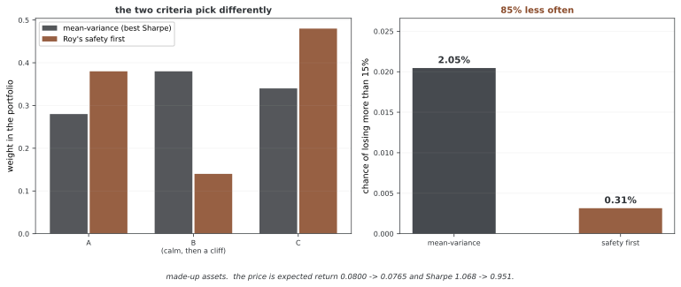

# 위험을 살피는 추천 시스템

여느 추천 시스템은 맞음을 가장 좋게 한다. 곧 쓰는 이가 좋아할 물건을 권한다. 금융에서는 맞음만으로는 모자란다. 추천은 위험도 다루고 규제 매임도 지켜야 한다. 위험을 살피는 추천 시스템은 권할 때 내림 위험, 꾸러미 쏠림, 꼬리 매임, 시장 버거움 상황을 드러나게 나타낸다. 여느 시장 형편에서 가장 좋아 보이는 추천이 버거운 때에는 재앙이 되거나 꾸러미를 지나치게 쏠리게 할 수 있다.

위험을 살피는 시스템은 꾸러미 최적화, 버거움 시험, 매임 지키기를 추천 알고리즘에 아우른다. 기대 벌이나 어림한 쓰는 이 취향으로 물건을 그저 매기는 대신, 위험이라는 렌즈로 추천을 따진다. 이 추천이 꾸러미의 흔들림, 꺾임, 쏠림, 꼬리 위험에 어떤 영향을 주는가? 추천이 위험 한도나 규제 매임을 어기는가? 추천이 여러 시장 상황에서 튼튼한가?

이 절는 위험을 살피는 추천 틀을 세우고 꾸러미 위험 다루기와의 아우름을 살피며 규제받는 금융 기관의 실제 짜기를 보여 준다.

---

## 1. 핵심 개념

### 추천의 위험 클래스
- **흔들림**: 추천 뒤 꾸러미 벌이의 표준 어긋남
- **꺾임**: 꼭대기에서 골까지 기대되는 가장 큰 내림
- **쏠림**: 추천이 위험을 몇 자리에 몰아넣는지
- **꼬리 위험**: 위험 밸류와 기대 모자람
- **얽힘 무너짐**: 시장이 버거울 때 추천의 성과

### 매임의 클래스
- **규제**: 규제 한도(한 자리 최대 30%, 지렛대 한도)
- **위험 규정**: 안쪽 위험 한도(꾸러미 최대 흔들림, 최대 꺾임)
- **돈**: 알맞음, 비용 매임
- **ESG**: 환경, 사회, 지배 구조에 대한 살핌

---

## 2. 수학적 틀

### 위험을 고려한 추천 점수 매기기

위험 벌을 더한 여느 추천 점수:

$$\text{Score}_{\text{risk-aware}}(u, p) = w_1 \cdot \text{Accuracy}(u, p) - w_2 \cdot \text{RiskPenalty}(u, p)$$

여기서 각 기호는 다음과 같다.

$$\text{RiskPenalty}(u, p) = \alpha_1 \cdot \text{RiskIncrease} + \alpha_2 \cdot \text{Concentration} + \alpha_3 \cdot \text{TailRisk}$$

### 꾸러미 위험의 늘어남

추천이 꾸러미 위험을 얼마나 늘리는지 수량으로 나타낸다:

$$\Delta \sigma^2 = (w_{\text{old}} + \Delta w)^T \Sigma (w_{\text{old}} + \Delta w) - w_{\text{old}}^T \Sigma w_{\text{old}}$$

$$\approx 2 \Delta w^T \Sigma w_{\text{old}} + (\Delta w)^T \Sigma (\Delta w)$$

작은 바뀜에 대한 1차 어림.

### 꼬리 위험 잣대

추천 뒤 꾸러미의 위험 밸류:

$$\text{VaR}_\alpha = \inf\{r : P(\text{portfolio return} \leq r) \geq \alpha\}$$

위험 밸류를 늘리는 추천에 벌을 준다:

$$\text{TailRiskPenalty} = \max(0, \text{VaR}_\alpha(\text{new}) - \text{VaR}_\alpha(\text{old}))$$

---

## 3. 매임 기초 거르기

### 규제 매임

점수를 매기기 전에 굳은 매임을 어기는 추천을 거른다:

**자리 한도**: 한 자리 < 30%

$$w_i < 0.30 \quad \forall i$$

**지렛대 한도**: 온 노출 < 자본의 1.5배

$$\sum_i |w_i| < 1.5$$

**업종 쏠림**: 어느 업종도 꾸러미의 40%를 넘지 않음

$$\sum_{i \in \text{sector}} w_i < 0.40$$

**거래 상대 한도**: 한 기관에 대한 최대 노출 < 20%

$$\sum_{i: \text{issuer}=j} w_i < 0.20 \quad \forall j$$

### 위험 규정 매임

안쪽 위험 다루기 한도:

**흔들림 천장**:

$$\sigma(\text{portfolio}_{\text{new}}) \leq \sigma_{\text{max}} = 0.15$$

**최대 꺾임**:

$$\max_{T} \min_{t \leq T} \frac{\text{portfolio}_t - \text{portfolio}_T}{\text{portfolio}_T} \leq D_{\text{max}} = -0.25$$

**얽힘 매임**: 이미 가진 것과 크게 얽힌 자산을 더하지 않는다

$$\max_j \text{Corr}(r_{\text{new}}, r_j) \leq 0.75$$

### 매임 어김 다루기

추천이 매임을 어길 때:

1. **물리치기**: 어김이 심하면 후보에서 뺀다
2. **고치기**: 매임이 채워질 때까지 자리 크기를 줄인다
3. **바꾸기**: 매임을 채우는 다른 물건을 권한다

---

## 4. 추천의 버거움 시험

### 지난 버거움 상황

지난 시장 위기 아래에서 추천을 따진다:

**2008년 금융 위기**: 2008년 8월에 가진 꾸러미를 2008년 10월까지의 성과로 따진다

$$\text{Stress Loss} = -\frac{\text{portfolio value}_{10/2008} - \text{portfolio value}_{8/2008}}{\text{portfolio value}_{8/2008}}$$

버거울 때 로스가 큰 추천에 벌을 준다.

### 지어낸 버거움 상황

그럴듯하지만 실제로 일어나지 않은 상황을 만든다:

**상황 1 - 주식 폭락**: S&P 500이 20% 내리고 얽힘이 0.3 늘어남

**상황 2 - 신용 충격**: 채권 값 차이가 200bp 벌어지고 주식이 10% 내림

**상황 3 - 흔들림 치솟음**: VIX이 50% 오르고 흔들림에 민감한 자산이 15% 내림

상황마다 꾸러미 추천을 따진다:

$$\text{Worst-Case Loss} = \min_{\text{scenario}} \text{Return}_{\text{scenario}}$$

가장 나쁜 경우 로스가 큰 추천에 벌을 준다.

### 얽힘 무너짐 상황

버거울 때 얽힘이 1에 가까워진다. 얽힘을 높여 버거움 시험을 한다:

$$\rho_{\text{stress}} = \min(1.0, \rho_{\text{normal}} + 0.3)$$

얽힘이 무너지면 꾸러미 위험이 2~3배로 치솟을 수 있다.

---

## 5. 추천의 위험과 벌이 트레이드오프

### 파레토 최적 추천

추천 하나 대신 파레토 앞자락을 보인다:

1. **최대 맞음**: 기대 쓸모가 가장 높고 매임 없음
2. **균형**: 알맞은 맞음, 알맞은 위험
3. **조심스러움**: 낮은 맞음, 가장 작은 위험

위험을 감당할 뜻에 따라 트레이드오프 굽은 줄 위에서 쓰는 이가 고르게 한다.

<div class="storybox" markdown>

**그림으로 보는 AI 1.** "위험"을 흔들림으로 적을지 재앙 확률로 적을지는 1952년에 갈렸다

이 쪽이 내내 미는 것은 맞음만으로 모자라고 **내림 위험**을 따로 적어야 한다는 것이다. 그 생각이 언제 나왔는가 하면, 꾸러미 이론이 태어난 바로 그 해다.

1952년에 해리 마코위츠(Harry Markowitz)가 평균과 분산으로 꾸러미를 고르는 틀을 냈다. 같은 해에 앤드루 로이(Andrew D. Roy)가 《에코노메트리카》에 「Safety First and the Holding of Assets」를 냈다. 로이의 기준은 효용 함수가 아니라 한 문장이었다 — **재앙 수준 아래로 떨어질 확률을 가장 작게 하라.** 두 사람은 서로 모른 채 같은 해에 썼고, 뒷날 마코위츠 자신이 이렇게 적었다. "Roy can claim an equal share of this honor."

두 기준은 대개 비슷한 답을 주지만, **흔들림이 못 보는 꼬리**가 있으면 갈라진다. 만든 자산으로 그 자리를 만들어 보았다.



자산 B는 평소 표준편차가 0.05로 셋 중 가장 얌전한데, 3%의 확률로 70%를 잃는다. 평균-분산으로 고르면 B에 **0.38**을 담는다. 분산은 드문 큰 손실을 평균에 섞어 희석하기 때문이다. 로이의 기준으로 고르면 **0.14**만 담는다.

값은 15% 넘게 잃을 확률이다 — **2.05%에서 0.31%로, 85% 줄어든다.** 이 쪽이 "여느 형편에서 가장 좋아 보이는 추천이 버거운 때에는 재앙이 된다"고 적은 것이 이 그림이다.

**다만 공짜가 아니고, 그것이 바로 위 파레토 앞자락의 뜻이다.** 같은 바꿈이 기대 벌이를 0.0800에서 0.0765로, 샤프를 1.068에서 0.951로 낮춘다. 안전제일이 평균-분산보다 **옳은** 것이 아니라 **다른 것을 묻는** 것이다. 그리고 여기서는 참 분포를 알고 재앙 확률을 세었지만, 실제로는 그 꼬리를 추정해야 하고 드문 사건일수록 추정이 흔들린다. 위험 잣대를 고르는 일은 추천에 붙이는 장식이 아니라 **무엇을 위험이라 부를지 정하는 일**이며, 1952년에 두 사람이 서로 다르게 답한 그 물음이다.

_확인한 곳 — A. D. Roy, "Safety First and the Holding of Assets", *Econometrica* **20**(3), 431–449 (1952). 재앙 수준 아래로 갈 확률을 최소화한다는 기준이 그 논문의 것이고, 마코위츠의 평균-분산 논문과 같은 해에 따로 나왔다. 인용한 마코위츠의 문장은 로이의 몫을 인정한 뒷날의 글에서 온 것으로 2차 기록에서 확인했다. 그림의 수는 그림을 그리는 코드가 만든 자산으로 직접 재며, 두 기준이 서로 다른 비중을 고르는지와 재앙 확률이 크게 줄어드는지를 먼저 확인한 뒤에만 그린다._

</div>

### 위험과 리워드 그리기

트레이드오프를 또렷이 알린다:

**추천 A**: 맞음 0.75, 기대 흔들림 2% 늘어남
**추천 B**: 맞음 0.70, 기대 흔들림 0.5% 늘어남
**추천 C**: 맞음 0.65, 기대 흔들림 0.5% 줄어듦

### 서로 다른 상황에서의 만족

상황마다 기대 만족을 알린다:

$$\text{Satisfaction}_{\text{scenario}} = \text{Accuracy}(u, p) \times \mathbb{1}[\text{return}_{\text{scenario}} > \text{risk-free}]$$

추천이 잘 되는 상황과 나쁜 상황.

---

## 6. 추천과 위험 다루기의 손발 맞추기

### 위험을 살피는 점수 매기기

함께 최적화: 추천 팀 + 위험 팀:

$$\text{Score}_{\text{final}} = \text{Recommendation score} \times \text{Risk approval factor}$$

여기서 위험 승인 ∈ [0, 1]이다. 점수 0 = "위험 팀이 물리침", 점수 1 = "위험 팀이 받아들임".

### 피드백 고리

추천 뒤 위험 지켜보기:

1. **권하기**: 추천을 만든다
2. **받아들이기**: 위험 팀이 매임을 확인한다
3. **실행하기**: 손님이 추천을 실행한다
4. **지켜보기**: 추천 뒤 성과를 좇는다
5. **학습하기**: 실제 위험과 헤아린 위험의 피드백이 모델을 좋게 한다

### 위로 올리는 절차

가장자리 경우의 추천에 대해:

- **여느 것**(예상된 위험): 저절로 받아들임
- **여느 것 아님**(높아진 위험): 위험 담당자가 살핌
- **예외**(큰 위험): 윗선 승인이 필요

또렷한 올림 잣대가 위험 다스림을 보장한다.

---

## 7. 구현 구조

### 위험을 살피는 추천 흐름

```
1. 후보 만들기
   ↓
2. 알맞음 걸러내기
   ↓
3. Constraint Filtering (eliminate hard constraint violations)
   ↓
4. Risk Assessment (compute volatility, drawdown, tail risk)
   ↓
5. Stress Testing (evaluate under scenarios)
   ↓
6. Risk-Aware Scoring (balance accuracy with risk)
   ↓
7. Risk Approval (risk team review)
   ↓
8. Recommendation Presentation (with risk disclosure)
```

### 데이터 요구

1. **시장 데이터**: 거래할 수 있는 모든 자산의 벌이, 얽힘, 흔들림
2. **꾸러미 데이터**: 지금 가진 것, 최근 거래
3. **위험 모델**: 함께 분산 행렬, 인수 모델, 버거움 잡
4. **매임 데이터**: 규제 한도, 안쪽 규정
5. **손님 데이터**: 위험 견딤, 투자 목표

---

## 8. 위험을 살피는 추천의 따지기

### 위험과 벌이 잣대

**추천의 샤프 비**:

$$\text{Sharpe} = \frac{\mu_{\text{rec}} - r_f}{\sigma_{\text{rec}}}$$

추천 뒤의 기대 벌이와 위험.

**앎 비**:

$$\text{IR} = \frac{\text{Return}_{\text{rec}} - \text{Return}_{\text{benchmark}}}{\text{Tracking Error}}$$

잣대에 비교하여 위험을 계산에 넣은 값어치 더함.

### 위험 다루기 잣대

**매임 채움 비율**:

$$\text{Compliance} = \frac{\# \text{recommendations satisfying all constraints}}{\# \text{total recommendations}}$$

타깃: 99% 넘게 지킴(가장자리 경우만 위로 올린다).

**가장 나쁜 경우의 성과**:

$$\text{Recovery Time} = \text{time until portfolio returns to pre-shock level}$$

시장 버거움에 견디는 힘을 잰다.

---

## 9. 사례 살피기: 위험을 살피는 펀드 추천

### 상황

기관 투자자, \$10M 꾸러미, 알맞은 위험 견딤, 15년 지평.

지금 나눔:

- 미국 대형주 50%
- 투자 등급 채권 30%
- 현금 20%

### 위험 인식 추천

**추천**: 떠오르는 시장 주식 5%를 더하고 현금을 15%로 줄인다

**위험 살피기**:

- 지금 흔들림: 8.5%
- 추천 뒤 흔들림: 9.1%(+0.6%)
- 기대 벌이 늘어남: 0.4%(갈라 담기에서)
- 샤프 비: 0.65 → 0.68(나아짐)

**버거움 시험**:

- 2008년식 위기: -22%(견딜 만함)
- 신용 충격: -12%(다룰 만함)
- 떠오르는 시장 위기: -18%(받아들일 만함)

**매임**: 모두 채움(쏠림 없음, 지렛대 말썽 없음)

**받아들임**: 위험 팀의 결재와 함께 권함.

---

## 10. 나아간 살핌

### 위험 헤아리기를 위한 머신러닝

추천 뒤 꾸러미 위험을 헤아리는 데 뉴럴 넷트웍을 쓴다:

$$\sigma_{\text{pred}}^{\text{post}} = \text{NN}(\text{current portfolio}, \text{recommendation})$$

지난 데이터로 학습된이다. 함께 분산 행렬을 드러나게 뒤집지 않고도 위험을 빠르게 잴 수 있다.

### 실시간 위험 지켜보기

시장 형편이 바뀔 때마다 위험 잣대를 고친다:

- 날마다: 얽힘과 흔들림을 다시 계산한다
- 실시간: 흔들림이 치솟으면 꼬리 위험 어림을 손본다
- 저절로: 꾸러미가 위험 한도에서 벗어나면 알림을 울린다

### 위험을 살피는 추천의 공정함

위험 매임이 공정하게 쓰이도록 한다:

- 거센 투자자가 더 위험한 추천을 받는가?
- 조심스러운 투자자가 알맞게 보호받는가?
- 차별하는 위험 정규화를 피한다

!!! warning "위험 다루기가 먼저다"
    금융에서는 위험 다루기가 추천의 맞음보다 앞선다. 맞음이 높아도 위험 매임이나 알맞음을 어기는 추천은 기대 벌이와 상관없이 물리쳐야 한다. 또렷한 다스림 구조, 매임 정의, 승인 절차가 책임 있는 금융 추천 시스템에 꼭 필요하다.

---

## 연습문제

<div class="drillbox" markdown>

**연습문제 1.** <span class="diff med" title="중간"></span>
이 길에서 차가운 출발 문제가 새 쓰는 이와 새 물건에 어떻게 다르게 나타나는지 밝혀라. 경우마다 누그러뜨릴 셈속을 하나씩 내놓아라.

</div>

??? success "풀이"
    새 쓰는 이는 취향을 배울 주고받음 지난 일이 없어 함께 거르기 신호를 쓸 수 없다. 누그러뜨리기: 내용 기초 피처(인구 특성, 밝힌 취향)으로 쓰는 이 임베딩의 첫 값을 잡는다. 새 물건은 아직 주고받은 쓰는 이가 없어 함께 거르기로 매길 수 없다. 누그러뜨리기: 물건 내용 피처(밝힘, 클래스)으로 그 물건을 임베딩 자리에서 닮은 물건 곁에 놓는다. 두 셈속 모두 주고받음이 넉넉히 쌓일 때까지 차가운 낱것을 띄워 준다. $\square$

---

<div class="drillbox" markdown>

**연습문제 2.** <span class="diff hard" title="어려움"></span>
이 절에서 밝힌 잡의 그래디언트 고침을 이끌어 내어라. 어느 항이 계산에 가장 비싼지 가려내고 어림을 내놓아라.

</div>

??? success "풀이"
    그래디언트에는 고르게 맞추려 온 물건 목록에 대한 기댓값을 셈하는 일이 든다. 물건 수에 선형으로 늘어나므로 가장 비싼 항이다. 음의 샘플링은 온 목록 대신 음의 물건 가운데 아무 작은 부분 모임만 더해 이를 어림하여, 고침마다 비용을 $O(|\mathcal{I}|)$에서 $O(k)$으로 줄인다. 여기서 $k$은 음의 표본 수(보통 5~20)이다. 중요도 샘플링이 이 어림에 치우치지 않은 어림개를 준다. $\square$

---

<div class="drillbox" markdown>

**연습문제 3.** <span class="diff hard" title="어려움"></span>
이 추천 방식이 인기 기초 밑그림보다 쓰는 이의 눈여겨봄을 높이는지 따질 A/B 시험을 설계하여라. 아무 나누기 단위, 으뜸 잣대, 최소 표본 크기 계산을 밝혀라.

</div>

??? success "풀이"
    아무 나누기 단위: 쓰는 이(서로 섞이지 않도록 세션이 아님). 으뜸 잣대: 추천의 누름 비율. 밑그림 누름 비율이 5%이고 알아챌 최소 효과가 0.5%포인트(상대 10% 오름)일 때, 뜻 있음 수준 $\alpha = 0.05$과 힘 $1 - \beta = 0.80$에서 무리마다 필요한 표본 크기는 $n = 2(z_{\alpha/2} + z_\beta)^2 \cdot p(1-p) / \delta^2 \approx 15{,}000$명이다. 주마다의 무늬를 담으려 적어도 2주 돌린다. 난간: 벌이와 다양함 잣대를 딸린 결과로 지켜본다. $\square$

---

<div class="drillbox" markdown>

**연습문제 4.** <span class="diff med" title="중간"></span>
이 추천 방법의 따지기가 오프라인(지난 데이터)과 온라인(실제 오감) 자리에서 어떻게 다른지 밝혀라. 오프라인 따지기에서 어떤 바이어스가 생길 수 있는가?

</div>

??? success "풀이"
    오프라인 따지기는 때로 나눈 지난 주고받음을 쓴다(지난 것으로 익히고 앞으로의 것으로 시험). 바이어스에는 다음이 있다. (1) 공정성 바이어스 -- 쓰는 이는 보여 준 물건과만 주고받았으므로 보지 않은 물건이 참으로 음인 것은 아니다. (2) 인기 바이어스 -- 인기 물건이 시험 모임을 지배한다. (3) 자리 바이어스 -- 위쪽에 놓인 물건이 알맞음과 상관없이 더 눌린다. 온라인 따지기(A/B 시험)는 공정성 바이어스를 피하지만 비싸고 느리다. 치우치지 않은 오프라인 따지기 방법으로는 보여 줄 확률로 봄에 다시 무게를 주는 역 성향 점수 매기기가 있다. $\square$

## 정리하며

이 절에서는 핵심 개념, 수학적 틀, 매임 기초 거르기, 추천의 버거움 시험을 살펴보았다.
