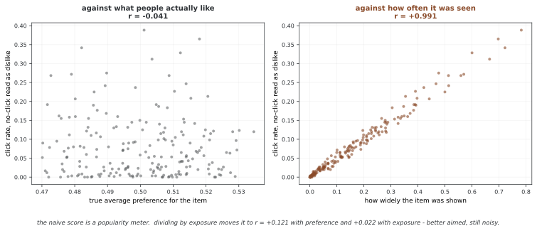

# 추천 시스템의 암묵적 피드백과 명시적 피드백

추천 시스템은 근본이 다른 두 종류의 피드백에서 사용자의 취향을 배운다. 명시적 피드백(사용자가 숫자 척도나 좋아요/싫어요로 곧바로 점수를 매김)과 암묵적 피드백(클릭, 구매, 체류 시간, 조회 같은 액션으로 취향이 드러남)이다. 저마다 뚜렷한 이점과 어려움이 있다. 명시적 피드백은 풀이할 수 있는 참 취향 신호를 주지만 사용자의 품이 들어 양이 적다. 암묵적 피드백은 액션에서 자연스레 나와 데이터가 넉넉하지만 노이즈가 섞이고 에두른다. 쪽을 오래 본 것이 참으로 관심 있어서일 수도, 그저 잘못 굴린 것일 수도 있다.

금융 시스템에서는 둘 다 결정적이다. 명시적 피드백은 설문과 곧바른 취향 표명에서, 암묵적 피드백은 거래 활동, 꾸러미 바꿈, 아이템 쓰임에서 온다. 언제 무엇을 쓸지, 어떻게 아우를지, 저마다의 어려움을 어떻게 다룰지 아는 것이 쓸모 있는 금융 추천 시스템을 세우는 데 꼭 필요하다.

이 절은 두 피드백 종류의 틀을 세우고 아우르는 길을 살피며 실제 구현을 보여 준다.

---

## 1. 핵심 개념

### 명시적 피드백
- **곧바른 취향 신호**: 사용자가 뜻을 두고 취향을 밝힌다
- **보기**: 별 다섯 평점, 좋아요/싫어요 단추, 취향 설문
- **성질**: 품질이 높고 풀이할 수 있으나 희소하다
- **바이어스**: 최근 경험이 비칠 수 있고 남 눈치를 보는 바이어스가 있다

### 암묵적 피드백
- **액션 신호**: 하는 짓에서 사용자의 취향을 미루어 안다
- **보기**: 클릭, 구매, 시청 시간, 꾸러미에 더함
- **성질**: 넉넉하고 노이즈가 있으나 남 눈치에 치우치지 않는다
- **어려움**: 아리송한 신호를 풀이하기

---

## 2. 수학적 틀

### 명시적 피드백 모델

사용자 u이 아이템 i에 점수 r_{ui} ∈ {1, 2, 3, 4, 5}을 드러나게 매긴다:

$$p(\text{rating} | u, i) = \text{Categorical}([p_1, p_2, p_3, p_4, p_5])$$

행렬 분해가 다음을 가장 작게 하는 임베딩을 배운다:

$$\mathcal{L}_{\text{explicit}} = \sum_{(u,i): \text{rated}(u,i)} (r_{ui} - \langle u_\theta, i_\theta \rangle)^2 + \lambda \|u_\theta\|^2 + \lambda \|i_\theta\|^2$$

본 칸만 로스에 이바지한다(보지 않은 평점은 나타내지 않는다).

### 암묵적 피드백 모델

이진 피드백: 상호작용(클릭, 구매)이 있으면 y_{ui} = 1, 아니면 0:

$$p(y_{ui} = 1 | u, i) = \sigma(\langle u_\theta, i_\theta \rangle)$$

로지스틱 로스가 다음을 가장 작게 한다:

$$\mathcal{L}_{\text{implicit}} = -\sum_u \sum_i [y_{ui} \log(\sigma(s_{ui})) + (1-y_{ui}) \log(1-\sigma(s_{ui}))]$$

여기서 $s_{ui} = \langle u_\theta, i_\theta \rangle$은 점수이다.

### 무게 매긴 암묵적 피드백

양의 피드백에 음의 것(없는 상호작용)보다 무게를 더 준다:

$$\mathcal{L}_{\text{weighted}} = \sum_u \sum_i c_{ui} [y_{ui} - \sigma(s_{ui})]^2$$

여기서 믿음 정도는:

$$c_{ui} = 1 + \alpha \cdot (\text{interaction count or duration})_{ui}$$

신호의 세기를 계산에 넣는다. 잦은 상호작용이 한 번의 클릭보다 앎이 많다.

---

## 3. 명시적 피드백 시스템

### 평점 기반 추천

사용자가 아이템을 매기고, 닮은 사용자가 높이 매긴 아이템을 권한다:

**별 다섯 평점**(보기로 영화 평):
```
쓰는 이 A: 영화 1 → 별 5개, 영화 2 → 별 3개
쓰는 이 B: 영화 1 → 별 4개, 영화 3 → 별 5개
→ Recommend Movie 3 to User A (similar taste)
```

### 취향 설문

구조 있는 설문지로 드러난 취향을 모은다:

**금융 상품 보기**:
```
Rate your interest (1=Not Interested, 5=Very Interested):
- Large-cap US stocks: [3]
- Small-cap US stocks: [4]
- International stocks: [2]
- Investment-grade bonds: [4]
- High-yield bonds: [1]
- Emerging markets: [1]
```

### 이진 피드백(좋아요/싫어요)

단순하게 만든 명시적 피드백:

$$y_{ui} \in \{0, 1\}$$

사용자가 주기 쉽지만 신호마다 앎이 적다(이진과 5점 척도의 차이).

---

## 4. 암묵적 피드백 시스템

### 참여 신호

사용자가 하는 짓에서 취향을 미루어 안다:

**클릭률**:

$$\text{CTR}_{ui} = \mathbb{1}[\text{user } u \text{ clicked item } i]$$

**체류 시간**:

$$t_{ui} = \text{seconds spent viewing item } i \text{ by user } u$$

**삼**:

$$p_{ui} = \mathbb{1}[\text{user } u \text{ purchased item } i]$$

사는 것이 가장 센 신호이고 클릭은 약한 신호이다.

### 금융 특유의 암묵적 신호

**꾸러미에 더함**: 투자자가 아이템을 꾸러미에 더할 때

**거래 활동**: 그 증권 거래의 잦음과 양

**앎 찾기**: 글 읽기, 연구 보기, 애널리스트의 보고서 열기

**눈여겨본 길이**: 아이템 쪽에 체류 시간, 받아 보기로 한 알림

### 암묵적 신호의 세기

신호마다 담은 앎이 다르다:

| 신호 | 세기 | 풀이 |
|--------|----------|-----------------|
| 페이지 조회 | 약함 | 우연일 수 있다 |
| 클릭 | 약함~보통 | 클릭할 만큼은 관심이 있다 |
| 체류 시간(>30초) | 보통 | 참으로 참여 |
| 즐겨찾기에 더함 | 강함 | 명시적 관심 신호 |
| 구매 | 매우 강함 | 액션으로 보인 취향 |

### 믿음 무게를 준 암묵적 피드백

암묵적 신호에 믿음 정도를 매긴다:

$$c_{ui} = \begin{cases}
0.5 & \text{if view} \\
1.0 & \text{if click} \\
5.0 & \text{if favorite} \\
10.0 & \text{if purchase}
\end{cases}$$

학습에 무게 로스를 쓴다. 중요한 신호가 임베딩에 더 큰 영향을 준다.

---

## 5. 명시적인 것과 암묵적인 것을 섞는 길

### 합친 로스 함수

명시적 평점과 암묵적 액션 둘 다에서 배운다:

$$\mathcal{L}_{\text{hybrid}} = w_e \cdot \mathcal{L}_{\text{explicit}} + w_i \cdot \mathcal{L}_{\text{implicit}}$$

무게가 균형을 잡는다:

- 명시적 피드백이 드물면 w_e = 0.7
- 암묵적 피드백이 넉넉하고 믿을 만하면 w_i = 0.7

### 피드백을 아우른 취향 모델

바탕에 참 취향 z_{ui}이 있다고 여기고 명시적 관측과 암묵적 관측을 함께 쓴다:

**명시적 평점**: $r_{ui} \sim \mathcal{N}(z_{ui}, \sigma_e^2)$(관측의 노이즈)

**암묵적 참여**: $c_{ui} = \text{count}(z_{ui})$(푸아송 모델)

아울러 미루어 알면 z_{ui}에 대한 믿음이 고쳐진다.

---

## 6. 암묵적 피드백의 바이어스 나타내기

### 암묵적 피드백의 거짓 음성

상호작용이 없다고 싫어한다는 뜻은 아니다. 그 아이템을 몰랐을 수도 있다:

$$p(y_{ui} = 0 | z_{ui}) = \mathbb{1}[z_{ui} < \text{threshold}] + (1-\text{awareness}_{ui})$$

노출도가 낮은 아이템은 실제 취향이 높아도 평점이 없어 보인다.

<div class="storybox" markdown>

**그림으로 보는 AI 1.** 없는 것을 싫음으로 읽으면 인기만 배운다

바로 위의 식은 조심하라는 단서처럼 읽히기 쉽다. 그런데 그 단서를 무시했을 때 무엇을 배우게 되는지는 꽤 극단적이다. 돌려 보면 **취향이 아니라 인기를 재는 자**가 만들어진다.

만든 자료로 확인해 보았다. 사용자 600명, 아이템 200개에 참 취향을 잠재 요인으로 깔고, **취향과는 아무 상관 없는** 노출도를 아이템마다 따로 두었다. 본 것 가운데 좋아하는 것만 누르게 하면 그것이 암묵적 피드백이다. 그러고 나서 가장 순진한 점수 — 클릭률, 곧 **클릭하지 않은 칸을 전부 싫음으로 읽은 것** — 을 매겼다.



결과가 두 그림에 그대로 있다. 순진한 점수와 **참 취향**의 상관은 $-0.041$, 사실상 0이다. 같은 점수와 **노출도**의 상관은 $+0.991$이다. 왼쪽은 형체가 없고 오른쪽은 거의 직선이다.

곧 이 점수는 "사람들이 무엇을 좋아하는가"를 재는 것이 아니라 **"무엇이 많이 보였는가"를 되읽고 있다.** 그것을 추천에 쓰면 이미 널리 보인 것을 더 보여 주고, 그러면 노출도가 더 커지고, 점수도 더 커진다.

2008년에 이페이 후(Yifan Hu)·예후다 코렌(Yehuda Koren)·크리스 볼린스키(Chris Volinsky)가 이 문제를 정면으로 다뤘다. 그들의 수는 **취향과 신뢰를 갈라 놓는 것**이었다 — 보지 않은 칸도 버리지 않고 남기되, 취향은 0/1로 두고 **얼마나 믿을지**를 관측 횟수로 따로 매긴다. 없는 것을 싫음으로도, 모름으로도 읽지 않고 **약한 싫음**으로 읽은 셈이다.

**다만 바로잡는 일이 쉽다는 뜻은 아니다.** 노출도를 안다고 가정하고 그것으로 나눠 보면 상관이 취향 쪽 $+0.121$, 노출도 쪽 $+0.022$로 바뀐다. 겨눈 방향은 분명히 옳아졌는데 **취향과의 상관은 여전히 낮다.** 드물게 보인 아이템일수록 나눌 분모가 작아 추정이 흔들리기 때문이다. 게다가 실제로는 노출도를 알지도 못한다 — 아래 위치 바이어스와 선택 바이어스가 이어서 다루는 것이 그 이야기다.

_확인한 곳 — Y. Hu, Y. Koren, C. Volinsky, "Collaborative Filtering for Implicit Feedback Datasets", *Proc. IEEE ICDM 2008*, 263–272. 암묵적 피드백을 취향과 **신뢰 수준**으로 나누어 다루자는 것이 그 논문의 제안이다. 그림과 본문의 수는 그림을 그리는 코드가 만든 자료로 직접 재며, 순진한 점수가 노출도를 따라가고 취향과는 상관이 낮은지를 먼저 확인한 뒤에만 그린다._

</div>

### 위치 바이어스

눈에 띄는 자리의 아이템이 품질과 상관없이 더 자주 눌린다:

$$p(\text{click}_{ui} | z_{ui}) = p(\text{position}_{ui}) \times p(\text{click} | \text{relevance})$$

암묵적 피드백에서 위치 바이어스를 바로잡아야 한다.

### 선택 바이어스

사용자가 무엇을 보고 매길지 스스로 고른다. 무작위 표본이 아니다:

$$p(\text{view}_{ui}) \neq \text{uniform}$$

사용자는 좋아할 것 같은 영화를 본다(양의 선택 바이어스).

---

## 7. 희소한 명시적 피드백과 풍부한 암묵적 피드백에서 학습하기

### 데이터가 드물 때의 전략

**명시적 피드백의 드묾**:

- 사용자가 아이템 1000개 가운데 1개를 매긴다
- 행렬의 성김: 99.9%

**전략**:

1. 암묵적 피드백으로 빈틈을 채운다
2. 골라 학습하기: 앎이 많은 아이템의 평점을 청한다
3. 정칙화: 매기지 않은 아이템에 대한 여김

### 데이터가 넉넉할 때의 전략

**암묵적 피드백의 넉넉함**:

- 사용자와 아이템의 상호작용이 수백만 개 있다
- 노이즈와 바이어스가 흔하다

**전략**:

1. 센 신호를 도드라지게 하는 믿음 무게 주기
2. 노이즈에서 배우지 않도록 음의 샘플링
3. 바이어스 바로잡기 모델

---

## 8. 실전 구현

### 섞은 피드백을 쓰는 금융 추천 시스템

**명시적 피드백**:

- 투자자 만족 설문: "이 추천에 얼마나 만족하십니까?"(1~5 척도)
- 취향 설문지: "이 아이템에 관심이 있습니까?"(예/아니오)
- 목표 적합성: "이것이 투자 목표에 도움이 됩니까?"(예/아니오/조금)

**암묵적 피드백**:

- 꾸러미에 더함: 이진 신호(더하면 1, 아니면 0)
- 시청 시간: 아이템 자세히 보기 쪽에 머문 길이
- 검색 빈도: 투자자가 이 아이템을 얼마나 자주 찾는가
- 추천 수용률: 받아들여진 추천의 %

**아우른 학습**:

1. 두 신호에서 배우는 **사용자 임베딩**:
   - 명시적: 곧바로 본 취향
   - 암묵적: 액션 패턴

2. 두 신호에서 배우는 **아이템 임베딩**:
   - 명시적: 그것을 매긴 사용자
   - 암묵적: 그것과 상호작용한 사용자

3. **함께 점수 매기기**:

$$\text{Score}(u, p) = w_e \cdot f_e(u, p) + w_i \cdot f_i(u, p)$$

### 사용자에게 밝히기

추천은 서로 다른 피드백에서 나올 수 있다:

```
권함: 성장 펀드 X

Why recommended:
- You viewed similar funds 5 times (implicit signal)
- 3 surveys indicate growth focus (explicit signal)
- Matches 90% of investor like you (collaborative pattern)
```

피드백이 어디서 왔는지 훤히 밝히면 믿음이 쌓인다.

---

## 9. 섞인 피드백으로 평가

### 명시적 피드백의 정확도

남겨 둔 평점으로 드러난 평점 예측을 시험한다:

$$\text{RMSE}_{\text{explicit}} = \sqrt{\frac{1}{N_{\text{test}}}\sum_{(u,i) \in \text{test}} (r_{ui} - \hat{r}_{ui})^2}$$

### 암묵적 피드백의 정확도

참여 예측을 시험한다(이진 분류):

$$\text{AUC}_{\text{implicit}} = \frac{\# \text{correct rankings}}{\# \text{total rankings}}$$

### 종류를 넘나드는 전이

명시적 피드백이 암묵적 예측을 좋게 할 수 있는가?

$$\Delta \text{AUC}_{\text{implicit}} = \text{AUC}_{\text{implicit+explicit}} - \text{AUC}_{\text{implicit only}}$$

값이 양이면 명시적 피드백이 도움이 된다는 뜻이다(옮겨 학습하기).

---

## 10. 모범 사례

### 명시적 피드백 모으기

- 끝까지 답하도록 설문지를 짧게(3~5개) 한다
- 또렷한 평점 척도를 쓴다(복잡한 순위 척도보다 별 1~5개가 낫다)
- 필요하면 참여에 리워드를 준다
- 자연스러운 때에 모은다(거래 뒤)

### 암묵적 피드백 풀이하기

- 신호 세기에 따라 믿음 무게를 매긴다
- 선택 바이어스와 위치 바이어스를 계산에 넣는다
- 신호 품질을 때에 따라 지켜본다
- 드러난 것이 있을 때 암묵적 신호를 그것과 맞대어 살핀다

### 하이브리드 추천 전략

- 내용 기반 방법과 드러난 사용자 프로파일링으로 시작한다
- 데이터가 쌓이면 암묵적 피드백을 더한다
- 처음에는 드러난 것에 무게를 크게 주고 때가 지나며 잠재 것의 무게를 늘린다
- 하이브리드 방법을 한 종류만 쓰는 베이스라인과 맞대어 살핀다

!!! note "피드백 고르기"
    상황에 맞는 피드백 종류를 고른다:

    - 명시적인 것만: 상호작용이 많은 아이템(금융 상담, 보험)으로 사용자가 자연스레 피드백을 준다
    - 암묵적인 것만: 양이 많은 도메인(사회 매체, 온라인 장터)으로 명시적 피드백이 드물다
    - 하이브리드: 둘 다 있을 때 가장 좋다. 저마다의 강점을 살린다

---

## 연습문제

<div class="drillbox" markdown>

**연습문제 1.** <span class="diff med" title="중간"></span>
이 길에서 콜드 스타트 문제가 새 사용자와 새 아이템에 어떻게 다르게 나타나는지 밝혀라. 경우마다 완화할 전략을 하나씩 내놓아라.

</div>

??? success "풀이"
    새 사용자는 취향을 배울 상호작용 이력이 없어 협업 필터링 신호를 쓸 수 없다. 완화책: 콘텐츠 기반 피처(인구 특성, 밝힌 취향)으로 사용자 임베딩의 초깃값을 잡는다. 새 아이템은 아직 상호작용한 사용자가 없어 협업 필터링으로 매길 수 없다. 완화책: 아이템 내용 피처(설명, 범주)으로 그 아이템을 임베딩 공간에서 닮은 아이템 곁에 놓는다. 두 전략 모두 상호작용이 넉넉히 쌓일 때까지 콜드 스타트 아이템을 띄워 준다. $\square$

---

<div class="drillbox" markdown>

**연습문제 2.** <span class="diff hard" title="어려움"></span>
이 절에서 밝힌 파라미터의 그래디언트 업데이트를 이끌어 내어라. 어느 항이 계산에 가장 비싼지 가려내고 근사를 내놓아라.

</div>

??? success "풀이"
    그래디언트에는 고르게 맞추려 온 아이템 목록에 대한 기댓값을 셈하는 일이 든다. 아이템 수에 선형으로 늘어나므로 가장 비싼 항이다. 음의 샘플링은 전체 목록 대신 음의 아이템 가운데 무작위로 고른 작은 부분집합만 더해 이를 근사하여, 업데이트마다 비용을 $O(|\mathcal{I}|)$에서 $O(k)$으로 줄인다. 여기서 $k$은 음의 표본 수(보통 5~20)이다. 중요도 샘플링이 이 근사에 치우치지 않은 추정량을 준다. $\square$

---

<div class="drillbox" markdown>

**연습문제 3.** <span class="diff hard" title="어려움"></span>
이 추천 방식이 인기 기반 베이스라인보다 사용자의 참여를 높이는지 평가할 A/B 테스트를 설계하여라. 무작위 배정 단위, 주 지표, 최소 표본 크기 계산을 밝혀라.

</div>

??? success "풀이"
    무작위 배정 단위: 사용자(서로 섞이지 않도록 세션이 아님). 주 지표: 추천의 클릭률. 베이스라인 클릭률이 5%이고 알아챌 최소 효과가 0.5%포인트(상대 10% 오름)일 때, 뜻 있음 수준 $\alpha = 0.05$과 힘 $1 - \beta = 0.80$에서 집단마다 필요한 표본 크기는 $n = 2(z_{\alpha/2} + z_\beta)^2 \cdot p(1-p) / \delta^2 \approx 15{,}000$명이다. 주마다의 패턴을 담으려 적어도 2주 돌린다. 가드레일: 수익률과 다양성 지표를 딸린 결과로 지켜본다. $\square$

---

<div class="drillbox" markdown>

**연습문제 4.** <span class="diff med" title="중간"></span>
이 추천 방법의 평가가 오프라인(지난 데이터)과 온라인(실제 반응) 자리에서 어떻게 다른지 밝혀라. 오프라인 평가에서 어떤 바이어스가 생길 수 있는가?

</div>

??? success "풀이"
    오프라인 평가는 때로 나눈 지난 상호작용을 쓴다(지난 것으로 익히고 앞으로의 것으로 시험). 바이어스에는 다음이 있다. (1) 선택 바이어스 -- 사용자는 보여 준 아이템과만 상호작용했으므로 보지 않은 아이템이 참으로 음인 것은 아니다. (2) 인기 바이어스 -- 인기 아이템이 테스트 집합을 지배한다. (3) 위치 바이어스 -- 위쪽에 놓인 아이템이 관련성과 상관없이 더 클릭된다. 온라인 평가(A/B 테스트)는 선택 바이어스를 피하지만 비싸고 느리다. 치우치지 않은 오프라인 평가 방법으로는 보여 줄 확률로 관측에 다시 무게를 주는 역 성향 점수 매기기가 있다. $\square$

## 정리하며

이 절에서는 핵심 개념, 수학적 틀, 명시적 피드백 시스템, 암묵적 피드백 시스템을 살펴보았다.
