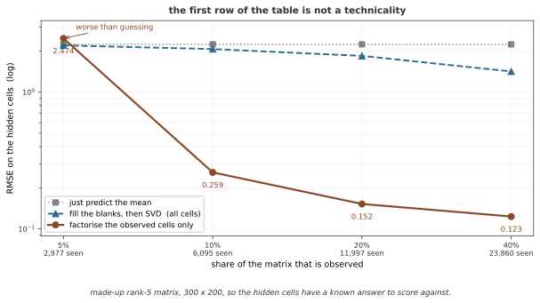

# 행렬 분해

---

## 1. 학습 목표

- 저계수 근사에서 행렬 분해의 목표를 이끌어 낸다
- 행렬 분해를 특잇값 분해와 잇고 희소 행렬에서 곧바른 특잇값 분해가 왜 안 되는지 밝힌다
- 임베딩으로 보는 풀이와 PyTorch 구현을 이해한다
- 평점 예측의 바이어스 분해를 이끌어 내고 바이어스 항이 왜 예측 오차를 크게 줄이는지 밝힌다
- `nn.Embedding`으로 기본 행렬 분해와 바이어스 있는 버전을 PyTorch로 구현한다
- 수렴 성질과 임베딩 차원의 효과를 살핀다

---

## 2. 저계수 근사에서 행렬 분해로

### 이상적인 경우: 온전한 행렬

평점 행렬 $R \in \mathbb{R}^{m \times n}$을 빠짐없이 보았다면 가장 좋은 계수 $d$ 근사는 **잘라 낸 특잇값 분해**로 주어진다:

$$R \approx U_d \Sigma_d V_d^\top$$

여기서 $U_d \in \mathbb{R}^{m \times d}$, $\Sigma_d \in \mathbb{R}^{d \times d}$, $V_d \in \mathbb{R}^{n \times d}$은 위 $d$개 성분이다. 에카르트–영–미르스키 정리에 따라 이것이 다음을 가장 작게 한다:

$$\min_{\text{rank}(X) = d} \|R - X\|_F^2$$

$P = U_d \Sigma_d^{1/2}$과 $Q = V_d \Sigma_d^{1/2}$으로 두면 $R \approx P Q^\top$이 된다.

### 실제 경우: 희소 행렬

실제로 $R$의 칸은 대부분 비어 있다. 곧바른 특잇값 분해가 안 되는 까닭은 다음과 같다:

1. **특잇값 분해에는 온전한 행렬이 필요하다.** 빈 칸을 0으로 다루면 분해가 0 쪽으로 치우친다. 사용자가 매기지 않은 영화는 0으로 매긴 영화와 같지 않다.
2. **채워 넣기는 돌고 돈다.** 특잇값 분해 전에 빈 값을 채우려면 예측하려는 바로 그것을 알아야 한다.

풀이: **본 칸에 대해서만** 가장 좋게 한다.

---

## 3. 행렬 분해의 목표

### 정식화

본 평점 $\Omega = \{(u, i) : R_{ui} \text{를 보았음}\}$이 주어질 때 다음을 가장 작게 하여 사용자 임베딩 $\mathbf{p}_u \in \mathbb{R}^d$과 아이템 임베딩 $\mathbf{q}_i \in \mathbb{R}^d$을 배운다:

$$\mathcal{L}(\theta) = \sum_{(u,i) \in \Omega} \bigl(R_{ui} - \mathbf{p}_u^\top \mathbf{q}_i\bigr)^2$$

이는 **볼록하지 않은** 최적화 문제이지만($P$과 $Q$에 대해 쌍선형) 그래디언트 기반 방법이 실제로 잘 듣는다.

### 그래디언트의 유도

본 평점 $(u, i)$ 하나에 대해 예측 오차를 다음과 같이 정의한다:

$$e_{ui} = R_{ui} - \mathbf{p}_u^\top \mathbf{q}_i$$

이 짝의 로스는 $\ell_{ui} = e_{ui}^2$이다. 그래디언트는 다음과 같다:

$$\frac{\partial \ell_{ui}}{\partial \mathbf{p}_u} = -2\, e_{ui}\, \mathbf{q}_i$$

$$\frac{\partial \ell_{ui}}{\partial \mathbf{q}_i} = -2\, e_{ui}\, \mathbf{p}_u$$

**이끌어 냄:** 사슬 규칙으로:

$$\frac{\partial \ell_{ui}}{\partial \mathbf{p}_u} = 2(R_{ui} - \mathbf{p}_u^\top \mathbf{q}_i) \cdot \frac{\partial}{\partial \mathbf{p}_u}\bigl(-\mathbf{p}_u^\top \mathbf{q}_i\bigr) = -2\, e_{ui}\, \mathbf{q}_i$$

$\frac{\partial}{\partial \mathbf{p}_u}(\mathbf{p}_u^\top \mathbf{q}_i) = \mathbf{q}_i$이기 때문이다($\mathbf{q}_i$을 $\mathbf{p}_u$에 대해 상수로 본다).

확률적 경사 하강법의 업데이트 규칙은 다음과 같다:

$$\mathbf{p}_u \leftarrow \mathbf{p}_u + \eta \cdot e_{ui} \cdot \mathbf{q}_i$$

$$\mathbf{q}_i \leftarrow \mathbf{q}_i + \eta \cdot e_{ui} \cdot \mathbf{p}_u$$

여기서 $\eta$은 러닝레이트다.

### L2 정칙화와 함께

(특히 희소한 데이터에서) 과적합을 막으려 웨이트 감쇠를 더한다:

$$\mathcal{L}_{\text{reg}}(\theta) = \sum_{(u,i) \in \Omega} \bigl(R_{ui} - \mathbf{p}_u^\top \mathbf{q}_i\bigr)^2 + \lambda \Bigl(\sum_u \|\mathbf{p}_u\|^2 + \sum_i \|\mathbf{q}_i\|^2\Bigr)$$

정칙화한 그래디언트는 다음이 된다:

$$\frac{\partial \mathcal{L}_{\text{reg}}}{\partial \mathbf{p}_u} = -2\, e_{ui}\, \mathbf{q}_i + 2\lambda\, \mathbf{p}_u$$

$$\frac{\partial \mathcal{L}_{\text{reg}}}{\partial \mathbf{q}_i} = -2\, e_{ui}\, \mathbf{p}_u + 2\lambda\, \mathbf{q}_i$$

!!! note "Adam의 웨이트 감쇠"
    PyTorch에서 `torch.optim.Adam`에 `weight_decay=wd`을 넘기면 L2 정칙화가 걸린다. Adam의 웨이트 감쇠는 맞춰 가는 러닝레이트와 서로 얽히므로, 떼어 놓은 웨이트 감쇠를 쓰려면 `AdamW`을 쓴다(2장 참고).

---

## 4. 임베딩으로 보는 풀이

행렬 $P \in \mathbb{R}^{m \times d}$은 **임베딩 표**로 볼 수 있다. 줄 $u$은 사용자 $u$의 $d$차원 표현이다. 마찬가지로 $Q \in \mathbb{R}^{n \times d}$은 아이템 임베딩 표이다.

PyTorch에서 `nn.Embedding(num_users, d)`이 바로 이 표를 담는다. 사용자 $u$과 아이템 $i$의 순전파는:

```python
p_u = self.user_emb(u)   # 형태: (batch, d) — P에서 줄 u을 찾는다
q_i = self.item_emb(i)   # 형태: (batch, d) — Q에서 줄 i을 찾는다
rating = (p_u * q_i).sum(1)  # 원소마다 곱한 뒤 더한다 → 안쪽 곱
```

**왜 `torch.dot` 대신 원소마다 곱한 뒤 더하는가?** 입력이 묶여 있다. `p_u`과 `q_i`의 형태는 `(batch_size, d)`이다. 원소마다 곱한 뒤 `sum(1)`을 하면 배치의 **표본마다 따로** 내적을 셈해 형태가 `(batch_size,)`인 텐서가 나온다.

!!! warning "임베딩의 초깃값이 중요하다"
    이 구현은 임베딩의 초깃값을 `uniform_(0, 0.05)`으로 둔다. 작고 양인 초깃값을 보장한다. 흔한 다른 방식으로는 Xavier 초기화나 $\mathcal{N}(0, 0.01)$에서 샘플링이 있다. 초깃값이 나쁘면(보기로 큰 값) 최적화가 발산할 수 있다.

---

## 5. PyTorch 구현: 기본 행렬 분해

```python
class MF(nn.Module):
    """
    함께 거르기를 위한 행렬 인수 분해.
    
    매김을 이렇게 예측한다: r_hat = p_u^T q_i
    여기서 p_u과 q_i은 배운 임베딩 벡터이다.
    """
    def __init__(self, num_users, num_items, emb_size=100):
        super(MF, self).__init__()
        self.user_emb = nn.Embedding(num_users, emb_size)
        self.item_emb = nn.Embedding(num_items, emb_size)
        # 작은 양의 첫 값
        self.user_emb.weight.data.uniform_(0, 0.05)
        self.item_emb.weight.data.uniform_(0, 0.05)

    def forward(self, u, v):
        u = self.user_emb(u)          # (batch, emb_size)
        v = self.item_emb(v)          # (batch, emb_size)
        return (u * v).sum(1)         # (batch,) — 표본마다 안쪽 곱
```

### 하나씩 짚기

1. **`__init__`**: 형태가 `(num_users, emb_size)`과 `(num_items, emb_size)`인 임베딩 표 둘을 만든다.
2. **`forward(u, v)`**: 정수 텐서 `u`(사용자 번호)과 `v`(아이템 번호)를 받아 임베딩을 찾고 내적을 예측한 평점으로 돌려준다.
3. **파라미터 개수**: $(m + n) \times d$. $m = 610$, $n = 9{,}724$, $d = 100$이면 파라미터가 약 103만 개이다.

---

## 6. 특잇값 분해와의 이음

행렬 분해와 특잇값 분해는 가깝지만 같지는 않다:

| 항목 | 잘라 낸 특잇값 분해 | 배운 행렬 분해 |
|--------|--------------|-----------|
| **목표** | $\min \|R - PQ^\top\|_F^2$(모든 칸) | $\min \sum_{(u,i) \in \Omega}(R_{ui} - \mathbf{p}_u^\top \mathbf{q}_i)^2$(본 칸만) |
| **풀이** | 닫힌 형태(에카르트–영) | 되풀이(경사 하강법) |
| **직교성** | $P^\top P = I$, $Q^\top Q = I$ | 제약 없음 |
| **빈 데이터** | 본디 다루지 못함 | 자연스럽게 다룸 |
| **유일성** | 유일(부호를 빼고) | 최적이 여럿 |

배운 행렬 분해를 (Simon Funk의 넷플릭스 상 방식을 따라) "Funk SVD"라 부르기도 하지만 참된 특잇값 분해는 아니다.

<div class="storybox" markdown>

**그림으로 보는 AI 1.** 이름을 붙인 사람이 먼저 그 이름을 의심했다

바로 윗줄의 조심스러움 — "Funk SVD라 부르기도 하지만 참된 특잇값 분해는 아니다" — 은 뒷사람이 붙인 단서가 아니다. **그 방법을 내놓은 사람이 직접 적은 말이다.**

2006년 12월, 넷플릭스 상이 한창일 때 사이먼 펑크(Simon Funk)가 자기 블로그에 「Netflix Update: Try This at Home」이라는 글을 올렸다. 첫 문장이 이렇게 시작한다 — "Ok, so here's where I tell all about how I (now we) got to be tied for third place on the netflix prize." **경쟁 중인 참가자가 3위에 오른 방법을 통째로 공개한 것이다.** 그 글에 적힌 확률적 경사 하강법 행렬 분해는 이후 대부분의 참가 팀이 가져다 썼다.

그리고 이름에 대해 그는 이렇게 적었다.

> "The end result, it's worth noting, is exactly an SVD **if the training set perfectly covers the matrix. Call it what you will when it doesn't.**"

행렬이 꽉 차 있으면 SVD가 맞고, 비어 있으면 — 뭐라 부르든 마음대로 하라는 것이다. 위 표의 마지막 줄 "빈 데이터"가 바로 그 단서를 표로 옮긴 것이다.



표 첫 줄의 차이가 얼마나 큰지 재어 보았다. 참값을 아는 계수 5짜리 $300\times200$ 행렬을 만들고 일부만 관측한 뒤, 가린 칸에서 RMSE를 쟀다.

관측이 40%일 때 **빈칸을 평균으로 채워 SVD** 하면 1.4188이고, **본 칸만 분해**하면 0.1233이다. 열 배 넘는 차이다. 더 눈여겨볼 것은 채워 넣는 길이 관측을 늘려도 평균으로 찍는 2.2361 근처를 좀처럼 벗어나지 못한다는 점이다. 없는 값을 지어내 목표에 넣으면, 그 지어낸 값을 맞추는 데 모델의 힘이 쓰인다.

**그런데 본 칸만 보는 쪽도 공짜가 아니다.** 관측이 5%로 내려가면 그 길의 RMSE가 **2.4744**로, 평균을 찍는 2.2406보다 **나빠진다.** 볼 수 있는 칸이 모자라면 자유로운 인수들이 노이즈를 외운다. 7절이 $d$가 너무 크면 과적합이 된다고 적은 것과 같은 일이며, 여기서는 $d$를 키운 것이 아니라 **자료를 줄여** 같은 자리에 닿았다.

그러니 "빈 데이터를 자연스럽게 다룸"은 빈칸이 공짜라는 뜻이 아니라, **빈칸을 지어내지 않는다**는 뜻일 뿐이다. 얼마나 비어 있어도 되는지는 표가 말해 주지 않고 재어 보아야 안다.

_확인한 곳 — Simon Funk, "Netflix Update: Try This at Home" (sifter.org, 2006년 12월 11일) 을 직접 읽었다. 인용한 첫 문장과 SVD 에 관한 문장이 그 글에 있다. 그림과 본문의 수는 그림을 그리는 코드가 만든 행렬로 직접 재며, 조밀할 때 본 칸만 보는 쪽이 크게 이기는지와 가장 희소할 때 평균보다 못해지는지를 먼저 확인한 뒤에만 그린다. MovieLens 가 아니라 **만든 자료**인 것은 가린 칸의 참값이 있어야 점수를 매길 수 있기 때문이다._

</div>

---

## 7. 임베딩 차원의 효과

임베딩 차원 $d$이 모델의 용량을 다스린다:

- **$d$이 너무 작음**: 과소적합. 모델이 잠재 구조를 담지 못한다.
- **$d$이 너무 큼**: 과적합. 데이터가 희소하면 모델이 노이즈를 외운다.

**경험 규칙**: $d \in \{50, 100, 200\}$으로 시작해 검증 로스로 손본다. MovieLens-Small 데이터셋(평점 약 10만 개)에서는 $d = 100$이 알맞은 기본값이다.

데이터에 실제로 있는 잠재 요인의 개수는 (채워 넣은) 평점 행렬의 특잇값 스펙트럼을 살펴 추정할 수 있다. 특잇값이 빠르게 줄어들면 작은 $d$으로 넉넉하다.

---

## 8. 기본 행렬 분해의 한계

기본 행렬 분해에는 중요한 한계가 있다. 평점을 오로지 사용자와 아이템의 상호작용으로만 나타내어 다음과 같은 몸에 밴 효과를 무시한다:

- **사용자 바이어스**: 어떤 사람은 무엇이든 높게 매기고 어떤 사람은 박하다.
- **아이템 바이어스**: 어떤 영화는 두루 사랑받고 어떤 것은 소수 취향이다.
- **전역 평균**: 모든 평점을 통틀은 평균 평점.

보기로 전역 평균 평점이 3.5이고 사용자 $u$이 평균보다 0.5 높게 매기며 영화 $i$이 평균보다 0.3 낮다면, 잠재 요인의 상호작용을 계산에 넣기 전 베이스라인 예측은 \$3.5 + 0.5 - 0.3 = 3.7$이어야 한다.

---

## 9. 바이어스를 더한 행렬 분해

### 까닭: 평점에 몸에 밴 효과

MovieLens 데이터셋을 보자. 눈에 띄는 어떤 패턴은 사용자와 아이템의 궁합과 아무 상관이 없다:

- **사용자의 버릇**: A은 평균 4.2로, B은 평균 2.8로 매긴다. 이는 특정 영화에 대한 취향이 아니라 성향을 비춘다.
- **아이템 품질**: "쇼생크 탈출"은 모든 사람을 통틀어 평균 4.5이고 저예산 영화는 평균 2.1이다. 이는 개인 취향이 아니라 품질에 대한 합의를 비춘다.
- **전역 베이스라인**: 데이터셋의 전체 평균 평점이 3.5쯤일 수 있다.

기본 행렬 분해 $\hat{R}_{ui} = \mathbf{p}_u^\top \mathbf{q}_i$은 이런 몸에 밴 효과까지 **모든** 변동성을 잠재 요인이 담게 만든다. 이는 모델의 용량을 낭비하고 잠재 요인을 풀이하기 어렵게 한다.

### 바이어스 분해

Koren, Bell, Volinsky(2009)을 따라 평점마다 다음과 같이 쪼갠다:

$$R_{ui} = \underbrace{\mu}_{\text{global mean}} + \underbrace{b_u}_{\text{user bias}} + \underbrace{b_i}_{\text{item bias}} + \underbrace{\mathbf{p}_u^\top \mathbf{q}_i}_{\text{interaction}} + \underbrace{\epsilon_{ui}}_{\text{noise}}$$

예측한 평점은 다음이 된다:

$$\hat{R}_{ui} = \mu + b_u + b_i + \mathbf{p}_u^\top \mathbf{q}_i$$

여기서 각 기호는 다음과 같다.

- $\mu = \frac{1}{|\Omega|}\sum_{(u,i) \in \Omega} R_{ui}$은 전역 평균이다(미리 셈할 수 있다)
- $b_u \in \mathbb{R}$은 사용자 $u$의 바이어스다(배운다)
- $b_i \in \mathbb{R}$은 아이템 $i$의 바이어스다(배운다)
- $\mathbf{p}_u^\top \mathbf{q}_i$은 남은 사용자-아이템 상호작용을 담는다

**풀이**: 베이스라인 추정 $\mu + b_u + b_i$은 "사용자가 누구이고 아이템이 무엇인지에 바탕한 기대 평점"을 담는다. 상호작용 항 $\mathbf{p}_u^\top \mathbf{q}_i$은 "바로 이 사용자-아이템 짝이 베이스라인에서 얼마나 벗어나는지"를 담는다.

### 가장 좋은 바이어스 값(닫힌 형태)

잠재 요인을 붙박아 두고 바이어스만 가장 좋게 하면 가장 좋은 값이 다음을 가장 작게 한다:

$$\min_{b_u, b_i} \sum_{(u,i) \in \Omega} \bigl(R_{ui} - \mu - b_u - b_i - \mathbf{p}_u^\top \mathbf{q}_i\bigr)^2 + \lambda\bigl(\sum_u b_u^2 + \sum_i b_i^2\bigr)$$

$b_u$에 대해 미분해 0으로 놓으면:

$$\frac{\partial}{\partial b_u}: \quad -2 \sum_{i:(u,i) \in \Omega} \bigl(R_{ui} - \mu - b_u - b_i - \mathbf{p}_u^\top \mathbf{q}_i\bigr) + 2\lambda b_u = 0$$

풀면:

$$b_u^* = \frac{\sum_{i:(u,i) \in \Omega} (R_{ui} - \mu - b_i - \mathbf{p}_u^\top \mathbf{q}_i)}{|I_u| + \lambda}$$

여기서 $|I_u|$은 사용자 $u$이 매긴 아이템의 개수이다. 마찬가지로:

$$b_i^* = \frac{\sum_{u:(u,i) \in \Omega} (R_{ui} - \mu - b_u - \mathbf{p}_u^\top \mathbf{q}_i)}{|U_i| + \lambda}$$

실제로는 이 닫힌 형태 풀이를 쓰지 않고 경사 하강법으로 모든 파라미터를 함께 배운다. 그래도 닫힌 형태는 통찰을 준다. 분모의 정칙화 항 $\lambda$이 바이어스를 0 쪽으로 **줄이며**, 평점이 적은 사용자나 아이템일수록 더 세게 줄인다.

### 바이어스를 넣은 목표 함수

바이어스 있는 행렬 분해의 정칙화한 로스는 다음과 같다:

$$\mathcal{L} = \sum_{(u,i) \in \Omega} \bigl(R_{ui} - \mu - b_u - b_i - \mathbf{p}_u^\top \mathbf{q}_i\bigr)^2 + \lambda\Bigl(\sum_u \|\mathbf{p}_u\|^2 + \sum_i \|\mathbf{q}_i\|^2 + \sum_u b_u^2 + \sum_i b_i^2\Bigr)$$

남은 값 $e_{ui} = R_{ui} - \mu - b_u - b_i - \mathbf{p}_u^\top \mathbf{q}_i$을 정의한다. 봄 $(u, i)$ 하나의 그래디언트는:

$$\frac{\partial \mathcal{L}}{\partial b_u} = -2\, e_{ui} + 2\lambda\, b_u$$

$$\frac{\partial \mathcal{L}}{\partial b_i} = -2\, e_{ui} + 2\lambda\, b_i$$

$$\frac{\partial \mathcal{L}}{\partial \mathbf{p}_u} = -2\, e_{ui}\, \mathbf{q}_i + 2\lambda\, \mathbf{p}_u$$

$$\frac{\partial \mathcal{L}}{\partial \mathbf{q}_i} = -2\, e_{ui}\, \mathbf{p}_u + 2\lambda\, \mathbf{q}_i$$

바이어스 그래디언트는 스칼라이고 임베딩 기울기는 $d$차원 벡터임에 유의한다.

---

## 10. PyTorch 구현: 바이어스 있는 행렬 분해

```python
class MF_bias(nn.Module):
    """
    쓰는 이와 물건의 치우침을 넣은 행렬 인수 분해.
    
    매김을 이렇게 예측한다: r_hat = p_u^T q_i + b_u + b_i
    
    유의: 온 자리 평균 mu은 치우침 항에 빨려 들어가거나
    익히는 동안(PyTorch가 이를 담도록 b_u와 b_i를 맞춘다),
    붙박인 상수로 드러나게 더할 수 있다.
    """
    def __init__(self, num_users, num_items, emb_size=100):
        super(MF_bias, self).__init__()
        self.user_emb = nn.Embedding(num_users, emb_size)
        self.user_bias = nn.Embedding(num_users, 1)
        self.item_emb = nn.Embedding(num_items, emb_size)
        self.item_bias = nn.Embedding(num_items, 1)
        # 숨은 인수: 작은 양의 값
        self.user_emb.weight.data.uniform_(0, 0.05)
        self.item_emb.weight.data.uniform_(0, 0.05)
        # 치우침: 0을 가운데 둔 작은 값
        self.user_bias.weight.data.uniform_(-0.01, 0.01)
        self.item_bias.weight.data.uniform_(-0.01, 0.01)

    def forward(self, u, v):
        U = self.user_emb(u)                # (batch, emb_size)
        V = self.item_emb(v)                # (batch, emb_size)
        b_u = self.user_bias(u).squeeze()   # (배치,)
        b_v = self.item_bias(v).squeeze()   # (배치,)
        return (U * V).sum(1) + b_u + b_v   # (배치,)
```

### 구현의 세부

**`nn.Embedding(n, 1)`으로 둔 바이어스**: 바이어스는 사용자나 아이템마다 스칼라 하나다. 출력 차원이 1인 `nn.Embedding`을 쓰면 잠재 요인처럼 이 스칼라를 찾기 표에 담는다. `.squeeze()`이 뒤따르는 차원을 없앤다. `(batch, 1)` → `(batch,)`.

**왜 `nn.Parameter`이 아닌가?** `self.user_bias = nn.Parameter(torch.zeros(num_users))`으로 두고 손으로 번호를 짚어도 *된다*. `nn.Embedding` 쪽이 깔끔한 까닭은 배치 찾기를 저절로 다루고 옵티마이저의 웨이트 감쇠와 잘 어울리기 때문이다.

**파라미터 개수**: $(m + n) \times d + (m + n)$. 바이어스 항은 잡을 $m + n$개만 더한다. 임베딩에 견주면 하찮다.

!!! note "전역 평균 $\mu$은 어디에 있는가"
    위 구현은 $\mu$을 드러나게 담지 않는다. 학습하는 동안 바이어스 항 $b_u$과 $b_i$이 전역 평균을 빨아들인다. $\mu$을 드러내고 싶으면 미리 셈해 순전파에서 더한다:
    ```python
    return (U * V).sum(1) + b_u + b_v + self.global_mean
    ```
    바이어스가 가장 좋은 값에 더 가까이서 시작하므로 수렴이 좋아질 수 있다.

### 초깃값의 편차

잠재 요인은 $[0, 0.05]$(양)에서, 바이어스는 $[-0.01, 0.01]$(가운데 맞춤)에서 초깃값을 잡는다. 이는 맡은 몫이 다름을 비춘다:

- **잠재 요인**: 양의 초깃값은 첫 내적이 음이 아니게 하며 이는 양의 평점 척도에 알맞다.
- **바이어스**: 가운데 맞춘 초깃값은 대부분의 사용자와 아이템이 평균에 가깝다는 사전 믿음을 비춘다.

---

## 11. 바이어스가 왜 도움이 되는가: 정량 분석

무엇이든 평균보다 1점 높게 매기는 사용자를 보자. 편향이 없으면:

- 잠재 요인이 이 버릇을 담아야 하므로 상호작용을 담을 힘이 줄어든다.
- 같은 정확도를 얻으려면 더 큰 $d$이 필요하다.

바이어스가 있으면:

- $b_u \approx 1.0$이 그 버릇을 곧바로 담는다.
- 잠재 요인은 오로지 사용자와 아이템의 궁합에 집중한다.
- 더 작은 $d$으로 넉넉해져 일반화가 좋아진다.

**겪어 본 효과**: MovieLens 데이터셋에서 바이어스를 더하면 대개 검증 평균 제곱 오차가 10~20% 줄고, 평균 평점이 극단인 사용자나 아이템에서 가장 크게 좋아진다.

---

## 12. 행렬 분해 변형 비교

| 모델 | 예측 | 파라미터 | 담는 것 |
|-------|-----------|-----------|----------|
| 기본 행렬 분해 | $\mathbf{p}_u^\top \mathbf{q}_i$ | $(m+n)d$ | 상호작용만 |
| 행렬 분해 + 바이어스 | $b_u + b_i + \mathbf{p}_u^\top \mathbf{q}_i$ | $(m+n)(d+1)$ | 바이어스 + 상호작용 |
| 행렬 분해 + 바이어스 + $\mu$ | $\mu + b_u + b_i + \mathbf{p}_u^\top \mathbf{q}_i$ | $(m+n)(d+1) + 1$ | 온 자리 + 바이어스 + 상호작용 |

---

## 13. 학습할 때 살필 점

### 러닝레이트 스케줄

원본 코드는 **단계별 러닝레이트** 전략을 쓴다:

```python
train_epochs(model, df_train, df_val, epochs=10, lr=0.1)   # 1단계: 거칠게
train_epochs(model, df_train, df_val, epochs=15, lr=0.01)  # 2단계: 다듬기
train_epochs(model, df_train, df_val, epochs=15, lr=0.001) # 3단계: 매끄럽게
```

이는 러닝레이트 감쇠를 손으로 근사한 것이다. 처음의 높은 속도가 좋은 자리를 빨리 찾고, 낮은 속도가 그 안에서 곱게 다듬는다.

### 전체 배치 학습과 작은 배치 학습

이 구현은 **전체 배치** 경사 하강법을 쓴다(스텝마다 학습 데이터 전체). MovieLens-Small(학습 평점 약 8만 개)에서는 할 만하지만 더 큰 데이터셋에서는 작은 배치 학습로 바꾸어야 한다:

```python
from torch.utils.data import DataLoader, TensorDataset

dataset = TensorDataset(
    torch.LongTensor(df_train.userId.values),
    torch.LongTensor(df_train.movieId.values),
    torch.FloatTensor(df_train.rating.values)
)
loader = DataLoader(dataset, batch_size=1024, shuffle=True)
```

---

## 14. 온전한 학습 흐름

다음은 데이터 불러오기, 담기, 학습의 온전한 흐름을 보여 준다:

```python
def train_epochs(model, df_train, df_val, epochs=10, lr=0.01, wd=0.0):
    """밝힌 판수만큼 모델을 익힌다."""
    optimizer = torch.optim.Adam(model.parameters(), lr=lr, weight_decay=wd)

    for epoch in range(epochs):
        model.train()
        users = torch.LongTensor(df_train.userId.values)
        items = torch.LongTensor(df_train.movieId.values)
        ratings = torch.FloatTensor(df_train.rating.values)

        y_hat = model(users, items)
        loss = F.mse_loss(y_hat, ratings)

        optimizer.zero_grad()
        loss.backward()
        optimizer.step()

        # 때때로 살피기
        if (epoch + 1) % 5 == 0 or epoch == 0:
            model.eval()
            with torch.no_grad():
                val_users = torch.LongTensor(df_val.userId.values)
                val_items = torch.LongTensor(df_val.movieId.values)
                val_ratings = torch.FloatTensor(df_val.rating.values)
                val_hat = model(val_users, val_items)
                val_loss = F.mse_loss(val_hat, val_ratings).item()
            print(f"  Epoch {epoch+1:3d} | "
                  f"Train MSE: {loss.item():.4f} | Val MSE: {val_loss:.4f}")
```

!!! tip "번호 담기"
    MovieLens의 사용자 번호와 영화 번호는 이어져 있지 않다(보기로 사용자 번호가 3에서 7로 건너뛸 수 있다). `nn.Embedding`을 쓰기 전에 번호를 $[0, N)$의 이어진 정수로 다시 옮긴다. 원본 코드는 `proc_col`과 `encode_data` 함수로 이를 다룬다. 검증 데이터는 학습 데이터와 **같은** 인코딩으로 담아야 하며 본 적 없는 사용자나 아이템이 든 칸은 버려야 한다.

---

## 연습문제

1. **그래디언트 확인**: 행렬 분해 모델을 짜고 `torch.autograd.gradcheck`으로 손으로 구한 그래디언트를 PyTorch의 자동 미분과 맞대어 확인하여라.

2. **계수 분석**: 계수가 2인 $5 \times 5$ 평점 행렬에서 $d = 2$의 행렬 분해가 모든 칸을 완벽히 복원한다는 것을 보여라. $d = 1$이면 어떻게 되는가?

3. **초깃값 실험**: 초깃값 두는 방식 셋(`uniform_(0, 0.05)`, `uniform_(-1, 1)`, `normal_(0, 1)`)으로 행렬 분해 모델을 학습하라. 수렴 속도와 마지막 검증 로스를 비교하여라.

4. **임베딩 차원 훑기**: MovieLens-Small에서 $d \in \{10, 50, 100, 200, 500\}$으로 학습하라. $d$에 대한 학습과 검증 평균 제곱 오차를 그려라. 어느 지점에서 과적합이 시작되는가?

5. **수학의 같음**: $R$을 빠짐없이 보았고 정칙화 없이 $\|R - PQ^\top\|_F^2$을 가장 작게 하면 온 자리 최소가 $PQ^\top = U_d \Sigma_d V_d^\top$(잘라 낸 특잇값 분해)을 만족함을 밝혀라.

6. **바이어스 되찾기**: 바이어스를 알고 잠재 요인이 없는 $R_{ui} = 3.0 + b_u + b_i + \epsilon_{ui}$의 지어낸 데이터셋을 만들어라. $d = 1$으로 바이어스 있는 행렬 분해를 학습하라. 배운 바이어스가 참값을 되찾는가?

7. **떼어 보기**: MovieLens에서 모델 셋을 학습하라. (a) 편향 없는 행렬 분해, (b) 바이어스만 있는 모델($d = 0$으로 $\mu + b_u + b_i$뿐), (c) 바이어스 있는 행렬 분해. 검증 평균 제곱 오차를 알려라. 예측력 가운데 바이어스만으로 얻는 몫은 얼마인가?

8. **정칙화 민감도**: (Adam의 `weight_decay`으로) $\lambda \in \{0, 10^{-4}, 10^{-3}, 10^{-2}, 10^{-1}\}$을 두어 바이어스 있는 행렬 분해를 학습하라. $\lambda$에 대한 검증 평균 제곱 오차를 그려라. 가장 좋은 $\lambda$이 바이어스와 임베딩에서 같은가?

9. **풀이**: 학습된 뒤 배운 바이어스 $b_u$이 가장 높은 이와 가장 낮은 이를 찾아라. 그들의 평점 지난 일은 어떠한가? 바이어스가 감성과 맞는가?

## 정리하며

행렬 분해는 내적이 본 평점을 근사하도록 사용자와 아이템의 낮은 차원 임베딩을 배운다. (특잇값 분해와 달리) 본 칸에 대해서만 가장 좋게 하고, 경사 하강법을 써서 작은 배치 학습을 할 수 있으며, PyTorch에서 `nn.Embedding`으로 자연스럽게 적힌다. 바이어스 항을 더하면 몸에 밴 효과(사용자가 누구인지, 아이템이 무엇인지)를 상호작용 효과(이 짝이 얼마나 잘 맞는지)에서 떼어 놓아, 파라미터를 거의 늘리지 않고도 예측 품질을 뜻있게 높인다. 다음 마디에서는 표현 힘을 더 키우려 내적을 뉴럴 네트워크로 바꾼다.

---
