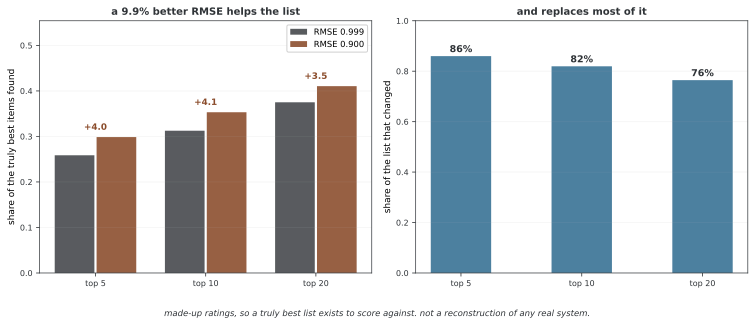

# 35장: 추천 시스템

이 장은 **추천 시스템**을 다룬다.

추천 시스템은 쓰는 이의 취향을 헤아려 큰 목록에서 알맞은 물건을 내민다. 이 장은 고전 함께 거르기와 행렬 분해에서 요즘 뉴럴 넷트웍 방법, 그래프 기반 추천, 엄밀한 따지기 틀에 이르기까지 추천의 길을 두루 다룬다. 꾸러미 권하기, 물건 추천, 위험을 살피는 시스템 같은 금융 응용을 곳곳에서 살핀다.

---

## 1. 차례

### 30.1 기초

- 추천 시스템 살펴보기 -- 추천 문제의 엄밀한 정의, 매김 행렬, 추천 시스템 구조의 클래스
- 함께 거르기 -- 쓰는 이와 물건의 닮음 잣대를 쓰는 기억 기초와 모델 기초 함께 거르기
- 내용 기초 거르기 -- TF-IDF과 뉴럴 넷트웍 뽑개로 앞서 좋아한 물건과의 피처 닮음에 바탕해 물건 권하기
- [행렬 분해](foundations/matrix_factorization.md) -- 특잇값 분해 기초 임베딩으로 매김 행렬을 낮은 계수로 어림하기와 PyTorch의 바이어스 있는 판
- [암묵적 피드백과 명시적 피드백](foundations/implicit_explicit.md) -- 드러난 매김과 숨은 액션 신호의 틀, 둘을 아우르는 길
- 차가운 출발 문제 -- 주고받음 데이터가 적은 새 쓰는 이, 새 물건, 새 시스템을 다루는 셈속

### 30.2 뉴럴 넷트웍 방법

- 뉴럴 넷트웍 함께 거르기 -- 나타냄 힘이 센 쓰는 이-물건 주고받음을 위해 내적을 뉴럴 넷트웍으로 바꾸기
- [오토인코더 기반 추천 시스템](neural_methods/autoencoder_recsys.md) -- 매김 성능에서 숨은 쓰는 이 나타냄을 배우는 변분 및 여느 오토인코더
- 차례 추천 -- GRU4Rec과 셀프 어텐션 모델(SASRec)을 쓰는 때를 살피는 추천
- 뉴럴 넷트웍 내용 기초 거르기 -- 뉴럴 넷트웍 피처 샘플링을 쓰는 내용 기반 추천의 딥러닝 길
- 임베딩 기반 추천 시스템 -- 키울 수 있는 추천을 위한 두 탑 구조와 어림 가장 가까운 이웃 찾기
- [어텐션 기반 추천 시스템](neural_methods/attention_recsys.md) -- 쓰는 이의 지난 일과 맥락 앎에 그때그때 무게를 주는 어텐션 구조
- 섞은 방법 -- 저마다의 한계를 넘으려 함께 거르기와 내용 기초 신호를 아우르기

### 30.3 그래프 기반 추천 시스템

- 두 쪽 그래프로 나타내기 -- 아무 스텝과 스펙트럼 방법으로 쓰는 이-물건 주고받음을 두 쪽 그래프로 나타내기
- 그래프 뉴럴 넷트웍 기반 추천 시스템 -- 주고받음 그래프 위 메시지 패싱로 끝에서 끝까지 추천하는 그래프 뉴럴 넷트웍
- 지식 그래프 추천 시스템 -- 밝힐 수 있고 미루어 아는 추천을 위해 구조 있는 뜻 앎을 살리기
- 사회 그래프 추천 시스템 -- 소셜 네트워크 구조를 쓰는 믿음을 살피고 영향에 바탕한 추천

### 30.4 따지기

- 추천 시스템 따지기 -- 평균 제곱 어긋남, 그 제곱근, 평균 절대 어긋남 잣대로 보는 매김 헤아리기와 매김 따지기의 틀
- 매김 잣대 -- 추천 목록의 품질을 따지는 Precision@K, Recall@K, NDCG, MAP
- 온라인 따지기와 오프라인 따지기 -- 때로 나누기, 하나 빼기 규약, 오프라인 잣대와 실제 성과의 틈
- 덮음과 다양함 -- 목록 덮음과 목록 안 다양함 재기, 인기 바이어스 다루기
- 추천 시스템의 A/B 시험 -- 실제 시험을 위한 실험 설계, 아무 나누기, 표본 크기 계산, 통계 뜻 있음
- 맞음 잣대를 넘어 -- 두루 살피는 여러 차원 따지기 틀: 새로움, 뜻밖의 반가움, 공정함

### 30.5 금융 응용

- [포트폴리오 추천](finance/portfolio_suggestion.md) -- 벌이, 위험 알맞음, 갈라 담기, 규제 지킴을 저울질하는 사람마다 맞춘 꾸러미 추천
- 금융 물건 추천 -- 알맞음 요구와 신의 성실 매임 아래 펀드, 상장 지수 펀드, 은행 물건 권하기
- [연구 보고서 추천](finance/research_recommendation.md) -- 자연어 처리의 내용 이해와 함께 거르기로 알맞은 주식 연구와 거시 논평을 내밀기
- [위험을 살피는 추천 시스템](finance/risk_aware.md) -- 내림 위험, 꾸러미 쏠림, 버거움 상황을 추천 알고리즘에 담기

---

**그림으로 보는 AI 1.** 백만 달러짜리 답은 끝내 쓰이지 않았다

이 장의 차례가 매김 예측(30.1)으로 시작해 목록 잣대(30.4)로 끝나는 데에는 내력이 있다. 그 둘이 같지 않다는 것을 분야 전체가 한 번 크게 배웠기 때문이다.

2006년에 넷플릭스가 상금 100만 달러를 걸었다. 조건은 자기네 매김 예측기보다 **RMSE를 10% 낮추라**는 것 하나였다. 2009년에 BellKor's Pragmatic Chaos 팀이 10.06%로 그 선을 넘어 상을 받았다.

**그런데 그 답은 제품에 들어가지 않았다.** 넷플릭스 기술 블로그가 밝힌 까닭은 "측정된 정확도 향상이 그것을 제품 환경에 가져오는 데 드는 공학적 수고를 정당화하지 못했다"는 것이었다. 백만 달러를 주고 산 모델을 쓰지 않기로 한 것이다.

RMSE 10%가 목록을 얼마나 바꾸는지 만든 자료로 재어 보면 그 판단이 읽힌다.

RMSE를 9.9% 낮추면 상위 10 목록이 참으로 좋은 물건을 **31.3%에서 35.3%로** 더 많이 담는다. 분명히 나아졌다. 그런데 같은 바꿈이 **목록의 82%를 갈아치운다.**

이 둘을 나란히 놓으면 공학적 저울질이 보인다. 4점을 얻자고 사람마다 보던 목록의 대부분을 바꾸고, 그 모델을 돌릴 길을 새로 깔아야 한다. 상금의 조건이 RMSE 하나였기 때문에 **상금은 그 저울질을 묻지 않았다.**

**다만 이것을 "RMSE는 쓸모없다"로 읽으면 안 된다.** 위 수에서 보듯 RMSE가 낮아지면 목록도 분명히 좋아진다. 그리고 여기 쓴 것은 **만든 자료**이지 넷플릭스에서 실제로 일어난 일을 되살린 것이 아니다. 말할 수 있는 것은 **잣대 하나가 곧 쓸모는 아니라는 것**까지이고, 30.4절이 RMSE와 함께 Precision@K·NDCG를 따로 두는 까닭, 그리고 30.5절의 금융 쪽에서 알맞음과 규제 같은 조건이 잣대 바깥에서 들어오는 까닭이 그것이다.

_확인한 곳 — 넷플릭스 상은 2006년에 시작해 2009년 BellKor's Pragmatic Chaos 팀이 10.06% 향상으로 받았다. 우승 앙상블이 제품에 들어가지 않았다는 것과 "정확도 향상이 공학적 수고를 정당화하지 못했다"는 설명은 넷플릭스 기술 블로그의 것으로, 원문을 직접 받지 못해(접근 거부) 그 대목을 인용한 2차 기록으로 확인했다. 그림의 수는 그림을 그리는 코드가 만든 자료로 직접 재며, 더 낮은 RMSE 가 목록을 낫게 하는지와 목록이 크게 바뀌는지를 먼저 확인한 뒤에만 그린다._

## 정리하며

이 절에서는 차례를 살펴보았다.
