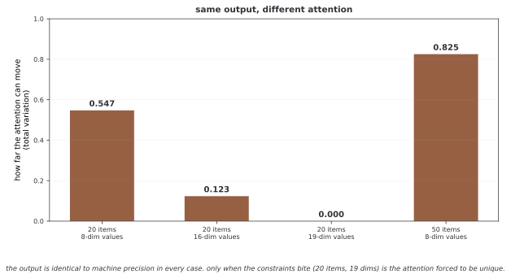

# 어텐션 기반 추천 시스템

어텐션 구조 덕에 뉴럴 네트워크 추천 시스템은 추천을 만들 때 사용자의 이력, 아이템 피처, 맥락 정보 가운데 가장 알맞은 곳에 집중할 수 있다. 지난 상호작용을 모두 같게 다루는 대신, 어텐션 기반 시스템은 지난 아이템 가운데 어느 것이 지금 추천에 가장 큰 영향을 주는지 상황마다 다른 웨이트를 배운다. 덕분에 시퀀스를 이룬 사용자의 액션에서 장거리 의존성을 담고 길이가 제각각인 시퀀스도 효율적으로 다룬다.

계량 금융에서 어텐션 구조는 시간에 따라 변하는 사용자의 취향과 시장 국면을 담는 데 특히 값지다. 성장주를 좋아하는 마음이 강세장에서는 짙어지고 약세장에서는 옅어질 수 있다. 과거 보유 종목, 최근 거래, 지금 시장 상황에 어텐션을 두면 추천 시스템이 바뀌는 맥락에 맞춰 적응할 수 있다.

이 쪽은 추천을 위한 어텐션 구조를 세우고 어텐션과 협업 필터링을 아우른 구조를 살피며 금융 응용을 보인다.

---

## 1. 핵심 개념

### 어텐션의 기초
- **쿼리**: 지금의 추천 맥락(누구에게, 어떤 맥락에서)
- **키/값**: 과거 정보(지난 구매, 아이템 피처)
- **어텐션 웨이트**: 키마다의 관련성을 나타내는 배운 점수
- **출력**: 어텐션 웨이트로 값을 더한 가중합

### 추천의 어텐션 종류
- **아이템 어텐션**: 지난 아이템 가운데 어느 것이 지금 취향에 영향을 주는가
- **시퀀스 어텐션**: 시퀀스의 어느 위치가 가장 중요한가
- **피처 어텐션**: 아이템의 어느 피처가 가장 알맞은가
- **크로스 어텐션**: 사용자와 아이템의 상호작용

---

## 2. 수학적 틀

### 기본 어텐션 구조

쿼리 q, 키 K, 값 V에 대해:

$$\text{Attention}(q, K, V) = \text{softmax}\left(\frac{q K^T}{\sqrt{d}}\right) V$$

어텐션 웨이트:

$$\alpha_i = \frac{\exp(q \cdot k_i / \sqrt{d})}{\sum_j \exp(q \cdot k_j / \sqrt{d})}$$

출력: 값의 가중합:

$$\text{Output} = \sum_i \alpha_i v_i$$

### 멀티헤드 어텐션

여러 측면을 동시에 본다:

$$\text{MultiHead}(q, K, V) = \text{Concat}(\text{head}_1, \ldots, \text{head}_h) W^O$$

여기서 각 기호는 다음과 같다.

$$\text{head}_i = \text{Attention}(q W_i^Q, K W_i^K, V W_i^V)$$

헤드마다 다른 측면을 배운다(보기로 단기 취향과 장기 취향).

### 시퀀스를 위한 셀프 어텐션

시퀀스 안에서 서로를 살핀다:

$$q = K = V = \text{Item embeddings}$$

아이템끼리의 어텐션을 가능하게 해 지난 아이템들이 서로 어떻게 영향을 주는지 나타낸다.

### 사용자–아이템 매칭을 위한 크로스 어텐션

사용자(쿼리)가 아이템(키/값)을 살핀다:

$$q = \text{user embedding}, K = V = \text{item embeddings}$$

아이템마다 사용자에게 얼마나 알맞은지 계산한다.

---

## 3. 어텐션 기반 추천 구조

### 구매 이력을 위한 시퀀스 어텐션

구매 시퀀스에 어텐션을 두어 사용자 취향의 시간 흐름을 배운다:

1. **지난 아이템 임베딩**: 구매 $i_1, \ldots, i_T$에 대해 $h_t = \text{embed}(i_t)$
2. **어텐션 계산**: 쿼리(지금 맥락)가 지난 임베딩을 살핀다
3. **출력**: 웨이트로 합친 과거 맥락을 아이템 임베딩과 합친다

예측:

$$\hat{r}_{u,i} = \text{MLP}(\text{attention context}, \text{item embedding})$$

### 트랜스포머 기반 추천

멀티헤드 셀프 어텐션 레이어를 쌓는다:

```
들임: 물건 임베딩 h₀
1레이어: MultiHeadAttention(h₀) → h₁
2레이어: MultiHeadAttention(h₁) → h₂
...
Layer L: MultiHeadAttention(h_{L-1}) → h_L
내놓기: h_L에서 쓰는 이의 취향을 헤아린다
```

복잡한 아이템 의존성을 담을 수 있게 한다.

### 어텐션 기반 협업 필터링

사용자 어텐션과 아이템 어텐션을 아우른다:

1. **아이템 어텐션**: 사용자가 아이템을 살핌(어느 아이템이 사용자에게 중요한가)
2. **사용자 어텐션**: 아이템이 닮은 사용자를 살핌(어느 사용자가 그 아이템에 중요한가)
3. **함께**: 두 어텐션이 예측에서 서로 작용한다

$$\hat{r}_{u,i} = f(\text{ItemAttention}(u) + \text{UserAttention}(i))$$

---

## 4. 어텐션의 금융 응용

### 어텐션을 쓴 꾸러미 추천

종목 10개 꾸러미를 가진 투자자에게 다음에 편입할 종목을 추천한다:

1. **지난 아이템**: 보유 종목을 임베딩한다
2. **아이템 피처**: 업종, 배당 수익률, 위험 지표
3. **어텐션**: 보유 종목 가운데 어느 것이 후보 종목과 가장 닮았는지 정한다
4. **예측**: 어텐션을 많이 받은 보유 종목과 닮은 종목을 추천한다

**해석**: "꾸러미가 배당 기술주(애플, 마이크로소프트)에 크게 쏠려 있으므로 기술 배당 상장 지수 펀드를 추천합니다."

### 국면을 살피는 어텐션

시장 국면에 따라 어텐션을 조절한다:

$$\alpha_i^{\text{regime}} = \text{softmax}(\alpha_i \cdot \text{regime factor})$$

상승 국면: 최근 수익률이 좋은 종목의 웨이트를 올린다
하락 국면: 방어주의 웨이트를 올린다

### 시간 어텐션

최근 거래가 오래된 거래보다 관련성이 높다:

$$\alpha_t = \text{softmax}(\alpha_t^{\text{base}} \times \exp(-\lambda(T - t)))$$

지수 감쇠가 최근 아이템에 더 큰 웨이트를 준다.

---

## 5. 구현의 세부

### 위치 인코딩

트랜스포머는 (순서가 원래 있는 순환 뉴럴 네트워크와 달리) 위치 정보가 필요하다:

$$\text{pos\_encoding}(t, 2d) = \sin(t / 10000^{2d/d_{model}})$$

$$\text{pos\_encoding}(t, 2d+1) = \cos(t / 10000^{2d/d_{model}})$$

어텐션 전에 임베딩에 더한다.

### 레이어 정규화와 잔차 연결

트레인을 안정시킨다:

$$\text{Output} = \text{LayerNorm}(x + \text{Attention}(x))$$

잔차 연결과 레이어 정규화가 그래디언트 흐름을 좋게 한다.

### 인과 어텐션을 위한 마스킹

순차 예측에서는 미래 아이템을 가린다(그러지 않으면 정보가 누출된다):

$$\text{Attention}(q, K, V) = \text{softmax}\left(\frac{qK^T}{\sqrt{d}} + M\right) V$$

여기서 M이 미래 위치를 -∞로 가린다.

---

## 6. 어텐션의 해석 가능성

### 시각화

어텐션 웨이트를 히트맵으로 그린다:

```
              물건 1  물건 2  물건 3  물건 4
쓰는 이 A     0.5     0.3     0.1     0.1
쓰는 이 B     0.1     0.1     0.6     0.2
쓰는 이 C     0.2     0.2     0.2     0.4
```

사용자마다 어느 아이템이 중요한지 보여 준다.

### 어텐션으로 하는 설명

어텐션 웨이트에서 설명을 만든다:

```
권함: 애플 주식
Attention scores:
- AAPL(지금 보유): 0.6 ← 가장 높음
- MSFT(지금 보유): 0.3
- IBM(앞서 팔았음): 0.05

Explanation: "You're highly engaged with Apple stock 
in your portfolio. Similar tech companies recommended."
```

---

## 7. 트레인할 때 살필 점

### 데이터 요구

어텐션 기반 모델은 파라미터가 많아 트레인 데이터가 넉넉해야 한다:

- 최소: 사용자마다 상호작용 50~100개
- 바람직: 사용자마다 500개 넘게
- 가장 좋음: 사용자마다 5,000개 넘게

### 계산 비용

멀티헤드 어텐션은 L = 시퀀스 길이, d = 임베딩 차원일 때 O(L² × d)로 커진다.

시퀀스가 길면(L > 1000) 비싸진다. 대책:

1. **잘라내기**: 최근 100~200개만 살핀다
2. **희소 어텐션**: 가장 가까운 k개만 살핀다
3. **선형 어텐션**: 소프트맥스를 선형 연산으로 근사한다

### 최적화

Adam 옵티마이저와 러닝레이트 스케줄로 트레인한다:

- 초기 러닝레이트: 1e-3
- 감쇠: 선형 또는 지수
- 워밍업: 트레인의 첫 10% 동안 차츰 올림

---

## 8. 평가

### 정확도 지표

따로 떼어 둔 테스트 집합에서 흔히 쓰는 NDCG와 AUC를 쓴다. 어텐션 모델은 대개 순환 뉴럴 네트워크 베이스라인과 같거나 낫다.

### 어텐션 품질 평가

**어블레이션**: 어텐션 구조를 빼고 정확도가 얼마나 떨어지는지 잰다.

크게 떨어지면(>5%) 어텐션이 실제로 도움이 된다는 뜻이다.

**어텐션의 일관성**: 닮은 사용자가 닮은 어텐션 패턴을 보이는가?

일관성이 높으면 배운 패턴이 의미 있다는 것을 시사한다.

### 온라인 평가

A/B 테스트로 어텐션 모델을 배포한다:

- 대조: 베이스라인 추천기
- 처치: 어텐션 기반 추천기
- 지표: 클릭률, 참여, 전환

---

## 9. 사례 연구: 애널리스트의 연구 어텐션

### 문제

읽은 이력이 많은 주식 애널리스트에게 연구 논문을 추천한다.

### 풀이

**어텐션 모델**:

1. 애널리스트가 읽은 논문을 **임베딩한다**(제목, 초록, 업종, 글쓴이)
2. **시퀀스**: 읽은 것을 시계열로 늘어놓는다
3. **셀프 어텐션**: 어느 논문이 서로 영향을 주는지 배운다
4. **크로스 어텐션**: 쿼리(애널리스트의 프로필)가 논문을 살핀다
5. **예측**: 크로스 어텐션으로 후보 논문에 점수를 매긴다

### 결과

- NDCG@5: 0.68(베이스라인 순환 뉴럴 네트워크 0.60)
- 참여 12% 향상(추천 클릭 기준)
- 어텐션이 애널리스트가 기술과 의료 업종에 집중함을 보인다(맡은 범위와 맞다)

### 설명 보기

```
Recommended: "Cloud Database Architecture"
Attention insights:
- Analyst recently read (0.7 attention): "Serverless Computing Trends"
- Analyst read frequently (0.5 attention): "Database Benchmarks"
- 추천: 지난 관심에서 나온 닮은 기술 논문
```

---

## 10. 더 깊은 주제

### 계층적 어텐션

어텐션을 여러 계층으로 둔다:

- **문서 수준**: 논문 안의 장을 살핀다
- **문장 수준**: 장 안의 중요한 문장을 살핀다
- **단어 수준**: 핵심 단어를 살핀다

계층적 표현 학습을 할 수 있게 한다.

### 크로스 모달 어텐션

서로 다른 모달리티(텍스트, 수치 데이터, 감성)를 넘나들며 살핀다:

$$\text{Attention}_{\text{cross-modal}}(q_{\text{text}}, K_{\text{price}}, V_{\text{sentiment}})$$

데이터 종류를 넘나드는 추론을 할 수 있게 한다.

!!! note "추천을 위한 어텐션"
    어텐션 구조는 사용자 취향의 흐름을 담고 해석할 수 있는 추천을 주는 데 뛰어나다. 특히 다음일 때 값지다:

    - 순차 패턴이 중요할 때(사용자 취향의 변화)
    - 설명 가능성이 결정적일 때(금융, 의료)
    - 아이템 피처가 복잡할 때(속성이 여럿)
    
    데이터와 계산 자원이 넉넉해야 한다. 보통 큰 규모 시스템에서 값을 한다.

<div class="storybox" markdown>

**그림으로 보는 AI 1.** "어느 아이템이 영향을 줬는지 보인다"는 말을 두고 다툰 적이 있다

바로 위 상자가 어텐션의 값어치로 **설명 가능성**을 들었다. 가중치가 큰 아이템이 추천을 이끌었다고 읽는 것이다. 이 읽기가 정당한지를 두고 2019년에 논문 두 편이 제목으로 맞섰다 — 「Attention is not Explanation」(제인·월리스)과 그 응답인 「Attention is not **not** Explanation」(비그레페·핀터)이다.

처음 쪽의 논거는 간단하다. **출력은 같은데 가중치는 다른 경우가 있다**는 것이다. 그렇다면 가중치는 "무엇이 영향을 줬는가"를 가리킬 수 없다.

그 기제는 선형대수라 바로 셈할 수 있다. 어텐션 출력은 값 벡터들의 가중합 $\sum_i a_i v_i$ 이고, 가중치가 지켜야 할 것은 **출력이 같을 것**($d$개 식)과 **합이 1일 것**(1개 식)뿐이다. 아이템이 $n$개면 미지수가 $n$개다. $n$이 $d+1$보다 크면 답이 하나로 정해지지 않는다.



재어 보았다. 아이템 20개에 값이 8차원이면, 출력을 **기계 정밀도까지 똑같이** 유지하면서 가중치를 총변동 거리 **0.547**만큼 옮길 수 있다. 아이템 50개에 값 8차원이면 **0.825**다. 총변동 거리의 최대가 1이니 거의 딴판인 분포다.

그리고 경계가 식 그대로 나온다. 아이템 20개에 값 **19차원**이면 거리가 **0.000** — 제약이 꽉 차서 가중치가 하나로 정해진다. 곧 이 문제는 어텐션의 흠이 아니라 **아이템이 값 차원보다 많을 때 생기는 산술**이며, 순차 추천은 바로 그런 자리다. 지난 아이템은 길게 쌓이고 임베딩 차원은 그보다 작다.

**다만 "그러니 어텐션은 설명이 아니다"로 끝나지 않는다.** 응답 쪽의 반론이 이것이다 — 사례마다 가중치를 손으로 비틀어 만든 분포는 **트레인으로 나올 수 있었던 모델**이 아니다. 그들은 자료 전체에 걸쳐 적대적 모델을 따로 트레인시켜 보았고, 그렇게 찾은 가중치는 제인·월리스의 것만큼 멀지 않았다고 보고했다. 곧 "여러 가중치가 가능하다"와 "트레인이 실제로 다른 가중치를 고를 수 있었다"는 다른 주장이다.

그러니 위 상자의 "설명 가능성"은 **공짜로 따라오는 성질이 아니라 확인할 거리**다. 특히 금융처럼 설명이 규제 요건인 자리에서는, 가중치를 근거로 내놓기 전에 **그 가중치가 그 자료와 그 구조에서 유일하게 정해지는지**를 먼저 물어야 한다. 위 그림의 마지막 막대가 말해 주듯, 이력이 길어질수록 그 답은 "아니다" 쪽으로 간다.

_확인한 곳 — S. Jain, B. C. Wallace, "Attention is not Explanation" (NAACL 2019) 와 S. Wiegreffe, Y. Pinter, "Attention is not not Explanation" (EMNLP 2019, arXiv:1908.04626). 여러 어텐션 분포가 같은 예측을 낼 수 있다는 논거와, 사례별 조작이 아니라 트레인 가능한 적대 모델이어야 한다는 반론이 각각 그 글들의 것이다. 그림의 수는 그림을 그리는 코드가 선형계획으로 직접 풀어 재며, 제약이 꽉 차는 자리에서 분포가 유일해지는지를 먼저 확인한 뒤에만 그린다._

</div>

---

## 연습문제

<div class="drillbox" markdown>

**연습문제 1.** <span class="diff med" title="중간"></span>
이 방식에서 콜드 스타트 문제가 새 사용자와 새 아이템에 어떻게 다르게 나타나는지 밝혀라. 경우마다 완화할 전략을 하나씩 내놓아라.

</div>

??? success "풀이"
    새 사용자는 취향을 배울 상호작용 이력이 없어 협업 필터링 신호를 쓸 수 없다. 완화책: 콘텐츠 기반 피처(인구 통계 특성, 직접 밝힌 취향)로 사용자 임베딩의 초깃값을 잡는다. 새 아이템은 아직 상호작용한 사용자가 없어 협업 필터링으로 점수를 매길 수 없다. 완화책: 아이템 내용 피처(설명, 범주)로 그 아이템을 임베딩 공간에서 닮은 아이템 곁에 놓는다. 두 전략 모두 상호작용이 넉넉히 쌓일 때까지 협업 신호 대신 내용 피처로 버틴다. $\square$

---

<div class="drillbox" markdown>

**연습문제 2.** <span class="diff hard" title="어려움"></span>
이 절에서 밝힌 파라미터의 그래디언트 업데이트를 이끌어 내어라. 어느 항이 계산에 가장 비싼지 가려내고 근사를 내놓아라.

</div>

??? success "풀이"
    그래디언트에는 전체 아이템 목록에 걸친 합 — 소프트맥스의 정규화 항이나 관측되지 않은 모든 칸의 로스 — 을 계산하는 일이 든다. 아이템 수에 선형으로 늘어나므로 가장 비싼 항이다. 네거티브 샘플링은 전체 목록 대신 상호작용이 없는 아이템 가운데 무작위로 고른 작은 부분집합만 더해 이를 근사하여, 업데이트마다 비용을 $O(|\mathcal{I}|)$에서 $O(k)$로 줄인다. 여기서 $k$는 음성 표본 수(보통 5~20)다. 중요도 샘플링으로 보정하면 이 근사의 바이어스를 줄일 수 있다. $\square$

---

<div class="drillbox" markdown>

**연습문제 3.** <span class="diff hard" title="어려움"></span>
이 추천 방식이 인기 기반 베이스라인보다 사용자의 참여를 높이는지 평가할 A/B 테스트를 설계하여라. 무작위 배정 단위, 주 지표, 최소 표본 크기 계산을 밝혀라.

</div>

??? success "풀이"
    무작위 배정 단위: 사용자(한 사용자가 두 집단에 섞이지 않도록 세션 단위로 하지 않는다). 주 지표: 추천의 클릭률. 베이스라인 클릭률이 5%이고 최소 검출 효과가 0.5%포인트(상대 10% 상승)일 때, 유의수준 $\alpha = 0.05$와 검정력 $1 - \beta = 0.80$에서 집단마다 필요한 표본 크기는 $n = 2(z_{\alpha/2} + z_\beta)^2 \cdot p(1-p) / \delta^2 \approx 15{,}000$명이다. 요일별 패턴을 담으려 적어도 2주 돌린다. 가드레일: 수익률과 다양성 지표를 보조 지표로 지켜본다. $\square$

---

<div class="drillbox" markdown>

**연습문제 4.** <span class="diff med" title="중간"></span>
이 추천 방법의 평가가 오프라인(지난 데이터)과 온라인(실제 반응) 자리에서 어떻게 다른지 밝혀라. 오프라인 평가에서 어떤 바이어스가 생길 수 있는가?

</div>

??? success "풀이"
    오프라인 평가는 시간 기준으로 나눈 과거 상호작용을 쓴다(앞 시기로 트레인하고 뒤 시기로 평가). 바이어스에는 다음이 있다. (1) 선택 바이어스 -- 사용자는 보여 준 아이템과만 상호작용했으므로 보지 않은 아이템이 실제로 음성인 것은 아니다. (2) 인기 바이어스 -- 인기 아이템이 테스트 집합을 지배한다. (3) 위치 바이어스 -- 위쪽에 놓인 아이템이 관련성과 상관없이 더 클릭된다. 온라인 평가(A/B 테스트)는 선택 바이어스를 피하지만 비싸고 느리다. 치우치지 않은 오프라인 평가 방법으로는 노출 확률의 역수로 관측에 웨이트를 다시 주는 역성향 점수 가중(IPS)이 있다. $\square$

## 정리하며

이 쪽에서는 핵심 개념, 수학적 틀, 어텐션 기반 추천 구조, 어텐션의 금융 응용을 살펴보았다.
