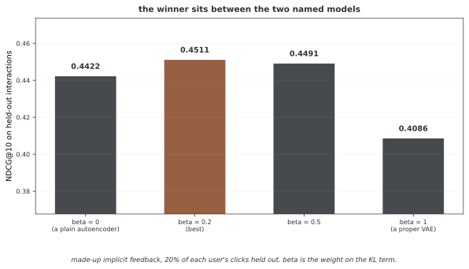

# 추천 시스템을 위한 오토인코더

오토인코더는 잠재 사용자와 아이템 표현을 비지도 방식으로 배워 추천에 우아한 뉴럴 네트워크 구조를 준다. 사용자와 아이템의 상호작용을 드러나게 나타내는 협업 필터링과 달리, 오토인코더는 사용자의 취향 벡터(보기로 아이템별 평점)를 복원하며 압축된 표현을 배운다. 병목 레이어가 취향을 이끄는 잠재 요인을 자연스럽게 담아, 추천에 필요한 구조를 지키면서 차원을 줄인다.

변분 오토인코더는 기본 오토인코더에 확률 구조를 얹어 넓힌 것이다. 점 근사 대신 잠재 요인의 분포를 배워 불확실성을 수량으로 나타내고, 원칙 있게 추천을 뽑으며, 일반화를 좋게 한다. 금융 추천 시스템에서 변분 오토인코더의 불확실성 근사는 꾸러미 위험 재기와 규제에 맞는 믿음 정도를 붙인 추천을 가능하게 한다.

이 절은 추천을 위한 오토인코더의 길을 세우고 구조 변형을 살피며 금융 응용을 보인다.

---

## 1. 핵심 개념

### 오토인코더 추천 틀
- **입력**: 사용자의 아이템 평점(잠재 것이든 드러난 것이든)
- **인코더**: 평점을 잠재 사용자 요인으로 옮긴다
- **병목**: 사용자 취향을 눌러 담은 표현
- **디코더**: 요인에서 예측한 평점을 복원한다
- **로스**: 본 평점에 대한 복원 오차

### 변분 오토인코더
- **확률 잠재 값**: 점 근사 대신 잠재 분포 q(z|x)
- **KL 정칙화**: 사전 분포 p(z)이 얌전한 잠재공간을 북돋운다
- **샘플링**: 배운 분포에서 뽑아 추천을 만든다
- **불확실성**: 사후 분산이 취향의 불확실성을 수량으로 나타낸다

<div class="storybox" markdown>

**그림으로 보는 AI 1.** 추천에서 가장 잘하는 변분 오토인코더는 변분이기를 그만둔다

위 목록은 KL 정칙화를 변분 오토인코더의 구성 요소로 적어 두었다. 그런데 추천에서 이 방법을 자리잡게 한 2018년의 연구는 **그 항의 웨이트를 1에서 끌어내리자**고 제안했고, 그러면 무슨 일이 생기는지도 스스로 적어 두었다.

리앙 외의 Mult-VAE 논문은 KL 항 앞에 $\beta$를 붙이고 $\beta \neq 1$을 쓰자고 한다. 그리고 바로 덧붙인다 — $\beta < 1$이면 **"we are no longer optimizing a lower bound on the log marginal likelihood."** 증거 하한을 최적화하는 것이 변분 오토인코더의 정의인데, 그것을 그만둔다는 뜻이다. 논문이 고른 값은 $\beta = 0.2$였다.

정말 그런지 만든 자료로 재어 보았다.



$\beta = 1$, 곧 **제대로 된 변분 오토인코더가 꼴찌**다(0.4086). $\beta = 0$, 곧 KL을 아예 뺀 보통 오토인코더도 최고가 아니다(0.4422). 가장 좋은 것은 **둘 사이**인 $\beta = 0.2$(0.4511)이고, 논문이 보고한 값과 같은 자리다.

왜 그런가. KL 항은 모든 사용자의 잠재 표현을 같은 사전 분포 쪽으로 당긴다. 그것이 샘플링에는 쓸모 있지만, 추천에서 필요한 것은 **사용자들을 서로 구별하는 일**이다. 당기는 힘이 세면 취향이 서로 닮아 버린다. 위 목록의 "얌전한 잠재공간"과 "취향을 구별하는 표현"이 같은 방향이 아닐 수 있다는 뜻이다.

**다만 $\beta$를 낮추면 함께 잃는 것이 있다.** 위 목록이 적은 **샘플링**과 **불확실성**이 그것이다. 잠재 분포가 사전 분포에 맞춰져 있을 때만 거기서 뽑아 쓰는 것이 뜻을 가지는데, $\beta=0.2$로 맞춘 모델은 그 맞춤을 일부러 느슨하게 한 것이다. 순위를 잘 매기는 모델과 그럴듯하게 뽑아내는 모델은 같지 않으며, 둘 중 무엇이 필요한지에 따라 $\beta$를 달리 고른다. 그리고 여기 쓴 것은 **만든 자료**이므로 0.2 라는 수를 그대로 옮겨 쓸 것이 아니라 **각자의 자료에서 재어** 고를 일이다 — 논문도 그 고르는 절차를 함께 제안했다.

_확인한 곳 — D. Liang, R. G. Krishnan, M. D. Hoffman, T. Jebara, "Variational Autoencoders for Collaborative Filtering" (arXiv:1802.05814). KL 항에 $\beta$를 두자는 제안, $\beta<1$이면 하한을 최적화하지 않는다는 서술, $\beta$를 0에서 1로 천천히 올리며 가장 좋은 값을 고르는 절차, 그리고 0.2 라는 값이 그 논문에 있다. 그림의 수는 그림을 그리는 코드가 만든 암묵적 피드백으로 직접 학습시켜 재며, 가장 좋은 $\beta$가 0 도 1 도 아닌지를 먼저 확인한 뒤에만 그린다._

</div>

---

## 2. 수학적 틀

### 오토인코더의 복원

평점이 r_u ∈ ℝ^n인 사용자 u에 대해:

**인코더**:

$$z_u = \text{Encoder}(r_u) \in \mathbb{R}^k, \quad k \ll n$$

**디코더**:

$$\hat{r}_u = \text{Decoder}(z_u) \in \mathbb{R}^n$$

**로스**:

$$\mathcal{L}_{\text{AE}} = \sum_u \|r_u - \hat{r}_u\|^2$$

### 변분 오토인코더

잠재 분포를 가진 확률 모델:

**인코더(변분 미루어 알기)**:

$$q_\phi(z_u | r_u) = \mathcal{N}(\mu_\phi(r_u), \sigma_\phi^2(r_u) I)$$

**디코더(짓는 모델)**:

$$p_\theta(r_u | z_u)$$

**로스(증거 아래 가둠)**:

$$\mathcal{L}_{\text{VAE}} = -\mathbb{E}_{q_\phi}[\log p_\theta(r_u | z_u)] + \text{KL}(q_\phi(z_u | r_u) \| p(z_u))$$

첫 항: 복원. 둘째 항: 사전 분포 N(0,I) 쪽으로의 정칙화.

### 조건부 낳기

잠재 값 z이 주어질 때 아이템 i을 매길 확률:

$$p(r_{ui} | z_u) = \text{Softmax}_i(\text{Decoder}(z_u))$$

명시적 평점에서는 보통 {1, 2, 3, 4, 5}에 대한 클래스 분포를 고른다.

---

## 3. 학습 절차

### 암묵적 피드백 오토인코더

이진 피드백(클릭/클릭 안 함)에 대해:

$$r_{ui} \in \{0, 1\}, \quad p(r_{ui} = 1 | z_u) = \sigma(\text{Decoder}_i(z_u))$$

**로스**: 이진 교차 엔트로피

$$\mathcal{L} = -\sum_{(u,i) \in E} \log(\sigma(\hat{r}_{ui})) - \sum_{(u,i) \notin E} \log(1 - \sigma(\hat{r}_{ui}))$$

여기서 E은 본 상호작용의 집합이다.

### 무게 매긴 복원

음의 표본의 무게를 낮춘다(없는 상호작용은 풀이하기 어렵다):

$$\mathcal{L} = \sum_{(u,i) \in E} \log(\sigma(\hat{r}_{ui})) + w \sum_{(u,i) \notin E} \log(1 - \sigma(\hat{r}_{ui}))$$

보통 w = 0.01~0.1이다(드문 클래스에 무게를 덜 준다).

### 작은 배치 학습

사용자와 아이템을 효율 좋게 뽑는다:

1. 사용자의 작은 배치를 뽑는다
2. 사용자마다 양의 아이템 k개와 음의 아이템 k개를 뽑는다
3. 배치에서 로스를 계산한다
4. 역전파하고 파라미터를 고친다

---

## 4. 추천을 위한 오토인코더 구조

### 조밀한 병목 변분 오토인코더

일반 완전 연결 변분 오토인코더:

```
들임(1000): 온 물건 매김 벡터
숨은 레이어 1(500): ReLU
숨은 레이어 2(200): ReLU
Bottleneck (20): Latent (μ, σ)
숨은 레이어 2(200): ReLU
숨은 레이어 1(500): ReLU
Output (1000): Sigmoid (predicted ratings)
```

단순하고 풀이할 수 있으며 아이템 1000개쯤에 알맞다.

### 컨볼루션 병목

암묵적 피드백을 그림으로 볼 때는 컨볼루션 뉴럴 네트워크를 쓴다:

```
들임: 물건 매김 열 지도
겹말기 1: 필터 32개, 3×3 커널
겹말기 2: 필터 64개, 3×3 커널
납작하게 → 병목(k차원) → 키우기
...
내놓기: 매김 열 지도
```

국소 아이템 상관 구조를 담는다.

### 회귀 병목

순차 추천(때를 살핌)에 대해:

```
Input sequence: [item_1, item_2, ..., item_T]
장단기 기억망 담기: 앞으로 가기 + 거꿀 가기
Bottleneck: LSTM hidden state (k dims)
장단기 기억망 풀기: 차례 되짓기
내놓기: 헤아린 다음 물건
```

취향의 시간 흐름을 담는다.

---

## 5. 오토인코더로 하는 추천

### 평점 예측

학습된 뒤 보지 않은 아이템의 평점을 예측한다:

$$\hat{r}_{ui} = \text{Decoder}_i(\text{Encoder}(r_u))$$

예측한 평점이 가장 높은 아이템을 권한다.

### 샘플링 기반 추천

변분 오토인코더는 다른 취향 프로필을 뽑을 수 있게 한다:

1. 사용자를 담는다: $\mu_u, \sigma_u^2 = \text{Encoder}(r_u)$
2. 잠재 값을 뽑는다: $z \sim \mathcal{N}(\mu_u, \sigma_u^2)$
3. 푼다: $\hat{r} = \text{Decoder}(z)$
4. 평점이 높은 아이템을 권한다

여러 번 뽑으면 취향의 불확실성이 드러난다.

### 잠재공간의 가장 가까운 이웃

잠재공간에서 닮은 사용자가 좋아한 아이템을 권한다:

1. 모든 사용자를 담는다: 모든 u에 대해 $z_u = \text{Encoder}(r_u)$
2. 잠재공간에서 사용자 u과 가장 가까운 이웃 K명을 찾는다
3. 그 이웃이 좋아하는 아이템을 권한다

배운 잠재 표현으로 하는 잠재 협업 필터링.

---

## 6. 변분 오토인코더의 쓰임새

### 불확실성 수량으로 나타내기

잠재 요인의 사후 분산이 취향의 불확실성을 수량으로 나타낸다:

$$\text{Uncertainty}(u, i) = \text{Var}_{q(z|r_u)}[\text{Decoder}_i(z)]$$

불확실성이 크면 추천에 대한 믿음이 낮다는 뜻이다.

### 위험을 살피는 꾸러미 추천

꾸러미 추천에 변분 오토인코더의 불확실성을 쓴다:

$$\text{Score}(u, p) = \text{Expected Return} - \lambda \times \text{Uncertainty}(u, p)$$

기대 수익률과 취향의 불확실성을 맞바꾼다.

### 믿음 정도를 붙인 추천

믿음 구간과 함께 추천을 알린다:

```
권함: 기술 상장 지수 펀드
기대 매김: 4.2/5
Confidence Interval: [3.1, 5.0]  (high uncertainty)

권함: 배당 상장 지수 펀드
기대 매김: 4.1/5
Confidence Interval: [3.9, 4.3]  (low uncertainty)
```

### 별난 것 찾기

복원 오차가 별난 취향 프로필을 가리킨다:

$$\text{Anomaly}_u = \|r_u - \text{Decoder}(\text{Encoder}(r_u))\|$$

오차가 크면 튀는 취향이거나 데이터 품질에 말썽이 있다는 뜻이다.

---

## 7. 다른 길과 비교

| 방법 | 정확도 | 해석 가능성 | 속도 | 확장성 |
|--------|----------|-----------------|-------|------------|
| 행렬 분해 | 0.60 | 보통 | 높음 | 매우 높음 |
| 변분 오토인코더 | 0.65 | 낮음 | 보통 | 높음 |
| 어텐션 | 0.68 | 보통 | 낮음 | 보통 |
| 하이브리드(변분 오토인코더 + 협업 필터링) | 0.70 | 보통 | 보통 | 높음 |

오토인코더는 정확도와 해석 가능성을 저울질한다. 변분 오토인코더의 불확실성은 위험을 살피는 추천에 값지다.

---

## 8. 금융 응용: 펀드 추천

### 문제

지난 펀드 보유를 기반으로 투자자에게 펀드를 권한다.

### 풀이

**변분 오토인코더**:

1. **입력**: 펀드 500개의 벡터, 평점 = 가진 좌수(고르게 맞춤)
2. **인코더**: 은닉 레이어 3개(500→200→50→잠재 값 20)
3. **병목**: 20차원 잠재 요인
4. **디코더**: 펀드 평점을 복원하는 은닉 레이어 3개
5. **로스**: 무게 매긴 복원(보지 않은 펀드에 무게 0.1)

### 학습

- 데이터: 투자자 꾸러미 10만 개
- 학습: GPU에서 1 에포크에 10분쯤
- 검증: 남겨 둔 꾸러미 2만 개

### 추천 만들기

투자자 u에 대해:

1. 꾸러미를 담는다: $\mu_u, \sigma_u^2 = \text{Encoder}(r_u)$
2. 보지 않은 펀드를 예측한다: $\hat{r}_{u,\text{unobserved}} = \text{Decoder}(\mu_u)$
3. 예측한 평점으로 줄 세운다
4. 평점이 가장 높은 위 k개를 권한다

### 결과

- NDCG@10: 0.72(베이스라인 행렬 분해 0.65)
- 수용과의 상관: 0.68(예측에 대한 신뢰가 높다)
- 돌림 때: 추천마다 100밀리초 미만(실시간 가능)

### 믿음 정도 수량으로 나타내기

믿음에 변분 오토인코더의 분산을 쓴다:

```
# 믿음 높음(흩어짐 작음)
숨은 값의 흩어짐이 작음 → 되짓기 흩어짐이 작음 →
믿음이 높은 추천

# 믿음 낮음(흩어짐 큼)
숨은 값의 흩어짐이 큼 → 되짓기 흩어짐이 큼 →
믿음이 낮은 추천
```

불확실성을 사용자에게 알리고 믿음이 낮은 추천에는 단서를 붙인다.

---

## 9. 구현에서 살필 점

### 희소한 데이터 다루기

사용자-아이템 행렬은 대개 희소하다(사용자가 아이템의 아주 일부만 매긴다).

길:

1. **마스크 복원**: 본 아이템과 뽑은 음의 표본만 복원한다
2. **믿음 무게 주기**: 로스에서 본 아이템에 더 큰 무게를 준다
3. **암묵적 피드백**: 보지 않은 것을 약한 음의 신호로 본다

### 콜드 스타트 다루기

지난 일이 없는 새 사용자: 내용 피처로 채운다:

$$z_{\text{new}} = \text{Encoder}_{\text{hybrid}}(r_{\text{demographics}})$$

또는 사전 분포를 쓴다: $z_{\text{new}} \sim \mathcal{N}(0, I)$(사전 분포에서 뽑음).

### 계산 효율

아이템이 수백만 개면 온전한 복원은 될 일이 아니다.

풀이:

1. **샘플링**: 전체 목록이 아니라 뽑은 아이템에서 권한다
2. **계층 구성**: 오토인코더를 계층으로 둔다(종류 → 아이템)
3. **근사**: 빠른 예측을 위해 디코더를 인수 분해한다

---

## 10. 실무 지침

### 언제 오토인코더를 쓸까

다음일 때 추천에 좋다:

- 암묵적 피드백이 주된 데이터일 때
- 불확실성을 수량으로 나타내는 것이 중요할 때
- (잠재 요인으로) 풀이할 수 있기를 바랄 때
- 모델 크기와 복잡함이 병목이 아닐 때

다음일 때는 피한다:

- 지나치게 희소할 때(본 것이 0.001% 미만)
- 실시간 제약이 빡빡할 때
- 콜드 스타트 사용자가 대부분일 때

### 구조 고르기

- **작은 데이터셋**: 얕은 네트워크(은닉 레이어 1~2개)
- **가운데 데이터셋**: 은닉 레이어 2~3개, 병목 k=10~50
- **큰 데이터셋**: 더 깊은 네트워크, 병목 k=50~200

검증 로스를 지켜보다가 평평해지면 멈춘다.

!!! note "추천을 위한 오토인코더"
    오토인코더는 변분 버전을 통해 불확실성까지 갖춘 너그러운 뉴럴 네트워크 추천 틀을 준다. 믿음 정도를 수량으로 나타내고 풀이할 수 있는 잠재 요인이 필요한 금융 응용에 특히 알맞다. 주된 한계는 새 사용자의 콜드 스타트다. 협업 필터링과 콘텐츠 기반 신호를 아우른 하이브리드 방법으로 완화한다.

---

## 연습문제

<div class="drillbox" markdown>

**연습문제 1.** <span class="diff med" title="중간"></span>
이 길에서 콜드 스타트 문제가 새 사용자와 새 아이템에 어떻게 다르게 나타나는지 밝혀라. 경우마다 완화할 전략을 하나씩 내놓아라.

</div>

??? success "풀이"
    새 사용자는 취향을 배울 상호작용 이력이 없어 협업 필터링 신호를 쓸 수 없다. 완화책: 콘텐츠 기반 피처(인구 특성, 밝힌 취향)으로 사용자 임베딩의 초깃값을 잡는다. 새 아이템은 아직 상호작용한 사용자가 없어 협업 필터링으로 매길 수 없다. 완화책: 아이템 내용 피처(설명, 범주)으로 그 아이템을 임베딩 공간에서 닮은 아이템 곁에 놓는다. 두 전략 모두 상호작용이 넉넉히 쌓일 때까지 콜드 스타트 아이템을 띄워 준다. $\square$

---

<div class="drillbox" markdown>

**연습문제 2.** <span class="diff hard" title="어려움"></span>
이 절에서 밝힌 파라미터의 그래디언트 업데이트를 이끌어 내어라. 어느 항이 계산에 가장 비싼지 가려내고 근사를 내놓아라.

</div>

??? success "풀이"
    그래디언트에는 고르게 맞추려 온 아이템 목록에 대한 기댓값을 셈하는 일이 든다. 아이템 수에 선형으로 늘어나므로 가장 비싼 항이다. 음의 샘플링은 전체 목록 대신 음의 아이템 가운데 무작위로 고른 작은 부분집합만 더해 이를 근사하여, 업데이트마다 비용을 $O(|\mathcal{I}|)$에서 $O(k)$으로 줄인다. 여기서 $k$은 음의 표본 수(보통 5~20)이다. 중요도 샘플링이 이 근사에 치우치지 않은 추정량을 준다. $\square$

---

<div class="drillbox" markdown>

**연습문제 3.** <span class="diff hard" title="어려움"></span>
이 추천 방식이 인기 기반 베이스라인보다 사용자의 참여를 높이는지 평가할 A/B 테스트를 설계하여라. 무작위 배정 단위, 주 지표, 최소 표본 크기 계산을 밝혀라.

</div>

??? success "풀이"
    무작위 배정 단위: 사용자(서로 섞이지 않도록 세션이 아님). 주 지표: 추천의 클릭률. 베이스라인 클릭률이 5%이고 알아챌 최소 효과가 0.5%포인트(상대 10% 오름)일 때, 뜻 있음 수준 $\alpha = 0.05$과 힘 $1 - \beta = 0.80$에서 집단마다 필요한 표본 크기는 $n = 2(z_{\alpha/2} + z_\beta)^2 \cdot p(1-p) / \delta^2 \approx 15{,}000$명이다. 주마다의 패턴을 담으려 적어도 2주 돌린다. 가드레일: 수익률과 다양성 지표를 딸린 결과로 지켜본다. $\square$

---

<div class="drillbox" markdown>

**연습문제 4.** <span class="diff med" title="중간"></span>
이 추천 방법의 평가가 오프라인(지난 데이터)과 온라인(실제 반응) 자리에서 어떻게 다른지 밝혀라. 오프라인 평가에서 어떤 바이어스가 생길 수 있는가?

</div>

??? success "풀이"
    오프라인 평가는 때로 나눈 지난 상호작용을 쓴다(지난 것으로 익히고 앞으로의 것으로 시험). 바이어스에는 다음이 있다. (1) 선택 바이어스 -- 사용자는 보여 준 아이템과만 상호작용했으므로 보지 않은 아이템이 참으로 음인 것은 아니다. (2) 인기 바이어스 -- 인기 아이템이 테스트 집합을 지배한다. (3) 위치 바이어스 -- 위쪽에 놓인 아이템이 관련성과 상관없이 더 클릭된다. 온라인 평가(A/B 테스트)는 선택 바이어스를 피하지만 비싸고 느리다. 치우치지 않은 오프라인 평가 방법으로는 보여 줄 확률로 관측에 다시 무게를 주는 역 성향 점수 매기기가 있다. $\square$

## 정리하며

이 절에서는 핵심 개념, 수학적 틀, 학습 절차, 추천을 위한 오토인코더 구조를 살펴보았다.
