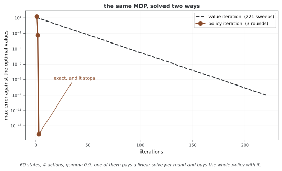

# 32.4.3 폴리시 반복

**폴리시 반복**은 폴리시 평가와 폴리시 개선을 번갈아 하여 최적 폴리시를 찾는다. 마르코프 결정 과정의 고전 동적 계획법 알고리즘 둘 가운데 하나다.

---

## 1. 알고리즘

$$\pi_0 \xrightarrow{\text{evaluate}} V_{\pi_0} \xrightarrow{\text{improve}} \pi_1 \xrightarrow{\text{evaluate}} V_{\pi_1} \xrightarrow{\text{improve}} \pi_2 \to \cdots \to \pi^*$$

### 의사 코드

```
모든 s ∈ S에 대해 π(s)을 아무렇게나 첫 값으로 둔다

Repeat:
    # 폴리시 따지기
    Compute V_π (solve V = r_π + γ P_π V)

    # 폴리시 좋게 하기
    policy_stable = True
    For each s ∈ S:
        old_action = π(s)
        π(s) = argmax_a [R(s,a) + γ Σ_s' P(s'|s,a) V_π(s')]
        If old_action ≠ π(s):
            policy_stable = False

    If policy_stable:
        Return π, V_π  (optimal)
```

---

## 2. 수렴

1. 폴리시 평가마다 정확한 $V_\pi$을 낸다
2. 폴리시 개선마다 엄밀히 더 좋은 폴리시를 낸다(최적이면 그대로)
3. 결정론적 폴리시는 많아야 $|\mathcal{A}|^{|\mathcal{S}|}$개다
4. 그러므로 폴리시 반복은 유한한 스텝에 끝난다

실제로 폴리시 반복은 스텝마다 크게 좋아지므로 아주 적은 반복으로 수렴한다(웬만한 마르코프 결정 과정에서 흔히 5~10번).

<div class="storybox" markdown>

**그림으로 보는 AI 1.** 값을 세는 대신 폴리시를 세기로 한 사람

벨먼이 최적성 원리를 내놓은 지 세 해 뒤인 1960년, MIT 의 로널드 하워드(Ronald A. Howard)가 《동적 계획법과 마르코프 과정》이라는 136쪽짜리 책을 냈다. 거기 담긴 것이 이 절의 알고리즘이고, 지금도 그의 이름을 따 하워드의 폴리시 개선 알고리즘이라 부른다.

바꾼 자리가 한 군데다. 가치 반복은 **밸류를 조금씩 고쳐 가며** 그에 딸린 폴리시가 저절로 좋아지기를 기다린다. 하워드는 **폴리시를 세기로** 했다 — 폴리시를 하나 고정해 그 밸류를 끝까지 정확히 풀고, 그 밸류로 폴리시를 한 번 고친다. 위 2절의 네 줄짜리 수렴 논증이 그래서 성립한다. 폴리시는 유한하고 매번 엄밀히 좋아지므로 **끝날 수밖에 없다.**



상태 60개짜리 무작위 MDP 에 둘을 돌려 보았다. 가치 반복은 허용오차 $10^{-10}$ 에 닿기까지 **221번** 쓸어야 했다. 폴리시 반복은 **세 번**에 끝났고, 그때 오차는 반올림 수준이다. 위 문단이 말한 "5~10번"보다도 적다.

**그래도 공짜는 아니고, 값을 내는 자리가 옮겨 갔을 뿐이다.** 아래 3절의 표가 그것을 적어 두었다 — 폴리시 평가를 정확히 하려면 되풀이마다 $O(|\mathcal{S}|^3)$ 짜리 선형 풀이를 해야 한다. 가치 반복의 한 걸음은 그보다 훨씬 싸다. 그러니 "세 번이면 끝난다"와 "빠르다"는 같은 말이 아니다. 상태가 수백만이면 $|\mathcal{S}|^3$ 선형 풀이를 한 번도 못 하는데, 그때는 걸음 수가 적다는 것이 아무 쓸모가 없다.

4절이 다룰 **수정(잘라낸) 폴리시 반복**이 바로 이 두 극단 사이를 메우는 장치다. 정확히 풀지도, 한 번만 쓸지도 않고 몇 번만 쓸고 폴리시를 고친다. 두 방법은 서로 다른 알고리즘이라기보다 **한 손잡이의 양 끝**이다.

_확인한 곳 — R. A. Howard, *Dynamic Programming and Markov Processes*, Technology Press of MIT (1960), 136쪽. 폴리시 반복을 세운 책이며 하워드의 폴리시 개선 알고리즘이라는 이름이 여기서 왔다. 그림의 걸음 수는 그림을 그리는 코드가 같은 MDP 에 두 방법을 돌려 직접 세며, 폴리시 반복이 실제로 최적에 닿았는지를 `assert` 로 확인한 뒤에 그린다._

</div>

---

## 3. 계산 비용

| 구성 요소 | 비용 |
|-----------|------|
| 폴리시 평가(정확) | 되풀이마다 $O(\|\mathcal{S}\|^3)$ |
| 폴리시 평가(되풀이) | 쓸기 $k$번에 $O(\|\mathcal{S}\|^2 \|\mathcal{A}\| \cdot k)$ |
| 폴리시 개선 | 되풀이마다 $O(\|\mathcal{S}\|^2 \|\mathcal{A}\|)$ |
| 전체 반복 횟수 | 가장 나쁜 경우 보통 $O(\|\mathcal{S}\| \|\mathcal{A}\|)$ |

---

## 4. 변형

### 수정 폴리시 반복

폴리시 평가를 수렴할 때까지 돌리지 않는다. 개선하기 전에 스윕을 $k$번만 한다:

$$V^{(k)} \approx V_\pi \quad \text{(approximate evaluation)}$$

$$\pi' \leftarrow \text{greedy}(V^{(k)})$$

이는 폴리시 반복($k = \infty$)와 가치 반복($k = 1$) 사이를 잇는다.

### 일반화된 폴리시 반복(GPI)

평가와 개선을 반드시 끝까지 하지는 않으면서 번갈아 하는 생각을 **일반화된 폴리시 반복**이라 부른다. 대부분의 강화학습 알고리즘을 GPI의 예로 볼 수 있다:

- **폴리시 평가**: 지금 $\pi$에 대해 $V$을 더 맞게 만드는 어떤 과정이든
- **폴리시 개선**: 지금 $V$에 대해 $\pi$을 더 그리디하게 만드는 어떤 과정이든

GPI은 일부만 고쳐도 $V$과 $\pi$을 모두 최적값 쪽으로 몰아간다.

---

## 5. 폴리시 반복과 가치 반복

| 항목 | 폴리시 반복 | 가치 반복 |
|---------|-----------------|-----------------|
| 평가 | 완전(정확한 $V_\pi$) | 없음(쓸기 1번 = 벨먼 최적 백업 1번) |
| 되풀이마다 비용 | 높음(완전한 평가) | 낮음(쓸기 한 번) |
| 되풀이 횟수 | 적음(큰 스텝) | 많음(작은 스텝) |
| 전체 효율 | 작은 마르코프 결정 과정에서 흔히 빠름 | 큰 마르코프 결정 과정에서 흔히 빠름 |
| 수렴 | 유한 스텝(정확) | 점근($\epsilon$최적) |

---

## 연습문제

<div class="drillbox" markdown>

**연습문제 1.** <span class="diff med" title="중간"></span>
이 절의 주제와 관련된 단순한 마르코프 결정 과정을 생각하여라. 상태 3개와 액션 2개의 작은 예에서 관련 양을 손으로 계산하여라.

</div>

??? success "풀이"
    상태 $S = \{s_1, s_2, s_3\}$과 액션 $A = \{a_1, a_2\}$을 정의한다. 전이 확률과 리워드를 정한다. 상태-액션 쌍마다 기대 즉시 리워드와 전이 분포를 계산한다. 이 절의 정의와 식으로 원하는 양을 계산한다. 상태 공간이 작아 정확히 계산할 수 있으므로 추상적인 식이 구체적인 숫자로 어떻게 옮겨지는지 보여 준다. $\square$

---

<div class="drillbox" markdown>

**연습문제 2.** <span class="diff med" title="중간"></span>
이 절에서 다룬 핵심 성질이나 수렴 결과를 증명하라. 가정을 분명히 적고 어느 것이 꼭 필요한지 가려내어라.

</div>

??? success "풀이"
    증명은 그 연산자에 축약 사상 정리를 적용해 따라온다. 할인율이 $\gamma < 1$인 유한 마르코프 결정 과정을 가정하면 그 연산자는 상한 노름에서 $\gamma$-축약이다. 바나흐 고정점 정리에 따라 반복 적용하면 $k$이 반복 횟수일 때 속도 $O(\gamma^k)$으로 유일한 고정점에 수렴한다. 유한성 가정이 리워드의 유계성을 보장하고 할인율 $\gamma < 1$이 축약 성질에 꼭 필요하다. $\square$

---

<div class="drillbox" markdown>

**연습문제 3.** <span class="diff hard" title="어려움"></span>
이 절에서 다룬 알고리즘이나 계산을 단순한 격자 세계에 대해 파이썬으로 구현하라. $\epsilon = 0.01$ 안으로 수렴하는 데 필요한 반복 횟수를 보고하라.

</div>

??? success "풀이"
    모서리에 종료 상태가 있고 균등 무작위 폴리시를 쓰는 $4 \times 4$ 격자 세계가 전형적인 시험 사례다. 구현은 모든 상태의 최대 변화량이 $\epsilon$ 아래로 떨어질 때까지 갱신 규칙을 반복한다. 할인율에 따라 보통 50~200번 반복하면 수렴한다. 핵심 구현 세부는 동기 갱신보다 빨리 수렴하도록 제자리 갱신(가우스-자이델 방식)을 쓰는 것이다. $\square$

---

<div class="drillbox" markdown>

**연습문제 4.** <span class="diff med" title="중간"></span>
이 절에서 다룬 방법에 내재한 근본 한계나 트레이드오프를 논하라. 뒤 장의 더 발전된 방법이 이 한계를 어떻게 극복하는가?

</div>

??? success "풀이"
    표 기반 방법은 모든 상태(어쩌면 액션까지)를 나열해야 하는데 연속이거나 고차원인 상태 공간에서는 불가능하다. 차원의 저주는 상태 변수의 수에 따라 상태 수가 지수적으로 늘어남을 뜻한다. 함수 근사(38~39장)는 그 함수를 뉴럴 네트워크로 파라미터화하고 비슷한 상태들에 걸쳐 일반화해 이를 넘는다. 다만 새 어려움이 생긴다. 수렴이 더는 보장되지 않으며 함수 근사, 부트스트래핑, 오프폴리시 학습이 함께 있으면(죽음의 삼각) 발산이 일어날 수 있다. $\square$

## 정리하며

폴리시 반복은 지금 폴리시의 평가와 개선을 번갈아 하여 정확히 최적 폴리시를 찾는 강력한 알고리즘이다. 강점은 적은 반복으로 빨리 수렴하는 것이지만 완전한 폴리시 평가 때문에 반복마다 비쌀 수 있다. GPI 틀은 이 번갈아 하기를 넓혀 대부분의 강화학습 알고리즘을 아우른다.
