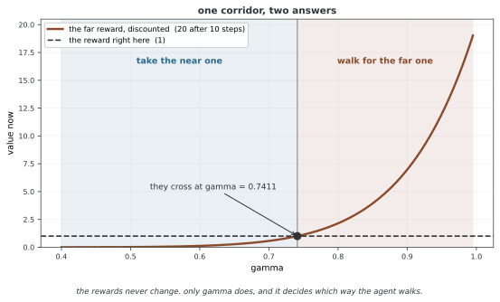

# 32.2.5 할인율

---

## 1. 정의

**할인율** $\gamma \in [0, 1]$은 에이전트가 앞으로의 리워드를 지금의 리워드에 비교하여 얼마나 값지게 여기는지 정한다. 할인된 리턴은 다음과 같다:

$$G_t = \sum_{k=0}^{\infty} \gamma^k R_{t+k+1} = R_{t+1} + \gamma R_{t+2} + \gamma^2 R_{t+3} + \cdots$$

---

## 2. 해석

할인율은 여러 가지로 해석된다:

### 수학: 수렴 보장

유계 리워드 $|R| \leq R_{\max}$와 $\gamma < 1$에서:

$$|G_t| \leq \sum_{k=0}^{\infty} \gamma^k R_{\max} = \frac{R_{\max}}{1 - \gamma}$$

할인하지 않으면($\gamma = 1$) 연속형 과제에서 리턴이 발산할 수 있다.

### 경제: 화폐의 시간 가치

오늘의 1달러가 내일의 1달러보다 값지다. 할인율이 이 시간 선호를 담으며 금융의 **할인율**과 비슷하다:

$$\gamma = \frac{1}{1 + r}$$

여기서 $r$은 기간마다의 이자율이다.

### 확률: 살아남을 확률

$\gamma$는 스텝마다 과정이 이어질 확률로 해석할 수 있다. 확률 $1 - \gamma$로 에피소드가 끝나며 유효 지평이 평균 $\frac{1}{1-\gamma}$의 기하 분포가 된다.

### 계산: 유효 지평

**유효 지평**은 리턴에 크게 영향을 주는 앞으로의 스텝 수다:

$$\text{Effective Horizon} \approx \frac{1}{1 - \gamma}$$

| $\gamma$ | 유효 지평 | 해석 |
|-----------|------------------|----------------|
| 0.0 | 1스텝 | 아주 근시안적 |
| 0.9 | 10스텝 | 단기 계획 |
| 0.95 | 20스텝 | 중기 |
| 0.99 | 100스텝 | 장기 계획 |
| 0.999 | 1000스텝 | 아주 긴 지평 |
| 1.0 | $\infty$ | 할인하지 않음(에피소드형 과제에만) |

---

## 3. 최적 폴리시에 주는 영향

할인율이 어떤 폴리시가 최적인지에 직접 영향을 준다:

- **낮은 $\gamma$(근시안적)**: 에이전트가 즉시 리워드를 앞세우고 장기적 결과를 무시한다. 장기 이득을 위해 단기 손해를 감수하는 전략을 놓칠 수 있다.
- **높은 $\gamma$(원시안적)**: 에이전트가 장기적 결과를 살피지만 리턴 추정의 분산이 크고 값이 전파되는 것이 느려 학습하기가 어려워진다.

### 할인율과 편향-분산 트레이드오프

| 낮은 $\gamma$ | 높은 $\gamma$ |
|--------------|---------------|
| 리턴 추정의 분산이 작음 | 분산이 큼 |
| 바이어스가 큼(미래를 무시) | 바이어스가 작음 |
| 빨리 수렴 | 느리게 수렴 |
| 장기 전략을 놓칠 수 있음 | 복잡한 전략을 배울 수 있음 |

**그림으로 보는 AI 1.** 만든 사람이 "완전히 임의"라고 적어 둔 수

미래의 리워드에 $\gamma^t$ 를 곱해 할인한다는 생각은 강화학습에서 나오지 않았다. 1937년에 스물두 살의 폴 새뮤얼슨(Paul Samuelson)이 《경제학 연구 리뷰》에 실은 「효용 측정에 관한 소고」가 그 출처다. 사람이 시간에 걸친 선택을 어떻게 하는지를 다루려고, **때마다의 만족을 지수로 할인해 더한다**는 형태를 적어 넣었다.

놀라운 것은 그가 같은 글에서 그 형태를 변호하지 않았다는 점이다. 오히려 못 박아 두었다 — 개인이 그런 적분을 최대화하도록 행동한다고 가정하는 것은 **"완전히 임의(completely arbitrary)"** 라고. 사람이 실제로 그렇게 고른다는 증거가 있어서 고른 식이 아니라, **다루기 쉬워서** 고른 식이라는 뜻이다. 경제학은 그 경고를 적어 둔 채로 이 식을 표준으로 삼았고, 강화학습도 똑같이 물려받았다.

위 표가 "낮은 γ는 장기 전략을 놓칠 수 있다"고 적은 것을 복도 하나로 보면 이렇다. 왼쪽으로 가면 **지금 1**을 받고 끝나고, 오른쪽으로 열 칸 걸으면 **20**을 받고 끝난다. 어느 쪽이 옳은가는 $\gamma$ 가 정한다. 갈림 지점은 $\gamma^{\*}=(1/20)^{1/10}=0.7411$ 로 정확히 떨어지고, 0.74에서는 가까운 쪽을, 0.75에서는 먼 쪽을 고른다.

**리워드는 하나도 바뀌지 않았다.** 환경이 주는 것은 그대로이고 $\gamma$ 만 움직였는데 **최적 폴리시가 뒤집힌다.**

그래서 $\gamma$ 를 "학습을 안정시키는 손잡이"로만 다루면 절반만 본 것이다. 수렴 속도에 영향을 주는 것은 맞지만, 그보다 먼저 **무엇을 좋은 결과로 칠 것인지를 정하는 값**이다. 다음 절의 "특별한 경우"와 5절의 "감마 고르기"를 읽을 때, 고르는 일이 하이퍼파라미터 조정이 아니라 **문제 정의**라는 것을 기억하는 편이 낫다. 새뮤얼슨이 임의라고 적어 둔 자리가 바로 거기다.

_확인한 곳 — P. A. Samuelson, "A Note on Measurement of Utility", *Review of Economic Studies* (1937). 지수 할인 형태와, 개인이 그런 적분을 최대화한다고 가정하는 것이 "completely arbitrary" 라는 그의 단서가 그 글에 있다. 그림의 갈림 지점은 그림을 그리는 코드가 직접 셈하며, 해석적인 값과 맞는지 `assert` 로 확인한 뒤에 그린다._

---

## 4. 특별한 경우

### 감마 = 0: 근시안적 에이전트

$$G_t = R_{t+1}$$

에이전트가 즉시 리워드만 살피는 **그리디** 또는 **근시안적** 에이전트다. 최적 폴리시는 스텝마다 $R(s,a)$를 최대화한다.

### 감마 = 1: 할인하지 않은 리턴

$$G_t = \sum_{k=0}^{T-t-1} R_{t+k+1}$$

$T$가 유한한 에피소드형 과제에만 올바르다. 에이전트가 앞으로의 리워드를 모두 똑같이 다룬다. 많은 게임 응용에 쓰인다.

### 평균 리워드 설정

$\gamma \to 1$인 연속형 과제에서 다른 길은 **평균 리워드** 기준이다:

$$r(\pi) = \lim_{T \to \infty} \frac{1}{T} \sum_{t=1}^{T} \mathbb{E}_\pi[R_t]$$

이는 모든 타임스텝을 똑같이 다루면서 발산을 피한다.

---

## 5. 실제로 감마 고르기

### 지침

1. **에피소드형 과제**: $\gamma = 1.0$이나 $\gamma = 0.99$가 흔하다
2. **연속형 과제**: $\gamma < 1$이어야 한다. 보통 $0.95 \leq \gamma \leq 0.999$이다
3. **문제 의존성**: $\frac{1}{1-\gamma}$를 자연스러운 계획 지평에 맞춘다
4. **튜닝**: 흔히 튜닝해야 할 하이퍼파라미터로 다룬다

### 다른 하이퍼파라미터와의 상호작용

할인율은 다음과 얽혀 있다:

- **러닝레이트**: $\gamma$가 크면 안정을 위해 러닝레이트를 낮춰야 할 수 있다
- **에피소드 길이**: 에이전트가 에피소드의 끝을 "볼" 수 있을 만큼 $\gamma$가 커야 한다
- **리워드 스케일**: 값의 범위는 $\left[-\frac{R_{\max}}{1-\gamma}, \frac{R_{\max}}{1-\gamma}\right]$이다

---

## 6. 금융 응용

### 투자 지평에 맞추기

$\gamma$를 투자자의 시간 지평에 맞춘다:

| 투자자 유형 | 지평 | 권하는 $\gamma$ |
|--------------|---------|-------------------|
| 데이 트레이더 | 몇 시간에서 며칠 | 0.9~0.95 |
| 스윙 트레이더 | 며칠에서 몇 주 | 0.95~0.99 |
| 포지션 트레이더 | 몇 주에서 몇 달 | 0.99~0.995 |
| 장기 투자자 | 몇 달에서 몇 해 | 0.995~0.999 |

### 무위험 이자율과의 관계

무위험 이자율이 기간마다 $r_f$이면:

$$\gamma_{\text{financial}} = \frac{1}{1 + r_f}$$

연 무위험 이자율이 5%인 일간 데이터에서는 $\gamma \approx \frac{1}{1 + 0.05/252} \approx 0.9998$이다.

### 실제로 살필 것

- 거래 비용이 자연스럽게 인내심(더 큰 $\gamma$)을 선호하게 만든다
- 시장 미시 구조 효과는 낮은 $\gamma$(짧은 지평)에 더 알맞다
- 레짐이 바뀌면 적응형 $\gamma$나 상태에 의존하는 할인이 필요할 수 있다

---

## 연습문제

**연습문제 1.** 
이 절의 주제와 관련된 단순한 마르코프 결정 과정을 생각하여라. 상태 3개와 액션 2개의 작은 예에서 관련 양을 손으로 계산하여라.

??? success "풀이"
    상태 $S = \{s_1, s_2, s_3\}$과 액션 $A = \{a_1, a_2\}$를 정의한다. 전이 확률과 리워드를 정한다. 상태-액션 쌍마다 기대 즉시 리워드와 전이 분포를 계산한다. 이 절의 정의와 식으로 원하는 양을 계산한다. 상태 공간이 작아 정확히 계산할 수 있으므로 추상적인 식이 구체적인 숫자로 어떻게 옮겨지는지 보여 준다. $\square$

---

**연습문제 2.** 
이 절에서 다룬 핵심 성질이나 수렴 결과를 증명하라. 가정을 분명히 적고 어느 것이 꼭 필요한지 가려내어라.

??? success "풀이"
    증명은 그 연산자에 축약 사상 정리를 적용해 따라온다. 할인율이 $\gamma < 1$인 유한 마르코프 결정 과정을 가정하면 그 연산자는 상한 노름에서 $\gamma$-축약이다. 바나흐 고정점 정리에 따라 반복 적용하면 $k$가 반복 횟수일 때 속도 $O(\gamma^k)$로 유일한 고정점에 수렴한다. 유한성 가정이 리워드의 유계성을 보장하고 할인율 $\gamma < 1$이 축약 성질에 꼭 필요하다. $\square$

---

**연습문제 3.** 
이 절에서 다룬 알고리즘이나 계산을 단순한 격자 세계에 대해 파이썬으로 구현하라. $\epsilon = 0.01$ 안으로 수렴하는 데 필요한 반복 횟수를 보고하라.

??? success "풀이"
    모서리에 종료 상태가 있고 균등 무작위 폴리시를 쓰는 $4 \times 4$ 격자 세계가 전형적인 시험 사례다. 구현은 모든 상태의 최대 변화량이 $\epsilon$ 아래로 떨어질 때까지 갱신 규칙을 반복한다. 할인율에 따라 보통 50~200번 반복하면 수렴한다. 핵심 구현 세부는 동기 갱신보다 빨리 수렴하도록 제자리 갱신(가우스-자이델 방식)을 쓰는 것이다. $\square$

---

**연습문제 4.** 
이 절에서 다룬 방법에 내재한 근본 한계나 트레이드오프를 논하라. 뒤 장의 더 발전된 방법이 이 한계를 어떻게 극복하는가?

??? success "풀이"
    표 기반 방법은 모든 상태(어쩌면 액션까지)를 나열해야 하는데 연속이거나 고차원인 상태 공간에서는 불가능하다. 차원의 저주는 상태 변수의 수에 따라 상태 수가 지수적으로 늘어남을 뜻한다. 함수 근사(38~39장)는 그 함수를 뉴럴 네트워크로 파라미터화하고 비슷한 상태들에 걸쳐 일반화해 이를 넘는다. 다만 새 어려움이 생긴다. 수렴이 더는 보장되지 않으며 함수 근사, 부트스트래핑, 오프폴리시 학습이 함께 있으면(죽음의 삼각) 발산이 일어날 수 있다. $\square$

## 정리하며

할인율은 에이전트의 계획 지평과 즉시 리워드와 앞으로의 리워드 사이의 트레이드오프를 조절하는 근본 파라미터다. 어떻게 고르느냐가 최적 폴리시, 수렴 성질, 실제 성능에 크게 영향을 준다. 금융 응용에서 $\gamma$는 세우려는 전략의 투자 지평과 위험 취향에 맞춰야 한다.
