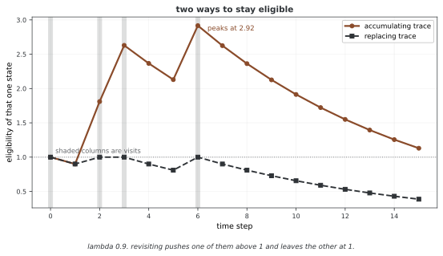

# 32.7.4 자격 추적(Eligibility Traces)

**자격 추적**은 최근에 들른 상태의 짧은 때 기억을 지녀 때 차이 방법과 몬테카를로 방법을 잇는 구조다. TD(λ)를 후방 관점으로 짜게 해 주고 λ 리턴을 효율 좋게 온라인으로 셈하게 한다.

---

## 1. 추적의 클래스

### 쌓이는 추적

$$e_t(s) = \gamma \lambda \, e_{t-1}(s) + \mathbb{1}[S_t = s]$$

들를 때마다 추적에 1을 더하고 스텝마다 추적이 $\gamma\lambda$만큼 스러진다. 여러 번 들르면 쌓인다.

### 바꿔 넣는 추적

$$e_t(s) = \begin{cases} 1 & \text{if } S_t = s \\ \gamma \lambda \, e_{t-1}(s) & \text{otherwise} \end{cases}$$

들를 때마다 쌓지 않고 추적을 1로 되돌린다. 실제로 더 잘될 때가 많다.

### 네덜란드 추적

$$e_t(s) = \gamma \lambda \, e_{t-1}(s) + \alpha(1 - \gamma \lambda \, e_{t-1}(s)) \mathbb{1}[S_t = s]$$

선형 함수 어림 자리에서 오프라인 λ 리턴 알고리즘을 정확히 되살리도록 설계되었다.

<div class="storybox" markdown>

**그림으로 보는 AI 1.** "자격"이라는 말은 시냅스를 두고 한 말이었다

왜 하필 **자격**(eligibility)인가. 추적이나 기억이라 부르면 될 것을 굳이 "자격 있음"이라 한 데에는 까닭이 있다. 이 말은 알고리즘이 아니라 **신경세포**를 두고 나왔다.

1972년에 해리 클로프(A. Harry Klopf)가 미 공군 케임브리지 연구소에서 낸 기술 보고서 「뇌 기능과 적응 시스템 — 이종 항상성 이론」이 출처다. 그가 내놓은 그림은 이렇다. 시냅스가 활동하면 그 시냅스는 **한동안 고쳐질 수 있는 상태**로 남는다. 곧 자격을 얻는다. 그 자격이 남아 있는 동안에 좋거나 나쁜 일이 닥치면 그때 비로소 고쳐지고, 자격이 스러진 뒤에 닥친 일은 그 시냅스를 건드리지 못한다.

늦게 오는 리워드를 **누구의 몫으로 돌릴 것인가**라는 문제에 대한 답을 생물학 쪽에서 적어 둔 셈이고, 위 식들의 $\gamma\lambda$ 거듭제곱이 바로 그 "한동안"이다.



위에 적은 두 추적이 갈리는 자리가 **같은 상태를 거듭 들렀을 때**다. 짧은 구간에서 네 번 들르게 해 보면 쌓이는 추적은 **2.92**까지 올라가고, 바꿔 넣는 추적은 올라가 봐야 **1**이다.

클로프의 그림에 더 가까운 쪽은 바꿔 넣는 추적이다. 시냅스가 "고칠 수 있는 상태"라면 그것은 **켜졌거나 꺼졌거나**이지 두 번 켜졌다고 세 배로 켜지지는 않는다. 위 문단이 "실제로 더 잘될 때가 많다"고 적어 둔 것도 그와 통한다 — 쌓이는 추적은 고리를 도는 상태에 자격을 과하게 몰아주고, 그만큼 갱신이 크게 흔들린다.

**다만 어느 쪽이 맞다고 정해진 것은 아니다.** 셋째 줄의 네덜란드 추적은 **생물학과 아무 상관 없이** 설계된 것이다 — 선형 함수 어림에서 오프라인 λ 리턴을 정확히 되살리려고 역산한 식이다. 비유가 알고리즘을 낳기는 했지만 알고리즘이 비유에 묶여 있지는 않다. 이 세 줄을 고를 때 묻는 것은 "어느 것이 뇌에 가까운가"가 아니라 **"내 문제에서 같은 상태를 얼마나 자주 다시 들르는가"** 다.

_확인한 곳 — A. H. Klopf, *Brain Function and Adaptive Systems: A Heterostatic Theory*, Technical Report AFCRL-72-0164, Air Force Cambridge Research Laboratories (1972). 시냅스가 한동안 고쳐질 자격을 지닌다는 생각과 "자격" 이라는 말이 거기서 왔다. 그림의 수는 그림을 그리는 코드가 위 두 식을 그대로 돌려 얻으며, 쌓이는 쪽이 1 을 넘고 바꿔 넣는 쪽이 넘지 않는다는 것을 `assert` 로 확인한 뒤에 그린다._

</div>

---

## 2. 자격 추적을 쓴 TD(λ)

```
Initialize V(s), e(s) = 0 for all s
잡: α, γ, λ

For each episode:
    S = initial state, e(s) = 0 for all s
    For each step:
        A ~ π(S)
        Take A, observe R, S'
        δ = R + γ V(S') - V(S)          # 때 차이 어긋남
        e(S) = e(S) + 1                   # 자취를 고친다(쌓임)
        For all s:
            V(s) ← V(s) + α δ e(s)       # 값을 고친다
            e(s) ← γ λ e(s)              # 자취를 스러뜨린다
        S ← S'
```

---

## 3. SARSA(λ) — 추적을 쓴 다스리기

자격 추적을 상태-액션 짝으로 넓힌다:

$$e_t(s, a) = \gamma \lambda \, e_{t-1}(s, a) + \mathbb{1}[S_t = s, A_t = a]$$

$$\delta_t = R_{t+1} + \gamma Q(S_{t+1}, A_{t+1}) - Q(S_t, A_t)$$

$$Q(s, a) \leftarrow Q(s, a) + \alpha \delta_t e_t(s, a) \quad \text{for all } s, a$$

---

## 4. 왓킨스의 Q(λ) — 추적을 쓴 벗어난 폴리시

욕심쟁이 액션이 실제로 한 액션과 다르면 추적을 끊는다:

$$e_t(s, a) = \begin{cases} \gamma \lambda \, e_{t-1}(s, a) + \mathbb{1}[S_t=s, A_t=a] & \text{if } A_t = \arg\max_{a'} Q(S_t, a') \\ \mathbb{1}[S_t=s, A_t=a] & \text{otherwise (reset)} \end{cases}$$

이로써 추적이 욕심쟁이 추적을 따라서만 퍼진다.

---

## 5. 느낌: 공 돌리기

자격 추적은 **때에 따른 공 돌리기** 문제를 푼다:

- 리워드를 받았을 때 지난 어느 상태와 액션이 그 몫을 했는가?
- 추적 $e(s)$이 상태마다 공을 받을 "자격"을 잰다
- 최근에 자주 들른 상태가 공을 더 받는다
- 추적이 빠르기 $\gamma\lambda$으로 스러져 오래된 상태가 흐려진다

---

## 6. 계산에 대한 고려

| 길 | 기억 | 스텝마다 비용 |
|----------|--------|---------------|
| n-step(전방 관점) | n-step을 담는다 | $O(n)$ |
| 자격 추적 | 상태마다 추적 하나 | 스텝마다 $O(\|\mathcal{S}\|)$ |
| 성긴 추적 | 살아 있는 상태만 | $O(\text{살아 있는 상태})$ |

상태 자리가 크면 성긴 추적 짜기는 추적이 무시할 수 없는 상태만 고친다.

---

## 7. 하나로 꿴 눈

자격 추적은 하나로 아우르는 틀을 준다:

$$\text{TD}(0) \xleftrightarrow{\lambda \in [0,1]} \text{MC}$$

$$\text{SARSA}(0) \xleftrightarrow{\lambda \in [0,1]} \text{MC Control}$$

잡 $\lambda$이 순수한 띄워 올리기와 순수한 샘플링 사이를 매끄럽게 잇는다.

---

## 연습문제

<div class="drillbox" markdown>

**연습문제 1.** <span class="diff med" title="중간"></span>
이 절의 주제와 딸린 단순한 마르코프 결정 과정을 생각하여라. 상태 3개와 액션 2개의 작은 보기에서 관련 양을 손으로 계산하여라.

</div>

??? success "풀이"
    상태 $S = \{s_1, s_2, s_3\}$과 액션 $A = \{a_1, a_2\}$을 뜻매김한다. 옮김 확률과 리워드를 매긴다. 상태-액션 짝마다 기대 즉시 리워드와 옮김 분포를 계산한다. 이 절의 정의와 식으로 바라는 양을 계산한다. 상태 자리가 작아 정확히 셈할 수 있어 추상 적기가 구체 숫자로 어떻게 옮겨지는지 보여 준다. $\square$

---

<div class="drillbox" markdown>

**연습문제 2.** <span class="diff med" title="중간"></span>
이 절에서 다룬 핵심 성질이나 수렴 결과를 밝혀라. 여김을 또렷이 적고 어느 것이 꼭 필요한지 가려내어라.

</div>

??? success "풀이"
    밝힘은 그 연산자에 오므리는 옮김 정리를 써서 따라온다. 할인율이 $\gamma < 1$인 유한 마르코프 결정 과정을 여기면 그 연산자는 상한 노름에서 $\gamma$오므리기다. 바나흐 고정점 정리에 따라 되풀이해 쓰면 $k$이 되풀이 횟수일 때 빠르기 $O(\gamma^k)$으로 하나뿐인 고정점에 모인다. 유한하다는 여김이 리워드가 가둬짐을 보장하고 할인율 $\gamma < 1$이 오므리기 성질에 꼭 필요하다. $\square$

---

<div class="drillbox" markdown>

**연습문제 3.** <span class="diff hard" title="어려움"></span>
이 절에서 밝힌 알고리즘이나 계산을 단순한 격자 세상에 대해 파이썬으로 짜라. $\epsilon = 0.01$ 안으로 모이는 데 필요한 되풀이 횟수를 알려라.

</div>

??? success "풀이"
    모서리에 마침 상태가 있고 고른 아무 폴리시를 쓰는 $4 \times 4$ 격자 세상이 여느 시험 사례가 된다. 짜기는 모든 상태의 가장 큰 바뀜이 $\epsilon$ 아래로 떨어질 때까지 고침 규칙을 되풀이한다. 할인율에 따라 보통 50~200번 되풀이하면 모인다. 핵심 짜기 세부는 맞춘 고침보다 빨리 모이도록 제자리 고침(가우스-자이델 방식)을 쓰는 것이다. $\square$

---

<div class="drillbox" markdown>

**연습문제 4.** <span class="diff med" title="중간"></span>
이 절에서 밝힌 길에 본디 있는 근본 한계나 트레이드오프를 다루어라. 뒤 장의 더 나아간 방법이 이 한계를 어떻게 넘는가?

</div>

??? success "풀이"
    표로 하는 길은 모든 상태(어쩌면 액션까지)를 늘어놓아야 하는데 이어지거나 차원이 높은 상태 자리에서는 될 일이 아니다. 차원의 저주는 상태 변수의 수에 따라 상태 수가 지수로 늘어남을 뜻한다. 함수 어림(38~39장)은 그 함수를 뉴럴 넷트웍으로 잡을 두어 나타내고 닮은 상태에 걸쳐 넓혀 이를 넘는다. 다만 새 어려움이 생긴다. 수렴이 더는 보장되지 않으며 함수 어림, 띄워 올리기, 벗어난 폴리시 학습의 죽음의 삼각이 발산을 일으킬 수 있다. $\square$

## 정리하며

자격 추적은 여러 스텝 때 차이 방법을 효율 좋게 짜게 하는 힘센 공 돌리기 구조다. 들른 상태의 스러지는 기억을 지니고 스텝마다 자격 있는 모든 상태에 때 차이 어긋남을 나눈다. 추적 클래스(쌓임, 바꿔 넣음, 네덜란드)와 λ 잡을 어떻게 고르느냐가 때 차이와 몬테카를로 액션의 균형을 다스린다.
