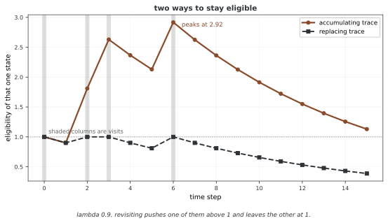

# 32.7.4 자격 추적(Eligibility Traces)

**자격 추적**은 최근에 방문한 상태의 단기 기억을 유지해 시간차 방법과 몬테카를로 방법을 잇는 구조다. TD(λ)를 후방 관점으로 구현하게 해 주고 λ 리턴을 효율적으로 온라인 계산하게 한다.

---

## 1. 추적의 종류

### 누적 추적

$$e_t(s) = \gamma \lambda \, e_{t-1}(s) + \mathbb{1}[S_t = s]$$

방문할 때마다 추적에 1을 더하고 스텝마다 추적이 $\gamma\lambda$만큼 감쇠한다. 여러 번 방문하면 누적된다.

### 교체 추적

$$e_t(s) = \begin{cases} 1 & \text{if } S_t = s \\ \gamma \lambda \, e_{t-1}(s) & \text{otherwise} \end{cases}$$

방문할 때마다 쌓지 않고 추적을 1로 되돌린다. 실제로 더 잘될 때가 많다.

### 더치 추적

$$e_t(s) = \gamma \lambda \, e_{t-1}(s) + \alpha(1 - \gamma \lambda \, e_{t-1}(s)) \mathbb{1}[S_t = s]$$

선형 함수 근사에서 오프라인 λ 리턴 알고리즘을 정확히 재현하도록 설계되었다.

<div class="storybox" markdown>

**그림으로 보는 AI 1.** "자격"이라는 말은 시냅스를 두고 한 말이었다

왜 하필 **자격**(eligibility)인가. 추적이나 기억이라 부르면 될 것을 굳이 "자격 있음"이라 한 데에는 까닭이 있다. 이 말은 알고리즘이 아니라 **신경세포**를 두고 나왔다.

1972년에 해리 클로프(A. Harry Klopf)가 미 공군 케임브리지 연구소에서 낸 기술 보고서 「뇌 기능과 적응 시스템 — 이종 항상성 이론」이 출처다. 그가 내놓은 그림은 이렇다. 시냅스가 활동하면 그 시냅스는 **한동안 고쳐질 수 있는 상태**로 남는다. 곧 자격을 얻는다. 그 자격이 남아 있는 동안에 좋거나 나쁜 일이 닥치면 그때 비로소 고쳐지고, 자격이 스러진 뒤에 닥친 일은 그 시냅스를 건드리지 못한다.

늦게 오는 리워드를 **누구의 몫으로 돌릴 것인가**라는 문제에 대한 답을 생물학 쪽에서 적어 둔 셈이고, 위 식들의 $\gamma\lambda$ 거듭제곱이 바로 그 "한동안"이다.



위에 적은 두 추적이 갈리는 자리가 **같은 상태를 거듭 방문했을 때**다. 짧은 구간에서 네 번 방문하게 해 보면 누적 추적은 **2.92**까지 올라가고, 교체 추적은 올라가 봐야 **1**이다.

클로프의 그림에 더 가까운 쪽은 교체 추적이다. 시냅스가 "고칠 수 있는 상태"라면 그것은 **켜졌거나 꺼졌거나**이지 두 번 켜졌다고 세 배로 켜지지는 않는다. 위 문단이 "실제로 더 잘될 때가 많다"고 적어 둔 것도 그와 통한다 — 누적 추적은 고리를 도는 상태에 자격을 과하게 몰아주고, 그만큼 갱신이 크게 흔들린다.

**다만 어느 쪽이 맞다고 정해진 것은 아니다.** 셋째 줄의 더치 추적은 **생물학과 아무 상관 없이** 설계된 것이다 — 선형 함수 근사에서 오프라인 λ 리턴을 정확히 재현하려고 역산한 식이다. 비유가 알고리즘을 낳기는 했지만 알고리즘이 비유에 묶여 있지는 않다. 이 세 줄을 고를 때 묻는 것은 "어느 것이 뇌에 가까운가"가 아니라 **"내 문제에서 같은 상태를 얼마나 자주 다시 방문하는가"** 다.

_확인한 곳 — A. H. Klopf, *Brain Function and Adaptive Systems: A Heterostatic Theory*, Technical Report AFCRL-72-0164, Air Force Cambridge Research Laboratories (1972). 시냅스가 한동안 고쳐질 자격을 지닌다는 생각과 "자격" 이라는 말이 거기서 왔다. 그림의 수는 그림을 그리는 코드가 위 두 식을 그대로 돌려 얻으며, 쌓이는 쪽이 1 을 넘고 바꿔 넣는 쪽이 넘지 않는다는 것을 `assert` 로 확인한 뒤에 그린다._

</div>

---

## 2. 자격 추적을 쓴 TD(λ)

```
Initialize V(s), e(s) = 0 for all s
잡: α, γ, λ

For each episode:
    S = initial state, e(s) = 0 for all s
    For each step:
        A ~ π(S)
        Take A, observe R, S'
        δ = R + γ V(S') - V(S)          # 때 차이 어긋남
        e(S) = e(S) + 1                   # 자취를 고친다(쌓임)
        For all s:
            V(s) ← V(s) + α δ e(s)       # 값을 고친다
            e(s) ← γ λ e(s)              # 자취를 스러뜨린다
        S ← S'
```

---

## 3. SARSA(λ) — 추적을 쓴 제어

자격 추적을 상태-액션 쌍으로 넓힌다:

$$e_t(s, a) = \gamma \lambda \, e_{t-1}(s, a) + \mathbb{1}[S_t = s, A_t = a]$$

$$\delta_t = R_{t+1} + \gamma Q(S_{t+1}, A_{t+1}) - Q(S_t, A_t)$$

$$Q(s, a) \leftarrow Q(s, a) + \alpha \delta_t e_t(s, a) \quad \text{for all } s, a$$

---

## 4. 왓킨스의 Q(λ) — 추적을 쓴 오프폴리시

그리디 액션이 실제로 한 액션과 다르면 추적을 끊는다:

$$e_t(s, a) = \begin{cases} \gamma \lambda \, e_{t-1}(s, a) + \mathbb{1}[S_t=s, A_t=a] & \text{if } A_t = \arg\max_{a'} Q(S_t, a') \\ \mathbb{1}[S_t=s, A_t=a] & \text{otherwise (reset)} \end{cases}$$

이로써 추적이 그리디 궤적을 따라서만 전파된다.

---

## 5. 직관: 신용 할당

자격 추적은 **시간적 신용 할당** 문제를 푼다:

- 리워드를 받았을 때 지난 어느 상태와 액션이 그 몫을 했는가?
- 추적 $e(s)$이 상태마다 공을 받을 "자격"을 잰다
- 최근에 자주 방문한 상태가 공을 더 받는다
- 추적이 비율 $\gamma\lambda$으로 감쇠해 오래된 상태가 흐려진다

---

## 6. 계산에 대한 고려

| 방법 | 메모리 | 스텝마다 비용 |
|----------|--------|---------------|
| n-step(전방 관점) | n-step을 담는다 | $O(n)$ |
| 자격 추적 | 상태마다 추적 하나 | 스텝마다 $O(\|\mathcal{S}\|)$ |
| 성긴 추적 | 살아 있는 상태만 | $O(\text{살아 있는 상태})$ |

상태 공간이 크면 성긴 추적 구현은 추적이 무시할 수 없는 상태만 고친다.

---

## 7. 통합 관점

자격 추적은 하나로 아우르는 틀을 준다:

$$\text{TD}(0) \xleftrightarrow{\lambda \in [0,1]} \text{MC}$$

$$\text{SARSA}(0) \xleftrightarrow{\lambda \in [0,1]} \text{MC Control}$$

잡 $\lambda$이 순수한 부트스트래핑과 순수한 샘플링 사이를 매끄럽게 잇는다.

---

## 연습문제

<div class="drillbox" markdown>

**연습문제 1.** <span class="diff med" title="중간"></span>
이 절의 주제와 관련된 단순한 마르코프 결정 과정을 생각하여라. 상태 3개와 액션 2개의 작은 예에서 관련 양을 손으로 계산하여라.

</div>

??? success "풀이"
    상태 $S = \{s_1, s_2, s_3\}$과 액션 $A = \{a_1, a_2\}$을 정의한다. 전이 확률과 리워드를 정한다. 상태-액션 쌍마다 기대 즉시 리워드와 전이 분포를 계산한다. 이 절의 정의와 식으로 원하는 양을 계산한다. 상태 공간이 작아 정확히 계산할 수 있으므로 추상적인 식이 구체적인 숫자로 어떻게 옮겨지는지 보여 준다. $\square$

---

<div class="drillbox" markdown>

**연습문제 2.** <span class="diff med" title="중간"></span>
이 절에서 다룬 핵심 성질이나 수렴 결과를 증명하라. 가정을 분명히 적고 어느 것이 꼭 필요한지 가려내어라.

</div>

??? success "풀이"
    증명은 그 연산자에 축약 사상 정리를 적용해 따라온다. 할인율이 $\gamma < 1$인 유한 마르코프 결정 과정을 가정하면 그 연산자는 상한 노름에서 $\gamma$-축약이다. 바나흐 고정점 정리에 따라 반복 적용하면 $k$이 반복 횟수일 때 속도 $O(\gamma^k)$으로 유일한 고정점에 수렴한다. 유한성 가정이 리워드의 유계성을 보장하고 할인율 $\gamma < 1$이 축약 성질에 꼭 필요하다. $\square$

---

<div class="drillbox" markdown>

**연습문제 3.** <span class="diff hard" title="어려움"></span>
이 절에서 다룬 알고리즘이나 계산을 단순한 격자 세계에 대해 파이썬으로 구현하라. $\epsilon = 0.01$ 안으로 수렴하는 데 필요한 반복 횟수를 보고하라.

</div>

??? success "풀이"
    모서리에 종료 상태가 있고 균등 무작위 폴리시를 쓰는 $4 \times 4$ 격자 세계가 전형적인 시험 사례다. 구현은 모든 상태의 최대 변화량이 $\epsilon$ 아래로 떨어질 때까지 갱신 규칙을 반복한다. 할인율에 따라 보통 50~200번 반복하면 수렴한다. 핵심 구현 세부는 동기 갱신보다 빨리 수렴하도록 제자리 갱신(가우스-자이델 방식)을 쓰는 것이다. $\square$

---

<div class="drillbox" markdown>

**연습문제 4.** <span class="diff med" title="중간"></span>
이 절에서 다룬 방법에 내재한 근본 한계나 트레이드오프를 논하라. 뒤 장의 더 발전된 방법이 이 한계를 어떻게 극복하는가?

</div>

??? success "풀이"
    표 기반 방법은 모든 상태(어쩌면 액션까지)를 나열해야 하는데 연속이거나 고차원인 상태 공간에서는 불가능하다. 차원의 저주는 상태 변수의 수에 따라 상태 수가 지수적으로 늘어남을 뜻한다. 함수 근사(38~39장)는 그 함수를 뉴럴 네트워크로 파라미터화하고 비슷한 상태들에 걸쳐 일반화해 이를 넘는다. 다만 새 어려움이 생긴다. 수렴이 더는 보장되지 않으며 함수 근사, 부트스트래핑, 오프폴리시 학습이 함께 있으면(죽음의 삼각) 발산이 일어날 수 있다. $\square$

## 정리하며

자격 추적은 여러 스텝 시간차 방법을 효율적으로 구현하게 하는 강력한 신용 할당 구조다. 방문한 상태의 감쇠하는 기억을 유지하고 스텝마다 자격 있는 모든 상태에 시간차 오차를 나눈다. 추적 클래스(누적, 교체, 더치)와 λ 파라미터를 어떻게 고르느냐가 시간차와 몬테카를로 동작의 균형을 조절한다.
