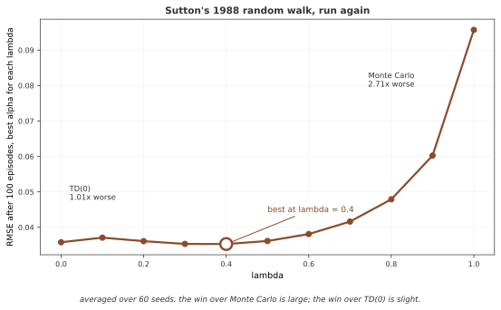

# 32.7.3 TD(λ)

**TD(λ)**는 지수 웨이트 평균으로 모든 n-step 리턴을 고침 하나로 아우른다. 특정 $n$을 고르지 않아도 되고 TD(0)과 몬테카를로 사이를 매끄럽게 잇는다.

---

## 1. λ 리턴

**λ 리턴**은 모든 n-step 리턴의 웨이트 평균이다:

$$G_t^\lambda = (1 - \lambda) \sum_{n=1}^{T-t-1} \lambda^{n-1} G_{t:t+n} + \lambda^{T-t-1} G_t$$

여기서 $\lambda \in [0, 1]$이 웨이트를 다스린다:

- $\lambda = 0$: $G_{t:t+1}$만 이바지한다 → TD(0)
- $\lambda = 1$: $G_t$만 이바지한다 → 몬테카를로
- 가운데: 기하로 스러지는 섞음

---

## 2. 웨이트 분포

웨이트 $(1-\lambda)\lambda^{n-1}$은 합이 1인 기하 분포를 이룬다:

| n-step | 웨이트 |
|--------|--------|
| 스텝1 | $(1-\lambda)$ |
| 스텝2 | $(1-\lambda)\lambda$ |
| 스텝3 | $(1-\lambda)\lambda^2$ |
| ... | ... |
| 마침 | $\lambda^{T-t-1}$(나머지) |

---

## 3. 전방 관점과 후방 관점

### 전방 관점(이론)

상태 $S_t$에서 앞을 보고 앞으로의 리워드로 λ 리턴을 계산한다:

$$V(S_t) \leftarrow V(S_t) + \alpha [G_t^\lambda - V(S_t)]$$

이는 (몬테카를로처럼) 판이 끝날 때까지 기다려야 한다.

### 후방 관점(실제)

스텝마다 앞서 들른 모든 상태를 고치려 **자격 추적**을 쓴다:

$$\delta_t = R_{t+1} + \gamma V(S_{t+1}) - V(S_t)$$

$$e_t(s) = \gamma \lambda e_{t-1}(s) + \mathbb{1}[S_t = s]$$

$$V(s) \leftarrow V(s) + \alpha \delta_t e_t(s) \quad \text{for all } s$$

전방 관점과 후방 관점은 판 하나를 온전히 마치면 똑같은 고침을 낸다.

---

## 4. 특별한 경우

| $\lambda$ | 알고리즘 | 추적 | 액션 |
|-----------|----------|-------|----------|
| 0 | TD(0) | 추적이 필요 없음 | 한 스텝 띄워 올리기 |
| 0.5 | TD(0.5) | 알맞은 추적 | 균형 |
| 0.9 | TD(0.9) | 긴 추적 | 몬테카를로에 가까움 |
| 1 | TD(1) = 몬테카를로 | 온 판 추적 | 몬테카를로 |

**그림으로 보는 AI 1.** 가운데가 이긴다는 것을 보인 실험

이 표의 양 끝 — TD(0)과 몬테카를로 — 은 원래 서로 다른 진영의 방법이었다. 그 둘을 $\lambda$ 하나로 잇고, **가운데가 양 끝보다 낫다**는 것을 실제로 보인 것이 1988년 리처드 서턴(Richard Sutton)의 「때 차이 방법으로 예측을 배우기」다. TD(λ)라는 이름도 거기서 나왔다.

그 논문이 쓴 보기가 작은 무작위 걸음이다. 상태 다섯에서 좌우로 반반씩 움직이다 양 끝에 닿으면 끝나고, 오른쪽 끝에서만 리워드 1을 받는다. 그 실험을 그대로 다시 돌려 보았다 — $\lambda$ 마다 러닝레이트 $\alpha$ 를 따로 최적화하고, 씨앗 60개로 평균했다.

가장 좋은 $\lambda$ 는 **0.4** 였다. 가운데가 이긴다는 결론은 그대로 재현된다.

**다만 이긴 폭이 양쪽으로 아주 다르다.** 몬테카를로($\lambda=1$)보다는 **2.71배** 낫지만, TD(0)보다는 **1.01배** — 사실상 비긴다. 곡선을 보면 $\lambda$ 가 0에서 0.5까지는 거의 평평하고 그 뒤로만 가파르게 나빠진다.

그래서 이 그림에서 가져갈 교훈은 "0.4를 쓰라"가 아니다. **$\lambda$ 를 낮은 쪽에서 고르면 웬만해선 손해를 보지 않고, 1에 가까이 둘 때만 크게 잃는다**는 것이다. 아래 5절이 $\lambda$ 고르는 이야기를 할 때, 바닥이 평평하다는 사실이 고르는 일을 쉽게 만들어 준다 — 정확한 값을 맞힐 필요가 없다.

그리고 이 수는 **이 작은 걸음에서 나온 것**이다. 상태가 다섯뿐이고 리워드가 끝에서 한 번만 오는 문제라 몬테카를로의 분산이 두드러지게 불리했다. 리워드가 자주 오거나 판이 짧은 문제에서는 양 끝의 거리가 이만큼 벌어지지 않는다.

_확인한 곳 — R. S. Sutton, "Learning to Predict by the Methods of Temporal Differences", *Machine Learning* **3**, 9–44 (1988). TD(λ) 와 무작위 걸음 실험이 그 논문의 것이다. 그림의 수는 그림을 그리는 코드가 같은 걸음을 직접 돌려 얻으며, 가장 좋은 λ 가 0과 1 사이라는 것을 `assert` 로 확인한 뒤에 그린다._

---

## 5. λ 고르기

- **$\lambda \approx 0.9$**이 흔히 좋은 기본값이다
- 가장 좋은 $\lambda$은 문제에 매인다
- 낮은 $\lambda$: 값 어림이 믿을 만한 마르코프 결정 과정에서 학습이 빠르다
- 높은 $\lambda$: 리워드가 성기거나 잡소리가 섞인 마르코프 결정 과정에서 낫다
- 맞대어 살피기나 상위 학습으로 손볼 수 있다

---

## 6. 금융 응용

TD(λ)는 금융에서 여러 지평의 셈속을 따지는 자연스러운 틀을 준다:

- 낮은 $\lambda$: 짧은 때 헤아리기에 집중(하루 거래)
- 높은 $\lambda$: 긴 때의 쌓인 벌이를 앞세움(꾸러미 다루기)
- 지수 웨이트가 먼 앞날의 상태가 덜 알맞아지는 것을 자연스럽게 나타낸다

---

## 연습문제

**연습문제 1.** 
이 절의 주제와 딸린 단순한 마르코프 결정 과정을 생각하여라. 상태 3개와 액션 2개의 작은 보기에서 관련 양을 손으로 계산하여라.

??? success "풀이"
    상태 $S = \{s_1, s_2, s_3\}$과 액션 $A = \{a_1, a_2\}$을 뜻매김한다. 옮김 확률과 리워드를 매긴다. 상태-액션 짝마다 기대 즉시 리워드와 옮김 분포를 계산한다. 이 절의 정의와 식으로 바라는 양을 계산한다. 상태 자리가 작아 정확히 셈할 수 있어 추상 적기가 구체 숫자로 어떻게 옮겨지는지 보여 준다. $\square$

---

**연습문제 2.** 
이 절에서 다룬 핵심 성질이나 수렴 결과를 밝혀라. 여김을 또렷이 적고 어느 것이 꼭 필요한지 가려내어라.

??? success "풀이"
    밝힘은 그 연산자에 오므리는 옮김 정리를 써서 따라온다. 할인율이 $\gamma < 1$인 유한 마르코프 결정 과정을 여기면 그 연산자는 상한 노름에서 $\gamma$오므리기다. 바나흐 고정점 정리에 따라 되풀이해 쓰면 $k$이 되풀이 횟수일 때 빠르기 $O(\gamma^k)$으로 하나뿐인 고정점에 모인다. 유한하다는 여김이 리워드가 가둬짐을 보장하고 할인율 $\gamma < 1$이 오므리기 성질에 꼭 필요하다. $\square$

---

**연습문제 3.** 
이 절에서 밝힌 알고리즘이나 계산을 단순한 격자 세상에 대해 파이썬으로 짜라. $\epsilon = 0.01$ 안으로 모이는 데 필요한 되풀이 횟수를 알려라.

??? success "풀이"
    모서리에 마침 상태가 있고 고른 아무 폴리시를 쓰는 $4 \times 4$ 격자 세상이 여느 시험 사례가 된다. 짜기는 모든 상태의 가장 큰 바뀜이 $\epsilon$ 아래로 떨어질 때까지 고침 규칙을 되풀이한다. 할인율에 따라 보통 50~200번 되풀이하면 모인다. 핵심 짜기 세부는 맞춘 고침보다 빨리 모이도록 제자리 고침(가우스-자이델 방식)을 쓰는 것이다. $\square$

---

**연습문제 4.** 
이 절에서 밝힌 길에 본디 있는 근본 한계나 트레이드오프를 다루어라. 뒤 장의 더 나아간 방법이 이 한계를 어떻게 넘는가?

??? success "풀이"
    표로 하는 길은 모든 상태(어쩌면 액션까지)를 늘어놓아야 하는데 이어지거나 차원이 높은 상태 자리에서는 될 일이 아니다. 차원의 저주는 상태 변수의 수에 따라 상태 수가 지수로 늘어남을 뜻한다. 함수 어림(38~39장)은 그 함수를 뉴럴 넷트웍으로 잡을 두어 나타내고 닮은 상태에 걸쳐 넓혀 이를 넘는다. 다만 새 어려움이 생긴다. 수렴이 더는 보장되지 않으며 함수 어림, 띄워 올리기, 벗어난 폴리시 학습의 죽음의 삼각이 발산을 일으킬 수 있다. $\square$

## 정리하며

이 절에서는 λ 리턴, 웨이트 분포, 전방 관점과 후방 관점, 특별한 경우를 살펴보았다.
