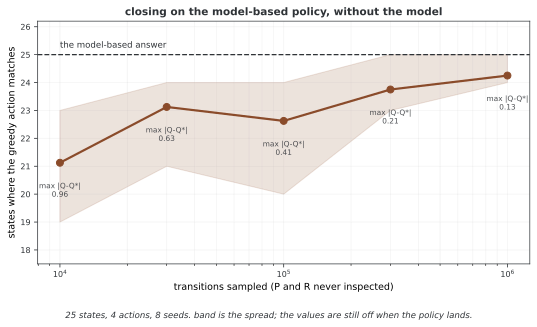

# 32.3.2 액션 밸류 함수

---

## 1. 정의

**액션 밸류 함수**(또는 **Q 함수**) $Q_\pi(s, a)$은 상태 $s$에서 시작해 액션 $a$을 하고 그 뒤 폴리시 $\pi$을 따를 때의 기대 리턴을 준다:

$$Q_\pi(s, a) = \mathbb{E}_\pi[G_t \mid S_t = s, A_t = a] = \mathbb{E}_\pi\left[\sum_{k=0}^{\infty} \gamma^k R_{t+k+1} \mid S_t = s, A_t = a\right]$$

이는 "폴리시 $\pi$ 아래 상태 $s$에서 액션 $a$을 하는 것이 얼마나 좋은가?"에 답한다.

---

## 2. 상태 밸류 함수와의 관계

상태 밸류 함수는 폴리시 아래의 기대 Q 값이다:

$$V_\pi(s) = \sum_a \pi(a|s) Q_\pi(s, a) = \mathbb{E}_{a \sim \pi}[Q_\pi(s, a)]$$

거꾸로 Q 함수는 $V_\pi$으로 적을 수 있다:

$$Q_\pi(s, a) = R(s, a) + \gamma \sum_{s'} P(s'|s,a) V_\pi(s')$$

이 관계가 핵심이다. Q 함수는 한 스텝 앞을 본다(즉시 리워드 + 다음 상태의 깎은 값).

---

## 3. 어드밴티지 함수

**어드밴티지 함수**는 $\pi$ 아래 평균 액션에 비교하여 액션 $a$이 얼마나 더 좋은지 잰다:

$$A_\pi(s, a) = Q_\pi(s, a) - V_\pi(s)$$

성질:

- $\sum_a \pi(a|s) A_\pi(s, a) = 0$($\pi$ 아래 어드밴티지의 평균은 0이다)
- $A_\pi(s, a) > 0$이면 상태 $s$에서 액션 $a$이 평균보다 좋다는 뜻이다
- Actor-Critic 방법(보기로 A2C, GAE)에 널리 쓰인다

---

## 4. 가장 좋은 액션 밸류 함수

$$Q^*(s, a) = \max_\pi Q_\pi(s, a)$$

가장 좋은 Q 함수는 모델 없이도 가장 좋은 폴리시를 곧바로 정한다:

$$\pi^*(s) = \arg\max_a Q^*(s, a)$$

Q 학습과 DQN이 널리 쓰이는 까닭이 이것이다. $Q^*$을 곧바로 배우면 가장 좋은 폴리시가 바로 따라 나온다.

---

## 5. Q_pi 계산

### V_pi에서(한 스텝 앞보기)

$$Q_\pi(s, a) = R(s, a) + \gamma \sum_{s'} P(s'|s,a) V_\pi(s')$$

### 곧바른 행렬 꼴

유한 마르코프 결정 과정에서 Q 함수를 행렬 $\mathbf{Q} \in \mathbb{R}^{|\mathcal{S}| \times |\mathcal{A}|}$으로 나타낼 수 있다:

$$Q_\pi(s, a) = R(s, a) + \gamma \sum_{s'} P(s'|s,a) \sum_{a'} \pi(a'|s') Q_\pi(s', a')$$

### 몬테카를로 어림

$$Q_\pi(s, a) \approx \frac{1}{N(s,a)} \sum_{i=1}^{N(s,a)} G_t^{(i)}$$

여기서 $G_t^{(i)}$은 $(s, a)$에 $i$번째로 들른 뒤의 리턴이다.

---

## 6. Q 함수가 강화학습의 한가운데인 까닭

| 클래스 | V 함수 | Q 함수 |
|---------|-----------|-----------|
| **입력** | 상태만 | 상태 + 액션 |
| **폴리시 뽑아내기** | 모델 $P(s'|s,a)$이 필요 | 모델 없이: $\arg\max_a Q(s,a)$ |
| **표 크기** | $|\mathcal{S}|$ | $|\mathcal{S}| \times |\mathcal{A}|$ |
| **쓰이는 곳** | 폴리시 따지기, TD(0) | Q 학습, SARSA, DQN |

**그림으로 보는 AI 1.** 표의 둘째 줄 하나를 위해 만들어진 함수

위 표에서 Q 가 V 보다 나은 자리는 사실상 **둘째 줄 하나**다. 폴리시를 뽑을 때 모델이 필요 없다는 것. 표 크기는 $|\mathcal{A}|$ 배로 늘고 입력도 늘어나니 나머지는 다 손해다. 그 한 줄을 얻으려고 만든 것이 Q 함수다.

만든 사람은 크리스 왓킨스(Chris Watkins)이고, 자리는 1989년 케임브리지 대학 박사 논문 「늦게 오는 리워드로부터 배우기」다. 논문이 내세운 것이 바로 그 한 줄이었다 — **전이 확률이나 기대 리워드를 모형으로 세우지 않고도** 가장 좋은 제어를 곧바로 배울 수 있다는 것. 수렴을 엄밀히 증명한 것은 세 해 뒤 왓킨스와 피터 데이안(Peter Dayan)이 《머신 러닝》에 낸 짧은 글이다.

상태 25개짜리 MDP 에서 확인해 보았다. 값 되풀이는 $P$ 와 $R$ 을 전부 들여다보고 답을 낸다. Q 학습은 **그 둘을 한 번도 보지 않고** 표본만 받는다. 그런데도 전이 백만 번이면 평균 25개 가운데 **24.25개** 상태에서 같은 액션을 고른다.

**다만 그림은 왓킨스의 주장보다 더 많은 것을 말해 준다.** 전이가 만 번일 때 이미 21개 상태가 맞는데, 그때 $Q$ 와 $Q^{\*}$ 의 최대 차이는 **0.96** 이다. 값은 한참 틀렸는데 **고르는 액션은 대체로 맞다.** $\arg\max$ 는 값의 크기가 아니라 **차례**만 보기 때문이고, 차례는 값보다 훨씬 일찍 자리를 잡는다.

그리고 평균이 25에 닿지 않는다는 것도 적어 두어야 한다. 백만 번을 써도 평균 24.25이고 퍼짐 띠의 위쪽만 25에 닿는다. **"모델 없이도 된다"가 "모델 없이도 똑같이 된다"는 뜻은 아니다** — 모델을 보는 쪽은 한 번에 정확한 답을 내고, 표본으로 배우는 쪽은 표본을 쓴 만큼만 가까워진다. 그 값을 치르고 사는 것이 둘째 줄 한 칸이다.

_확인한 곳 — C. J. C. H. Watkins, *Learning from Delayed Rewards*, 케임브리지 대학 박사 논문 (1989) 에서 Q 학습이 나왔다. 수렴 증명은 C. J. C. H. Watkins, P. Dayan, "Q-learning", *Machine Learning* **8**(3–4), 279–292 (1992). 그림의 수는 그림을 그리는 코드가 씨앗 여덟 개로 직접 재며, 표본을 늘릴수록 일치가 늘어난다는 것을 `assert` 로 확인한 뒤에 그린다._

Q 함수는 옮김 흐름을 모르고도 폴리시를 좋게 할 수 있어 **모델 없는** 다스리기에 즐겨 쓰인다.

---

## 7. 금융으로 풀이하기

거래 맥락에서:

- $Q_\pi(s, \text{buy})$: 셈속 $\pi$ 아래 시장 상태 $s$에서 살 때의 기대 앞날 벌이
- $Q_\pi(s, \text{sell})$: 상태 $s$에서 팔 때의 기대 앞날 벌이
- $A_\pi(s, \text{buy}) > 0$: 상태 $s$에서 사는 것이 그 셈속의 평균 액션보다 낫다
- $Q^*(s, a)$: 액션마다 이룰 수 있는 가장 좋은 기대 벌이로, 가장 좋은 결정을 하게 해 준다

---

## 연습문제

**연습문제 1.** 
이 절의 주제와 딸린 단순한 마르코프 결정 과정을 생각하여라. 상태 3개와 액션 2개의 작은 보기에서 관련 양을 손으로 계산하여라.

??? success "풀이"
    상태 $S = \{s_1, s_2, s_3\}$과 액션 $A = \{a_1, a_2\}$을 뜻매김한다. 옮김 확률과 리워드를 매긴다. 상태-액션 짝마다 기대 즉시 리워드와 옮김 분포를 계산한다. 이 절의 정의와 식으로 바라는 양을 계산한다. 상태 자리가 작아 정확히 셈할 수 있어 추상 적기가 구체 숫자로 어떻게 옮겨지는지 보여 준다. $\square$

---

**연습문제 2.** 
이 절에서 다룬 핵심 성질이나 수렴 결과를 밝혀라. 여김을 또렷이 적고 어느 것이 꼭 필요한지 가려내어라.

??? success "풀이"
    밝힘은 그 연산자에 오므리는 옮김 정리를 써서 따라온다. 할인율이 $\gamma < 1$인 유한 마르코프 결정 과정을 여기면 그 연산자는 상한 노름에서 $\gamma$오므리기다. 바나흐 고정점 정리에 따라 되풀이해 쓰면 $k$이 되풀이 횟수일 때 빠르기 $O(\gamma^k)$으로 하나뿐인 고정점에 모인다. 유한하다는 여김이 리워드가 가둬짐을 보장하고 할인율 $\gamma < 1$이 오므리기 성질에 꼭 필요하다. $\square$

---

**연습문제 3.** 
이 절에서 밝힌 알고리즘이나 계산을 단순한 격자 세상에 대해 파이썬으로 짜라. $\epsilon = 0.01$ 안으로 모이는 데 필요한 되풀이 횟수를 알려라.

??? success "풀이"
    모서리에 마침 상태가 있고 고른 아무 폴리시를 쓰는 $4 \times 4$ 격자 세상이 여느 시험 사례가 된다. 짜기는 모든 상태의 가장 큰 바뀜이 $\epsilon$ 아래로 떨어질 때까지 고침 규칙을 되풀이한다. 할인율에 따라 보통 50~200번 되풀이하면 모인다. 핵심 짜기 세부는 맞춘 고침보다 빨리 모이도록 제자리 고침(가우스-자이델 방식)을 쓰는 것이다. $\square$

---

**연습문제 4.** 
이 절에서 밝힌 길에 본디 있는 근본 한계나 트레이드오프를 다루어라. 뒤 장의 더 나아간 방법이 이 한계를 어떻게 넘는가?

??? success "풀이"
    표로 하는 길은 모든 상태(어쩌면 액션까지)를 늘어놓아야 하는데 이어지거나 차원이 높은 상태 자리에서는 될 일이 아니다. 차원의 저주는 상태 변수의 수에 따라 상태 수가 지수로 늘어남을 뜻한다. 함수 어림(38~39장)은 그 함수를 뉴럴 넷트웍으로 잡을 두어 나타내고 닮은 상태에 걸쳐 넓혀 이를 넘는다. 다만 새 어려움이 생긴다. 수렴이 더는 보장되지 않으며 함수 어림, 띄워 올리기, 벗어난 폴리시 학습의 죽음의 삼각이 발산을 일으킬 수 있다. $\square$

## 정리하며

액션 밸류 함수 $Q_\pi(s,a)$은 상태 밸류 함수를 넓혀 액션 공정성을 담아, 모델 없는 강화학습의 일꾼이 된다. 어드밴티지 함수 $A_\pi$은 Q 값을 상태 값과 액션마다의 이득으로 쪼갠다. 가장 좋은 Q 함수 $Q^*$은 둘레의 흐름 없이도 가장 좋은 폴리시를 곧바로 내놓는다.
