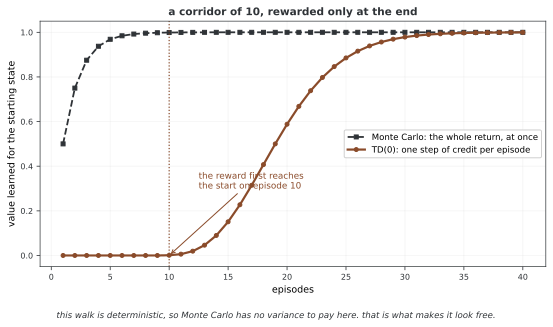

# 32.3.1 상태 밸류 함수

---

## 1. 정의

**상태 밸류 함수** $V_\pi(s)$은 상태 $s$에서 시작해 그 뒤 폴리시 $\pi$을 따를 때의 기대 리턴을 준다:

$$V_\pi(s) = \mathbb{E}_\pi[G_t \mid S_t = s] = \mathbb{E}_\pi\left[\sum_{k=0}^{\infty} \gamma^k R_{t+k+1} \mid S_t = s\right]$$

이 함수는 "폴리시 $\pi$ 아래 상태 $s$에 있는 것이 얼마나 좋은가?"에 답한다.

**그림으로 보는 AI 1.** 이 함수는 1961년에 적힌 물음의 답이다

밸류 함수를 왜 만드는가. 리턴 $G_t$ 를 그냥 쓰면 될 것을 굳이 그 기댓값을 상태마다 붙여 두는 까닭이 있다. 그 까닭을 가장 먼저 또렷하게 적어 둔 사람이 마빈 민스키(Marvin Minsky)다.

1961년 1월 《IRE 회보》에 실린 「인공지능을 향한 발걸음」의 D절 제목이 **「학습 시스템의 신용 배분 문제」** 다. 체스나 체커처럼 이기고 지는 것이 분명한 게임에서도, 그 한 번의 승패에는 **엄청나게 많은 내부 결정**이 딸려 있다는 것이다. 그는 이렇게 적었다.

> "If the run is successful, how can we assign credit for the success among the multitude of decisions?"

판이 잘 풀렸을 때 그 공로를 **수많은 결정 가운데 누구에게 얼마나 돌릴 것인가**. 밸류 함수는 이 물음에 대한 답이다. $V_\pi(s)$ 는 "앞으로 벌어질 일 전부"를 **지금 이 상태에 붙은 수 하나로** 접어 두므로, 늦게 오는 결과를 멀리 있는 결정에까지 끌고 갈 필요가 없어진다.

공로가 실제로 얼마나 느리게 뒤로 가는지는 재어 보면 선명하다. 길이 10짜리 복도에서 끝에서만 리워드를 주면, TD(0)은 한 에피소드에 **한 칸씩만** 뒤로 밀어 준다. 시작 상태가 0을 벗어나는 것은 **열 번째 에피소드**이고, 복도가 100칸이면 100번이 걸린다. 몬테카를로는 첫 판에 바로 닿는다 — 판이 끝난 뒤 리턴 전체를 모든 상태에 한꺼번에 나눠 주기 때문이다.

이 생각을 끝까지 밀면 서턴이 2004년에 내놓은 **밸류 함수 가설**이 된다 — "잇단 결정 문제를 푸는 효율적인 방법은 모두 중간 단계로 밸류 함수를 정하게 된다." 가설이라고 이름 붙인 것 자체가 **증명된 정리가 아니라는 표시**다.

**다만 위 그림이 몬테카를로의 손을 들어 주는 것처럼 보인다면, 그것은 이 복도가 결정적이기 때문이다.** 걸음에 우연이 없으니 리턴이 늘 똑같고, 몬테카를로가 치러야 할 분산이 **아예 없다.** 값이 드러나는 것은 리턴이 흔들릴 때이고, 그 저울질은 이 장 뒤쪽 TD(λ) 쪽에서 수로 다룬다. 밸류 함수가 공로 배분을 **풀어 주는** 것이 아니라, 공로를 **어떤 모양으로 치를지 고르게 해 주는** 장치라고 읽는 편이 맞다.

_확인한 곳 — M. Minsky, "Steps Toward Artificial Intelligence", *Proceedings of the IRE* **49**(1) (1961년 1월, IRE 접수 1960년 10월 24일) 의 D절. 인용한 문장이 그 절의 것이다. 밸류 함수 가설은 R. Sutton (2004) 의 진술이다. 그림의 수는 그림을 그리는 코드가 직접 돌려 얻으며, TD(0)이 한 칸씩 기어간다는 것을 `assert` 로 확인한 뒤에 그린다._

---

## 2. 성질

1. **폴리시에 매임**: 폴리시가 다르면 밸류 함수도 다르다
2. **가둬짐**: $\gamma < 1$이고 리워드가 가둬져 있으면 $|V_\pi(s)| \leq \frac{R_{\max}}{1-\gamma}$이다
3. **하나뿐임**: 주어진 폴리시 $\pi$과 마르코프 결정 과정에서 $V_\pi$이 하나로 뜻매김된다
4. **회귀**: 벨먼 방정식을 만족한다(32.3.3 참고)

---

## 3. 유한 마르코프 결정 과정에서 V_pi 계산

### 곧바른 계산(행렬 꼴)

유한 마르코프 결정 과정에서 $V_\pi$은 선형 방정식 체계를 풀어 셈할 수 있다:

$$\mathbf{v}_\pi = \mathbf{r}_\pi + \gamma \mathbf{P}_\pi \mathbf{v}_\pi$$

정리하면 다음과 같다.

$$\mathbf{v}_\pi = (\mathbf{I} - \gamma \mathbf{P}_\pi)^{-1} \mathbf{r}_\pi$$

여기서 각 기호는 다음과 같다.

- $[\mathbf{P}_\pi]_{ss'} = \sum_a \pi(a|s) P(s'|s,a)$인 $\mathbf{P}_\pi \in \mathbb{R}^{|\mathcal{S}| \times |\mathcal{S}|}$
- $[\mathbf{r}_\pi]_s = \sum_a \pi(a|s) R(s,a)$인 $\mathbf{r}_\pi \in \mathbb{R}^{|\mathcal{S}|}$

행렬을 뒤집는 데 계산 $O(|\mathcal{S}|^3)$이 든다.

### 되풀이 계산

상태 자리가 크면 되풀이 방법을 즐겨 쓴다:

$$V_{k+1}(s) = \sum_a \pi(a|s) \left[R(s,a) + \gamma \sum_{s'} P(s'|s,a) V_k(s')\right]$$

$k \to \infty$일 때 $V_\pi$으로 모인다(오므리는 옮김이 보장한다).

### 몬테카를로 어림

여러 판의 리턴을 평균 내어 $V_\pi(s)$을 어림한다:

$$V_\pi(s) \approx \frac{1}{N(s)} \sum_{i=1}^{N(s)} G_t^{(i)}$$

여기서 $G_t^{(i)}$은 상태 $s$에 $i$번째로 들른 뒤의 리턴이다.

---

## 4. 가장 좋은 상태 밸류 함수

**가장 좋은 상태 밸류 함수** $V^*(s)$은 모든 폴리시에 대한 최대다:

$$V^*(s) = \max_\pi V_\pi(s) \quad \text{for all } s \in \mathcal{S}$$

가장 좋은 폴리시 $\pi^*$은 모든 상태에서 한꺼번에 $V_{\pi^*}(s) = V^*(s)$을 이룬다.

---

## 5. 폴리시의 반쯤 차례

다음이면 폴리시 $\pi$이 폴리시 $\pi'$보다 **낫거나 같다**($\pi \geq \pi'$으로 적는다):

$$V_\pi(s) \geq V_{\pi'}(s) \quad \text{for all } s \in \mathcal{S}$$

다른 모든 폴리시보다 낫거나 같은 가장 좋은 폴리시 $\pi^*$이 적어도 하나는 늘 있다.

---

## 6. 금융에서의 풀이

꾸러미 다루기에서:

- $V_\pi(s)$은 셈속 $\pi$ 아래 시장 상태 $s$에서의 위험을 고려한 기대 앞날 벌이를 나타낸다
- 상태에 걸쳐 $V_\pi(s)$을 견주면 어떤 시장 형편이 더 좋은지 드러난다
- $V^*(s)$은 어느 상태에서든 이룰 수 있는 가장 좋은 기대 성과를 나타낸다

---

## 연습문제

**연습문제 1.** 
이 절의 주제와 딸린 단순한 마르코프 결정 과정을 생각하여라. 상태 3개와 액션 2개의 작은 보기에서 관련 양을 손으로 계산하여라.

??? success "풀이"
    상태 $S = \{s_1, s_2, s_3\}$과 액션 $A = \{a_1, a_2\}$을 뜻매김한다. 옮김 확률과 리워드를 매긴다. 상태-액션 짝마다 기대 즉시 리워드와 옮김 분포를 계산한다. 이 절의 정의와 식으로 바라는 양을 계산한다. 상태 자리가 작아 정확히 셈할 수 있어 추상 적기가 구체 숫자로 어떻게 옮겨지는지 보여 준다. $\square$

---

**연습문제 2.** 
이 절에서 다룬 핵심 성질이나 수렴 결과를 밝혀라. 여김을 또렷이 적고 어느 것이 꼭 필요한지 가려내어라.

??? success "풀이"
    밝힘은 그 연산자에 오므리는 옮김 정리를 써서 따라온다. 할인율이 $\gamma < 1$인 유한 마르코프 결정 과정을 여기면 그 연산자는 상한 노름에서 $\gamma$오므리기다. 바나흐 고정점 정리에 따라 되풀이해 쓰면 $k$이 되풀이 횟수일 때 빠르기 $O(\gamma^k)$으로 하나뿐인 고정점에 모인다. 유한하다는 여김이 리워드가 가둬짐을 보장하고 할인율 $\gamma < 1$이 오므리기 성질에 꼭 필요하다. $\square$

---

**연습문제 3.** 
이 절에서 밝힌 알고리즘이나 계산을 단순한 격자 세상에 대해 파이썬으로 짜라. $\epsilon = 0.01$ 안으로 모이는 데 필요한 되풀이 횟수를 알려라.

??? success "풀이"
    모서리에 마침 상태가 있고 고른 아무 폴리시를 쓰는 $4 \times 4$ 격자 세상이 여느 시험 사례가 된다. 짜기는 모든 상태의 가장 큰 바뀜이 $\epsilon$ 아래로 떨어질 때까지 고침 규칙을 되풀이한다. 할인율에 따라 보통 50~200번 되풀이하면 모인다. 핵심 짜기 세부는 맞춘 고침보다 빨리 모이도록 제자리 고침(가우스-자이델 방식)을 쓰는 것이다. $\square$

---

**연습문제 4.** 
이 절에서 밝힌 길에 본디 있는 근본 한계나 트레이드오프를 다루어라. 뒤 장의 더 나아간 방법이 이 한계를 어떻게 넘는가?

??? success "풀이"
    표로 하는 길은 모든 상태(어쩌면 액션까지)를 늘어놓아야 하는데 이어지거나 차원이 높은 상태 자리에서는 될 일이 아니다. 차원의 저주는 상태 변수의 수에 따라 상태 수가 지수로 늘어남을 뜻한다. 함수 어림(38~39장)은 그 함수를 뉴럴 넷트웍으로 잡을 두어 나타내고 닮은 상태에 걸쳐 넓혀 이를 넘는다. 다만 새 어려움이 생긴다. 수렴이 더는 보장되지 않으며 함수 어림, 띄워 올리기, 벗어난 폴리시 학습의 죽음의 삼각이 발산을 일으킬 수 있다. $\square$

## 정리하며

상태 밸류 함수는 강화학습의 한가운데 양으로, 주어진 폴리시 아래 상태마다의 긴 때 바람직함을 담는다. 작은 마르코프 결정 과정에서는 정확히 셈할 수 있고(행렬 뒤집기) 큰 문제에서는 되풀이나 샘플링 방법으로 어림한다. 가장 좋은 밸류 함수 $V^*$이 이룰 수 있는 가장 좋은 성과를 나타낸다.
