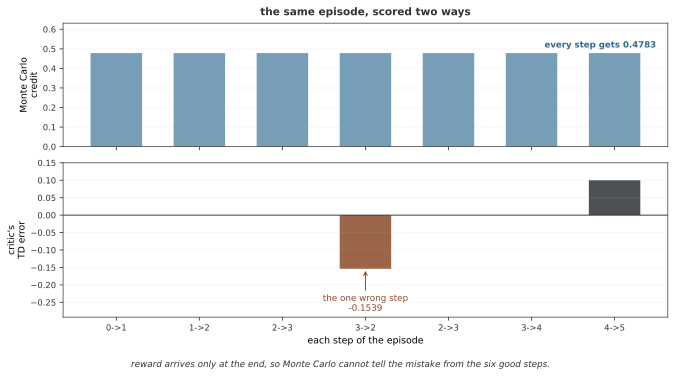

# Actor-Critic 기초

Actor-Critic 방법은 폴리시 기반 방법과 밸류 기반 방법의 장점을 함께 취한다. **액터**는 파라미터화된 폴리시 $\pi_\theta(a|s)$ 를 지니고, **크리틱**은 액터가 고른 액션이 얼마나 좋은지 평가하는 밸류 함수 $V_\phi(s)$(또는 $Q_\phi(s,a)$)를 배운다. 이렇게 엮으면 폴리시를 직접 최적화하는 이점을 지키면서 순수 REINFORCE보다 분산이 작은 그래디언트 추정을 얻는다.

---

## 1. 구조

### 두 조각 설계

Actor-Critic 틀은 다음으로 이루어진다.

1. **액터** $\pi_\theta(a|s)$: 액션을 고르는 폴리시 네트워크
2. **크리틱** $V_\phi(s)$: 기대 리턴을 추정하는 값 네트워크

크리틱은 배운 베이스라인 노릇을 하여 어드밴티지 추정을 준다.

$$A_t = r_t + \gamma V_\phi(s_{t+1}) - V_\phi(s_t)$$

### 갱신 규칙

**액터 갱신**(어드밴티지를 쓰는 폴리시 경사):

$$\theta \leftarrow \theta + \alpha_\theta \nabla_\theta \log \pi_\theta(a_t|s_t) \cdot A_t$$

**크리틱 갱신**(밸류 함수 회귀):

$$\phi \leftarrow \phi - \alpha_\phi \nabla_\phi (V_\phi(s_t) - G_t)^2$$

여기서 $G_t$ 는 타깃 리턴이다(몬테카를로, 시간차, 또는 n-step).

---

## 2. Actor-Critic이 REINFORCE보다 나은 점

| 결 | REINFORCE | Actor-Critic |
|--------|-----------|--------------|
| 분산 | 큼(몬테카를로) | 작음(부트스트랩) |
| 바이어스 | 치우치지 않음 | 바이어스(밸류 함수 오차) |
| 갱신 빈도 | 에피소드 끝 | 스텝마다(온라인) |
| 샘플 효율 | 낮음 | 더 높음 |
| 수렴 속도 | 더딤 | 더 빠름 |

중요한 트레이드오프는 이렇다. Actor-Critic은 크리틱의 불완전한 값 추정 때문에 바이어스를 들여오지만 분산을 크게 줄여, 실제로는 더 빨리 수렴한다.

<div class="storybox" markdown>

**그림으로 보는 AI 1.** 크리틱이 처음 맡은 일은 분산 줄이기가 아니었다

위 표는 크리틱을 **분산을 줄이는 장치**로 세워 둔다. 오늘 쓰는 자리에서는 맞는 말이다. 그런데 이 구조가 처음 나왔을 때 크리틱에게 주어진 일은 그것이 아니었다.

1983년에 앤드루 바토(Andrew Barto)·리처드 서튼(Richard Sutton)·찰스 앤더슨(Charles Anderson)이 수레 위의 막대를 세우는 문제에 두 조각짜리 학습기를 내놓았다. 이름도 액터와 크리틱이 아니었다 — **ASE**(Associative Search Element)와 **ACE**(Adaptive Critic Element)였다. 오늘 이름의 절반은 저 ACE에서 왔다.

그리고 ACE가 맡은 일은 논문의 말로 이렇다 — 리워드만으로 얻을 수 있는 것보다 **"a more informative evaluation function"** 을 만드는 것. 분산이라는 말은 거기 없다. 그럴 만한 사정이 있었다. 그 문제에서 리워드는 **막대가 쓰러질 때 한 번** 올 뿐이어서, 줄일 분산 이전에 **쓸 신호 자체가 없었다.**



그 차이를 끝에서만 리워드가 오는 복도에서 정확히 계산해 보면 그림과 같다. 걸음 일곱 가운데 하나에서만 뒤로 샜다고 하자.

**몬테카를로는 일곱 걸음 **모두**에 똑같이 0.4783을 돌려준다.** 잘한 여섯 걸음과 잘못한 한 걸음을 구별할 길이 없다. 끝에서 온 수 하나를 그대로 나눠 가졌기 때문이다.

**크리틱을 두면 TD 오차가 걸음마다 다르다.** 제대로 간 여섯 걸음에서는 **정확히 0**이고, 뒤로 샌 그 한 걸음에서만 $-0.1539$ 다. 어디가 잘못이었는지를 **집어낸다.**

그러니 위 표의 "분산 작음"은 결과이지 처음의 동기가 아니다. ACE가 하려던 것은 **드문드문 오는 신호를 걸음마다 쓸 수 있는 신호로 바꾸는 일** — 곧 공을 돌릴 자리를 찾아 주는 일이었다. 이 구별이 쓸모 있는 까닭은 디버깅에서 드러난다. 크리틱이 잘 안 배워질 때 물어야 할 것은 "분산이 큰가"가 아니라 **"내 리워드가 걸음마다 뜻을 가지는가"** 이고, 리워드가 끝에서 한 번만 오는 과제라면 크리틱이 할 일이 그만큼 더 무겁다.

_확인한 곳 — A. G. Barto, R. S. Sutton, C. W. Anderson, "Neuronlike adaptive elements that can solve difficult learning control problems", *IEEE Transactions on Systems, Man, and Cybernetics* **SMC-13**(5), 834–846 (1983). 두 조각의 이름이 ASE 와 ACE 라는 것, ACE 가 리워드만으로 얻을 수 있는 것보다 더 알찬 평가 함수를 만든다는 것이 그 글의 것이다. 그림의 수는 그림을 그리는 코드가 작은 복도에서 닫힌 식으로 계산해 얻으며, TD 오차가 실제로 한 걸음에만 몰리는지를 먼저 확인한 뒤에만 그린다._

</div>

---

## 3. 온라인 Actor-Critic

가장 쉬운 Actor-Critic은 타임스텝마다 갱신한다.

```
스텝 t마다:
    액션 a_t ~ π_θ(·|s_t)을 벌인다
    r_t, s_{t+1}을 본다
    δ_t = r_t + γ V_φ(s_{t+1}) - V_φ(s_t)       # 때 차이 잘못
    θ ← θ + α_θ · δ_t · ∇_θ log π_θ(a_t|s_t)     # 액터 고침
    φ ← φ + α_φ · δ_t · ∇_φ V_φ(s_t)              # 크리틱 고침
```

시간차(TD) 오차 $\delta_t$ 가 한 스텝 어드밴티지 추정 노릇을 한다.

---

## 4. 배치 Actor-Critic

실제로는 배치로 갱신하는 것이 더 강건하다.

1. $\pi_\theta$ 로 전이의 배치를 모은다
2. 모든 전이에 대해 어드밴티지 추정을 계산한다
3. 어드밴티지를 쓰는 폴리시 경사로 액터를 갱신한다
4. 값 회귀로 크리틱을 갱신한다

### 크리틱 타깃

크리틱 타깃을 어떻게 고르느냐가 편향-분산에 영향을 준다.

- **TD(0)**: $y_t = r_t + \gamma V_\phi(s_{t+1})$ -- 분산이 작고 바이어스가 큼
- **N스텝**: $y_t = \sum_{k=0}^{n-1} \gamma^k r_{t+k} + \gamma^n V_\phi(s_{t+n})$ -- 그 사이
- **몬테카를로**: $y_t = G_t = \sum_{k=t}^{T} \gamma^{k-t} r_k$ -- 편향이 없고 분산이 큼
- **GAE**: n-step 리턴을 지수로 웨이트 주어 섞은 것(이 절의 GAE 쪽)

---

## 5. 설계 선택

### 함께 쓰는 네트워크와 따로 두는 네트워크

**공유 백본**(A2C/PPO에서 흔하다):

- 액터 헤드와 크리틱 헤드가 피처 추출기를 함께 쓴다
- 파라미터와 계산이 줄어든다
- 위험: 폴리시 목표와 값 목표 사이에서 그래디언트가 서로를 방해한다
- 완화책: 로스 계수를 달리 쓴다(예를 들어 값 로스에 0.5)

**따로 두는 네트워크**(SAC/TD3에서 흔하다):

- 액터와 크리틱이 서로 독립인 구조를 지닌다
- 트레인이 더 강건하다
- 액터와 크리틱의 러닝레이트가 달라야 할 수 있는 오프폴리시 방법에 더 알맞다

### 엔트로피 정칙화

엔트로피 보너스를 더하면 너무 일찍 수렴하는 것을 막는다.

$$L_\text{온} = L_\text{폴리시} + c_v L_\text{값} - c_e \mathcal{H}(\pi_\theta)$$

흔한 계수: $c_v = 0.5$, $c_e = 0.01$.

### 그래디언트 흐름

함께 쓰는 네트워크에서는 세 원천에서 온 그래디언트가 네트워크를 지난다.

1. 폴리시 경사(액터): 이로운 액션의 확률을 올린다
2. 값 그래디언트(크리틱): 값 추정을 낫게 한다
3. 엔트로피 그래디언트: 탐험을 지킨다

한 목표가 판치지 않도록 이들의 저울을 맞추어야 한다.

---

## 6. 이론적 성질

### 수렴

호환 함수 근사를 쓰는 Actor-Critic 방법은 적절한 조건(러닝레이트 감소 등)에서 국소 최적점으로 수렴한다. 크리틱은 호환 함수 근사기여야 한다.

$$Q_w(s, a) = \nabla_\theta \log \pi_\theta(a|s)^\top w$$

실제로 뉴럴 네트워크 크리틱은 이 조건을 깨뜨리므로 그 수렴 보장은 더 이상 서지 않는다. 그래도 트레인은 대개 잘 작동한다.

### 죽음의 삼각

함수 근사를 쓰는 Actor-Critic은 불안정을 낳을 수 있는 세 가지를 한데 엮는다.

1. **함수 근사**(뉴럴 네트워크)
2. **부트스트랩**(크리틱을 위한 시간차 학습)
3. **오프폴리시 학습**(데이터를 되쓸 때)

온폴리시 Actor-Critic 방법은 셋째를 피하므로 더 안정적이다.

---

## 연습문제

<div class="drillbox" markdown>

**연습문제 1.** <span class="diff hard" title="어려움"></span>
이 절에서 다룬 방법의 폴리시 경사를 유도하라. 어느 항이 추정해야 하는 것이고 어느 항이 정확히 계산할 수 있는 것인지 분명히 밝혀라.

</div>

??? success "풀이"
    폴리시 경사는 $\nabla_\theta J(\theta) = \mathbb{E}_{\tau \sim \pi_\theta}[\sum_t \nabla_\theta \log \pi_\theta(a_t | s_t) \cdot \hat{A}_t]$ 형태이며, 여기서 $\hat{A}_t$ 는 어드밴티지 추정값이다. 로그 확률 그래디언트 $\nabla_\theta \log \pi_\theta$ 는 자동 미분으로 정확히 계산할 수 있다. 어드밴티지 $\hat{A}_t$ 는 샘플링한 궤적에서 추정해야 하므로 분산이 들어온다. 기댓값은 궤적 배치에 걸친 평균으로 추정한다. 베이스라인으로 분산을 줄이면 불편성을 지키면서 추정 잡음을 줄인다. $\square$

---

<div class="drillbox" markdown>

**연습문제 2.** <span class="diff med" title="중간"></span>
연속 제어 과제에서 이 방법의 샘플 효율을 밸류 기반 방법(예를 들어 DQN)과 비교하여라. 관찰되는 차이의 이론적 까닭을 설명하라.

</div>

??? success "풀이"
    폴리시 기반 방법은 온폴리시 데이터를 쓰므로(궤적마다 한 번씩 쓴다) 밸류 기반 방법보다 샘플 효율이 대체로 낮다. DQN은 경험 리플레이로 데이터를 재사용해서 더 나은 샘플 효율을 얻는다. 그러나 폴리시 방법은 연속 액션을 자연스럽게 다루고(액션 공간에 대한 argmax가 필요 없다), 최적 폴리시가 확률적 폴리시일 때 그리로 수렴할 수 있다. 크리틱이 있으면 에피소드 끝을 기다리지 않고 스텝마다 갱신할 수 있어 REINFORCE 보다는 샘플을 덜 쓴다. 오프폴리시 Actor-Critic 방법(DDPG, SAC)은 폴리시 최적화와 경험 리플레이를 엮어 이 간극을 메운다. $\square$

---

<div class="drillbox" markdown>

**연습문제 3.** <span class="diff med" title="중간"></span>
간단한 연속 제어 과제(예를 들어 Pendulum-v1)에 이 방법을 구현하라. 러닝레이트와 이 방법 고유의 중요한 하이퍼파라미터에 대해 얼마나 민감한지 보고하라.

</div>

??? success "풀이"
    폴리시는 평균을 네트워크가 내는 가우스로 두고, 액션 범위 $[-2,2]$ 는 tanh 압축이나 잘라 내기로 맞춘다. Actor-Critic 고유의 하이퍼파라미터는 액터와 크리틱의 러닝레이트 비율, 크리틱 타깃의 종류(TD(0)·n-step), 값 로스 계수 $c_v$, 엔트로피 계수 $c_e$ 다. 크리틱이 액터보다 느리게 배우면 어드밴티지가 잡음에 가까워 트레인이 더디고, 액터가 너무 빠르면 크리틱이 따라오기 전에 폴리시가 바뀌어 진동한다. 그래서 크리틱의 러닝레이트를 액터와 같거나 더 크게 두는 경우가 많다. 러닝레이트는 로그 눈금으로 몇 개(예: $10^{-4}$, $3\times10^{-4}$, $10^{-3}$)를 시도하고, 설정마다 시드를 다섯 개 이상 돌려 평균 리턴의 차이가 시드에 따른 흔들림보다 큰지 확인한 뒤에 민감도를 말한다. $\square$

---

<div class="drillbox" markdown>

**연습문제 4.** <span class="diff med" title="중간"></span>
액션 공간이 단체(합이 1인 자본 웨이트)이고 리워드가 위험 조정 리턴인 포트폴리오 배분 최적화에 이 방법을 어떻게 쓸 수 있을지 논하라.

</div>

??? success "풀이"
    액션 공간은 $(n-1)$차원 단체 $\Delta^{n-1} = \{w \in \mathbb{R}^n : w_i \geq 0, \sum_i w_i = 1\}$이다. 폴리시는 디리클레 분포나 소프트맥스로 변환한 가우스 분포를 쓸 수 있다. 리워드는 그 포트폴리오 배분의 샤프 비율이나 미분 샤프 비율이다. 어려움으로는 고차원 액션 공간(자산이 많다), 잦은 리밸런싱에 벌점을 주는 거래 비용, 시장 리턴의 비정상성이 있다. 시장 리턴은 잡음이 커서 몬테카를로 리턴만으로는 그래디언트의 분산이 지나치게 크므로, 크리틱 $V_\phi(s)$ 로 어드밴티지를 만들어 분산을 줄이는 것이 이 방법을 쓰는 까닭이다. 다만 비정상성 때문에 크리틱이 과거 레짐에 맞춰진 채 남을 수 있으므로, 시간 순서대로 나눈 검증 구간에서 크리틱의 예측 오차를 따로 살핀다. $\square$

## 정리하며

Actor-Critic 방법은 폴리시 경사와 밸류 기반 트레인을 잇는다. 크리틱은 분산이 작은 어드밴티지 추정을 주고 액터는 폴리시를 직접 최적화한다. 이 결합이 A2C, A3C, PPO, SAC 같은 요즘 알고리즘의 기초를 이룬다.
