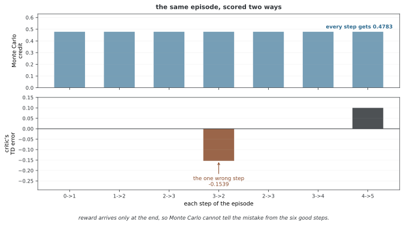

# 34.2.1 Actor-Critic 기초

Actor-Critic 방법은 폴리시 기반 길과 밸류 기반 길의 힘을 함께 얻는다. **액터**는 파라메터로 나타낸 폴리시 $\pi_\theta(a|s)$을 지니고, **크리틱**는 액터의 성능을 따지는 밸류 함수 $V_\phi(s)$(또는 $Q_\phi(s,a)$)을 배운다. 이 어우름은 곧바로 폴리시를 가장 좋게 하는 이로움을 지키면서 순수 REINFORCE보다 분산이 작은 그래디언트 어림을 이루게 한다.

---

## 1. 구조

### 두 조각 설계

Actor-Critic 틀은 다음으로 이루어진다.

1. **액터** $\pi_\theta(a|s)$: 액션을 고르는 폴리시 네트워크
2. **크리틱** $V_\phi(s)$: 어림 리턴을 어림하는 값 네트워크

크리틱은 배운 베이스라인 노릇을 하여 어드밴티지 어림을 준다.

$$A_t = r_t + \gamma V_\phi(s_{t+1}) - V_\phi(s_t)$$

### 고침 규칙

**액터 고침**(어드밴티지를 쓰는 폴리시 경사):

$$\theta \leftarrow \theta + \alpha_\theta \nabla_\theta \log \pi_\theta(a_t|s_t) \cdot A_t$$

**크리틱 고침**(밸류 함수 회귀):

$$\phi \leftarrow \phi - \alpha_\phi \nabla_\phi (V_\phi(s_t) - G_t)^2$$

여기서 $G_t$은 타깃 리턴이다(몬테카를로, 때 차이, 또는 n-step).

---

## 2. Actor-Critic이 REINFORCE보다 나은 점

| 결 | REINFORCE | Actor-Critic |
|--------|-----------|--------------|
| 분산 | 큼(몬테카를로) | 작음(부트스트랩) |
| 바이어스 | 치우치지 않음 | 바이어스(밸류 함수 잘못) |
| 고치는 잦기 | 에피소드 끝 | 스텝마다(잇달아) |
| 샘플링 효율 | 낮음 | 더 높음 |
| 모이는 빠르기 | 더딤 | 더 빠름 |

중요한 트레이드오프는 이렇다. Actor-Critic은 크리틱의 온전치 않은 값 어림 때문에 바이어스를 들여오지만 분산을 크게 줄여, 실제로 더 빨리 모이게 한다.

<div class="storybox" markdown>

**그림으로 보는 AI 1.** 비평자가 처음 맡은 일은 분산 줄이기가 아니었다

위 표는 크리틱을 **분산을 줄이는 장치**로 세워 둔다. 오늘 쓰는 자리에서는 맞는 말이다. 그런데 이 구조가 처음 나왔을 때 크리틱에게 주어진 일은 그것이 아니었다.

1983년에 앤드루 바토(Andrew Barto)·리처드 서튼(Richard Sutton)·찰스 앤더슨(Charles Anderson)이 수레 위의 막대를 세우는 문제에 두 조각짜리 학습기를 내놓았다. 이름도 액터와 크리틱이 아니었다 — **ASE**(Associative Search Element)와 **ACE**(Adaptive Critic Element)였다. 오늘 이름의 절반은 저 ACE에서 왔다.

그리고 ACE가 맡은 일은 논문의 말로 이렇다 — 리워드만으로 얻을 수 있는 것보다 **"a more informative evaluation function"** 을 만드는 것. 분산이라는 말은 거기 없다. 그럴 만한 사정이 있었다. 그 문제에서 리워드는 **막대가 쓰러질 때 한 번** 올 뿐이어서, 줄일 분산 이전에 **쓸 신호 자체가 없었다.**



그 차이를 끝에서만 리워드가 오는 복도에서 정확히 셈해 보면 그림과 같다. 걸음 일곱 가운데 하나에서만 뒤로 샜다고 하자.

**몬테카를로는 일곱 걸음 **모두**에 똑같이 0.4783을 돌려준다.** 잘한 여섯 걸음과 잘못한 한 걸음을 구별할 길이 없다. 끝에서 온 수 하나를 그대로 나눠 가졌기 때문이다.

**비평자를 두면 TD 오차가 걸음마다 다르다.** 제대로 간 여섯 걸음에서는 **정확히 0**이고, 뒤로 샌 그 한 걸음에서만 $-0.1539$ 다. 어디가 잘못이었는지를 **집어낸다.**

그러니 위 표의 "분산 작음"은 결과이지 처음의 동기가 아니다. ACE가 하려던 것은 **드문드문 오는 신호를 걸음마다 쓸 수 있는 신호로 바꾸는 일** — 곧 공을 돌릴 자리를 찾아 주는 일이었다. 이 구별이 쓸모 있는 까닭은 디버깅에서 드러난다. 크리틱이 잘 안 배워질 때 물어야 할 것은 "분산이 큰가"가 아니라 **"내 리워드가 걸음마다 뜻을 가지는가"** 이고, 리워드가 끝에서 한 번만 오는 과제라면 크리틱이 할 일이 그만큼 더 무겁다.

_확인한 곳 — A. G. Barto, R. S. Sutton, C. W. Anderson, "Neuronlike adaptive elements that can solve difficult learning control problems", *IEEE Transactions on Systems, Man, and Cybernetics* **SMC-13**(5), 834–846 (1983). 두 조각의 이름이 ASE 와 ACE 라는 것, ACE 가 리워드만으로 얻을 수 있는 것보다 더 알찬 평가 함수를 만든다는 것이 그 글의 것이다. 그림의 수는 그림을 그리는 코드가 작은 복도에서 닫힌 식으로 셈해 얻으며, TD 오차가 실제로 한 걸음에만 몰리는지를 먼저 확인한 뒤에만 그린다._

</div>

---

## 3. 잇단 Actor-Critic

가장 쉬운 Actor-Critic은 때 스텝마다 고친다.

```
스텝 t마다:
    액션 a_t ~ π_θ(·|s_t)을 벌인다
    r_t, s_{t+1}을 본다
    δ_t = r_t + γ V_φ(s_{t+1}) - V_φ(s_t)       # 때 차이 잘못
    θ ← θ + α_θ · δ_t · ∇_θ log π_θ(a_t|s_t)     # 액터 고침
    φ ← φ + α_φ · δ_t · ∇_φ V_φ(s_t)              # 크리틱 고침
```

때 차이 잘못 $\delta_t$이 한 스텝 어드밴티지 어림 노릇을 한다.

---

## 4. 배치 Actor-Critic

실제로는 배치로 고치는 것이 더 든든하다.

1. $\pi_\theta$으로 넘어감의 배치를 모은다
2. 온 넘어감에 대해 어드밴티지 어림을 계산한다
3. 어드밴티지를 쓰는 폴리시 경사로 액터를 고친다
4. 값 회귀로 크리틱을 고친다

### 크리틱 타깃

크리틱 타깃을 어떻게 고르느냐가 편향-분산에 미친다.

- **TD(0)**: $y_t = r_t + \gamma V_\phi(s_{t+1})$ -- 분산이 작고 바이어스가 큼
- **N스텝**: $y_t = \sum_{k=0}^{n-1} \gamma^k r_{t+k} + \gamma^n V_\phi(s_{t+n})$ -- 그 사이
- **몬테카를로**: $y_t = G_t = \sum_{k=t}^{T} \gamma^{k-t} r_k$ -- 편향이 없고 분산이 큼
- **GAE**: n-step 리턴을 지수로 웨이트 주어 섞은 것(36.2.4절)

---

## 5. 설계 공정성

### 함께 쓰는 네트워크와 따로 두는 네트워크

**함께 쓰는 등뼈**(A2C/PPO에서 흔하다):

- 액터 머리와 크리틱 머리가 피처 뽑개를 함께 쓴다
- 파라메터와 계산이 줄어든다
- 위험: 폴리시 목표와 값 목표 사이에서 그래디언트가 서로를 방해한다
- 누그러뜨리기: 로스 계수를 달리 쓴다(보기로 값 로스에 0.5)

**따로 두는 네트워크**(SAC/TD3에서 흔하다):

- 액터와 크리틱이 서로 매이지 않은 구조를 지닌다
- 학습이 더 든든하다
- 액터와 크리틱의 러닝레이트가 달라야 할 수 있는 벗어난 폴리시 방법에 더 알맞다

### 엔트로피 정규화

엔트로피 덤을 더하면 너무 일찍 모이는 것을 막는다.

$$L_\text{온} = L_\text{폴리시} + c_v L_\text{값} - c_e \mathcal{H}(\pi_\theta)$$

흔한 계수: $c_v = 0.5$, $c_e = 0.01$.

### 그래디언트 흐름

함께 쓰는 네트워크에서는 샘 셋에서 온 그래디언트가 네트워크를 지난다.

1. 폴리시 경사(액터): 이로운 액션의 확률을 올린다
2. 값 그래디언트(크리틱): 값 어림을 낫게 한다
3. 엔트로피 그래디언트: 살펴보기를 지킨다

한 목표가 판치지 않도록 이들의 저울을 맞추어야 한다.

---

## 6. 이치 성질

### 수렴

어울리는 함수 어림을 쓰는 Actor-Critic 방법은 여느 조건에서 그 언저리 가장 좋은 곳으로 모인다. 크리틱은 어울리는 함수 어림개여야 한다.

$$Q_w(s, a) = \nabla_\theta \log \pi_\theta(a|s)^\top w$$

실제로 뉴럴 넷트웍 크리틱은 이 조건을 깨뜨리지만, 그릇이 넉넉하면 학습이 그래도 잘 듣는다.

### 죽음의 삼발이

함수 어림을 쓰는 Actor-Critic은 들쭉날쭉함을 낳을 수 있는 세 가지를 한데 엮는다.

1. **함수 어림**(뉴럴 넷트웍)
2. **부트스트랩**(크리틱을 위한 때 차이 학습)
3. **벗어난 폴리시 학습**(데이터를 되쓸 때)

폴리시 안 Actor-Critic 방법은 셋째를 비껴가므로 더 나은 든든함 보장을 준다.

---

## 연습문제

<div class="drillbox" markdown>

**연습문제 1.** <span class="diff hard" title="어려움"></span>
이 절에서 밝힌 방법의 폴리시 경사를 이끌어 내어라. 어느 마디가 어림해야 하는 것이고 어느 마디가 딱 맞게 셈할 수 있는 것인지 또렷이 밝혀라.

</div>

??? success "풀이"
    폴리시 경사는 $\nabla_\theta J(\theta) = \mathbb{E}_{\tau \sim \pi_\theta}[\sum_t \nabla_\theta \log \pi_\theta(a_t | s_t) \cdot \hat{A}_t]$ 꼴이며 여기서 $\hat{A}_t$은 어드밴티지 어림이다. 로그 확률 그래디언트 $\nabla_\theta \log \pi_\theta$은 저절로 미분으로 딱 맞게 셈할 수 있다. 어드밴티지 $\hat{A}_t$은 뽑은 추적에서 어림해야 하므로 분산이 들어온다. 기댓값은 추적 배치에 걸쳐 고르게 하여 어림한다. 베이스라인으로 분산을 줄이면 치우치지 않음을 지키면서 어림 잡음을 줄인다. $\square$

---

<div class="drillbox" markdown>

**연습문제 2.** <span class="diff med" title="중간"></span>
이어진 다스리기 과제에서 이 방법의 샘플링 효율을 밸류 기반 길(보기로 DQN)과 비교하여라. 보이는 다름의 이치 까닭을 풀어라.

</div>

??? success "풀이"
    폴리시 기반 방법은 폴리시 안 데이터를 쓰므로(추적마다 한 번씩 쓴다) 밸류 기반 방법보다 샘플링 효율이 대체로 낮다. DQN은 경험 리플레이로 데이터를 되써서 더 나은 샘플링 효율을 이룬다. 그러나 폴리시 방법은 이어진 액션을 절로 다루고(액션 공간에 대한 argmax가 필요 없다), 가장 좋은 것이 확률 폴리시일 때 그리로 모이며, 신뢰 영역 아래에서 한결같은 나아짐을 보장한다. 벗어난 폴리시 Actor-Critic 방법(DDPG, SAC)은 폴리시 최적화와 경험 리플레이를 엮어 이 사이를 메운다. $\square$

---

<div class="drillbox" markdown>

**연습문제 3.** <span class="diff med" title="중간"></span>
쉬운 이어진 다스리기 과제(보기로 Pendulum-v1)에 이 방법을 만들어라. 러닝레이트와 이 방법에 딸린 중요한 파라메터에 대해 얼마나 예민한지 알려라.

</div>

??? success "풀이"
    가우스 폴리시를 쓰는 Pendulum-v1에서 흔한 성능은 이렇다. 러닝레이트 $3 \times 10^{-4}$이면 약 500 에피소드에 모이고, $10^{-3}$이면 흔들리며, $10^{-5}$이면 너무 더디게 모인다. 이 방법에 딸린 파라메터(보기로 PPO의 자르는 너비, TRPO의 쿨백-라이블러 매임)는 고침의 사나움과 든든함 사이의 트레이드오프를 다스린다. 너무 사나우면 성능이 무너지고 너무 조심스러우면 샘플링을 버린다. 가장 좋은 자리는 이 둘의 저울을 맞추는 곳이며 흔히 좁은 너비에서 격자 찾기로 얻는다. $\square$

---

<div class="drillbox" markdown>

**연습문제 4.** <span class="diff med" title="중간"></span>
액션 공간이 단체(합이 1인 자본 웨이트)이고 리워드가 위험을 맞춘 리턴인 포트폴리오 배분 최적화에 이 방법을 어떻게 쓸 수 있을지 따져라.

</div>

??? success "풀이"
    액션 공간은 $(n-1)$차원 단체 $\Delta^{n-1} = \{w \in \mathbb{R}^n : w_i \geq 0, \sum_i w_i = 1\}$이다. 폴리시는 디리클레 분포나 소프트맥스로 바꾼 가우스를 쓸 수 있다. 리워드는 그 포트폴리오 배분의 샤프 비나 미분 샤프 비다. 어려움에는 높은 차원의 액션 공간(자산이 많다), 잦은 다시 맞추기에 벌을 주는 거래 비용, 저자 리턴의 흐름 바뀜이 있다. 이 절의 방법은 든든하게 폴리시를 고치는 제 장치로 이를 다룬다. $\square$

## 정리하며

Actor-Critic 방법은 폴리시 경사와 밸류 기반 학습을 잇는다. 크리틱은 분산이 작은 어드밴티지 어림을 주고 액터는 폴리시를 곧바로 가장 좋게 한다. 이 어우름이 A2C, A3C, PPO, SAC 같은 요즘 알고리즘의 기초를 이룬다.
