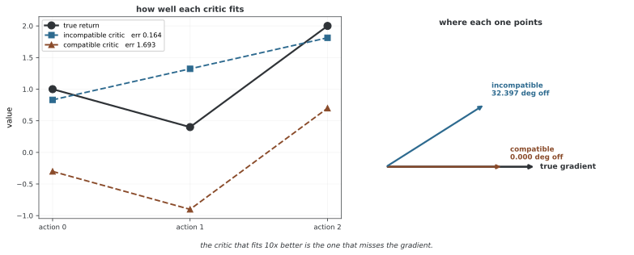

# 폴리시 경사 정리

**폴리시 경사 정리**는 기대 리턴 $J(\theta)$ 의 그래디언트를 환경의 동역학을 미분하지 않고 $\mathbb E[\nabla_\theta\log\pi_\theta(a\mid s)\,Q^{\pi}(s,a)]$ 형태의 기댓값으로 쓸 수 있다는 결과다. 기댓값이므로 궤적을 뽑아 평균하면 그래디언트를 추정할 수 있다. 이 쪽은 그 바탕인 로그 미분 트릭(점수 함수 추정량)을 수치로 확인하고, 그래디언트 추정량 세 가지 — 궤적 전체 리턴, 리워드 투 고(reward-to-go), 베이스라인을 뺀 것 — 를 구현해 흩어짐을 견준다.

## 1. 코드

```python
"""
34.1.2장: 폴리시 그래디언트 정리
========================================
폴리시 그래디언트 정리, 점수 함수 어림개, 여러 클래스 그래디언트 어림 꾀를
보여 준다.
"""

import torch
import torch.nn as nn
import torch.nn.functional as F
from torch.distributions import Categorical, Normal
import numpy as np
import gymnasium as gym
from typing import List, Tuple

# ========================================================================
# 메인
# ========================================================================


# ---------------------------------------------------------------------------
# 점수 함수 어림개 보여 주기
# ---------------------------------------------------------------------------

class SimplePolicy(nn.Module):
    """폴리시 그래디언트 정리를 보이기 위한 쉬운 소프트맥스 폴리시."""
    
    def __init__(self, obs_dim: int, act_dim: int, hidden_dim: int = 32):
        super().__init__()
        self.net = nn.Sequential(
            nn.Linear(obs_dim, hidden_dim),
            nn.ReLU(),
            nn.Linear(hidden_dim, act_dim),
        )
    
    def forward(self, obs: torch.Tensor) -> Categorical:
        logits = self.net(obs)
        return Categorical(logits=logits)


def collect_trajectory(
    env: gym.Env,
    policy: SimplePolicy,
    max_steps: int = 200,
) -> Tuple[List, List, List]:
    """
    주어진 폴리시로 자취 하나를 모은다.
    
    돌려주는 값
    -------
    log_probs : Tensor의 목록
        벌인 액션의 로그 확률.
    rewards : float의 목록
        스텝마다 받은 리워드.
    states : ndarray의 목록
        들른 상태.
    """
    obs, _ = env.reset()
    log_probs, rewards, states = [], [], []
    
    for _ in range(max_steps):
        obs_t = torch.FloatTensor(obs).unsqueeze(0)
        dist = policy(obs_t)
        action = dist.sample()
        log_prob = dist.log_prob(action)
        
        next_obs, reward, terminated, truncated, _ = env.step(action.item())
        
        log_probs.append(log_prob)
        rewards.append(reward)
        states.append(obs)
        
        obs = next_obs
        if terminated or truncated:
            break
    
    return log_probs, rewards, states


def compute_returns(rewards: List[float], gamma: float = 0.99) -> List[float]:
    """
    깎은 앞으로의 돌아옴 G_t = sum_{k=t}^T gamma^{k-t} r_k을 셈한다.
    
    이는 까닭 매김을 다듬은 것이다. G_t마다 때 t 뒤의 리워드만 담는다.
    """
    returns = []
    G = 0.0
    for r in reversed(rewards):
        G = r + gamma * G
        returns.insert(0, G)
    return returns


# ---------------------------------------------------------------------------
# 폴리시 그래디언트 어림개
# ---------------------------------------------------------------------------

def pg_total_reward(
    log_probs: List[torch.Tensor],
    rewards: List[float],
    gamma: float = 0.99,
) -> torch.Tensor:
    """
    온 자취 리워드를 쓰는 REINFORCE(까닭 매김 없음).
    
    그래디언트: sum_t [log pi(a_t|s_t) * R(tau)]
    
    치우치지 않지만 온 액션에 온 자취 리워드로 무게를 주므로
    흩어짐이 아주 크다.
    """
    # 자취의 온 깎은 돌아옴
    R = sum(gamma**t * r for t, r in enumerate(rewards))
    
    # 폴리시 그래디언트 로스
    loss = -sum(lp * R for lp in log_probs)
    return loss


def pg_reward_to_go(
    log_probs: List[torch.Tensor],
    rewards: List[float],
    gamma: float = 0.99,
) -> torch.Tensor:
    """
    앞으로의 리워드를 쓰는 REINFORCE(까닭 매김을 매김).
    
    그래디언트: sum_t [log pi(a_t|s_t) * G_t]
    
    액션마다 앞날의 리워드로만 무게를 주므로 온 리워드보다
    흩어짐이 작다.
    """
    returns = compute_returns(rewards, gamma)
    
    loss = -sum(lp * G for lp, G in zip(log_probs, returns))
    return loss


def pg_with_baseline(
    log_probs: List[torch.Tensor],
    rewards: List[float],
    baseline: float,
    gamma: float = 0.99,
) -> torch.Tensor:
    """
    상수 베이스라인을 빼는 REINFORCE.
    
    그래디언트: sum_t [log pi(a_t|s_t) * (G_t - b)]
    
    베이스라인 b는 기댓값을 바꾸지 않지만(치우치지 않음) b ≈ E[G_t]일 때
    흩어짐을 줄인다.
    """
    returns = compute_returns(rewards, gamma)
    
    loss = -sum(lp * (G - baseline) for lp, G in zip(log_probs, returns))
    return loss


# ---------------------------------------------------------------------------
# 로그 미분 재주 보여 주기
# ---------------------------------------------------------------------------

def demonstrate_log_derivative_trick():
    """
    풀어낸 그래디언트와 점수 함수 그래디언트를 견주어
    ∇_θ E_π[f(x)] = E_π[∇_θ log π(x) · f(x)]임을 보인다.
    """
    print("=" * 60)
    print("Log-Derivative Trick Verification")
    print("=" * 60)
    
    # 쉬운 1차원 경우: π_θ(x) = Categorical([θ, 1-θ])
    # f(x) = [3.0, 1.0] (액션마다의 리워드)
    
    theta = torch.tensor([0.6], requires_grad=True)
    f_values = torch.tensor([3.0, 1.0])
    
    # E[f(x)] = θ·3 + (1-θ)·1 = 2θ + 1의 풀어낸 그래디언트
    # ∇_θ E[f(x)] = 2.0
    analytical_grad = 2.0
    
    # 점수 함수 어림(몬테카를로)
    n_samples = 100000
    torch.manual_seed(42)
    
    probs = torch.cat([theta, 1 - theta])
    dist = Categorical(probs=probs)
    
    samples = dist.sample((n_samples,))
    log_probs = dist.log_prob(samples)
    rewards = f_values[samples]
    
    # ∇_θ E[f] ≈ (1/N) Σ ∇_θ log π(x_i) · f(x_i)
    surrogate_loss = -(log_probs * rewards).mean()
    surrogate_loss.backward()
    
    score_function_grad = -theta.grad.item()  # 가장 작게 했으므로 부호를 뒤집는다
    
    print(f"Analytical gradient:        {analytical_grad:.4f}")
    print(f"Score function estimate:    {score_function_grad:.4f}")
    print(f"Error:                      {abs(analytical_grad - score_function_grad):.4f}")


# ---------------------------------------------------------------------------
# 어림개별 흩어짐 견주기
# ---------------------------------------------------------------------------

def compare_estimator_variance():
    """
    그래디언트 어림을 여러 번 벌여 폴리시 그래디언트 어림개들의 흩어짐을
    견준다.
    """
    print("\n" + "=" * 60)
    print("Policy Gradient Estimator Variance Comparison")
    print("=" * 60)
    
    env = gym.make("CartPole-v1")
    obs_dim = env.observation_space.shape[0]
    act_dim = env.action_space.n
    
    torch.manual_seed(42)
    policy = SimplePolicy(obs_dim, act_dim)
    
    n_estimates = 50
    n_trajectories = 5
    gamma = 0.99
    
    grads_total = []
    grads_rtg = []
    grads_baseline = []
    
    for i in range(n_estimates):
        # 자취 배치를 모은다
        batch_log_probs = []
        batch_rewards = []
        all_returns = []
        
        for _ in range(n_trajectories):
            lps, rews, _ = collect_trajectory(env, policy, max_steps=200)
            batch_log_probs.append(lps)
            batch_rewards.append(rews)
            all_returns.extend(compute_returns(rews, gamma))
        
        baseline = np.mean(all_returns)
        
        # 어림개마다 그래디언트를 셈한다
        for est_name, est_func, grads_list in [
            ("total", pg_total_reward, grads_total),
            ("rtg", pg_reward_to_go, grads_rtg),
            ("baseline", lambda lp, r: pg_with_baseline(lp, r, baseline), grads_baseline),
        ]:
            policy.zero_grad()
            total_loss = sum(
                est_func(lps, rews)
                for lps, rews in zip(batch_log_probs, batch_rewards)
            ) / n_trajectories
            total_loss.backward()
            
            # 그래디언트 노름을 모은다
            grad_norm = sum(
                p.grad.norm().item() ** 2 
                for p in policy.parameters() 
                if p.grad is not None
            ) ** 0.5
            grads_list.append(grad_norm)
    
    print(f"\nGradient norm statistics over {n_estimates} estimates:")
    print(f"{'Estimator':<15} {'Mean':>10} {'Std':>10} {'CV':>10}")
    print("-" * 45)
    for name, grads in [
        ("Total reward", grads_total),
        ("Reward-to-go", grads_rtg),
        ("With baseline", grads_baseline),
    ]:
        mean_g = np.mean(grads)
        std_g = np.std(grads)
        cv = std_g / (mean_g + 1e-8)
        print(f"{name:<15} {mean_g:>10.4f} {std_g:>10.4f} {cv:>10.4f}")
    
    env.close()


# ---------------------------------------------------------------------------
# 서로 다른 돌아옴 어림개로 그래디언트 어림하기
# ---------------------------------------------------------------------------

def demonstrate_gradient_computation():
    """폴리시 그래디언트를 스텝마다 셈해 보인다."""
    print("\n" + "=" * 60)
    print("Step-by-Step Policy Gradient Computation")
    print("=" * 60)
    
    env = gym.make("CartPole-v1")
    obs_dim = env.observation_space.shape[0]
    act_dim = env.action_space.n
    
    torch.manual_seed(0)
    policy = SimplePolicy(obs_dim, act_dim)
    
    # 자취 하나를 모은다
    log_probs, rewards, states = collect_trajectory(env, policy, max_steps=50)
    returns = compute_returns(rewards, gamma=0.99)
    
    T = len(rewards)
    print(f"\nTrajectory length: {T}")
    print(f"Total reward: {sum(rewards):.1f}")
    print(f"Discounted return G_0: {returns[0]:.4f}")
    
    # 앞쪽 몇 스텝을 보인다
    print(f"\n{'Step':>4} {'Reward':>8} {'G_t':>10} {'log π':>10}")
    print("-" * 36)
    for t in range(min(10, T)):
        print(f"{t:>4} {rewards[t]:>8.2f} {returns[t]:>10.4f} {log_probs[t].item():>10.4f}")
    
    if T > 10:
        print(f"  ... ({T - 10} more steps)")
    
    # 앞으로의 리워드로 폴리시 그래디언트를 셈한다
    policy.zero_grad()
    loss = pg_reward_to_go(log_probs, rewards, gamma=0.99)
    loss.backward()
    
    print(f"\nPolicy gradient (reward-to-go):")
    for name, param in policy.named_parameters():
        if param.grad is not None:
            print(f"  {name}: grad norm = {param.grad.norm().item():.6f}")
    
    env.close()


# ---------------------------------------------------------------------------
# 대리 로스 짓기
# ---------------------------------------------------------------------------

def demonstrate_surrogate_loss():
    """
    저절로 미분하도록 대리 로스를 어떻게 짓는지 보인다.
    
    종요로운 눈길: 돌아옴이나 이점을 거쳐 미분하지 않는다.
    L(θ) = -E[log π_θ(a|s) · Â]을 짓고 여느 가장 좋게 하는 개를 쓴다.
    """
    print("\n" + "=" * 60)
    print("Surrogate Loss Construction")
    print("=" * 60)
    
    # 흉내 낸 넘어감 배치
    batch_size = 32
    obs_dim, act_dim = 4, 2
    
    torch.manual_seed(42)
    policy = SimplePolicy(obs_dim, act_dim)
    optimizer = torch.optim.Adam(policy.parameters(), lr=1e-3)
    
    # 흉내 낸 자료(실제로는 둘레에서 모은다)
    obs = torch.randn(batch_size, obs_dim)
    actions = torch.randint(0, act_dim, (batch_size,))
    advantages = torch.randn(batch_size)  # 고르게 한 이점
    advantages = (advantages - advantages.mean()) / (advantages.std() + 1e-8)
    
    # 대리 로스를 짓는다
    dist = policy(obs)
    log_probs = dist.log_prob(actions)
    
    # 종요로움: 이점은 상수로 다룬다(떼어 놓는다)
    # 오직 log_probs만 θ을 거쳐 그래디언트를 나른다
    surrogate_loss = -(log_probs * advantages.detach()).mean()
    
    print(f"Batch size: {batch_size}")
    print(f"Surrogate loss: {surrogate_loss.item():.6f}")
    
    # 여느 그래디언트 내림 스텝
    optimizer.zero_grad()
    surrogate_loss.backward()
    
    grad_norm = sum(
        p.grad.norm().item() ** 2 
        for p in policy.parameters() 
        if p.grad is not None
    ) ** 0.5
    print(f"Gradient norm: {grad_norm:.6f}")
    
    optimizer.step()
    print("Parameter update applied via Adam optimizer.")


if __name__ == "__main__":
    demonstrate_log_derivative_trick()
    compare_estimator_variance()
    demonstrate_gradient_computation()
    demonstrate_surrogate_loss()
```

## 2. 논의

데모는 네 부분이다.

**로그 미분 트릭.** $\pi_\theta = \text{Categorical}([\theta, 1-\theta])$, 리워드 $f=[3,1]$ 이면 $\mathbb E[f] = 2\theta+1$ 이라 참 그래디언트는 2 다. 표본 10만 개로 $\frac1N\sum_i \nabla_\theta\log\pi_\theta(x_i)\,f(x_i)$ 를 계산해 이 값과 견준다. 코드는 이 평균의 음수를 로스로 두고 `backward()` 한 뒤 부호를 뒤집는데, 이것이 폴리시 경사를 자동 미분으로 계산하는 표준 방식이다.

**세 추정량.** `pg_total_reward` 는 궤적의 모든 로그 확률에 같은 리턴 $R(\tau)$ 를 곱하고, `pg_reward_to_go` 는 $t$ 시점 이후의 리워드 $G_t$ 만 곱하며, `pg_with_baseline` 은 $G_t$ 에서 상수 $b$ 를 뺀다. 과거의 리워드는 지금의 액션과 무관하므로 그 항을 빼도 기댓값은 그대로이고 흩어짐만 준다 — 이것이 **인과성**(causality)을 이용한 리워드 투 고다. 다만 이 코드의 두 함수는 할인을 서로 다르게 적용해서 정확히 같은 양을 추정하지는 않는다(연습문제 2). `compare_estimator_variance` 는 CartPole 에서 궤적 5개짜리 그래디언트 추정을 50 번 되풀이해 그래디언트 노름의 평균·표준편차·변동 계수(CV, 표준편차 ÷ 평균)를 찍는다. 그래디언트 벡터 자체의 분산이 아니라 노름의 흩어짐을 잰다는 점에 주의하라.

**스텝별 계산.** `demonstrate_gradient_computation` 은 궤적 하나(최대 50 스텝)를 모아 앞 10 스텝의 리워드·$G_t$·로그 확률을 찍고, 리워드 투 고 로스를 역전파해 레이어별 그래디언트 노름을 보인다.

**대리 로스.** `demonstrate_surrogate_loss` 는 $L(\theta) = -\frac1N\sum\log\pi_\theta(a_i\mid s_i)\,\hat A_i$ 를 만들고 어드밴티지 $\hat A$ 를 `detach()` 로 상수 취급한다. 이 로스의 그래디언트가 폴리시 경사의 추정값이 되도록 만든 것이지, 로스의 값 자체에는 뜻이 없다.

이 쪽에는 출력 블록이 없다. 직접 돌려 보면 시드를 박은 부분(로그 미분 트릭, 대리 로스)은 같은 수가 나오지만, CartPole 부분은 `env.reset()` 에 시드가 없어 돌릴 때마다 조금씩 달라진다.

<div class="storybox" markdown>

**그림으로 보는 AI 1.** 크리틱을 써도 된다는 허가에 붙어 있던 단서

폴리시 경사 정리에는 짝이 되는 둘째 정리가 있고, 실제로 액터-크리틱을 쓸 수 있게 해 주는 쪽은 그 둘째다. 1999년에 리처드 서튼·데이비드 맥알레스터·사틴더 싱·이샤이 만수어가 낸 글의 **정리 2**다.

그전까지 알려진 것은 약한 보증이었다. 야콜라·싱·조던이 특수한 경우에 대해 보인 것은 참 그래디언트와의 **내적이 양수**라는 것 — 다음 쪽 REINFORCE 에서 볼 윌리엄스의 정리 1과 같은 형태다. 네 사람의 글은 그것을 **등호**로 끌어올렸다고 적는다. "Here we extend their result to general function approximation and prove **equality** with the gradient."

**다만 공짜가 아니었다.** 등호를 받으려면 크리틱 $f_w$ 가 두 조건을 지켜야 한다. 하나는 폴리시 아래에서 제곱오차의 국소 최적에 닿아 있을 것, 다른 하나가 **호환 조건**이다.

$$
\frac{\partial f_w(s,a)}{\partial w} \;=\; \frac{\partial \pi(s,a)}{\partial \theta}\,\frac{1}{\pi(s,a)}
$$

곧 크리틱의 피처가 폴리시의 **점수 함수**와 같아야 한다. 그리고 바로 그 쪽 아래에 각주 하나가 달려 있다 — "Tsitsiklis (personal communication) points out that $f_w$ being **linear in the features** given on the righthand side **may be the only way to satisfy this condition.**" 개인적인 연락으로 전해 들은 말이 각주로 들어가 있고, 그 내용은 이 조건을 지키려면 크리틱이 **선형이어야 할지도 모른다**는 것이다.

호환이 무엇을 요구하는지는 "얼마나 잘 맞히는가"와 **아무 상관이 없다.** 작은 밴딧에서 크리틱 둘을 정확히 계산해 견주어 보면 그 점이 뚜렷하다.



**리턴을 열 배 더 잘 맞히는 크리틱이 그래디언트는 32.397도 어긋나게 만든다.** 반대로 호환 크리틱은 리턴을 형편없이 맞히는데 — 오차가 1.693으로 열 배쯤 크다 — 방향은 **0.000도**, 정확하다.

까닭은 왼쪽 그림에 그대로 보인다. 호환 크리틱은 점수 함수 피처로만 만들어져 있어서 폴리시 아래 평균이 0이다. 그래서 리턴의 **높이**를 못 맞힌다. 그런데 높이는 베이스라인이고, 베이스라인은 그래디언트를 바꾸지 않는다. 크리틱이 맞혀야 하는 것은 값이 아니라 **점수 공간에서의 모양**이다.

**그래서 오늘 쓰는 액터-크리틱은 정리 2가 덮어 주는 자리에 있지 않다.** 크리틱을 여러 레이어짜리 뉴럴 네트워크로 두는 순간 호환 조건은 깨지고, 각주가 가리키는 대로라면 깨지는 것이 당연하다. 그렇다고 못 쓸 일은 아니다 — 잘 되는 것을 우리는 보고 있다. 다만 **그때 보증되는 것은 정리 2의 등호가 아니다.** 크리틱을 더 크게 키워 Q를 더 잘 맞히는 것이 곧 더 나은 폴리시 경사를 뜻하지는 않으며, 이 쪽의 측정이 그 둘이 서로 다른 축이라는 것을 보인다.

_확인한 곳 — R. S. Sutton, D. McAllester, S. Singh, Y. Mansour, "Policy Gradient Methods for Reinforcement Learning with Function Approximation", NIPS 1999. 등호로 끌어올렸다는 문장은 2절, 정리 2와 호환 조건 (4)는 1060–1061쪽이며, 치치클리스의 선형성 지적은 1061쪽 각주 1이다. 그림의 두 각과 두 오차는 그림을 그리는 코드가 작은 밴딧에서 기댓값을 닫힌 식으로 정확히 계산해 얻고, 호환 크리틱이 실제로 등호를 주는지를 먼저 확인한 뒤에만 그린다._

</div>

## 연습문제

<div class="drillbox" markdown>

**연습문제 1.** <span class="diff med" title="중간"></span>
`demonstrate_log_derivative_trick` 의 설정($\theta=0.6$, $f=[3,1]$)에서 표본 하나짜리 점수 함수 추정량 $g(x)=f(x)\,\partial_\theta\log\pi_\theta(x)$ 가 갖는 두 값과 그 확률을 구하라. $\mathbb E[g]=2$ 임을 확인하고, $\mathrm{Var}[g]$ 와 표본 10만 개 평균의 표준오차를 계산하라. 데모가 출력하는 `Error` 는 그 표준오차와 비교해 어느 정도여야 하는가?

</div>

??? success "풀이"
    $x=0$ (확률 0.6)이면 $\partial_\theta\log\theta = 1/0.6$ 이라 $g=3/0.6=5$, $x=1$ (확률 0.4)이면 $\partial_\theta\log(1-\theta) = -1/0.4$ 라 $g=-2.5$ 다. $\mathbb E[g] = 0.6\cdot5 + 0.4\cdot(-2.5) = 2$ 로 참 그래디언트와 같다. $\mathbb E[g^2] = 0.6\cdot25 + 0.4\cdot6.25 = 17.5$ 이므로 $\mathrm{Var}[g] = 17.5 - 4 = 13.5$, 표준편차는 약 3.67 이다. 표본 10만 개 평균의 표준오차는 $3.67/\sqrt{10^5}\approx 0.0116$ 이므로 `Error` 는 대개 0.01 안팎, 0.02~0.03 을 넘는 일은 드물어야 한다. 참값이 2 인데 표본 하나의 추정량은 5 와 −2.5 만 오간다는 것이 점수 함수 추정량의 흩어짐이 얼마나 큰지를 보여 준다.

---

<div class="drillbox" markdown>

**연습문제 2.** <span class="diff med" title="중간"></span>
(가) $k<t$ 일 때 $\mathbb E[\nabla_\theta\log\pi_\theta(a_t\mid s_t)\, r_k]=0$ 임을 보여, 리워드 투 고 추정량이 궤적 전체 리턴 추정량과 같은 기댓값을 가짐을 증명하라. (나) 그런데 코드의 `pg_total_reward` 는 $R=\sum_k\gamma^k r_k$ 를, `pg_reward_to_go` 는 $G_t=\sum_{k\ge t}\gamma^{k-t}r_k$ 를 쓴다. 두 함수의 기댓값은 같은가?

</div>

??? success "풀이"
    (가) $r_k$ 는 $(s_0,a_0,\dots,s_k,a_k)$ 의 함수이고 $k<t$ 이면 $s_t$ 를 조건으로 할 때 $a_t$ 와 무관하다. 그러므로 $\mathbb E[\nabla\log\pi(a_t\mid s_t)\,r_k] = \mathbb E\big[r_k\,\mathbb E_{a_t\sim\pi}[\nabla\log\pi(a_t\mid s_t)\mid s_t,\dots]\big]$ 이고, 안쪽 기댓값은 $\sum_a \nabla\pi(a\mid s_t) = \nabla 1 = 0$ 이다. 그래서 과거 리워드 항을 지워도 기댓값이 바뀌지 않는다. (나) 같지 않다. (가)를 적용하면 `pg_total_reward` 의 기댓값은 $\sum_t \gamma^t\,\nabla\log\pi_t\,G_t$ 의 기댓값이 되어 $t$ 번째 항에 $\gamma^t$ 가 붙는다. `pg_reward_to_go` 에는 이 $\gamma^t$ 가 없다. 할인된 목표의 참 그래디언트는 앞엣것이고, 뒤엣것은 실제 구현에서 흔히 쓰지만 $\gamma^t$ 를 떨어뜨린 치우친 추정량이다. 따라서 데모의 흩어짐 비교는 엄밀히 말하면 서로 다른 두 양의 추정량을 견준 것이다.

---

<div class="drillbox" markdown>

**연습문제 3.** <span class="diff hard" title="어려움"></span>
`compare_estimator_variance` 의 베이스라인은 같은 배치의 모든 $G_t$ 의 평균 하나다. CartPole 에서는 $G_t$ 가 남은 스텝 수에 따라 크게 달라지므로 상수 하나는 좋은 베이스라인이 아니다. 시점 $t$ 마다 다른 베이스라인 $b_t$ (배치에서 같은 $t$ 의 $G_t$ 평균)를 쓰도록 바꾸고 그래디언트 노름의 CV 를 견주어라. 같은 배치로 베이스라인을 추정하면 생기는 문제와 그 해결책도 논하라.

</div>

??? success "풀이"
    $b_t$ 는 $s_t$ 이후의 액션에 의존하지 않는 한 그래디언트의 기댓값을 바꾸지 않는다. CartPole 에서는 에피소드 끝에 가까울수록 $G_t$ 가 작아지므로, $t$ 별 평균을 빼면 상수 평균을 뺄 때보다 남는 흩어짐이 작아질 것으로 기대된다. 다만 같은 배치로 $b$ 를 추정하면 $b$ 가 그 궤적 자신의 리턴에 의존해 아주 약간의 치우침이 생긴다. 궤적 $i$ 의 베이스라인을 나머지 궤적만으로 계산하는 **leave-one-out** 방식이 이것을 없앤다. 궤적이 5개뿐이므로 효과가 작을 수 있으니 50 번 추정의 CV 를 시드 여럿으로 되풀이해 차이가 흔들림보다 큰지 확인한다. 더 나아가면 상태에 따라 다른 $b(s_t)$ 를 학습하는데, 그것이 [베이스라인](baselines.md) 쪽과 Actor-Critic 의 크리틱이다.

## 정리하며

**다룬 것** — 폴리시 경사 정리

폴리시 경사는 $\nabla\log\pi$ 와 리턴의 곱의 기댓값이다. 과거 리워드를 빼는 리워드 투 고와 베이스라인은 기댓값을 지키며 흩어짐을 줄이고, 구현은 어드밴티지를 상수로 둔 대리 로스를 자동 미분하는 방식으로 한다.

핵심 클래스는 `SimplePolicy`이며 앞의 연습문제 3개로 스스로 따져 볼 수 있다.
