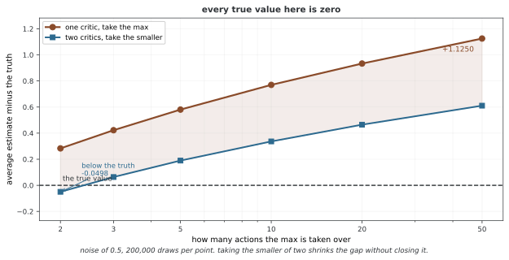

# 34.4.2 Twin Delayed DDPG(TD3)

TD3(후지모토 외, 2018)은 겨눈 고침 셋으로 DDPG의 중요한 걸림돌 셋을 다룬다. 곧 지나친 어림에 맞서는 쌍둥이 크리틱, 늦춘 폴리시 고침, 타깃 폴리시 다듬기다. 이 쉬운 바꿈이 든든함과 성능을 크게 높인다.

---

## 1. 중요한 고침 셋

### 1. 잘라 낸 곱절 Q 학습(쌍둥이 크리틱)

DDPG는 벨만 되돌리기의 max 연산자 때문에 Q 값을 지나치게 높이 어림하며 앓는다. TD3은 서로 매이지 않은 크리틱 네트워크 둘을 지니고 그 가운데 작은 값을 쓴다.

$$y = r + \gamma (1-d) \min_{i=1,2} Q_{\phi'_i}(s', \tilde{a}')$$

이 낮추어 보는 어림이 지나친 어림 바이어스를 되받는다.

<div class="storybox" markdown>

**그림으로 보는 AI 1.** 고르는 일만으로 값이 올라간다

위 문단이 "max 연산자 때문에" 값이 부푼다고 적었다. 그 말이 얼마나 곧이곧대로인지는 극단적인 자리를 하나 만들어 보면 드러난다. 학습도 근사 오차도 없이, **고르기만** 남겨 두는 것이다.

참 $Q$ 가 모든 액션에서 똑같이 0인 자리를 생각하자. 비평자가 그것을 잡음만 섞어 어림한다고 하자 — 치우침 없이, 평균이 정확히 0인 잡음이다. 그래도 **그중 가장 큰 것을 고르면** 평균이 0이 아니다. 잡음이 위로 튄 액션이 뽑히기 때문이다. 어림이 나빠서가 아니라 **고르는 행위가 위쪽 잡음을 추려 내서** 그렇다.



재어 보면 그림과 같다. 잡음의 표준편차가 0.5일 때 액션이 둘이면 평균이 **+0.2832** 만큼 높고, 쉰이면 **+1.1250** 이다. **고를 것이 많을수록 더 부푼다.** 참값은 내내 0인데도 그렇다.

위 식처럼 비평자를 둘 두고 작은 쪽을 쓰면 선이 분명히 내려간다 — 액션 쉰 개에서 1.125가 0.611이 된다. **다만 0이 되지는 않는다.** 그리고 액션이 둘뿐일 때는 **$-0.0498$ 로 참값보다 아래**다.

**그러니 쌍둥이 크리틱은 고침이 아니라 맞바꿈이다.** 위로 치우치던 것을 아래로 치우치게 만들어 가운데 어딘가에 두는 장치이고, 어느 쪽으로 얼마나 기울지는 액션 공간과 잡음 크기가 정한다. 논문 제목이 함수 근사 오차를 "없앤다"가 아니라 **"다룬다(Addressing)"** 인 것이 그 사정을 그대로 적은 것이다.

그리고 한 가지가 따라 나온다. 위 구현에서 두 크리틱의 값이 서로 벌어져 있다면 그것은 버그가 아니라 **이 장치가 기대고 있는 바로 그 틈**이다. 둘이 똑같아지면 $\min$ 이 아무 일도 하지 않는다.

_확인한 곳 — S. Fujimoto, H. van Hoof, D. Meger, "Addressing Function Approximation Error in Actor-Critic Methods", ICML 2018 (arXiv:1802.09477). 비평자 한 쌍에서 작은 값을 써 과대평가를 억누른다는 것과 폴리시 고침을 늦춘다는 것이 그 글의 장치다. 그림의 수는 그림을 그리는 코드가 점마다 20만 번씩 뽑아 직접 셈하며, 최댓값이 실제로 위로 치우치는지를 먼저 확인한 뒤에만 그린다._

</div>

### 2. 늦춘 폴리시 고침

액터를 크리틱보다 드물게 고친다(흔히 크리틱 고침 두 번마다 한 번). 이로써 액터가 파고들기 앞서 크리틱이 더 맞는 Q 값으로 모일 수 있어 잘못이 쌓이는 것이 준다.

### 3. 타깃 폴리시 다듬기

Q 함수를 매끄럽게 하려고 타깃 액션에 잡음을 더한다.

$$\tilde{a}' = \text{clip}(\mu_{\theta'}(s') + \text{clip}(\epsilon, -c, c), a_\text{아래}, a_\text{위})$$

$$\epsilon \sim \mathcal{N}(0, \sigma)$$

이는 액터가 파고들 만한 뾰족한 봉우리가 생기는 것을 막아 크리틱을 정규화한다.

---

## 2. TD3 알고리즘

```
액터 μ_θ, 크리틱 Q_{φ1}, Q_{φ2}, 타깃에 첫 값을 매긴다
되돌려 보기 버퍼 D에 첫 값을 매긴다

때 스텝마다:
    a = μ_θ(s) + ε, ε ~ N(0, σ)
    (s, a, r, s', done)을 D에 갈무리한다
    D에서 작은 배치를 뽑는다

    # 다듬기를 곁들인 타깃
    ã' = clip(μ_{θ'}(s') + clip(ε, -c, c), a_아래, a_위)
    y = r + γ(1-d) min(Q_{φ1'}(s', ã'), Q_{φ2'}(s', ã'))

    # 크리틱 둘을 모두 고친다
    φ1을 고친다: (Q_{φ1}(s,a) - y)²을 가장 작게 한다
    φ2를 고친다: (Q_{φ2}(s,a) - y)²을 가장 작게 한다

    # 늦춘 액터 고침(d 스텝마다)
    if t mod d == 0:
        θ를 고친다: Q_{φ1}(s, μ_θ(s))을 가장 크게 한다
        온 타깃을 부드럽게 고친다
```

---

## 3. 파라메터

| 파라메터 | 기본값 | 뜻 |
|-----------|---------|-------------|
| 폴리시 늦춤 $d$ | 2 | 액터를 고치는 잦기 |
| 타깃 잡음 $\sigma$ | 0.2 | 다듬기 잡음의 표준편차 |
| 잡음 자르기 $c$ | 0.5 | 다듬기 잡음의 매임 |
| 살펴보기 잡음 | 0.1 | 액션 잡음의 표준편차 |
| $\tau$ | 0.005 | 부드러운 고침 계수 |

---

## 4. TD3과 DDPG

| 걸림돌 | DDPG | TD3 |
|-------|------|-----|
| Q 지나친 어림 | 크리틱 하나 | 쌍둥이 크리틱(최솟값) |
| Actor-Critic 얽힘 | 한꺼번에 | 늦춘 액터 |
| 타깃 매끄러움 | 없음 | 정규화함 |
| 든든함 | 부서지기 쉬움 | 굳셈 |

---

## 연습문제

<div class="drillbox" markdown>

**연습문제 1.** <span class="diff hard" title="어려움"></span>
이 절에서 밝힌 방법의 폴리시 경사를 이끌어 내어라. 어느 마디가 어림해야 하는 것이고 어느 마디가 딱 맞게 셈할 수 있는 것인지 또렷이 밝혀라.

</div>

??? success "풀이"
    폴리시 경사는 $\nabla_\theta J(\theta) = \mathbb{E}_{\tau \sim \pi_\theta}[\sum_t \nabla_\theta \log \pi_\theta(a_t | s_t) \cdot \hat{A}_t]$ 꼴이며 여기서 $\hat{A}_t$은 어드밴티지 어림이다. 로그 확률 그래디언트 $\nabla_\theta \log \pi_\theta$은 저절로 미분으로 딱 맞게 셈할 수 있다. 어드밴티지 $\hat{A}_t$은 뽑은 추적에서 어림해야 하므로 분산이 들어온다. 기댓값은 추적 배치에 걸쳐 고르게 하여 어림한다. 베이스라인으로 분산을 줄이면 치우치지 않음을 지키면서 어림 잡음을 줄인다. $\square$

---

<div class="drillbox" markdown>

**연습문제 2.** <span class="diff med" title="중간"></span>
이어진 다스리기 과제에서 이 방법의 샘플링 효율을 밸류 기반 길(보기로 DQN)과 비교하여라. 보이는 다름의 이치 까닭을 풀어라.

</div>

??? success "풀이"
    폴리시 기반 방법은 폴리시 안 데이터를 쓰므로(추적마다 한 번씩 쓴다) 밸류 기반 방법보다 샘플링 효율이 대체로 낮다. DQN은 경험 리플레이로 데이터를 되써서 더 나은 샘플링 효율을 이룬다. 그러나 폴리시 방법은 이어진 액션을 절로 다루고(액션 공간에 대한 argmax가 필요 없다), 가장 좋은 것이 확률 폴리시일 때 그리로 모이며, 신뢰 영역 아래에서 한결같은 나아짐을 보장한다. 벗어난 폴리시 Actor-Critic 방법(DDPG, SAC)은 폴리시 최적화와 경험 리플레이를 엮어 이 사이를 메운다. $\square$

---

<div class="drillbox" markdown>

**연습문제 3.** <span class="diff med" title="중간"></span>
쉬운 이어진 다스리기 과제(보기로 Pendulum-v1)에 이 방법을 만들어라. 러닝레이트와 이 방법에 딸린 중요한 파라메터에 대해 얼마나 예민한지 알려라.

</div>

??? success "풀이"
    가우스 폴리시를 쓰는 Pendulum-v1에서 흔한 성능은 이렇다. 러닝레이트 $3 \times 10^{-4}$이면 약 500 에피소드에 모이고, $10^{-3}$이면 흔들리며, $10^{-5}$이면 너무 더디게 모인다. 이 방법에 딸린 파라메터(보기로 PPO의 자르는 너비, TRPO의 쿨백-라이블러 매임)는 고침의 사나움과 든든함 사이의 트레이드오프를 다스린다. 너무 사나우면 성능이 무너지고 너무 조심스러우면 샘플링을 버린다. 가장 좋은 자리는 이 둘의 저울을 맞추는 곳이며 흔히 좁은 너비에서 격자 찾기로 얻는다. $\square$

---

<div class="drillbox" markdown>

**연습문제 4.** <span class="diff med" title="중간"></span>
액션 공간이 단체(합이 1인 자본 웨이트)이고 리워드가 위험을 맞춘 리턴인 포트폴리오 배분 최적화에 이 방법을 어떻게 쓸 수 있을지 따져라.

</div>

??? success "풀이"
    액션 공간은 $(n-1)$차원 단체 $\Delta^{n-1} = \{w \in \mathbb{R}^n : w_i \geq 0, \sum_i w_i = 1\}$이다. 폴리시는 디리클레 분포나 소프트맥스로 바꾼 가우스를 쓸 수 있다. 리워드는 그 포트폴리오 배분의 샤프 비나 미분 샤프 비다. 어려움에는 높은 차원의 액션 공간(자산이 많다), 잦은 다시 맞추기에 벌을 주는 거래 비용, 저자 리턴의 흐름 바뀜이 있다. 이 절의 방법은 든든하게 폴리시를 고치는 제 장치로 이를 다룬다. $\square$

## 정리하며

TD3의 고침 셋 -- 쌍둥이 크리틱, 늦춘 고침, 타깃 다듬기 -- 은 DDPG의 들쭉날쭉함에 이치 있는 고침을 준다. 이어진 다스리기 과제의 든든한 잣대로 여전히 자리하며, 곧은 구현으로 뒤지지 않는 성능을 준다.
