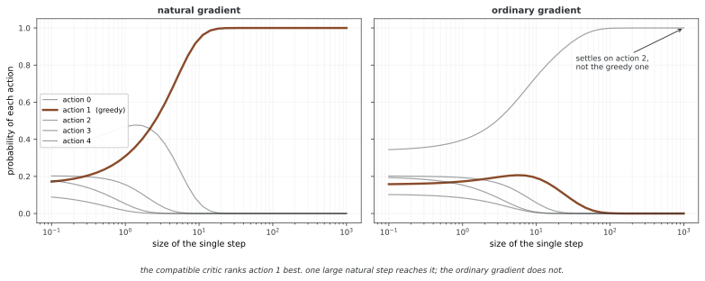

# 자연 폴리시 경사(NPG)

**자연 폴리시 경사**(NPG)는 폴리시 경사 $g$ 에 피셔 정보 행렬의 역행렬을 곱한 $F^{-1}g$ 방향으로 가는 방법이다. **피셔 정보 행렬** $F = \mathbb E[\nabla\log\pi\,\nabla\log\pi^\top]$ 는 파라미터를 조금 바꿀 때 폴리시 분포가 KL 발산으로 얼마나 바뀌는지를 재는 행렬이라, $F^{-1}g$ 는 「분포를 일정량만 바꾸면서 목표를 가장 많이 올리는」 방향이 된다. 그래서 파라미터를 어떻게 나타내든 같은 분포 변화를 준다. 이 쪽은 피셔-벡터 곱과 켤레 그래디언트로 $F^{-1}g$ 를 근사하는 `NaturalPolicyGradient` 와, 같은 틀에서 그냥 그래디언트로 가는 `VanillaPG` 를 구현해 CartPole 에서 견준다. TRPO 에서 선 탐색을 뺀 것이 이 방법이다.

## 1. 코드

```python
"""
34.3.2장: 자연 폴리시 그래디언트
=========================================
피셔 정보 행렬 셈하기를 곁들인 자연 폴리시 그래디언트 구현과 맹탕
폴리시 그래디언트와의 견줌.
"""

import torch
import torch.nn as nn
from torch.distributions import Categorical
import numpy as np
import gymnasium as gym
from typing import List
from collections import deque

# ========================================================================
# 메인
# ========================================================================


# ---------------------------------------------------------------------------
# 네트워크
# ---------------------------------------------------------------------------

class PolicyNet(nn.Module):
    def __init__(self, obs_dim, act_dim, hidden_dim=64):
        super().__init__()
        self.net = nn.Sequential(
            nn.Linear(obs_dim, hidden_dim), nn.Tanh(),
            nn.Linear(hidden_dim, hidden_dim), nn.Tanh(),
            nn.Linear(hidden_dim, act_dim),
        )
    
    def forward(self, obs):
        return Categorical(logits=self.net(obs))


class ValueNet(nn.Module):
    def __init__(self, obs_dim, hidden_dim=64):
        super().__init__()
        self.net = nn.Sequential(
            nn.Linear(obs_dim, hidden_dim), nn.Tanh(),
            nn.Linear(hidden_dim, hidden_dim), nn.Tanh(),
            nn.Linear(hidden_dim, 1),
        )
    
    def forward(self, obs):
        return self.net(obs).squeeze(-1)


# ---------------------------------------------------------------------------
# 피셔 정보 도구
# ---------------------------------------------------------------------------

def compute_fisher_vector_product(policy, obs, v, damping=0.1):
    """
    거꾸로 퍼뜨리기를 두 번 하여 피셔-벡터 곱 Fv를 셈한다.
    
    F = E[∇log π ∇log π^T]
    Fv = ∇(∇KL · v)
    """
    dist = policy(obs)
    # 헤세 행렬을 셈하려고 제 자신과의 쿨백-라이블러 어긋남을 쓴다
    log_probs = dist.logits - dist.logits.logsumexp(dim=-1, keepdim=True)
    probs = dist.probs
    kl = (probs * log_probs).sum(-1).mean()
    
    params = list(policy.parameters())
    kl_grad = torch.autograd.grad(kl, params, create_graph=True)
    kl_grad_flat = torch.cat([g.reshape(-1) for g in kl_grad])
    
    kl_v = kl_grad_flat.dot(v)
    fvp_grads = torch.autograd.grad(kl_v, params)
    fvp = torch.cat([g.reshape(-1) for g in fvp_grads])
    
    return fvp + damping * v


def conjugate_gradient(fvp_fn, b, n_steps=10, residual_tol=1e-10):
    """켤레 그래디언트로 Fx = b를 푼다."""
    x = torch.zeros_like(b)
    r = b.clone()
    p = b.clone()
    rdotr = r.dot(r)
    
    for _ in range(n_steps):
        Fp = fvp_fn(p)
        alpha = rdotr / (p.dot(Fp) + 1e-8)
        x += alpha * p
        r -= alpha * Fp
        new_rdotr = r.dot(r)
        if new_rdotr < residual_tol:
            break
        p = r + (new_rdotr / (rdotr + 1e-8)) * p
        rdotr = new_rdotr
    
    return x


def compute_empirical_fisher(policy, obs, actions, n_samples=None):
    """
    겪음에서 얻은 피셔 행렬을 셈한다(작은 네트워크에서).
    
    F = (1/N) Σ ∇log π(a|s) ∇log π(a|s)^T
    
    파라메터가 적을 때에만 다룰 수 있다.
    """
    if n_samples is None:
        n_samples = len(obs)
    
    indices = np.random.choice(len(obs), min(n_samples, len(obs)), replace=False)
    
    grads = []
    for i in indices:
        policy.zero_grad()
        dist = policy(obs[i:i+1])
        log_prob = dist.log_prob(actions[i:i+1])
        log_prob.backward()
        
        grad = torch.cat([p.grad.reshape(-1) for p in policy.parameters()])
        grads.append(grad)
    
    grads = torch.stack(grads)
    fisher = grads.T @ grads / len(grads)
    
    return fisher


# ---------------------------------------------------------------------------
# 자연 폴리시 그래디언트 에이전트
# ---------------------------------------------------------------------------

class NaturalPolicyGradient:
    """
    자연 폴리시 그래디언트 에이전트.
    
    피셔 정보 행렬로 자연 그래디언트 쪽을 셈하여, 파라메터 나타내기에
    흔들리지 않는 고침을 준다.
    """
    
    def __init__(
        self,
        env: gym.Env,
        step_size: float = 0.01,
        gamma: float = 0.99,
        lam: float = 0.97,
        hidden_dim: int = 64,
        cg_iters: int = 10,
        cg_damping: float = 0.1,
        value_lr: float = 1e-3,
        value_epochs: int = 5,
    ):
        self.env = env
        self.step_size = step_size
        self.gamma = gamma
        self.lam = lam
        self.cg_iters = cg_iters
        self.cg_damping = cg_damping
        self.value_epochs = value_epochs
        
        obs_dim = env.observation_space.shape[0]
        act_dim = env.action_space.n
        
        self.policy = PolicyNet(obs_dim, act_dim, hidden_dim)
        self.value_fn = ValueNet(obs_dim, hidden_dim)
        self.value_opt = torch.optim.Adam(self.value_fn.parameters(), lr=value_lr)
    
    def _flat_params(self):
        return torch.cat([p.data.reshape(-1) for p in self.policy.parameters()])
    
    def _set_flat_params(self, flat):
        idx = 0
        for p in self.policy.parameters():
            n = p.numel()
            p.data.copy_(flat[idx:idx + n].reshape(p.shape))
            idx += n
    
    def collect_data(self, n_steps=2048):
        states, actions, rewards, dones = [], [], [], []
        obs, _ = self.env.reset()
        ep_rewards = []
        ep_r = 0.0
        
        for _ in range(n_steps):
            obs_t = torch.FloatTensor(obs).unsqueeze(0)
            with torch.no_grad():
                dist = self.policy(obs_t)
                action = dist.sample()
            
            next_obs, reward, term, trunc, _ = self.env.step(action.item())
            done = term or trunc
            
            states.append(obs)
            actions.append(action.item())
            rewards.append(reward)
            dones.append(float(done))
            ep_r += reward
            
            obs = next_obs
            if done:
                ep_rewards.append(ep_r)
                ep_r = 0.0
                obs, _ = self.env.reset()
        
        return (
            torch.FloatTensor(np.array(states)),
            torch.LongTensor(actions),
            np.array(rewards, dtype=np.float32),
            np.array(dones, dtype=np.float32),
            ep_rewards,
        )
    
    def compute_gae(self, rewards, dones, values, last_value):
        T = len(rewards)
        advantages = np.zeros(T, dtype=np.float32)
        gae = 0.0
        for t in reversed(range(T)):
            nv = last_value if t == T - 1 else values[t + 1]
            nt = 1.0 - dones[t]
            delta = rewards[t] + self.gamma * nv * nt - values[t]
            advantages[t] = gae = delta + self.gamma * self.lam * nt * gae
        return torch.FloatTensor(advantages), torch.FloatTensor(advantages + values)
    
    def update_policy(self, obs, actions, advantages):
        """자연 폴리시 그래디언트 고침."""
        # 폴리시 그래디언트를 셈한다
        dist = self.policy(obs)
        log_probs = dist.log_prob(actions)
        surrogate = (log_probs * advantages).mean()
        
        grads = torch.autograd.grad(surrogate, self.policy.parameters())
        pg = torch.cat([g.reshape(-1) for g in grads])
        
        if pg.norm() < 1e-8:
            return 0.0
        
        # 켤레 그래디언트로 자연 그래디언트를 셈한다
        fvp_fn = lambda v: compute_fisher_vector_product(
            self.policy, obs, v, self.cg_damping
        )
        natural_grad = conjugate_gradient(fvp_fn, pg, self.cg_iters)
        
        # 쿨백-라이블러 매임에 바탕을 둔 스텝 크기: α = sqrt(2δ / g^T F^{-1} g)
        sFs = pg.dot(natural_grad)
        if sFs <= 0:
            return 0.0
        
        alpha = torch.sqrt(2 * self.step_size / (sFs + 1e-8))
        
        # 파라메터를 고친다
        old_params = self._flat_params()
        new_params = old_params + alpha * natural_grad
        self._set_flat_params(new_params)
        
        return (alpha * natural_grad).norm().item()
    
    def update_value(self, obs, returns):
        for _ in range(self.value_epochs):
            pred = self.value_fn(obs)
            loss = nn.functional.mse_loss(pred, returns)
            self.value_opt.zero_grad()
            loss.backward()
            self.value_opt.step()
    
    def train(self, n_iters=100, steps_per_iter=2048, print_interval=10):
        all_rewards = []
        recent = deque(maxlen=100)
        
        for it in range(1, n_iters + 1):
            obs, actions, rewards, dones, ep_rewards = self.collect_data(steps_per_iter)
            
            with torch.no_grad():
                values = self.value_fn(obs).numpy()
                last_val = self.value_fn(obs[-1:]).item()
            
            advantages, returns = self.compute_gae(rewards, dones, values, last_val)
            advantages = (advantages - advantages.mean()) / (advantages.std() + 1e-8)
            
            step_norm = self.update_policy(obs, actions, advantages)
            self.update_value(obs, returns)
            
            for r in ep_rewards:
                all_rewards.append(r)
                recent.append(r)
            
            if it % print_interval == 0 and len(recent) > 0:
                print(
                    f"Iter {it:>4d} | Avg(100): {np.mean(recent):>7.1f} | "
                    f"Step: {step_norm:>8.5f}"
                )
        
        return all_rewards


# ---------------------------------------------------------------------------
# 견줌: 여느 폴리시 그래디언트와 자연 폴리시 그래디언트
# ---------------------------------------------------------------------------

class VanillaPG(NaturalPolicyGradient):
    """견주기 위한 여느 폴리시 그래디언트."""
    
    def __init__(self, env, lr=1e-3, **kwargs):
        super().__init__(env, **kwargs)
        self.pg_lr = lr
    
    def update_policy(self, obs, actions, advantages):
        dist = self.policy(obs)
        log_probs = dist.log_prob(actions)
        loss = -(log_probs * advantages).mean()
        
        # 여느 그래디언트 고침
        grads = torch.autograd.grad(loss, self.policy.parameters())
        with torch.no_grad():
            for p, g in zip(self.policy.parameters(), grads):
                p.data -= self.pg_lr * g
        
        return sum(g.norm().item() for g in grads)


def demo_npg():
    print("=" * 60)
    print("Natural Policy Gradient on CartPole-v1")
    print("=" * 60)
    
    env = gym.make("CartPole-v1")
    agent = NaturalPolicyGradient(env=env, step_size=0.01, gamma=0.99, lam=0.97)
    rewards = agent.train(n_iters=80, steps_per_iter=2048, print_interval=10)
    env.close()
    
    if len(rewards) >= 50:
        print(f"\nFinal avg (last 50): {np.mean(rewards[-50:]):.1f}")


def demo_comparison():
    print("\n" + "=" * 60)
    print("Standard PG vs Natural PG Comparison")
    print("=" * 60)
    
    n_iters = 50
    n_trials = 3
    
    for name, AgentClass, kwargs in [
        ("Vanilla PG", VanillaPG, {"lr": 1e-3}),
        ("Natural PG", NaturalPolicyGradient, {"step_size": 0.01}),
    ]:
        trial_results = []
        for trial in range(n_trials):
            torch.manual_seed(trial)
            env = gym.make("CartPole-v1")
            agent = AgentClass(env=env, gamma=0.99, lam=0.97, **kwargs)
            rewards = agent.train(n_iters=n_iters, steps_per_iter=2048, print_interval=n_iters + 1)
            env.close()
            trial_results.append(np.mean(rewards[-30:]) if len(rewards) >= 30 else 0)
        
        print(f"{name:<15}: {np.mean(trial_results):.1f} ± {np.std(trial_results):.1f}")


if __name__ == "__main__":
    demo_npg()
    demo_comparison()
```

## 2. 논의

한 번의 반복은 이렇다. `collect_data` 가 2,048 스텝을 모으고, `compute_gae` 가 $\lambda=0.97$ 의 GAE 로 어드밴티지와 리턴 타깃을 만든다. `update_policy` 는 대리 목표의 그래디언트 $g$ 를 구하고, `conjugate_gradient` 가 피셔-벡터 곱만 써서 $Fx = g$ 를 10 번 되풀이로 근사해 $x \approx F^{-1}g$ 를 얻는다. 스텝 크기는 KL 의 이차 근사 $\tfrac12\alpha^2 x^\top F x = \delta$ 에서 $\alpha = \sqrt{2\delta/(g^\top F^{-1} g)}$ 로 정한다($x^\top F x = g^\top F^{-1} g$ 이므로 코드는 `pg.dot(natural_grad)` 를 쓴다). TRPO 와 달리 선 탐색으로 실제 KL 을 확인하지 않는다. 가치 네트워크는 Adam 으로 5 에포크씩 따로 맞춘다.

코드에는 결과를 읽을 때 알아야 할 결함이 둘 있다. 첫째, `compute_fisher_vector_product` 는 주석과 달리 KL 발산이 아니라 $\sum_a \pi\log\pi$, 곧 엔트로피의 음수를 미분한다. 옛 분포를 `detach()` 하지 않았기 때문이다. 이 함수의 헤세 행렬은 피셔 행렬과 다르고 양의 정부호라는 보장도 없어서, 코드가 $g^\top F^{-1}g \le 0$ 일 때 갱신을 건너뛰는 검사를 따로 두고 있다(연습문제 1). 그러니 이 구현이 쓰는 방향은 엄밀한 자연 그래디언트가 아니다. 둘째, `train` 의 `last_val` 은 롤아웃 다음 상태가 아니라 마지막으로 **저장된** 상태 `obs[-1:]` 의 가치라, 롤아웃이 에피소드 중간에서 끊길 때 부트스트랩이 한 스텝 어긋난다.

`demo_comparison` 은 `VanillaPG`(러닝레이트 $10^{-3}$ 의 SGD)와 NPG($\delta=0.01$)를 시드 3개로 50 반복씩 돌린다. 두 방법의 스텝 크기는 서로 다른 눈금에서 고른 것이라, 차이가 나도 그것이 방향의 차이인지 스텝 크기 선택의 차이인지 이 비교만으로는 가를 수 없다. `torch.manual_seed` 만 박고 `env.reset()` 에는 시드가 없어 돌릴 때마다 수가 달라진다. 이 쪽에는 출력 블록이 없다.

<div class="storybox" markdown>

**그림으로 보는 AI 1.** 크게 한 걸음이면 그리디 폴리시가 된다

자연경사가 파라미터 공간의 구조를 보는 경사라는 이야기는 이 책의 [20장](../../ch20/variational_inference/exercise_01_basic_vi.md)에서 이미 했다. 강화학습에만 있는 이야기는 따로 있고, 그것을 샴 카케이드(Sham Kakade)가 2002년에 보였다.

그가 내놓은 것은 **더 나은 액션**이 아니라 **최적 액션**에 관한 결과다. 초록의 문장이 그대로다 — "we show that the natural gradient is moving toward choosing a **greedy optimal action** rather than just a better action. These greedy optimal actions are those that would be chosen under one improvement step of **policy iteration** with approximate, compatible value functions."

그리고 3.2절에서 지수족 폴리시에 대해 한 발 더 나간다 — **충분히 큰** 한 걸음을 자연경사 방향으로 걸으면, 그 결과가 그리디 폴리시 개선 한 걸음과 **같은 폴리시**가 된다는 것이다.



작은 밴딧에서 그대로 재어 보면 이렇다. 호환 크리틱이 가장 높게 본 액션은 **1번**이다. 자연경사 방향으로 걸음을 키워 가면 작은 걸음에서는 2번이 앞서다가, 걸음이 10쯤 되면 뒤집혀 1번으로 가고, 100이면 확률이 **1.0000** 이 된다 — 그리디 폴리시다. 같은 크기를 **일반 경사**로 걸으면 1.0000이 되는 것은 **2번**이고, 1번의 확률은 0으로 내려간다.

곧 두 방향은 스텝 크기만 다른 것이 아니라 **다른 액션으로 데려간다.**

**다만 이 그림은 이 방법에 가장 유리한 자리에서 찍은 것이다.** 크리틱을 호환 조건에 맞춰 두었고 — [폴리시 경사 정리](../foundations/pg_theorem.md) 쪽에서 본 그 조건이다 — 기댓값도 표본이 아니라 닫힌 식으로 정확히 셈했다. 실제로는 피셔 행렬을 표본으로 어림하고, 크리틱은 호환이 아닌 뉴럴 네트워크이며, 걸음은 "충분히 크게"가 아니라 신뢰 영역이 허락하는 만큼만 걷는다. 그러니 카케이드의 등가는 **그 방향이 무엇을 겨누고 있는지**를 말해 주는 것이지, 우리가 짠 코드가 폴리시 반복을 하고 있다는 뜻이 아니다. 위 구현에서 자연경사가 늘 이기지는 않는 것도 그래서다.

_확인한 곳 — S. Kakade, "A Natural Policy Gradient", NIPS 2001/2002, Gatsby Computational Neuroscience Unit. 그리디 액션으로 간다는 진술은 초록과 1절, 충분히 큰 걸음이 그리디 개선 한 걸음과 같은 폴리시를 준다는 것은 3.2절이다. 호환 크리틱 조건은 Sutton 외 (1999) 의 것을 그대로 쓴다. 그림의 수는 그림을 그리는 코드가 작은 밴딧에서 정확히 계산해 얻고, 자연경사가 실제로 그리디 액션에 닿는지를 먼저 확인한 뒤에만 그린다._

</div>

## 연습문제

<div class="drillbox" markdown>

**연습문제 1.** <span class="diff med" title="중간"></span>
카테고리 분포 $p = \mathrm{softmax}(z)$ 에서 로짓 $z$ 에 대한 두 헤세 행렬을 견주어라. (가) $p_\text{old}$ 를 상수로 둔 $\mathrm{KL}(p_\text{old}\,\|\,p)$ 의 헤세 행렬을 $z = z_\text{old}$ 에서 구하고, 그것이 피셔 행렬 $\mathrm{diag}(p) - pp^\top$ 임을 보여라. (나) `compute_fisher_vector_product` 가 미분하는 $\sum_i p_i\log p_i$ 의 헤세 행렬은 이것과 같은가? 코드를 어떻게 고치는가?

</div>

??? success "풀이"
    (가) $\mathrm{KL}(p_\text{old}\|p) = \sum_i p_{\text{old},i}\log p_{\text{old},i} - \sum_i p_{\text{old},i}\log p_i$ 이고, $\log p_i = z_i - \log\sum_j e^{z_j}$ 이므로 $z$ 에 의존하는 부분은 $-\sum_i p_{\text{old},i} z_i + \log\sum_j e^{z_j}$ 다. 앞 항은 선형이라 헤세 행렬에 기여하지 않고, 로그-합-지수의 헤세 행렬은 $\mathrm{diag}(p) - pp^\top$ 다. 이것이 카테고리 분포의 로짓에 대한 피셔 행렬이며, $z=z_\text{old}$ 에서 그래디언트 $p - p_\text{old}$ 도 0 이다. (나) $\sum_i p_i\log p_i$ 는 $p$ 가 두 군데 모두 $z$ 에 의존하므로 헤세 행렬에 $\log p_i$ 가 들어간 항이 더 붙는다. 균등 분포처럼 특별한 점이 아니면 피셔 행렬과 다르고, 음의 고윳값을 가질 수도 있다. 고치려면 옛 확률을 `probs.detach()` 로 떼어 `kl = (probs.detach() * (probs.detach().log() - log_probs)).sum(-1).mean()` 처럼 쓴다. 그러면 $\theta_\text{old}$ 에서 KL 의 헤세 행렬이 피셔 행렬이 되어 켤레 그래디언트가 진짜 자연 그래디언트를 근사한다.

---

<div class="drillbox" markdown>

**연습문제 2.** <span class="diff med" title="중간"></span>
자연 그래디언트가 파라미터화에 불변임을 보여라. 가역 선형 변환 $\theta = A\phi$ 로 파라미터를 바꾸면 그래디언트와 피셔 행렬이 어떻게 바뀌는지 적고, $\phi$ 공간에서 계산한 자연 그래디언트 스텝을 $\theta$ 공간으로 옮기면 $\theta$ 공간의 자연 그래디언트 스텝과 같아짐을 확인하라. 일반 그래디언트 스텝은 어떤가?

</div>

??? success "풀이"
    연쇄 법칙으로 $g_\phi = A^\top g_\theta$ 이고, $\nabla_\phi\log\pi = A^\top\nabla_\theta\log\pi$ 이므로 $F_\phi = A^\top F_\theta A$ 다. $\phi$ 공간의 자연 그래디언트 스텝은 $\Delta\phi = F_\phi^{-1}g_\phi = A^{-1}F_\theta^{-1}A^{-\top}A^\top g_\theta = A^{-1}F_\theta^{-1}g_\theta$ 이고, 이것을 $\theta$ 로 옮기면 $\Delta\theta = A\Delta\phi = F_\theta^{-1}g_\theta$ 로 $\theta$ 공간의 자연 그래디언트 스텝과 같다. 일반 그래디언트 스텝은 $\Delta\phi = g_\phi = A^\top g_\theta$ 라 $\Delta\theta = AA^\top g_\theta$ 가 되어, $AA^\top = I$ 가 아니면 $\theta$ 공간의 $g_\theta$ 와 다르다. 곧 일반 그래디언트는 파라미터의 눈금을 어떻게 잡느냐에 따라 방향이 바뀐다. 스텝 크기 $\alpha = \sqrt{2\delta/(g^\top F^{-1}g)}$ 의 $g^\top F^{-1}g$ 도 $g_\phi^\top F_\phi^{-1}g_\phi = g_\theta^\top F_\theta^{-1}g_\theta$ 로 불변이다.

---

<div class="drillbox" markdown>

**연습문제 3.** <span class="diff hard" title="어려움"></span>
연습문제 1의 결함을 고친 뒤, 작은 네트워크(예: `hidden_dim=8`)에서 `compute_empirical_fisher` 로 피셔 행렬을 직접 만들어 $F^{-1}g$ 를 정확히 풀고, 켤레 그래디언트가 10 번 되풀이로 얻은 해와 견주어라(두 벡터 사이의 각도와 상대 오차). 다만 `compute_empirical_fisher` 는 **뽑힌 액션**의 점수로 만든 경험적 피셔이고, 피셔-벡터 곱은 분포 전체에 대한 기댓값을 쓴다는 차이를 함께 논하라. 그다음 $\delta$ 를 0.001, 0.01, 0.05 로 바꾸며 시드 여럿으로 트레인 곡선을 견주어라.

</div>

??? success "풀이"
    파라미터가 수백 개면 피셔 행렬을 만들고 감쇠 $0.1\,I$ 를 더해 `torch.linalg.solve` 로 풀 수 있다. 켤레 그래디언트는 $n$ 번 되풀이하면 정확한 해에 닿지만 10 번에서 멈추므로, 피셔 행렬의 고윳값이 넓게 퍼져 있을수록 오차가 남는다. 경험적 피셔 $\frac1N\sum\nabla\log\pi(a_i|s_i)\nabla\log\pi(a_i|s_i)^\top$ 는 액션을 표본으로 쓰므로, 액션에 대해 정확히 기댓값을 취한 피셔(KL 의 헤세 행렬)와 기댓값은 같아도 표본 잡음이 더 크다. 그래서 두 해 사이의 차이에는 켤레 그래디언트의 근사 오차와 피셔 추정 방식의 차이가 섞인다. $\delta$ 가 작으면 갱신이 안전하지만 느리고, 크면 이차 근사가 깨져 실제 KL 이 $\delta$ 를 크게 넘을 수 있는데 이 구현에는 선 탐색이 없어 그것을 막지 못한다. 갱신 뒤 실제 KL 을 재어 $\delta$ 와 견주면 근사가 언제 깨지는지 보인다. 이것이 TRPO 가 선 탐색을 더한 까닭이다.

## 정리하며

**다룬 것** — 자연 폴리시 경사

자연 폴리시 경사는 그래디언트에 피셔 행렬의 역을 곱해, 파라미터화와 무관하게 분포를 일정량만 바꾸며 목표를 올리는 방향으로 간다. 피셔-벡터 곱과 켤레 그래디언트로 큰 행렬 없이 계산하고, KL 의 이차 근사로 스텝 크기를 정한다. 이 쪽의 구현은 피셔-벡터 곱이 KL 대신 음의 엔트로피를 미분하므로, 그것을 고쳐야 이름 그대로의 자연 그래디언트가 된다.

핵심 클래스는 `PolicyNet`, `ValueNet`, `NaturalPolicyGradient`, `VanillaPG`이며 앞의 연습문제 3개로 스스로 따져 볼 수 있다.
