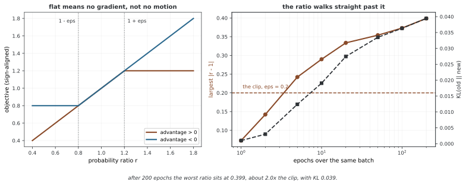

# 근접 폴리시 최적화(PPO)

**근접 폴리시 최적화**(PPO)는 요즘 강화학습에서 가장 널리 쓰이는 폴리시 경사 알고리즘으로, 신뢰 영역 방법의 안정성과 일차 최적화의 간단함을 함께 노린다. PPO 는 새 폴리시와 옛 폴리시의 확률 비 $r = \pi_\theta(a\mid s)/\pi_{\theta_\text{old}}(a\mid s)$ 를 $[1-\epsilon, 1+\epsilon]$ 으로 **잘라**(clip) 대리 목표를 만들어, 쿨백-라이블러 발산 제약을 명시적으로 계산하는 오버헤드 없이 폴리시를 무너뜨릴 만큼 큰 스텝을 억제한다. 이 쪽은 자르기 장치가 비와 어드밴티지의 조합마다 어떻게 동작하는지 보이고, PPO 로스를 한 배치에서 계산해 보며, 자르는 폭 $\epsilon$ 에 따라 잘리는 비율이 어떻게 달라지는지 견준다.

## 1. 코드

```python
"""
34.3.3장: PPO -- 잘라 낸 목표 보여 주기
======================================================
PPO의 자르기 장치를 보이고 잘라 낸 대리 목표와 자르지 않은
것을 견준다.
"""

import torch
import torch.nn as nn
import numpy as np
import matplotlib

# ========================================================================
# 메인
# ========================================================================
matplotlib.use("Agg")
import matplotlib.pyplot as plt


def visualize_ppo_clipping():
    """이점이 0보다 클 때와 작을 때의 PPO 잘라 낸 목표를 그려 본다."""
    epsilon = 0.2
    ratios = torch.linspace(0.5, 2.0, 300)
    
    fig, axes = plt.subplots(1, 2, figsize=(12, 5))
    
    for idx, (A, title) in enumerate([(1.0, "Positive Advantage (A=1)"),
                                       (-1.0, "Negative Advantage (A=-1)")]):
        ax = axes[idx]
        
        # 자르지 않은 대리 목표
        unclipped = ratios * A
        
        # 잘라 낸 대리 목표
        clipped_ratios = torch.clamp(ratios, 1 - epsilon, 1 + epsilon)
        clipped = clipped_ratios * A
        
        # PPO 목표: min(자르지 않음, 잘라 냄)
        ppo_obj = torch.min(unclipped, clipped)
        
        ax.plot(ratios.numpy(), unclipped.numpy(), "b--", label="Unclipped", alpha=0.7)
        ax.plot(ratios.numpy(), clipped.numpy(), "r--", label="Clipped", alpha=0.7)
        ax.plot(ratios.numpy(), ppo_obj.numpy(), "g-", label="PPO (min)", linewidth=2)
        
        ax.axvline(x=1.0, color="gray", linestyle=":", alpha=0.5)
        ax.axvline(x=1 - epsilon, color="orange", linestyle=":", alpha=0.5, label=f"1-ε={1-epsilon}")
        ax.axvline(x=1 + epsilon, color="orange", linestyle=":", alpha=0.5, label=f"1+ε={1+epsilon}")
        
        ax.set_xlabel("Probability Ratio r(θ)")
        ax.set_ylabel("Objective")
        ax.set_title(title)
        ax.legend(fontsize=8)
        ax.grid(True, alpha=0.3)
    
    plt.tight_layout()
    plt.savefig("ppo_clipping.png", dpi=150, bbox_inches="tight")
    plt.close()
    print("Saved PPO clipping visualization to ppo_clipping.png")


def demonstrate_clip_behavior():
    """자르기가 그래디언트 흐름에 어떻게 미치는지 보인다."""
    print("=" * 60)
    print("PPO Clipping Behavior Analysis")
    print("=" * 60)
    
    epsilon = 0.2
    
    # 서로 다른 비/이점 어우름을 흉내 낸다
    scenarios = [
        (1.5, 1.0, "Large ratio, positive advantage"),
        (0.7, 1.0, "Small ratio, positive advantage"),
        (1.5, -1.0, "Large ratio, negative advantage"),
        (0.7, -1.0, "Small ratio, negative advantage"),
        (1.1, 1.0, "Moderate ratio, positive advantage"),
        (0.9, -1.0, "Moderate ratio, negative advantage"),
    ]
    
    print(f"\nε = {epsilon}")
    print(f"{'Scenario':<45} {'Ratio':>6} {'A':>5} {'Unclip':>8} {'Clip':>8} {'PPO':>8} {'Clipped?':>8}")
    print("-" * 95)
    
    for ratio_val, adv_val, desc in scenarios:
        ratio = torch.tensor(ratio_val)
        adv = torch.tensor(adv_val)
        
        unclipped = ratio * adv
        clipped_ratio = torch.clamp(ratio, 1 - epsilon, 1 + epsilon)
        clipped = clipped_ratio * adv
        ppo = torch.min(unclipped, clipped)
        is_clipped = (ppo != unclipped).item()
        
        print(
            f"{desc:<45} {ratio_val:>6.2f} {adv_val:>5.1f} "
            f"{unclipped.item():>8.3f} {clipped.item():>8.3f} "
            f"{ppo.item():>8.3f} {'Yes' if is_clipped else 'No':>8}"
        )


def ppo_loss_computation_example():
    """PPO 로스를 스텝마다 셈해 본다."""
    print("\n" + "=" * 60)
    print("PPO Loss Computation Example")
    print("=" * 60)
    
    batch_size = 8
    epsilon = 0.2
    value_coef = 0.5
    entropy_coef = 0.01
    
    torch.manual_seed(42)
    
    # 흉내 낸 자료
    old_log_probs = torch.randn(batch_size) - 1.0  # 흔한 로그 확률 값
    new_log_probs = old_log_probs + torch.randn(batch_size) * 0.1  # 조금 다르다
    advantages = torch.randn(batch_size)
    advantages = (advantages - advantages.mean()) / (advantages.std() + 1e-8)
    values = torch.randn(batch_size, requires_grad=True)
    returns = values.detach() + torch.randn(batch_size) * 0.5
    entropy = torch.tensor(0.5)
    
    # 비를 셈한다
    ratio = torch.exp(new_log_probs - old_log_probs)
    
    # 잘라 낸 대리 목표
    surr1 = ratio * advantages
    surr2 = torch.clamp(ratio, 1 - epsilon, 1 + epsilon) * advantages
    policy_loss = -torch.min(surr1, surr2).mean()
    
    # 값 로스
    value_loss = nn.functional.mse_loss(values, returns)
    
    # 온 로스
    total_loss = policy_loss + value_coef * value_loss - entropy_coef * entropy
    
    print(f"\nBatch size: {batch_size}")
    print(f"Clip epsilon: {epsilon}")
    print(f"\nRatios: {ratio.detach().numpy().round(3)}")
    print(f"Advantages: {advantages.numpy().round(3)}")
    print(f"\nClipped count: {(torch.min(surr1, surr2) != surr1).sum().item()}/{batch_size}")
    print(f"Policy loss: {policy_loss.item():.4f}")
    print(f"Value loss: {value_loss.item():.4f}")
    print(f"Entropy bonus: {entropy.item():.4f}")
    print(f"Total loss: {total_loss.item():.4f}")


def compare_clip_values():
    """자르는 값을 달리하여 PPO를 견준다."""
    print("\n" + "=" * 60)
    print("Effect of Clipping Parameter ε")
    print("=" * 60)
    
    torch.manual_seed(42)
    batch_size = 1000
    old_log_probs = torch.randn(batch_size) - 1.0
    new_log_probs = old_log_probs + torch.randn(batch_size) * 0.3
    advantages = torch.randn(batch_size)
    advantages = (advantages - advantages.mean()) / (advantages.std() + 1e-8)
    
    ratio = torch.exp(new_log_probs - old_log_probs)
    
    print(f"\nRatio stats: mean={ratio.mean():.3f}, std={ratio.std():.3f}, "
          f"min={ratio.min():.3f}, max={ratio.max():.3f}")
    
    epsilons = [0.05, 0.1, 0.2, 0.3, 0.5]
    print(f"\n{'ε':>6} {'Loss':>10} {'% Clipped':>12} {'Effective KL':>14}")
    print("-" * 44)
    
    for eps in epsilons:
        surr1 = ratio * advantages
        surr2 = torch.clamp(ratio, 1 - eps, 1 + eps) * advantages
        ppo_obj = torch.min(surr1, surr2)
        loss = -ppo_obj.mean()
        pct_clipped = (ppo_obj != surr1).float().mean() * 100
        
        approx_kl = ((ratio - 1) - torch.log(ratio)).mean()
        
        print(f"{eps:>6.2f} {loss.item():>10.4f} {pct_clipped.item():>11.1f}% {approx_kl.item():>14.5f}")


if __name__ == "__main__":
    demonstrate_clip_behavior()
    ppo_loss_computation_example()
    compare_clip_values()
    visualize_ppo_clipping()
```

**출력:**

```
============================================================
PPO Clipping Behavior Analysis
============================================================

ε = 0.2
Scenario                                       Ratio     A   Unclip     Clip      PPO Clipped?
-----------------------------------------------------------------------------------------------
Large ratio, positive advantage                 1.50   1.0    1.500    1.200    1.200      Yes
Small ratio, positive advantage                 0.70   1.0    0.700    0.800    0.700       No
Large ratio, negative advantage                 1.50  -1.0   -1.500   -1.200   -1.500       No
Small ratio, negative advantage                 0.70  -1.0   -0.700   -0.800   -0.800      Yes
Moderate ratio, positive advantage              1.10   1.0    1.100    1.100    1.100       No
Moderate ratio, negative advantage              0.90  -1.0   -0.900   -0.900   -0.900       No

============================================================
PPO Loss Computation Example
============================================================

Batch size: 8
Clip epsilon: 0.2

Ratios: [1.047 1.027 1.055 1.084 1.117 0.845 0.906 1.101]
Advantages: [ 1.062  0.486 -1.319 -1.302  1.096  0.337 -0.82   0.461]

Clipped count: 0/8
Policy loss: -0.0101
Value loss: 0.1183
Entropy bonus: 0.5000
Total loss: 0.0440

============================================================
Effect of Clipping Parameter ε
============================================================

Ratio stats: mean=1.037, std=0.331, min=0.420, max=2.602

     ε       Loss    % Clipped   Effective KL
--------------------------------------------
  0.05     0.0742        44.6%        0.04880
  0.10     0.0576        38.3%        0.04880
  0.20     0.0319        26.9%        0.04880
  0.30     0.0148        17.1%        0.04880
  0.50    -0.0002         5.6%        0.04880
Saved PPO clipping visualization to ppo_clipping.png
```

## 2. 논의

PPO 의 목표는 $\min\big(rA,\ \mathrm{clip}(r, 1-\epsilon, 1+\epsilon)A\big)$ 이다. 첫 표가 여섯 경우를 보인다. 자르기가 실제로 걸리는 것은 두 경우뿐이다 — 어드밴티지가 양수인데 비가 $1+\epsilon$ 을 넘었을 때(1.50, $A=1$)와, 어드밴티지가 음수인데 비가 $1-\epsilon$ 아래로 내려갔을 때(0.70, $A=-1$)다. 둘 다 폴리시가 **이로운 쪽으로** 이미 충분히 움직인 경우라, 더 밀어도 목표가 오르지 않게 막는다. 반대로 해로운 쪽으로 움직인 경우(0.70, $A=1$ 과 1.50, $A=-1$)에는 $\min$ 이 자르지 않은 더 나쁜 값을 골라 그대로 벌한다. 그래서 자른 목표는 자르지 않은 목표보다 늘 작거나 같은, 비관적인 추정이 된다.

둘째 예에서는 여덟 비가 모두 $[0.8, 1.2]$ 안에 있어($0.845$ 에서 $1.117$) 하나도 잘리지 않았다(`Clipped count: 0/8`). 전체 로스 $0.0440$ 은 폴리시 로스 $-0.0101$ 에 값 로스의 절반 $0.5\times0.1183$ 을 더하고 엔트로피 보너스 $0.01\times0.5$ 를 뺀 값이다.

셋째 예는 비를 하나로 고정해 두고 $\epsilon$ 만 바꾼다. $\epsilon$ 이 0.05 에서 0.5 로 커지면 잘리는 표본의 비율이 44.6% 에서 5.6% 로 줄고, 로스는 0.0742 에서 $-0.0002$ 로 내려간다 — 자르는 폭이 좁을수록 목표가 더 비관적이다. 표의 `Effective KL` 이 다섯 줄 모두 0.04880 으로 같은 것은 결함이 아니라 계산 방식 때문이다. 이 값은 비만으로 계산한 KL 추정량 $\mathbb E[(r-1) - \log r]$ 이고 $\epsilon$ 을 쓰지 않는다. 이미 정해진 비에 대해 $\epsilon$ 은 로스만 바꿀 뿐 폴리시가 얼마나 움직였는지는 바꾸지 않는다는 것을 보여 주는 셈이다. 실제 트레인에서 $\epsilon$ 이 KL 에 미치는 영향은 갱신을 거듭할 때만 드러나며, 그것도 아래 그림 상자가 보이듯 묶어 주는 힘이 약하다.

<div class="storybox" markdown>

**그림으로 보는 AI 1.** 자르기는 묶어 두는 장치가 아니다

이 쪽 머리글이 PPO를 두고 "쿨백-라이블러 발산 제약을 명시적으로 계산하는 오버헤드 없이" 큰 스텝을 막는다고 적었다. 자르기가 그 제약을 **대신한다**는 말인데, 실제로 무엇을 대신하고 무엇은 대신하지 못하는지를 보면 결이 조금 다르다.

PPO 논문은 스스로를 TRPO의 뒤에 놓는다. TRPO가 벌점 대신 하드 제약을 쓴 까닭도 그대로 적어 두었다 — "TRPO uses a hard constraint rather than a penalty because it is hard to choose a single value of $\beta$ that performs well across different problems." 그리고 자른 목표가 성능의 "pessimistic estimate (i.e., lower bound)"가 된다고 말한다.

**그런데 자르기가 하는 일은 비를 **끌어오는** 것이 아니라 더 밀 **이유를 없애는** 것이다.** 왼쪽 그림이 그 생김새다. 비 $r$ 이 $1\pm\epsilon$ 밖으로 나가면 목표가 평평해져 기울기가 0이 된다. 0이 된다는 것은 **되돌리는 힘도 0**이라는 뜻이다. 게다가 소프트맥스에서는 한 액션의 확률이 다른 액션들과 묶여 있어서, 그 액션을 직접 밀지 않아도 남이 밀리면 함께 움직인다.



그래서 같은 배치로 에폭을 거듭하면 비가 $\epsilon$ 을 **지나쳐 계속 간다.** $\epsilon = 0.2$ 로 두고 재어 보면 한 에폭 뒤에는 0.073으로 안쪽에 있지만, 다섯 에폭이면 0.242로 이미 넘어서고, 이백 에폭에서는 **0.399 — 자른 폭의 두 배**다. 그동안 KL은 0.039까지 자라는데, TRPO가 흔히 쓰는 $\delta = 0.01$ 의 네 배에 가깝다.

**요컨대 $\epsilon$ 은 신뢰 영역의 반지름이 아니다.** 겉보기에는 "비를 $[0.8, 1.2]$ 안에 둔다"로 읽히지만 그런 보장은 어디에도 없다. $\epsilon$ 이 정하는 것은 **어디서부터 밀기를 그만두는가**이고, 실제로 폴리시가 얼마나 멀리 가는지는 에폭 수·러닝레이트·배치가 함께 정한다. 위 구현에서 자르는 임계를 바꿔 보는 것만으로 트레인이 안정되지 않는다면 그 까닭이 여기에 있다 — 손잡이가 하나가 아니다.

실무에서 PPO 구현들이 KL을 따로 재어 보고 너무 크면 에폭을 일찍 끊는 장치를 함께 두는 것도 같은 사정이다. 자르기가 KL을 묶어 준다면 그 장치가 필요 없을 것이다.

_확인한 곳 — J. Schulman, F. Wolski, P. Dhariwal, A. Radford, O. Klimov, "Proximal Policy Optimization Algorithms" (arXiv:1707.06347). 자른 목표가 성능의 비관적 하한이라는 말은 초록, TRPO가 벌점 대신 하드 제약을 쓴 까닭은 2절이다. 오른쪽 그림의 수는 그림을 그리는 코드가 시드 여덟 개로 직접 재어 중앙값을 적은 것이고, 비가 실제로 $\epsilon$ 을 넘는지를 먼저 확인한 뒤에만 그린다._

</div>

## 연습문제

<div class="drillbox" markdown>

**연습문제 1.** <span class="diff med" title="중간"></span>
PPO 목표 $\min(rA, \mathrm{clip}(r,1-\epsilon,1+\epsilon)A)$ 의 비 $r$ 에 대한 기울기를 $A>0$ 과 $A<0$ 으로 나누어 $r$ 의 구간마다 적어라. 첫 표의 「Clipped?」 열이 이 결과와 맞는지 여섯 줄 모두 확인하라.

</div>

??? success "풀이"
    $A>0$ 이면 $r \le 1+\epsilon$ 에서 $\min$ 이 $rA$ 라 기울기가 $A$ 이고, $r > 1+\epsilon$ 에서는 $(1+\epsilon)A$ 로 평평해 기울기가 0 이다. $r < 1-\epsilon$ 이어도 $rA < (1-\epsilon)A$ 이므로 자르지 않은 쪽이 골라져 기울기는 $A$ 그대로다. $A<0$ 이면 거꾸로 $r \ge 1-\epsilon$ 에서 기울기가 $A$ 이고, $r < 1-\epsilon$ 에서는 $(1-\epsilon)A$ 로 평평해 0 이다. 표를 보면 (1.50, 1) 과 (0.70, −1) 만 이 평평한 구간에 들어 `Yes` 이고, (0.70, 1) 과 (1.50, −1) 은 비가 범위 밖이어도 자르지 않은 값이 더 작아 `No` 다. (1.10, 1) 과 (0.90, −1) 은 범위 안이라 두 값이 같다. 곧 자르기는 범위 밖으로 나간 모든 표본이 아니라, 이로운 쪽으로 나간 표본의 기울기만 지운다.

---

<div class="drillbox" markdown>

**연습문제 2.** <span class="diff med" title="중간"></span>
`compare_clip_values` 의 KL 추정량 $\widehat{\mathrm{KL}} = \mathbb E[(r-1) - \log r]$ 에 대해, 액션을 옛 폴리시에서 뽑을 때 이것이 $\mathrm{KL}(\pi_\text{old}\,\|\,\pi_\theta)$ 의 불편 추정량이고 표본마다 음이 아님을 보여라. 출력의 비 통계(평균 1.037)로 0.04880 이라는 값이 그럴듯한지도 따져 보라.

</div>

??? success "풀이"
    $a\sim\pi_\text{old}$ 이면 $\mathbb E[r] = \sum_a \pi_\text{old}(a)\,\pi_\theta(a)/\pi_\text{old}(a) = 1$ 이므로 $\mathbb E[(r-1) - \log r] = -\mathbb E[\log r] = \mathbb E[\log\pi_\text{old} - \log\pi_\theta] = \mathrm{KL}(\pi_\text{old}\|\pi_\theta)$ 다. 또 $\log r \le r-1$ 이 모든 $r>0$ 에서 성립하므로 표본마다 $(r-1)-\log r \ge 0$ 이다. 그래서 $-\log r$ 만 평균 내는 추정량보다 분산이 작고 음수가 나오지 않는다. 데모의 비는 옛 폴리시에서 뽑은 것이 아니라 $\log r \sim \mathcal N(0, 0.3^2)$ 로 만든 합성값이라 $\mathbb E[\log r] \approx 0$ 이다. 그러면 추정량은 대략 $\mathbb E[r] - 1$ 인데, 로그정규분포의 평균은 $e^{0.3^2/2}\approx 1.046$ 이고 출력의 표본 평균은 1.037 이다. 그러니 0.04 대의 값은 그럴듯하며, 0.04880 과의 차이는 표본의 $\log r$ 평균이 정확히 0 이 아닌 데서 온다.

---

<div class="drillbox" markdown>

**연습문제 3.** <span class="diff hard" title="어려움"></span>
그림 상자는 같은 배치로 에폭을 거듭하면 비가 $\epsilon$ 을 넘어 계속 간다고 했다. 작은 소프트맥스 폴리시와 고정된 배치 하나를 만들어 PPO 로스로 에폭을 1, 5, 20, 200 번 돌리며 가장 큰 $|r-1|$ 과 KL 추정량을 재어라. 그다음 KL 추정량이 목표값(예: 0.01)의 1.5 배를 넘으면 에폭을 멈추는 조기 종료를 넣어 같은 측정을 되풀이하라.

</div>

??? success "풀이"
    자르기가 걸린 표본은 기울기가 0 이 되어 더는 직접 밀리지 않지만, 잘리지 않은 표본의 그래디언트가 공유 파라미터를 움직이므로 잘린 표본의 확률도 함께 바뀐다. 소프트맥스에서는 한 액션의 확률을 올리면 나머지가 내려가므로 이 효과가 특히 뚜렷하다. 그래서 에폭을 거듭하면 가장 큰 $|r-1|$ 이 $\epsilon$ 을 넘어서고 KL 도 계속 자란다. 조기 종료를 넣으면 KL 이 목표 근처에서 멈추므로 갱신의 크기가 실제로 묶인다. 결과는 시드에 따라 흔들리므로 여러 시드의 중앙값과 범위를 함께 적는다. 이 실험은 $\epsilon$ 이 신뢰 영역의 반지름이 아니라는 상자의 말을 직접 확인하는 것이고, 실무 구현이 `target_kl` 같은 장치를 따로 두는 까닭을 보여 준다.

## 정리하며

**다룬 것** — 근접 폴리시 최적화(PPO)

PPO 의 자른 목표는 폴리시가 이로운 쪽으로 $\epsilon$ 넘게 움직인 표본의 기울기만 지우고, 해로운 쪽으로 움직인 표본은 그대로 벌하는 비관적인 대리 목표다. 정해진 비에 대해 $\epsilon$ 은 잘리는 비율과 로스를 바꿀 뿐 폴리시가 움직인 거리를 묶지 않으므로, 실제 트레인에서는 KL 을 따로 재어 살핀다.

앞의 연습문제 3개로 스스로 점검해 볼 수 있다.
