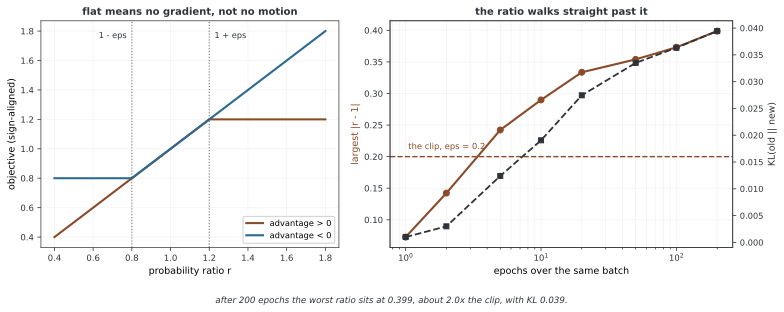

# 근접 폴리시 최적화(PPO)

근접 폴리시 최적화(PPO)는 요즘 강화학습에서 가장 널리 쓰이는 폴리시 경사 알고리즘으로, 신뢰 영역 방법의 든든함과 일차 최적화의 쉬움을 함께 얻는다. PPO는 새 폴리시와 옛 폴리시의 확률 비를 잘라 폴리시 고침을 매어 두어, 쿨백-라이블러 어긋남 매임을 드러내 셈하는 덧듦 없이 무너뜨릴 만큼 큰 스텝을 막는다. 이 구현은 자르기 장치를 보이고, 자르는 임계가 학습에 어떻게 미치는지 살피며, 잘라 낸 대리 목표와 자르지 않은 것을 견준다.

## 1. 코드

```python
"""
34.3.3장: PPO -- 잘라 낸 목표 보여 주기
======================================================
PPO의 자르기 장치를 보이고 잘라 낸 대리 목표와 자르지 않은
것을 견준다.
"""

import torch
import torch.nn as nn
import numpy as np
import matplotlib

# ========================================================================
# 메인
# ========================================================================
matplotlib.use("Agg")
import matplotlib.pyplot as plt


def visualize_ppo_clipping():
    """이점이 0보다 클 때와 작을 때의 PPO 잘라 낸 목표를 그려 본다."""
    epsilon = 0.2
    ratios = torch.linspace(0.5, 2.0, 300)
    
    fig, axes = plt.subplots(1, 2, figsize=(12, 5))
    
    for idx, (A, title) in enumerate([(1.0, "Positive Advantage (A=1)"),
                                       (-1.0, "Negative Advantage (A=-1)")]):
        ax = axes[idx]
        
        # 자르지 않은 대리 목표
        unclipped = ratios * A
        
        # 잘라 낸 대리 목표
        clipped_ratios = torch.clamp(ratios, 1 - epsilon, 1 + epsilon)
        clipped = clipped_ratios * A
        
        # PPO 목표: min(자르지 않음, 잘라 냄)
        ppo_obj = torch.min(unclipped, clipped)
        
        ax.plot(ratios.numpy(), unclipped.numpy(), "b--", label="Unclipped", alpha=0.7)
        ax.plot(ratios.numpy(), clipped.numpy(), "r--", label="Clipped", alpha=0.7)
        ax.plot(ratios.numpy(), ppo_obj.numpy(), "g-", label="PPO (min)", linewidth=2)
        
        ax.axvline(x=1.0, color="gray", linestyle=":", alpha=0.5)
        ax.axvline(x=1 - epsilon, color="orange", linestyle=":", alpha=0.5, label=f"1-ε={1-epsilon}")
        ax.axvline(x=1 + epsilon, color="orange", linestyle=":", alpha=0.5, label=f"1+ε={1+epsilon}")
        
        ax.set_xlabel("Probability Ratio r(θ)")
        ax.set_ylabel("Objective")
        ax.set_title(title)
        ax.legend(fontsize=8)
        ax.grid(True, alpha=0.3)
    
    plt.tight_layout()
    plt.savefig("ppo_clipping.png", dpi=150, bbox_inches="tight")
    plt.close()
    print("Saved PPO clipping visualization to ppo_clipping.png")


def demonstrate_clip_behavior():
    """자르기가 그래디언트 흐름에 어떻게 미치는지 보인다."""
    print("=" * 60)
    print("PPO Clipping Behavior Analysis")
    print("=" * 60)
    
    epsilon = 0.2
    
    # 서로 다른 비/이점 어우름을 흉내 낸다
    scenarios = [
        (1.5, 1.0, "Large ratio, positive advantage"),
        (0.7, 1.0, "Small ratio, positive advantage"),
        (1.5, -1.0, "Large ratio, negative advantage"),
        (0.7, -1.0, "Small ratio, negative advantage"),
        (1.1, 1.0, "Moderate ratio, positive advantage"),
        (0.9, -1.0, "Moderate ratio, negative advantage"),
    ]
    
    print(f"\nε = {epsilon}")
    print(f"{'Scenario':<45} {'Ratio':>6} {'A':>5} {'Unclip':>8} {'Clip':>8} {'PPO':>8} {'Clipped?':>8}")
    print("-" * 95)
    
    for ratio_val, adv_val, desc in scenarios:
        ratio = torch.tensor(ratio_val)
        adv = torch.tensor(adv_val)
        
        unclipped = ratio * adv
        clipped_ratio = torch.clamp(ratio, 1 - epsilon, 1 + epsilon)
        clipped = clipped_ratio * adv
        ppo = torch.min(unclipped, clipped)
        is_clipped = (ppo != unclipped).item()
        
        print(
            f"{desc:<45} {ratio_val:>6.2f} {adv_val:>5.1f} "
            f"{unclipped.item():>8.3f} {clipped.item():>8.3f} "
            f"{ppo.item():>8.3f} {'Yes' if is_clipped else 'No':>8}"
        )


def ppo_loss_computation_example():
    """PPO 로스를 스텝마다 셈해 본다."""
    print("\n" + "=" * 60)
    print("PPO Loss Computation Example")
    print("=" * 60)
    
    batch_size = 8
    epsilon = 0.2
    value_coef = 0.5
    entropy_coef = 0.01
    
    torch.manual_seed(42)
    
    # 흉내 낸 자료
    old_log_probs = torch.randn(batch_size) - 1.0  # 흔한 로그 확률 값
    new_log_probs = old_log_probs + torch.randn(batch_size) * 0.1  # 조금 다르다
    advantages = torch.randn(batch_size)
    advantages = (advantages - advantages.mean()) / (advantages.std() + 1e-8)
    values = torch.randn(batch_size, requires_grad=True)
    returns = values.detach() + torch.randn(batch_size) * 0.5
    entropy = torch.tensor(0.5)
    
    # 비를 셈한다
    ratio = torch.exp(new_log_probs - old_log_probs)
    
    # 잘라 낸 대리 목표
    surr1 = ratio * advantages
    surr2 = torch.clamp(ratio, 1 - epsilon, 1 + epsilon) * advantages
    policy_loss = -torch.min(surr1, surr2).mean()
    
    # 값 로스
    value_loss = nn.functional.mse_loss(values, returns)
    
    # 온 로스
    total_loss = policy_loss + value_coef * value_loss - entropy_coef * entropy
    
    print(f"\nBatch size: {batch_size}")
    print(f"Clip epsilon: {epsilon}")
    print(f"\nRatios: {ratio.detach().numpy().round(3)}")
    print(f"Advantages: {advantages.numpy().round(3)}")
    print(f"\nClipped count: {(torch.min(surr1, surr2) != surr1).sum().item()}/{batch_size}")
    print(f"Policy loss: {policy_loss.item():.4f}")
    print(f"Value loss: {value_loss.item():.4f}")
    print(f"Entropy bonus: {entropy.item():.4f}")
    print(f"Total loss: {total_loss.item():.4f}")


def compare_clip_values():
    """자르는 값을 달리하여 PPO를 견준다."""
    print("\n" + "=" * 60)
    print("Effect of Clipping Parameter ε")
    print("=" * 60)
    
    torch.manual_seed(42)
    batch_size = 1000
    old_log_probs = torch.randn(batch_size) - 1.0
    new_log_probs = old_log_probs + torch.randn(batch_size) * 0.3
    advantages = torch.randn(batch_size)
    advantages = (advantages - advantages.mean()) / (advantages.std() + 1e-8)
    
    ratio = torch.exp(new_log_probs - old_log_probs)
    
    print(f"\nRatio stats: mean={ratio.mean():.3f}, std={ratio.std():.3f}, "
          f"min={ratio.min():.3f}, max={ratio.max():.3f}")
    
    epsilons = [0.05, 0.1, 0.2, 0.3, 0.5]
    print(f"\n{'ε':>6} {'Loss':>10} {'% Clipped':>12} {'Effective KL':>14}")
    print("-" * 44)
    
    for eps in epsilons:
        surr1 = ratio * advantages
        surr2 = torch.clamp(ratio, 1 - eps, 1 + eps) * advantages
        ppo_obj = torch.min(surr1, surr2)
        loss = -ppo_obj.mean()
        pct_clipped = (ppo_obj != surr1).float().mean() * 100
        
        approx_kl = ((ratio - 1) - torch.log(ratio)).mean()
        
        print(f"{eps:>6.2f} {loss.item():>10.4f} {pct_clipped.item():>11.1f}% {approx_kl.item():>14.5f}")


if __name__ == "__main__":
    demonstrate_clip_behavior()
    ppo_loss_computation_example()
    compare_clip_values()
    visualize_ppo_clipping()
```

**출력:**

```
============================================================
PPO Clipping Behavior Analysis
============================================================

ε = 0.2
Scenario                                       Ratio     A   Unclip     Clip      PPO Clipped?
-----------------------------------------------------------------------------------------------
Large ratio, positive advantage                 1.50   1.0    1.500    1.200    1.200      Yes
Small ratio, positive advantage                 0.70   1.0    0.700    0.800    0.700       No
Large ratio, negative advantage                 1.50  -1.0   -1.500   -1.200   -1.500       No
Small ratio, negative advantage                 0.70  -1.0   -0.700   -0.800   -0.800      Yes
Moderate ratio, positive advantage              1.10   1.0    1.100    1.100    1.100       No
Moderate ratio, negative advantage              0.90  -1.0   -0.900   -0.900   -0.900       No

============================================================
PPO Loss Computation Example
============================================================

Batch size: 8
Clip epsilon: 0.2

Ratios: [1.047 1.027 1.055 1.084 1.117 0.845 0.906 1.101]
Advantages: [ 1.062  0.486 -1.319 -1.302  1.096  0.337 -0.82   0.461]

Clipped count: 0/8
Policy loss: -0.0101
Value loss: 0.1183
Entropy bonus: 0.5000
Total loss: 0.0440

============================================================
Effect of Clipping Parameter ε
============================================================

Ratio stats: mean=1.037, std=0.331, min=0.420, max=2.602

     ε       Loss    % Clipped   Effective KL
--------------------------------------------
  0.05     0.0742        44.6%        0.04880
  0.10     0.0576        38.3%        0.04880
  0.20     0.0319        26.9%        0.04880
  0.30     0.0148        17.1%        0.04880
  0.50    -0.0002         5.6%        0.04880
Saved PPO clipping visualization to ppo_clipping.png
```

## 2. 논의

이 구현은 PPO의 중요한 연산을 만든 도구 함수 여럿을 축으로 삼는다. 코드는 알고리즘 조각을 보여 주기와 따지기 논리에서 갈라놓는 조각 설계를 따른다.

보여 주기 함수는 이 조각들을 중요한 거동이 드러나는 지어낸 데이터에 실제로 써 보인다. 그 출력을 살피면 파라메터 공정성과 문제 구조에 따라 알고리즘의 성능이 어떻게 달라지는지 볼 수 있다.

쓰임의 눈으로 보면 이 구현은 날 성능보다 또렷함을 앞세운다. 서비스 시스템은 배치 계산, GPU 빠르게 하기, 더 야무진 파라메터 벼리기 같은 다듬기를 더 넣는 것이 보통이다. 그렇더라도 여기서 보인 한가운데 알고리즘 생각은 큰 잣대의 쓰임새에 그대로 옮겨 간다.

<div class="storybox" markdown>

**그림으로 보는 AI 1.** 자르기는 묶어 두는 장치가 아니다

이 쪽 머리글이 PPO를 두고 "쿨백-라이블러 어긋남 매임을 드러내 셈하는 덧듦 없이" 큰 스텝을 막는다고 적었다. 자르기가 그 매임을 **대신한다**는 말인데, 실제로 무엇을 대신하고 무엇은 대신하지 못하는지를 보면 결이 조금 다르다.

PPO 논문은 스스로를 TRPO의 뒤에 놓는다. TRPO가 벌점 대신 하드 제약을 쓴 까닭도 그대로 적어 두었다 — "TRPO uses a hard constraint rather than a penalty because it is hard to choose a single value of $\beta$ that performs well across different problems." 그리고 자른 목표가 성능의 "pessimistic estimate (i.e., lower bound)"가 된다고 말한다.

**그런데 자르기가 하는 일은 비를 **끌어오는** 것이 아니라 더 밀 **이유를 없애는** 것이다.** 왼쪽 그림이 그 생김새다. 비 $r$ 이 $1\pm\epsilon$ 밖으로 나가면 목표가 평평해져 기울기가 0이 된다. 0이 된다는 것은 **되돌리는 힘도 0**이라는 뜻이다. 게다가 소프트맥스에서는 한 액션의 확률이 다른 액션들과 묶여 있어서, 그 액션을 직접 밀지 않아도 남이 밀리면 함께 움직인다.



그래서 같은 배치로 에폭을 거듭하면 비가 $\epsilon$ 을 **지나쳐 계속 간다.** $\epsilon = 0.2$ 로 두고 재어 보면 한 에폭 뒤에는 0.073으로 안쪽에 있지만, 다섯 에폭이면 0.242로 이미 넘어서고, 이백 에폭에서는 **0.399 — 자른 폭의 두 배**다. 그동안 KL은 0.039까지 자라는데, TRPO가 흔히 쓰는 $\delta = 0.01$ 의 네 배에 가깝다.

**요컨대 $\epsilon$ 은 신뢰 영역의 반지름이 아니다.** 겉보기에는 "비를 $[0.8, 1.2]$ 안에 둔다"로 읽히지만 그런 보장은 어디에도 없다. $\epsilon$ 이 정하는 것은 **어디서부터 밀기를 그만두는가**이고, 실제로 폴리시가 얼마나 멀리 가는지는 에폭 수·러닝레이트·배치가 함께 정한다. 위 구현에서 자르는 임계를 바꿔 보는 것만으로 학습이 안정되지 않는다면 그 까닭이 여기에 있다 — 손잡이가 하나가 아니다.

실무에서 PPO 구현들이 KL을 따로 재어 보고 너무 크면 에폭을 일찍 끊는 장치를 함께 두는 것도 같은 사정이다. 자르기가 KL을 묶어 준다면 그 장치가 필요 없을 것이다.

_확인한 곳 — J. Schulman, F. Wolski, P. Dhariwal, A. Radford, O. Klimov, "Proximal Policy Optimization Algorithms" (arXiv:1707.06347). 자른 목표가 성능의 비관적 하한이라는 말은 초록, TRPO가 벌점 대신 하드 제약을 쓴 까닭은 2절이다. 오른쪽 그림의 수는 그림을 그리는 코드가 씨앗 여덟 개로 직접 재어 중앙값을 적은 것이고, 비가 실제로 $\epsilon$ 을 넘는지를 먼저 확인한 뒤에만 그린다._

</div>

## 연습문제

<div class="drillbox" markdown>

**연습문제 1.** <span class="diff med" title="중간"></span>
보여 주기 코드를 돌리고 중요한 출력 재기를 적어라. 파라메터 하나(러닝레이트, 숨은 차원, 켜 개수 따위)를 고쳐 열매가 어떻게 달라지는지 밝혀라.

</div>

??? success "풀이"
    보여 주기를 돌린 뒤 다른 것을 붙박아 두고 고른 파라메터만 구조 있게 바꾼다. 보기로 숨은 차원을 곱절로 늘리면 나타내는 그릇이 커지지만 셈하는 때가 는다. 러닝레이트는 한결같지 않은 결과를 낳는다. 너무 작으면 더디게 모이고 너무 크면 들쭉날쭉해진다. 고른 파라메터의 서로 다른 값 적어도 셋에 대해 또렷한 수를 적어 두라.

---

<div class="drillbox" markdown>

**연습문제 2.** <span class="diff med" title="중간"></span>
이 구현에서 중요한 구조 공정성이 맡은 몫을 풀어라. 왜 그런 엑티베이션 함수, 고르게 하기 꾀, 로스 함수를 쓰는가? 다른 것으로 바꾸면 무슨 일이 생기는가?

</div>

??? success "풀이"
    이 구조 공정성은 신뢰 영역 방법에서 자리 잡은 좋은 버릇을 비춘다. 보기로 ReLU 활성은 곧지 않음을 주면서 0보다 큰 입력에서 그래디언트가 사라지는 것을 막는다. 로스 함수는 과제 클래스에 맞추어 고른다(분류에는 교차 엔트로피, 회귀에는 평균 제곱 오차). 다른 것으로 바꾸면(보기로 시그모이드 활성, L1 로스) 최적화 지형이 바뀌어 성능이 나빠질 수 있으나, 어떤 자리에서는 바꾸는 것이 이로울 수도 있다.

---

<div class="drillbox" markdown>

**연습문제 3.** <span class="diff hard" title="어려움"></span>
이 구현을 더 만만치 않은 자리로 넓혀라. 더 큰 데이터셋, 다른 문제 클래스, 덧붙인 기능 가운데 하나를 고르라. 고친 바를 밝히고 성능에 미친 바를 따져라.

</div>

??? success "풀이"
    절로 떠오르는 넓히기 하나는 정규화(드롭아웃, 웨이트 삭임)나 더 야무진 구조(켜 더하기, 건너뛰는 이음)를 더하는 것이다. 고른 넓히기를 만들고 같은 데이터로 학습된 뒤 앞뒤의 재기를 비교하여라. 이 넓히기는 처음 알고리즘과 고친 바의 이치 밑뜻을 모두 아는 것을 보여야 한다.

## 정리하며

**다룬 것** — 근접 폴리시 최적화(PPO)

이 구현은 PPO의 중요한 연산을 만든 도구 함수 여럿을 축으로 삼는다.

앞의 연습문제 3개로 스스로 따져 볼 수 있다.
